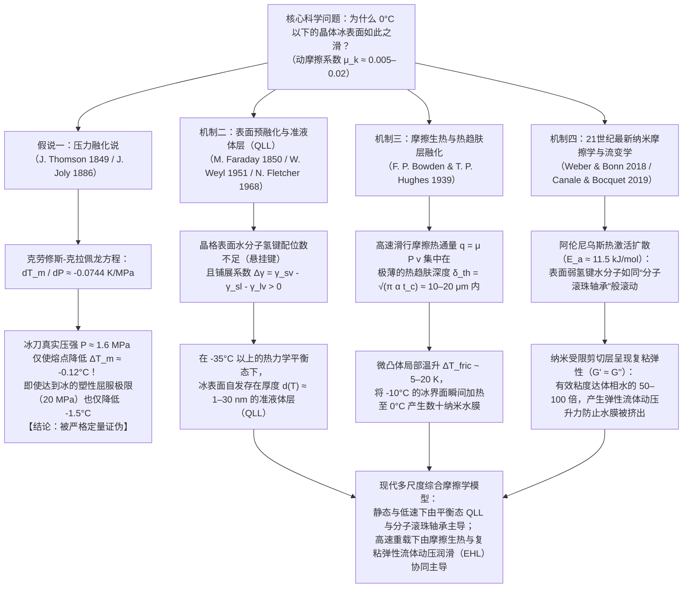

在寒冷的冬日清晨踏上结冰的路面，或是观看速度滑冰运动员以超过 $60\,\text{km/h}$ 的高速在冰面上飞驰，亦或观察重达 $20\,\text{kg}$ 的花岗岩冰壶在冰道上滑行四十米而几乎不减速，我们都在见证凝聚态物理学与摩擦学（Tribology）中最奇特的反常现象之一。从日常直觉来看，“冰面很滑”似乎是天经地义的常识；然而如果从固体物理学与表面力学的严格视角审视，<strong>“为什么偏偏只有冰这种晶体固体表面如此之滑？”</strong>却是一个困扰了物理学家超过170年的深邃科学难题。

当绝大多数干燥的晶体固体相互摩擦时——例如钢铁与玻璃、花岗岩与石英、或者铜与氧化铝陶瓷——在没有外加润滑油的情况下，其动摩擦系数通常高达 $\mu_k \approx 0.4\text{–}0.8$。在微观尺度上，接触表面的微凸体（Asperities）会发生冷焊粘着与剪切犁沟，耗散巨大的机械能并产生剧烈的粘滑磨损。然而，当钢制冰刀或聚乙烯滑雪板在 $-5^\circ\text{C}$ 至 $-10^\circ\text{C}$ 的普通六方晶系冰（Ice $I_h$）表面滑行时——此时温度远低于体相熔点 $0^\circ\text{C}$，冰完全处于热力学稳定的固相区——其动摩擦系数竟然骤降至 <strong>$\mu_k \approx 0.005\text{–}0.02$</strong>！这一数值比其他任何晶体固体都低一到两个数量级，甚至比号称“塑料王”的聚四氟乙烯（PTFE / 特氟龙，$\mu_k \approx 0.04\text{–}0.10$）还要滑得多。

翻开许多中学物理教材或科普读物，你几乎总会看到这样一种流传百年的标准解释：
<strong>“水在结冰时体积膨胀，因此对冰施加压力会降低其熔点（冰点）。当滑冰者站在纤细的冰刀上时，全身重量集中在极小的接触面积上，产生巨大的压强，使冰刀下方的冰瞬间融化成一层薄薄的水膜，从而起到润滑作用。”</strong>

这就是著名的<strong>“压力融化说（Pressure-Melting Theory）”</strong>（由詹姆斯·汤姆孙 James Thomson 于1849年提出热力学理论，并由约翰·乔利 John Joly 于1886年用于解释滑冰）。然而，现代物理学的严格定量计算表明：<strong>尽管克劳修斯-克拉佩龙方程本身完全正确，但将“压力融化”作为滑冰、滑雪或冰面打滑的原因，在数量级上是彻底错误的“教科书神话（Textbook Myth）”！</strong>

本文将从化学势平衡的第一性原理出发推导<strong>克劳修斯-克拉佩龙方程（Clausius–Clapeyron Equation）</strong>，代入精确的物理常数与滑冰者的真实接触压强，从数学上严格证伪压力融化说；接着剖析著名的<strong>“法拉第复冰（Regelation）与重物金属丝穿冰实验”</strong>背后的傅里叶热传导机制，解释为何铜丝能穿过冰块而同等压强下的尼龙线却纹丝不动；最后全面阐述现代物理学确立的三大核心机制：
1. <strong>表面预融化（Surface Premelting）与纳米级准液体层（Quasi-Liquid Layer, QLL）</strong>（法拉第 1850，Weyl 1951，Fletcher 1968，Dash 与 Somorjai）；
2. <strong>摩擦生热（Frictional Heating）与微米级热趋肤深度局域融化</strong>（Bowden & Hughes 1939）；
3. <strong>21世纪最新纳米摩擦学（Nanotribology）</strong>：表面欠配位水分子的热激活“分子滚珠轴承”效应（Weber & Bonn 等，2018）以及受限剪切界面层高达体相水50至100倍粘度的<strong>复粘弹性流变学（Complex Viscoelasticity, $G' \approx G''$）</strong>（Canale & Bocquet 等，2019）。

---

## 1. 作为固体摩擦反常极值的冰与四大物理机制框架

为了直观认识冰表面摩擦特性的极端反常性，我们将库仑-阿蒙顿摩擦定律定义的动摩擦系数 $\mu_k = F_f / F_N$ 在不同固体接触副之间进行定量对比：

| 接触界面组合（干摩擦或自润滑状态） | 环境温度 $T$ | 典型动摩擦系数 $\mu_k$ | 主导能量耗散与摩擦物理机制 |
| :--- | :--- | :--- | :--- |
| <strong>钢铁 vs. 钢铁</strong>（清洁干燥空气） | $20^\circ\text{C}$ | $0.50\text{–}0.80$ | 微凸体冷焊粘着节点的剪切破坏与塑性犁沟（Ploughing） |
| <strong>石英玻璃 vs. 石英玻璃</strong> | $20^\circ\text{C}$ | $0.40\text{–}0.90$ | 硅醇基氢键/共价键强粘着与脆性微裂纹扩展 |
| <strong>花岗岩 vs. 花岗岩</strong>（断层岩石滑动） | $20^\circ\text{C}$ | $0.60\text{–}0.70$ | 岩石微凸体脆性破碎与磨粒（断层泥）咬合摩擦 |
| <strong>PTFE（特氟龙） vs. 钢铁</strong> | $20^\circ\text{C}$ | $0.04\text{–}0.10$ | 氟碳分子链低表面能与取向转移膜滑移 |
| <strong>六方冰 $I_h$ vs. 钢铁</strong>（极低温区） | $-100^\circ\text{C}$ | $0.40\text{–}0.60$ | 与普通晶体固体无异的粘着与脆性剪切（完全不滑的冰！） |
| <strong>六方冰 $I_h$ vs. 钢铁</strong>（滑冰工况） | $-5^\circ\text{C}$ | <strong>$0.005\text{–}0.015$</strong> | 表面预融化QLL + 摩擦热边界层融化 + 粘弹性流体动压升力 |
| <strong>六方冰 $I_h$ vs. 超高分子量聚乙烯</strong>（滑雪板） | $-3^\circ\text{C}$ | <strong>$0.010\text{–}0.030$</strong> | 疏水界面壁面滑移（Wall Slip）+ 摩擦热混合润滑膜 |

上表清楚地揭示了一个关键事实：在 $-100^\circ\text{C}$（$173\,\text{K}$）的深低温下，冰的动摩擦系数高达 $\mu_k \approx 0.5$，表现得和玻璃、花岗岩一样粗糙干涩。冰的超低摩擦特性仅在接近熔点 $T_m = 273.15\,\text{K}$ 的温度窗口（约 $-35^\circ\text{C}$ 至 $0^\circ\text{C}$）内被激活。这一跨尺度物理机制的演进可归纳为如下流程图：

---

## 2. 彻底证伪“压力融化说”：克劳修斯-克拉佩龙方程的定量检验

### 2.1 六方冰 $I_h$ 的四面体氢键网络与反常体积膨胀

水分子 $\text{H}_2\text{O}$ 的氧原子采取接近 $sp^3$ 杂化的电子构型。在常压下冻结的普通六方晶系冰（Hexagonal Ice, $I_h$）中，每个水分子都严格遵循伯纳尔-福勒冰规则（Bernal–Fowler ice rules），与周围4个最近邻水分子形成4条方向性极强的线性氢键（$\text{O}-\text{H}\cdots\text{O}$ 键长约 $2.76\,\text{\AA}$，键角接近正四面体角 $109.5^\circ$）。这种开放的三维六元环笼状晶格内部存在着巨大的结构空隙（Interstitial voids）。

当冰在 $T_m = 273.15\,\text{K}$（$0^\circ\text{C}$）和标准大气压下融化为液态水时，刚性的四面体氢键网络发生部分断裂与弯曲，水分子坍缩填入晶格空隙中（第一配位层平均配位数从固相的 $4.0$ 增加到液相的 $4.4\text{–}4.7$）。因此，液态水的密度大于固态冰，即融化过程的比体积变化（单位质量的体积变化 $\Delta v_{\text{fus}} = v_{\text{liquid}} - v_{\text{ice}}$）为<strong>负值</strong>：

* <strong>六方冰 $I_h$（$0^\circ\text{C}$）</strong>：密度 $\rho_{\text{ice}} = 916.7\,\text{kg/m}^3 \implies$ 比体积 $v_{\text{ice}} = \frac{1}{\rho_{\text{ice}}} = 1.0909 \times 10^{-3}\,\text{m}^3/\text{kg}$
* <strong>液态水（$0^\circ\text{C}$）</strong>：密度 $\rho_{\text{liquid}} = 999.84\,\text{kg/m}^3 \implies$ 比体积 $v_{\text{liquid}} = \frac{1}{\rho_{\text{liquid}}} = 1.0002 \times 10^{-3}\,\text{m}^3/\text{kg}$
* <strong>融化比体积差</strong>：
  $$\Delta v_{\text{fus}} = v_{\text{liquid}} - v_{\text{ice}} = (1.0002 - 1.0909) \times 10^{-3}\,\text{m}^3/\text{kg} \approx -9.1 \times 10^{-5}\,\text{m}^3/\text{kg}$$

### 2.2 克劳修斯-克拉佩龙方程的严格推导与数值计算

在 $P$-$T$ 相图的固-液共存曲线上，固相（冰）与液相（水）的比吉布斯自由能（即化学势）相等：$g_{\text{ice}}(T_m, P) = g_{\text{liquid}}(T_m, P)$。沿着相界线发生微元变化 $(dT_m, dP)$ 时，两相的自由能微分同样相等：

$$dg_{\text{ice}} = dg_{\text{liquid}}$$

代入热力学基本微分关系 $dg = -s\,dT + v\,dP$（其中 $s$ 为比熵，$v$ 为比体积）：

$$-s_{\text{ice}}\,dT_m + v_{\text{ice}}\,dP = -s_{\text{liquid}}\,dT_m + v_{\text{liquid}}\,dP \implies \left(v_{\text{liquid}} - v_{\text{ice}}\right) dP = \left(s_{\text{liquid}} - s_{\text{ice}}\right) dT_m$$

由于等温等压可逆相变的比熵变等于比融化潜热 $L_f$ 除以熔点温度 $T_m$，即 $\Delta s_{\text{fus}} = s_{\text{liquid}} - s_{\text{ice}} = \frac{L_f}{T_m}$，代入上式即得<strong>克劳修斯-克拉佩龙方程（Clausius–Clapeyron Equation）</strong>：

$$\frac{dP}{dT_m} = \frac{L_f}{T_m \left(v_{\text{liquid}} - v_{\text{ice}}\right)}$$

现在代入水在 $0^\circ\text{C}$ 时的精确物理常数：
* 比融化潜热：$L_f = 3.34 \times 10^5\,\text{J/kg}$
* 熔点温度：$T_m = 273.15\,\text{K}$
* 比体积变化：$\Delta v_{\text{fus}} = v_{\text{liquid}} - v_{\text{ice}} = -9.1 \times 10^{-5}\,\text{m}^3/\text{kg}$

计算相界线斜率：

$$\frac{dP}{dT_m} = \frac{3.34 \times 10^5\,\text{J/kg}}{273.15\,\text{K} \times \left(-9.1 \times 10^{-5}\,\text{m}^3/\text{kg}\right)} \approx -1.344 \times 10^7\,\text{Pa/K} = -13.44\,\text{MPa/K}$$

取倒数即可得到单位压强引起的熔点降低率：

$$\frac{dT_m}{dP} \approx -0.0744\,\text{K/MPa} \quad \left(\text{或 } -0.00754^\circ\text{C/atm}\right)$$

这意味着：<strong>要想让冰的熔点仅仅降低 $1^\circ\text{C}$，必须施加高达 $13.44\,\text{MPa}$（约 $133$ 个标准大气压）的巨大压强！</strong>

### 2.3 滑冰者的真实压强计算与微凸体塑性屈服极限

让我们计算一位质量 $m = 75\,\text{kg}$ 的成年滑冰者单脚站立在冰刀上时产生的压强。取重力加速度 $g = 9.81\,\text{m/s}^2$，法向载荷为 $F_N = m g = 735.75\,\text{N}$。典型冰刀的有效接触长度 $L = 30\,\text{cm} = 0.30\,\text{m}$，刃宽 $w = 1.5\,\text{mm} = 1.5 \times 10^{-3}\,\text{m}$，名义接触面积 $A_{\text{nom}} = L w = 4.5 \times 10^{-4}\,\text{m}^2$。则平均接触压强为：

$$P = \frac{F_N}{A_{\text{nom}}} = \frac{735.75\,\text{N}}{4.5 \times 10^{-4}\,\text{m}^2} \approx 1.635\,\text{MPa} \quad (\approx 16.1\,\text{atm})$$

代入克劳修斯-克拉佩龙方程，对应的熔点变化量仅为：

$$\Delta T_m = \left(\frac{dT_m}{dP}\right) P = (-0.0744\,\text{K/MPa}) \times 1.635\,\text{MPa} \approx -0.122^\circ\text{C}$$

<strong>仅降低 $0.12^\circ\text{C}$！</strong> 即使考虑到表面粗糙度引起的微观真实接触面积 $A_{\text{real}}$ 缩小，局部压强也绝不可能无限增大——因为一旦局部应力达到冰的抗压塑性屈服强度（压痕硬度极限）$\sigma_{y,\text{ice}} \approx 10\text{–}20\,\text{MPa}$，冰的微凸体就会立即发生塑性流动或脆性压碎，使接触面积扩大直至 $P_{\text{local}} \le \sigma_{y,\text{ice}}$。即便按冰能承受的极限屈服压强 $P_{\max} = 20\,\text{MPa}$ 计算，压力融化也最多只能将熔点降低到：

$$\Delta T_{m,\max} = (-0.0744\,\text{K/MPa}) \times 20\,\text{MPa} \approx -1.49^\circ\text{C}$$

然而，室内冰球场和速滑馆的冰面温度通常保持在 $-5^\circ\text{C}$ 至 $-10^\circ\text{C}$，户外滑冰和滑雪更是常在 $-15^\circ\text{C}$ 至 $-20^\circ\text{C}$ 下进行；更不用说穿平底鞋的行人（$P \approx 34\,\text{kPa}$，$\Delta T_m \approx -0.0026^\circ\text{C}$）或冰球（$P \approx 370\,\text{Pa}$，$\Delta T_m \approx -0.00003^\circ\text{C}$）在几乎零压强下照样在冰面飞速打滑。由此可见，压力融化说在定量上彻底破产。

---

## 3. 法拉第“复冰现象（Regelation）”与金属丝穿冰实验的真相

为什么“重物悬挂金属丝穿过冰块而不将其切开”的经典实验（Bottomley, 1872）不能作为滑冰压力融化说的证据？
当半径为 $R$ 的金属丝压在 $0^\circ\text{C}$ 的冰块上时，金属丝下方的熔点降低 $|\Delta T_m| \sim 0.1^\circ\text{C}$。但<strong>冰的融化需要吸收巨额的融化潜热 $L_f = 3.34 \times 10^5\,\text{J/kg}$</strong>。这股热量来自于金属丝下方融化的水绕流到金属丝上方后，在常压下重新结冰（复冰）所释放的凝固潜热。为了维持这一稳态循环，上方释放的潜热必须在温差 $|\Delta T_m|$ 的驱动下，<strong>通过金属丝截面从上向下传导至下方融化界面</strong>。根据傅里叶热传导定律（Nye, 1967），金属丝穿冰速度为：

$$v_{\text{wire}} \approx \frac{\kappa_{\text{eff}} |\Delta T_m|}{\rho_{\text{ice}} L_f R}$$

* 若使用高导热的<strong>铜丝</strong>（$\kappa_{\text{Cu}} \approx 400\,\text{W/(m}\cdot\text{K)}$），热量迅速导向下侧，铜丝以每分钟数毫米（$v_{\text{wire}} \sim 10^{-5}\text{–}10^{-4}\,\text{m/s}$）的速度穿过冰块；即便如此，这一速度也比滑冰速度（$v \sim 10\,\text{m/s}$）慢了<strong>5到6个数量级</strong>！
* 若换成同直径、挂同样重物的<strong>尼龙钓鱼线</strong>（$\kappa_{\text{nylon}} \approx 0.25\,\text{W/(m}\cdot\text{K)}$，导热率仅为铜的 $1/1600$），由于无法将上方的潜热传导至下方，尼龙线在同等压强下几乎完全无法切入冰块！

事实上，早在1850年迈克尔·法拉第（Michael Faraday）首次发现两块冰轻触即冻结在一起的“复冰现象”时，法拉第本人就明确反对汤姆孙兄弟的压力融化解释，而是天才般地指出：<strong>冰的表面在低于冰点时原本就天然包裹着一层准液态水膜</strong>，当两块冰接触时，原本处于表面的水膜变成了冰的内部体相，因而立即冻结成冰！

---

## 4. 表面预融化与纳米级准液体层（QLL）的热力学

为什么冰表面在 $0^\circ\text{C}$ 以下会自发形成液态膜？
1. <strong>表面氢键配位缺失与林德曼融化判据（Lindemann Criterion）</strong>：
   体相六方冰中每个水分子有4条氢键束缚；而在晶体-气相自由表面，晶格突然终止，最外层水分子缺失了上方的邻居，仅剩2或3条氢键（存在悬挂 $\text{O}-\text{H}$ 键）。由于恢复力常数 $k_{\text{surf}}$ 减半，表面分子的热振动均方根振幅 $\sqrt{\langle u_{\text{surf}}^2 \rangle} \propto \sqrt{k_B T / k_{\text{surf}}}$ 远大于体相分子，在远低于 $273.15\,\text{K}$ 时就率先突破林德曼晶格失稳阈值（约占晶格常数 $10\text{–}15\%$），形成无序的<strong>准液体层（Quasi-Liquid Layer, QLL）</strong>。
2. <strong>界面自由能最小化模型（Weyl, Fletcher, Dash）</strong>：
   设在温度 $T < T_m$ 的冰表面形成一层厚度为 $d$ 的准液体水膜，系统的单位面积过剩吉布斯自由能变化为：
   $$\Delta G_{\text{surf}}(d) = -\left(\gamma_{sv} - \gamma_{sl} - \gamma_{lv}\right)\left(1 - e^{-d/\xi}\right) + \rho_l L_f \left(\frac{T_m - T}{T_m}\right) d$$
   由于冰-气界面能 $\gamma_{sv} \approx 109\,\text{mJ/m}^2$ 大于冰-水界面能 $\gamma_{sl} \approx 30\,\text{mJ/m}^2$ 与水-气表面张力 $\gamma_{lv} \approx 75.6\,\text{mJ/m}^2$ 之和（即铺展系数 $\Delta \gamma = \gamma_{sv} - \gamma_{sl} - \gamma_{lv} \approx +3.4\,\text{mJ/m}^2 > 0$），形成薄水膜能够显著降低表面自由能！对 $d$ 求导取极小值（$\frac{\partial \Delta G_{\text{surf}}}{\partial d} = 0$），可得平衡态 QLL 厚度随温度的对数发散律（短程结构力主导）或幂律（长程 Lifshitz 范德华色散力主导）：
   $$d(T) = \xi \ln\!\left(\frac{\Delta \gamma \, T_m}{\xi \rho_l L_f (T_m - T)}\right) \quad \text{或} \quad d(T) = \left(\frac{|A_H| T_m}{6 \pi \rho_l L_f (T_m - T)}\right)^{1/3}$$
   X射线散射、椭圆偏振术、原子力显微镜（AFM）以及和频振动光谱（SFG, Bonn 等 2017）证实：冰表面从约 $-35^\circ\text{C}$ 开始逐双分子层发生预融化，在 $-10^\circ\text{C}$ 时 QLL 厚度约为 $1.5\text{–}3\,\text{nm}$，在 $-1^\circ\text{C}$ 时增长至 $10\text{–}30\,\text{nm}$。这完美解释了为何零速度、零压强下冰面依然滑溜。

---

## 5. 摩擦生热与热趋肤层局域融化（Bowden & Hughes, 1939）

在宏观高速滑行（$v \sim 5\text{–}20\,\text{m/s}$）时，冰刀或滑雪板的表面粗糙度（$R_q \sim 0.1\text{–}1\,\mu\text{m}$）远大于几纳米的静态 QLL。1939年，剑桥大学摩擦学家<strong>鲍登（F. P. Bowden）</strong>与<strong>休斯（T. P. Hughes）</strong>在瑞士少女峰（Jungfraujoch）冰川洞窟实验中证明：导热率极高的黄铜滑雪板（$\kappa \approx 110\,\text{W/(m}\cdot\text{K)}$）会将摩擦热迅速导走，导致摩擦系数居高不下；而绝热的木制或硬橡胶/聚四氟乙烯滑雪板（$\kappa \approx 0.2\,\text{W/(m}\cdot\text{K)}$）能将摩擦热锁在冰面，从而大幅降低摩擦系数！

在滑行速度 $v$、接触长度 $L$（接触时间 $t_c = L/v$）下，单位面积摩擦热通量 $q_{\text{fric}} = \mu_k P v$ 仅能扩散至冰表面极薄的<strong>热趋肤深度（Thermal Skin Depth）$\delta_{\text{th}}$</strong>：

$$\delta_{\text{th}} = \sqrt{\pi \alpha_{\text{ice}} t_c} = \sqrt{\frac{\pi \alpha_{\text{ice}} L}{v}} \quad (\approx 10\text{–}20\,\mu\text{m})$$

由一维瞬态热传导方程（Jaeger 移动热源解），界面最大温升 $\Delta T_{\text{fric}}$ 为：

$$\Delta T_{\text{fric}} = \frac{2 \mu_k P \sqrt{v L}}{\sqrt{\pi} \left(\sqrt{\kappa_{\text{ice}} \rho_{\text{ice}} c_{p,\text{ice}}} + \sqrt{\kappa_{\text{slider}} \rho_{\text{slider}} c_{p,\text{slider}}}\right)}$$

这一公式不仅解释了高速滑行时微凸体如何被瞬间加热至 $0^\circ\text{C}$ 形成数十纳米厚的动态水膜，还解释了为什么在 $-35^\circ\text{C}$ 以下的西伯利亚或南极洲（如1912年斯科特南极探险队的悲剧记录），摩擦温升不足以达到熔点，冰雪变得像干燥石英砂一样难以滑行（$\mu_k \approx 0.4$）；而在 $0^\circ\text{C}$ 以上的湿雪中，过量水膜形成凹液面毛细桥，负拉普拉斯压强 $\Delta P_{\text{cap}} = -\frac{2\gamma_{lv}\cos\theta}{h}$ 产生强烈毛细吸盘效应，反而使摩擦再次急剧上升（形成著名的摩擦-温度“U型曲线”）。

---

## 6. 21世纪最新纳米摩擦学：分子滚珠轴承与复粘弹性流变学（2018–2024）

2018年至2019年，两项里程碑式的研究彻底革新了对冰面润滑层的微观认知：
1. <strong>表面水分子的“滚珠轴承”热激活运动（Weber & Bonn 等，*J. Phys. Chem. Lett.* 2018）</strong>：
   实验发现冰的摩擦系数在 $-100^\circ\text{C}$ 至 $0^\circ\text{C}$ 间严格遵循阿伦尼乌斯指数律：
   $$\mu(T) \propto \frac{1}{D_{\text{surf}}(T)} \propto \exp\!\left(\frac{E_a}{k_B T}\right), \qquad E_a \approx 11.5\,\text{kJ/mol}$$
   该激活能（$11.5\,\text{kJ/mol}$）远低于体相冰扩散所需的 $45\text{–}55\,\text{kJ/mol}$，对应于表面仅靠单根弱氢键相连的欠配位水分子在晶格平台上像<strong>“分子滚珠轴承（Molecular Ball Bearings）”</strong>一样自由滚动！
2. <strong>石英音叉纳米流变学与复粘弹性油脂效应（Canale & Bocquet 等，*Phys. Rev. X* 2019）</strong>：
   长期以来存在一个“挤出悖论（Squeeze-out Paradox）”：普通纯水粘度极低（$\eta_0 \approx 1.8\,\text{mPa}\cdot\text{s}$），在兆帕级冰刀压力下会瞬间被挤干，根本无法充当良好润滑剂。Bocquet 团队利用音叉原子力显微镜首次原位测得滑行界面亚微米水膜的复剪切模量 $G^*(\omega) = G'(\omega) + i G''(\omega)$，震惊地发现：界面水膜并非普通液态水，其<strong>有效粘度高达体相水的 50 至 100 倍（$\eta_{\text{eff}} \sim 0.05\text{–}0.2\,\text{Pa}\cdot\text{s}$，堪比机械润滑油）</strong>，且具有与损耗模量相当的<strong>巨大储能弹性模量（$G' \approx G'' \sim 10^4\text{–}10^5\,\text{Pa}$）</strong>！这种由纳米冰晶簇与纠缠氢键网络构成的“自愈合复粘弹性油脂”在法向产生强大的弹性流体动压升力（Elastohydrodynamic Lift）抵抗挤出，在切向又允许低阻剪切，从而造就了自然界最完美的自润滑界面。
