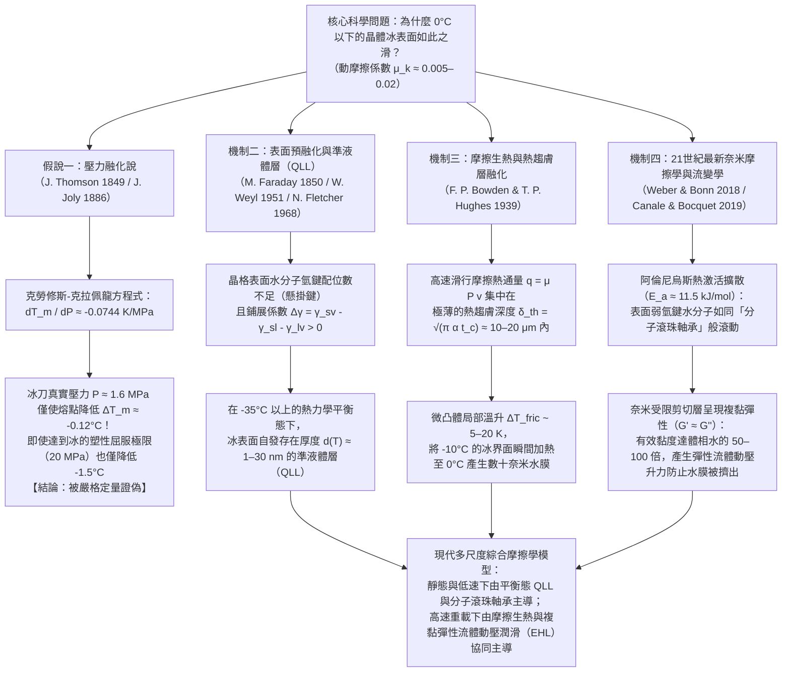

在寒冷的冬日清晨踏上結冰的路面，或是觀看競速溜冰運動員以超過 $60\,\text{km/h}$ 的高速在冰面上飛馳，亦或觀察重達 $20\,\text{kg}$ 的花崗岩冰壺在冰道上滑行四十公尺而幾乎不減速，我們都在見證凝聚態物理學與摩擦學（Tribology）中最奇特的反常現象之一。從日常直覺來看，「冰面很滑」似乎是天經地義的常識；然而如果從固體物理學與表面力學的嚴格視角審視，<strong>「為什麼偏偏只有冰這種晶體固體表面如此之滑？」</strong>卻是一個困擾了物理學家超過170年的深邃科學難題。

當絕大多數乾燥的晶體固體相互摩擦時——例如鋼鐵與玻璃、花崗岩與石英、或者銅與氧化鋁陶瓷——在沒有外加潤滑油的情況下，其動摩擦係數通常高達 $\mu_k \approx 0.4\text{–}0.8$。在微觀尺度上，接觸表面的微凸體（Asperities）會發生冷焊黏著與剪切犁溝，耗散巨大的機械能並產生劇烈的黏滑磨損。然而，當鋼製冰刀或聚乙烯滑雪板在 $-5^\circ\text{C}$ 至 $-10^\circ\text{C}$ 的普通六方晶系冰（Ice $I_h$）表面滑行時——此時溫度遠低於體相熔點 $0^\circ\text{C}$，冰完全處於熱力學穩定的固相區——其動摩擦係數竟然驟降至 <strong>$\mu_k \approx 0.005\text{–}0.02$</strong>！這一數值比其他任何晶體固體都低一到兩個數量級，甚至比號稱「塑膠王」的聚四氟乙烯（PTFE / 鐵氟龍，$\mu_k \approx 0.04\text{–}0.10$）還要滑得多。

翻開許多中學物理教材或科普讀物，你幾乎總會看到這樣一種流傳百年的標準解釋：
<strong>「水在結冰時體積膨脹，因此對冰施加壓力會降低其熔點（冰點）。當溜冰者站在纖細的冰刀上時，全身重量集中在極小的接觸面積上，產生巨大的壓力，使冰刀下方的冰瞬間融化成一層薄薄的水膜，從而起到潤滑作用。」</strong>

這就是著名的<strong>「壓力融化說（Pressure-Melting Theory）」</strong>（由詹姆斯·湯姆孫 James Thomson 於1849年提出熱力學理論，並由約翰·喬利 John Joly 於1886年用於解釋溜冰）。然而，現代物理學的嚴格定量計算表明：<strong>儘管克勞修斯-克拉佩龍方程式本身完全正確，但將「壓力融化」作為溜冰、滑雪或冰面打滑的原因，在數量級上是徹底錯誤的「教科書神話（Textbook Myth）」！</strong>

本文將從化學勢平衡的第一性原理出發推導<strong>克勞修斯-克拉佩龍方程式（Clausius–Clapeyron Equation）</strong>，代入精確的物理常數與溜冰者的真實接觸壓力，從數學上嚴格證偽壓力融化說；接著剖析著名的<strong>「法拉第復冰（Regelation）與重物金屬絲穿冰實驗」</strong>背後的傅立葉熱傳導機制，解釋為何銅絲能穿過冰塊而同等壓力下的尼龍線卻紋絲不動；最後全面闡述現代物理學確立的三大核心機制：
1. <strong>表面預融化（Surface Premelting）與奈米級準液體層（Quasi-Liquid Layer, QLL）</strong>（法拉第 1850，Weyl 1951，Fletcher 1968，Dash 與 Somorjai）；
2. <strong>摩擦生熱（Frictional Heating）與微米級熱趨膚深度局域融化</strong>（Bowden & Hughes 1939）；
3. <strong>21世紀最新奈米摩擦學（Nanotribology）</strong>：表面欠配位水分子的熱激活「分子滾珠軸承」效應（Weber & Bonn 等，2018）以及受限剪切界面層高達體相水50至100倍黏度的<strong>複黏彈性流變學（Complex Viscoelasticity, $G' \approx G''$）</strong>（Canale & Bocquet 等，2019）。

---

## 1. 作為固體摩擦反常極值的冰與四大物理機制框架

為了直觀認識冰表面摩擦特性的極端反常性，我們將庫侖-阿蒙頓摩擦定律定義的動摩擦係數 $\mu_k = F_f / F_N$ 在不同固體接觸副之間進行定量對比：

| 接觸界面組合（乾摩擦或自潤滑狀態） | 環境溫度 $T$ | 典型動摩擦係數 $\mu_k$ | 主導能量耗散與摩擦物理機制 |
| :--- | :--- | :--- | :--- |
| <strong>鋼鐵 vs. 鋼鐵</strong>（清潔乾燥空氣） | $20^\circ\text{C}$ | $0.50\text{–}0.80$ | 微凸體冷焊黏著節點的剪切破壞與塑性犁溝（Ploughing） |
| <strong>石英玻璃 vs. 石英玻璃</strong> | $20^\circ\text{C}$ | $0.40\text{–}0.90$ | 矽醇基氫鍵/共價鍵強黏著與脆性微裂紋擴展 |
| <strong>花崗岩 vs. 花崗岩</strong>（斷層岩石滑動） | $20^\circ\text{C}$ | $0.60\text{–}0.70$ | 岩石微凸體脆性破碎與磨粒（斷層泥）咬合摩擦 |
| <strong>PTFE（鐵氟龍） vs. 鋼鐵</strong> | $20^\circ\text{C}$ | $0.04\text{–}0.10$ | 氟碳分子鏈低表面能與取向轉移膜滑移 |
| <strong>六方冰 $I_h$ vs. 鋼鐵</strong>（極低溫區） | $-100^\circ\text{C}$ | $0.40\text{–}0.60$ | 與普通晶體固體無異的黏著與脆性剪切（完全不滑的冰！） |
| <strong>六方冰 $I_h$ vs. 鋼鐵</strong>（溜冰工況） | $-5^\circ\text{C}$ | <strong>$0.005\text{–}0.015$</strong> | 表面預融化QLL + 摩擦熱邊界層融化 + 黏彈性流體動壓升力 |
| <strong>六方冰 $I_h$ vs. 超高分子量聚乙烯</strong>（滑雪板） | $-3^\circ\text{C}$ | <strong>$0.010\text{–}0.030$</strong> | 疏水界面壁面滑移（Wall Slip）+ 摩擦熱混合潤滑膜 |

上表清楚地揭示了一個關鍵事實：在 $-100^\circ\text{C}$（$173\,\text{K}$）的深低溫下，冰的動摩擦係數高達 $\mu_k \approx 0.5$，表現得和玻璃、花崗岩一樣粗糙乾澀。冰的超低摩擦特性僅在接近熔點 $T_m = 273.15\,\text{K}$ 的溫度窗口（約 $-35^\circ\text{C}$ 至 $0^\circ\text{C}$）內被激活。這一跨尺度物理機制的演進可歸納為如下流程圖：

---

## 2. 徹底證偽「壓力融化說」：克勞修斯-克拉佩龍方程式的定量檢驗

### 2.1 六方冰 $I_h$ 的四面體氫鍵網絡與反常體積膨脹

水分子 $\text{H}_2\text{O}$ 的氧原子採取接近 $sp^3$ 混成的電子構型。在常壓下凍結的普通六方晶系冰（Hexagonal Ice, $I_h$）中，每個水分子都嚴格遵循伯納爾-福勒冰規則（Bernal–Fowler ice rules），與周圍4個最近鄰水分子形成4條方向性極強的線性氫鍵（$\text{O}-\text{H}\cdots\text{O}$ 鍵長約 $2.76\,\text{\AA}$，鍵角接近正四面體角 $109.5^\circ$）。這種開放的三維六元環籠狀晶格內部存在著巨大的結構空隙（Interstitial voids）。

當冰在 $T_m = 273.15\,\text{K}$（$0^\circ\text{C}$）和標準大氣壓下融化為液態水時，剛性的四面體氫鍵網絡發生部分斷裂與彎曲，水分子坍縮填入晶格空隙中（第一配位層平均配位數從固相的 $4.0$ 增加到液相的 $4.4\text{–}4.7$）。因此，液態水的密度大於固態冰，即融化過程的比體積變化（單位質量的體積變化 $\Delta v_{\text{fus}} = v_{\text{liquid}} - v_{\text{ice}}$）為<strong>負值</strong>：

* <strong>六方冰 $I_h$（$0^\circ\text{C}$）</strong>：密度 $\rho_{\text{ice}} = 916.7\,\text{kg/m}^3 \implies$ 比體積 $v_{\text{ice}} = \frac{1}{\rho_{\text{ice}}} = 1.0909 \times 10^{-3}\,\text{m}^3/\text{kg}$
* <strong>液態水（$0^\circ\text{C}$）</strong>：密度 $\rho_{\text{liquid}} = 999.84\,\text{kg/m}^3 \implies$ 比體積 $v_{\text{liquid}} = \frac{1}{\rho_{\text{liquid}}} = 1.0002 \times 10^{-3}\,\text{m}^3/\text{kg}$
* <strong>融化比體積差</strong>：
  $$\Delta v_{\text{fus}} = v_{\text{liquid}} - v_{\text{ice}} = (1.0002 - 1.0909) \times 10^{-3}\,\text{m}^3/\text{kg} \approx -9.1 \times 10^{-5}\,\text{m}^3/\text{kg}$$

### 2.2 克勞修斯-克拉佩龍方程式的嚴格推導與數值計算

在 $P$-$T$ 相圖的固-液共存曲線上，固相（冰）與液相（水）的比吉布斯自由能（即化學勢）相等：$g_{\text{ice}}(T_m, P) = g_{\text{liquid}}(T_m, P)$。沿著相界線發生微元變化 $(dT_m, dP)$ 時，兩相的自由能微分同樣相等：

$$dg_{\text{ice}} = dg_{\text{liquid}}$$

代入熱力學基本微分關係 $dg = -s\,dT + v\,dP$（其中 $s$ 為比熵，$v$ 為比體積）：

$$-s_{\text{ice}}\,dT_m + v_{\text{ice}}\,dP = -s_{\text{liquid}}\,dT_m + v_{\text{liquid}}\,dP \implies \left(v_{\text{liquid}} - v_{\text{ice}}\right) dP = \left(s_{\text{liquid}} - s_{\text{ice}}\right) dT_m$$

由於等溫等壓可逆相變的比熵變等於比融化潛熱 $L_f$ 除以熔點溫度 $T_m$，即 $\Delta s_{\text{fus}} = s_{\text{liquid}} - s_{\text{ice}} = \frac{L_f}{T_m}$，代入上式即得<strong>克勞修斯-克拉佩龍方程式（Clausius–Clapeyron Equation）</strong>：

$$\frac{dP}{dT_m} = \frac{L_f}{T_m \left(v_{\text{liquid}} - v_{\text{ice}}\right)}$$

現在代入水在 $0^\circ\text{C}$ 時的精確物理常數：
* 比融化潛熱：$L_f = 3.34 \times 10^5\,\text{J/kg}$
* 熔點溫度：$T_m = 273.15\,\text{K}$
* 比體積變化：$\Delta v_{\text{fus}} = v_{\text{liquid}} - v_{\text{ice}} = -9.1 \times 10^{-5}\,\text{m}^3/\text{kg}$

計算相界線斜率：

$$\frac{dP}{dT_m} = \frac{3.34 \times 10^5\,\text{J/kg}}{273.15\,\text{K} \times \left(-9.1 \times 10^{-5}\,\text{m}^3/\text{kg}\right)} \approx -1.344 \times 10^7\,\text{Pa/K} = -13.44\,\text{MPa/K}$$

取倒數即可得到單位壓力引起的熔點降低率：

$$\frac{dT_m}{dP} \approx -0.0744\,\text{K/MPa} \quad \left(\text{或 } -0.00754^\circ\text{C/atm}\right)$$

這意味著：<strong>要想讓冰的熔點僅僅降低 $1^\circ\text{C}$，必須施加高達 $13.44\,\text{MPa}$（約 $133$ 個標準大氣壓）的巨大壓力！</strong>

### 2.3 溜冰者的真實壓力計算與微凸體塑性屈服極限

讓我們計算一位質量 $m = 75\,\text{kg}$ 的成年溜冰者單腳站立在冰刀上時產生的壓力。取重力加速度 $g = 9.81\,\text{m/s}^2$，法向載荷為 $F_N = m g = 735.75\,\text{N}$。典型冰刀的有效接觸長度 $L = 30\,\text{cm} = 0.30\,\text{m}$，刃寬 $w = 1.5\,\text{mm} = 1.5 \times 10^{-3}\,\text{m}$，名義接觸面積 $A_{\text{nom}} = L w = 4.5 \times 10^{-4}\,\text{m}^2$。則平均接觸壓力為：

$$P = \frac{F_N}{A_{\text{nom}}} = \frac{735.75\,\text{N}}{4.5 \times 10^{-4}\,\text{m}^2} \approx 1.635\,\text{MPa} \quad (\approx 16.1\,\text{atm})$$

代入克勞修斯-克拉佩龍方程式，對應的熔點變化量僅為：

$$\Delta T_m = \left(\frac{dT_m}{dP}\right) P = (-0.0744\,\text{K/MPa}) \times 1.635\,\text{MPa} \approx -0.122^\circ\text{C}$$

<strong>僅降低 $0.12^\circ\text{C}$！</strong> 即使考慮到表面粗糙度引起的微觀真實接觸面積 $A_{\text{real}}$ 縮小，局部壓力也絕不可能無限增大——因為一旦局部應力達到冰的抗壓塑性屈服強度（壓痕硬度極限）$\sigma_{y,\text{ice}} \approx 10\text{–}20\,\text{MPa}$，冰的微凸體就會立即發生塑性流動或脆性壓碎，使接觸面積擴大直至 $P_{\text{local}} \le \sigma_{y,\text{ice}}$。即便按冰能承受的極限屈服壓力 $P_{\max} = 20\,\text{MPa}$ 計算，壓力融化也最多只能將熔點降低到：

$$\Delta T_{m,\max} = (-0.0744\,\text{K/MPa}) \times 20\,\text{MPa} \approx -1.49^\circ\text{C}$$

然而，室內冰球場和速滑館的冰面溫度通常保持在 $-5^\circ\text{C}$ 至 $-10^\circ\text{C}$，戶外溜冰和滑雪更是常在 $-15^\circ\text{C}$ 至 $-20^\circ\text{C}$ 下進行；更不用說穿平底鞋的行人（$P \approx 34\,\text{kPa}$，$\Delta T_m \approx -0.0026^\circ\text{C}$）或冰球（$P \approx 370\,\text{Pa}$，$\Delta T_m \approx -0.00003^\circ\text{C}$）在幾乎零壓力下照樣在冰面飛速打滑。由此可見，壓力融化說在定量上徹底破產。

---

## 3. 法拉第「復冰現象（Regelation）」與金屬絲穿冰實驗的真相

為什麼「重物懸掛金屬絲穿過冰塊而不將其切開」的經典實驗（Bottomley, 1872）不能作為溜冰壓力融化說的證據？
當半徑為 $R$ 的金屬絲壓在 $0^\circ\text{C}$ 的冰塊上時，金屬絲下方的熔點降低 $|\Delta T_m| \sim 0.1^\circ\text{C}$。但<strong>冰的融化需要吸收巨額的融化潛熱 $L_f = 3.34 \times 10^5\,\text{J/kg}$</strong>。這股熱量來自於金屬絲下方融化的水繞流到金屬絲上方後，在常壓下重新結冰（復冰）所釋放的凝固潛熱。為了維持這一穩態循環，上方釋放的潛熱必須在溫差 $|\Delta T_m|$ 的驅動下，<strong>通過金屬絲截面從上向下傳導至下方融化界面</strong>。根據傅立葉熱傳導定律（Nye, 1967），金屬絲穿冰速度為：

$$v_{\text{wire}} \approx \frac{\kappa_{\text{eff}} |\Delta T_m|}{\rho_{\text{ice}} L_f R}$$

* 若使用高導熱的<strong>銅絲</strong>（$\kappa_{\text{Cu}} \approx 400\,\text{W/(m}\cdot\text{K)}$），熱量迅速導向下側，銅絲以每分鐘數公釐（$v_{\text{wire}} \sim 10^{-5}\text{–}10^{-4}\,\text{m/s}$）的速度穿過冰塊；即便如此，這一速度也比溜冰速度（$v \sim 10\,\text{m/s}$）慢了<strong>5到6個數量級</strong>！
* 若換成同直徑、掛同樣重物的<strong>尼龍釣魚線</strong>（$\kappa_{\text{nylon}} \approx 0.25\,\text{W/(m}\cdot\text{K)}$，導熱率僅為銅的 $1/1600$），由於無法將上方的潛熱傳導至下方，尼龍線在同等壓力下幾乎完全無法切入冰塊！

事實上，早在1850年麥可·法拉第（Michael Faraday）首次發現兩塊冰輕觸即凍結在一起的「復冰現象」時，法拉第本人就明確反對湯姆孫兄弟的壓力融化解釋，而是天才般地指出：<strong>冰的表面在低於冰點時原本就天然包裹著一層準液態水膜</strong>，當兩塊冰接觸時，原本處於表面的水膜變成了冰的內部體相，因而立即凍結成冰！

---

## 4. 表面預融化與奈米級準液體層（QLL）的熱力學

為什麼冰表面在 $0^\circ\text{C}$ 以下會自發形成液態膜？
1. <strong>表面氫鍵配位缺失與林德曼融化判據（Lindemann Criterion）</strong>：
   體相六方冰中每個水分子有4條氫鍵束縛；而在晶體-氣相自由表面，晶格突然終止，最外層水分子缺失了上方的鄰居，僅剩2或3條氫鍵（存在懸掛 $\text{O}-\text{H}$ 鍵）。由於恢復力常數 $k_{\text{surf}}$ 減半，表面分子的熱振動均方根振幅 $\sqrt{\langle u_{\text{surf}}^2 \rangle} \propto \sqrt{k_B T / k_{\text{surf}}}$ 遠大於體相分子，在遠低於 $273.15\,\text{K}$ 時就率先突破林德曼晶格失穩閾值（約佔晶格常數 $10\text{–}15\%$），形成無序的<strong>準液體層（Quasi-Liquid Layer, QLL）</strong>。
2. <strong>界面自由能最小化模型（Weyl, Fletcher, Dash）</strong>：
   設在溫度 $T < T_m$ 的冰表面形成一層厚度為 $d$ 的準液體水膜，系統的單位面積過剩吉布斯自由能變化為：
   $$\Delta G_{\text{surf}}(d) = -\left(\gamma_{sv} - \gamma_{sl} - \gamma_{lv}\right)\left(1 - e^{-d/\xi}\right) + \rho_l L_f \left(\frac{T_m - T}{T_m}\right) d$$
   由於冰-氣界面能 $\gamma_{sv} \approx 109\,\text{mJ/m}^2$ 大於冰-水界面能 $\gamma_{sl} \approx 30\,\text{mJ/m}^2$ 與水-氣表面張力 $\gamma_{lv} \approx 75.6\,\text{mJ/m}^2$ 之和（即鋪展係數 $\Delta \gamma = \gamma_{sv} - \gamma_{sl} - \gamma_{lv} \approx +3.4\,\text{mJ/m}^2 > 0$），形成薄水膜能夠顯著降低表面自由能！對 $d$ 求導取極小值（$\frac{\partial \Delta G_{\text{surf}}}{\partial d} = 0$），可得平衡態 QLL 厚度隨溫度的對數發散律（短程結構力主導）或冪律（長程 Lifshitz 凡得瓦色散力主導）：
   $$d(T) = \xi \ln\!\left(\frac{\Delta \gamma \, T_m}{\xi \rho_l L_f (T_m - T)}\right) \quad \text{或} \quad d(T) = \left(\frac{|A_H| T_m}{6 \pi \rho_l L_f (T_m - T)}\right)^{1/3}$$
   X射線散射、橢圓偏振術、原子力顯微鏡（AFM）以及和頻振動光譜（SFG, Bonn 等 2017）證實：冰表面從約 $-35^\circ\text{C}$ 開始逐雙分子層發生預融化，在 $-10^\circ\text{C}$ 時 QLL 厚度約為 $1.5\text{–}3\,\text{nm}$，在 $-1^\circ\text{C}$ 時增長至 $10\text{–}30\,\text{nm}$。這完美解釋了為何零速度、零壓力下冰面依然滑溜。

---

## 5. 摩擦生熱與熱趨膚層局域融化（Bowden & Hughes, 1939）

在宏觀高速滑行（$v \sim 5\text{–}20\,\text{m/s}$）時，冰刀或滑雪板的表面粗糙度（$R_q \sim 0.1\text{–}1\,\mu\text{m}$）遠大於幾奈米的靜態 QLL。1939年，劍橋大學摩擦學家<strong>鮑登（F. P. Bowden）</strong>與<strong>休斯（T. P. Hughes）</strong>在瑞士少女峰（Jungfraujoch）冰川洞窟實驗中證明：導熱率極高的黃銅滑雪板（$\kappa \approx 110\,\text{W/(m}\cdot\text{K)}$）會將摩擦熱迅速導走，導致摩擦係數居高不下；而絕熱的木製或硬橡膠/聚四氟乙烯滑雪板（$\kappa \approx 0.2\,\text{W/(m}\cdot\text{K)}$）能將摩擦熱鎖在冰面，從而大幅降低摩擦係數！

在滑行速度 $v$、接觸長度 $L$（接觸時間 $t_c = L/v$）下，單位面積摩擦熱通量 $q_{\text{fric}} = \mu_k P v$ 僅能擴散至冰表面極薄的<strong>熱趨膚深度（Thermal Skin Depth）$\delta_{\text{th}}$</strong>：

$$\delta_{\text{th}} = \sqrt{\pi \alpha_{\text{ice}} t_c} = \sqrt{\frac{\pi \alpha_{\text{ice}} L}{v}} \quad (\approx 10\text{–}20\,\mu\text{m})$$

由一維瞬態熱傳導方程式（Jaeger 移動熱源解），界面最大溫升 $\Delta T_{\text{fric}}$ 為：

$$\Delta T_{\text{fric}} = \frac{2 \mu_k P \sqrt{v L}}{\sqrt{\pi} \left(\sqrt{\kappa_{\text{ice}} \rho_{\text{ice}} c_{p,\text{ice}}} + \sqrt{\kappa_{\text{slider}} \rho_{\text{slider}} c_{p,\text{slider}}}\right)}$$

這一公式不僅解釋了高速滑行時微凸體如何被瞬間加熱至 $0^\circ\text{C}$ 形成數十奈米厚的動態水膜，還解釋了為什麼在 $-35^\circ\text{C}$ 以下的西伯利亞或南極洲（如1912年史考特南極探險隊的悲劇記錄），摩擦溫升不足以達到熔點，冰雪變得像乾燥石英砂一樣難以滑行（$\mu_k \approx 0.4$）；而在 $0^\circ\text{C}$ 以上的濕雪中，過量水膜形成凹液面毛細橋，負拉普拉斯壓力 $\Delta P_{\text{cap}} = -\frac{2\gamma_{lv}\cos\theta}{h}$ 產生強烈毛細吸盤效應，反而使摩擦再次急劇上升（形成著名的摩擦-溫度「U型曲線」）。

---

## 6. 21世紀最新奈米摩擦學：分子滾珠軸承與複黏彈性流變學（2018–2024）

2018年至2019年，兩項里程碑式的研究徹底革新了對冰面潤滑層的微觀認知：
1. <strong>表面水分子的「滾珠軸承」熱激活運動（Weber & Bonn 等，*J. Phys. Chem. Lett.* 2018）</strong>：
   實驗發現冰的摩擦係數在 $-100^\circ\text{C}$ 至 $0^\circ\text{C}$ 間嚴格遵循阿倫尼烏斯指數律：
   $$\mu(T) \propto \frac{1}{D_{\text{surf}}(T)} \propto \exp\!\left(\frac{E_a}{k_B T}\right), \qquad E_a \approx 11.5\,\text{kJ/mol}$$
   該激活能（$11.5\,\text{kJ/mol}$）遠低於體相冰擴散所需的 $45\text{–}55\,\text{kJ/mol}$，對應於表面僅靠單根弱氫鍵相連的欠配位水分子在晶格平台上像<strong>「分子滾珠軸承（Molecular Ball Bearings）」</strong>一樣自由滾動！
2. <strong>石英音叉奈米流變學與複黏彈性油脂效應（Canale & Bocquet 等，*Phys. Rev. X* 2019）</strong>：
   長期以來存在一個「擠出悖論（Squeeze-out Paradox）」：普通純水黏度極低（$\eta_0 \approx 1.8\,\text{mPa}\cdot\text{s}$），在兆帕級冰刀壓力下會瞬間被擠乾，根本無法充當良好潤滑劑。Bocquet 團隊利用音叉原子力顯微鏡首次原位測得滑行界面亞微米水膜的複剪切模量 $G^*(\omega) = G'(\omega) + i G''(\omega)$，震驚地發現：界面水膜並非普通液態水，其<strong>有效黏度高達體相水的 50 至 100 倍（$\eta_{\text{eff}} \sim 0.05\text{–}0.2\,\text{Pa}\cdot\text{s}$，堪比機械潤滑油）</strong>，且具有與損耗模量相當的<strong>巨大儲能彈性模量（$G' \approx G'' \sim 10^4\text{–}10^5\,\text{Pa}$）</strong>！這種由奈米冰晶簇與糾纏氫鍵網絡構成的「自癒合複黏彈性油脂」在法向產生強大的彈性流體動壓升力（Elastohydrodynamic Lift）抵抗擠出，在切向又允許低阻剪切，從而造就了自然界最完美的自潤滑界面。
