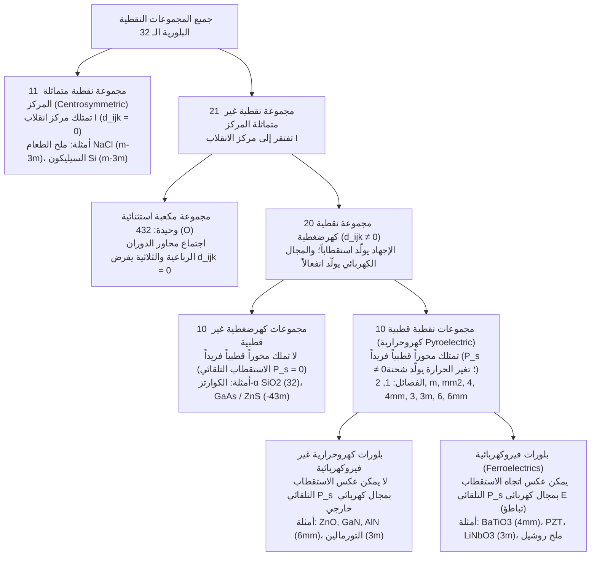
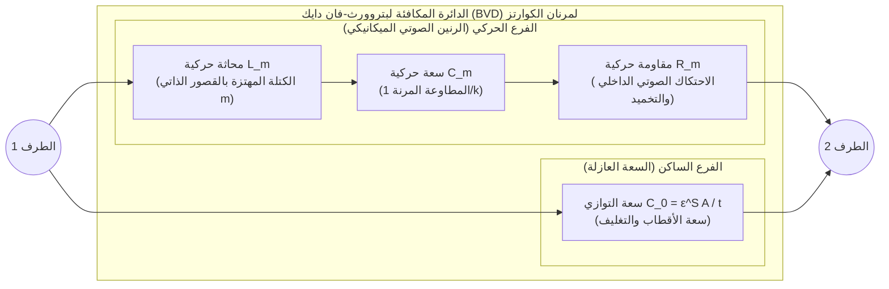

عندما تدير مفتاح إشعال موقد الغاز أو تضغط على قداحة إلكترونية وتسمع طقطقة ميكانيكية حادة، تقفز شرارة زرقاء عبر الفجوة الهوائية لتشعل الوقود دون بطارية أو توصيل بشبكة الكهرباء. وفي داخل ساعة اليد الكوارتز والهاتف الذكي في جيبك، تهتز شرائح مجهرية من بلورة الكوارتز ($\text{SiO}_2$) وأغشية رقيقة من نيتريد الألومنيوم ($\text{AlN}$) عشرات الآلاف إلى مليارات المرات في الثانية باستقرار مذهل لضبط نبض المعالجات الرقمية وترشيح ترددات الجيل الخامس (5G). وفي المستشفيات، يرسل مسبار الموجات فوق الصوتية نبضات صوتية صامتة ويستقبل أصداءها لتصوير قلب الجنين لحظياً، بينما تقوم مجاهر المسح النفقي (STM) ومجاهر القوة الذرية (AFM) بتتبع الذرات المنفردة بدقة رأسية تتجاوز البيكومتر الواحد ($1\,\text{pm} = 10^{-12}\,\text{m}$).

تعتمد جميع هذه التقنيات على ظاهرة فيزيائية واحدة عميقة: <strong>التأثير الكهرضغطي أو البيزوكهربائي (Piezoelectric Effect)</strong>. صاغ هذا المصطلحَ العالمُ فيلهلم غوتليب هانكل عام 1881 من الفعل اليوناني $\pi\iota\epsilon\zeta\epsilon\iota\nu$ (*piezein* بمعنى «يضغط» أو «يعصر»)، ويعبّر عن الاقتران الكهروميكانيكي الخطي والعكوس بين الإجهاد الميكانيكي والاستقطاب الكهربائي في البلورات التي تفتقر إلى مركز تماثل انعكاسي (مركز انقلاب).

لماذا يولّد ضغط بلورة الكوارتز أو سيراميك تيتانات زركونات الرصاص (PZT) جهداً كهربائياً، في حين لا ينتج عن ضغط ملح الطعام ($\text{NaCl}$) أو السيليكون أو الزجاج العادي أي إشارة كهربائية على الإطلاق؟ في هذا المقال نستعرض الديناميكا الحرارية، والمعادلات التنسورية، ونظرية مجموعات التماثل البلوري، والتطبيقات الهندسية للكهرباء الانضغاطية.

---

## الفصل 1: الاكتشاف التاريخي والحتمية الترموديناميكية — الأخوان كوري وتنبؤ ليبمان

### 1.1 عام 1880: بيير وجاك كوري يكتشفان التأثير الكهرضغطي المباشر

في عام 1880، وفي مختبر علم المعادن بجامعة السوربون في باريس، كان <strong>بيير كوري</strong> (21 عاماً) وشقيقه <strong>جاك كوري</strong> (24 عاماً) يدرسان ظاهرة <strong>الكهرباء الحرارية (Pyroelectricity)</strong> — أي ظهور شحنات كهربائية على أسطح بلورات مثل التورمالين عند تسخينها أو تبريدها. أدرك الأخوان كوري أن التغير الحراري يسبب تمدداً غير متناحٍ في الشبكة البلورية يؤدي إلى إزاحة مراكز ثقل الأيونات الموجبة والسالبة، فافترضا أن تطبيق ضغط ميكانيكي مباشر على طول محور بلوري غير متماثل عند درجة حرارة ثابتة لا بد أن يولّد شحنات سطحية مماثلة.

باستخدام أقطاب من رقائق القصدير ومقياس كلفن الكهربائي ذي الأرباع، أثبت الأخوان كوري عام 1880 <strong>التأثير الكهرضغطي المباشر (Direct Piezoelectric Effect)</strong> في بلورات <strong>الكوارتز-$\alpha$ ($\text{SiO}_2$)</strong>، و<strong>التورمالين</strong>، و<strong>التوباز</strong>، و<strong>السفاليريت ($\text{ZnS}$)</strong>، و<strong>سكر القصب</strong>، و<strong>ملح روشيل ($\text{KNaC}_4\text{H}_4\text{O}_6 \cdot 4\text{H}_2\text{O}$)</strong>:
1. يولّد إجهاد الضغط شحنة كهربائية سطحية $Q$ تتناسب طردياً بدقة مع القوة المؤثرة $F$.
2. استبدال الشد بالضغط يعكس الإشارة الجبرية للشحنة المتولدة بنفس المقدار تماماً.
3. لا تظهر هذه الخاصية إلا في البلورات التي تفتقر إلى مركز تماثل انعكاسي.

### 1.2 عام 1881: استنتاج غابرييل ليبمان الترموديناميكي للتأثير العكسي

في عام 1881، طبّق الفيزيائي <strong>غابرييل ليبمان (Gabriel Lippmann)</strong> القانونين الأول والثاني للديناميكا الحرارية على دورة كهروميكانيكية عكوسة، وأثبت رياضياً حتمية وجود <strong>التأثير الكهرضغطي العكسي (Converse Piezoelectric Effect)</strong>: عند وضع بلورة كهرضغطية في مجال كهربائي خارجي $\mathbf{E}$ فإنها تتشوه ميكانيكياً بمقدار انفعال خطي $\mathbf{S}$ يتطابق معامله تماماً مع معامل التأثير المباشر.

لنفرض وحدة حجم من بلورة عازلة عند درجة حرارة مطلقة $\Theta$، وكثافة إنتروبيا $s$، وموتر إجهاد ميكانيكي $T_{jk}$ ($\text{Pa}$)، وموتر انفعال $S_{jk}$، ومجال كهربائي $E_i$ ($\text{V/m}$)، وإزاحة كهربائية $D_i = \varepsilon_0 E_i + P_i$ ($\text{C/m}^2$). يُعطى التفاضل التام لكثافة الطاقة الداخلية $U(s, S_{jk}, D_i)$ وفق اصطلاح أينشتاين للجمع بالعلاقة:

$$dU = \Theta\,ds + T_{jk}\,dS_{jk} + E_i\,dD_i$$

وبإجراء تحويل ليجاندر إلى المتغيرات المستقلة المتحكم بها تجريبياً $(\Theta, T_{jk}, E_i)$، نعرّف كثافة طاقة غيبس الحرة المرنة-الكهربائية $G(\Theta, T_{jk}, E_i)$:

$$G(\Theta, T_{jk}, E_i) = U - \Theta s - T_{jk} S_{jk} - E_i D_i \quad \Longrightarrow \quad dG = -s\,d\Theta - S_{jk}\,dT_{jk} - D_i\,dE_i$$

عند ثبوت درجة الحرارة ($d\Theta = 0$)، نحصل على الانفعال والإزاحة الكهربائية كمشتقات جزئية أولى للدالة $G$:

$$S_{jk} = -\left(\frac{\partial G}{\partial T_{jk}}\right)_{\mathbf{E}, \Theta}, \qquad D_i = -\left(\frac{\partial G}{\partial E_i}\right)_{\mathbf{T}, \Theta}$$

وبموجب مبرهنة شفارتز لتساوي المشتقات الجزئية الثانية المختلطة ($\frac{\partial^2 G}{\partial E_i \partial T_{jk}} = \frac{\partial^2 G}{\partial T_{jk} \partial E_i}$)، نحصل فوراً على <strong>علاقة ماكسويل الترموديناميكية للكهرضغطية</strong>:

$$d_{ijk} \equiv \left(\frac{\partial D_i}{\partial T_{jk}}\right)_{\mathbf{E}, \Theta} = \left(\frac{\partial S_{jk}}{\partial E_i}\right)_{\mathbf{T}, \Theta}$$

يتساوى معامل الشحنة المباشر بوحدة كولوم لكل نيوتن ($\text{C/N}$) ومعامل الانفعال العكسي بوحدة متر لكل فولت ($\text{m/V}$) تطابقاً تاماً ($\frac{\text{C}}{\text{N}} = \frac{\text{C}\cdot\text{m}}{\text{J}} = \frac{\text{m}}{\text{V}}$). وقد تحقق الأخوان كوري تجريبياً من هذا التمدد المجهري وابتكرا مقياس الكوارتز الكهرضغطي، وهو الجهاز الذي مكّن ماري وبيير كوري عام 1898 من قياس النشاط الإشعاعي الضئيل لخام البتشبلند وعزل عنصري البولونيوم والراديوم.

---

## الفصل 2: المعادلات التنسورية التكوينية ومبدأ نويمان

### 2.1 المعادلات الخطية التكوينية وترميز فويغت المصفوفي (IEEE)

بفك دالة غيبس $G(T_{jk}, E_i)$ في متسلسلة تايلور حتى الحدود التربيعية حول حالة التوازن ($T_{jk}=0, E_i=0$)، نحصل على <strong>المعادلات التكوينية الكهرضغطية الخطية</strong>:

$$D_i = d_{ijk} T_{jk} + \varepsilon_{ij}^T E_j, \qquad S_{jk} = s_{jklm}^E T_{lm} + d_{ijk} E_i$$

حيث $\varepsilon_{ij}^T$ موتر السماحية الكهربائية عند ثبوت الإجهاد ($\text{F/m}$)، و$s_{jklm}^E$ موتر المطاوعة المرنة عند ثبوت المجال الكهربائي ($\text{Pa}^{-1}$)، و$d_{ijk}$ الموتر الكهرضغطي من الرتبة الثالثة. وبسبب تماثل الإجهاد والانفعال ($T_{jk} = T_{kj}, S_{jk} = S_{kj}$)، يتحقق التماثل $d_{ijk} = d_{ikj}$، مما يقلص عدد المركبات المستقلة من $27$ إلى $3 \times 6 = 18$ كحد أقصى. وباستخدام <strong>ترميز فويغت (Voigt notation)</strong> $(11\to 1, 22\to 2, 33\to 3, 23\to 4, 13\to 5, 12\to 6)$ مع تعريف انفعالات القص الهندسية $S_m = 2S_{jk}$ و$d_{im} = 2d_{ijk}$ ($m=4,5,6$)، نكتب:

$$D_i = d_{im} T_m + \varepsilon_{ij}^T E_j, \qquad S_m = s_{mn}^E T_n + d_{jm} E_j \qquad (i,j \in \{1,2,3\};\; m,n \in \{1,\dots,6\})$$

وتُقاس كفاءة تحويل الطاقة بين المجالين الميكانيكي والكهربائي بواسطة <strong>معامل الاقتران الكهروميكانيكي</strong> اللابعدي $k^2 = \frac{d^2}{\varepsilon^T s^E}$.

### 2.2 برهان صارم عبر مبدأ نويمان: لماذا يمنع مركز الانقلاب وجود الكهرضغطية؟

ينص <strong>مبدأ نويمان (Neumann's Principle, 1885)</strong> على أن أي موتر يصف خاصية فيزيائية عيانية للبلورة يجب أن يظل لا متغيراً (ثابتاً) تحت جميع عمليات التماثل $a_{ij}$ للمجموعة النقطية التي تنتمي إليها البلورة.

لنفترض أن البلورة تمتلك <strong>مركز انقلاب (تماثل مركزي $\mathcal{I}$)</strong> يحوّل كل متجه موضع $\mathbf{r}$ إلى $-\mathbf{r}$ عبر مصفوفة التحويل المتعامدة $a_{ij} = -\delta_{ij}$:
1. <strong>الإزاحة الكهربائية $D_i$ (متجه قطبي من الرتبة 1)</strong>: ينعكس اتجاه المتجه القطبي تحت عملية الانقلاب الفضائي: $D'_i = a_{ip} D_p = -D_i$.
2. <strong>الإجهاد الميكانيكي $T_{jk}$ (موتر قطبي من الرتبة 2)</strong>: قوتان متقابلتان تضغطان العينة تتبادلان موقعيهما فقط تحت الانقلاب الفضائي دون تغير حالة الانضغاط: $T'_{jk} = a_{jq} a_{kr} T_{qr} = (-1)^2 T_{jk} = +T_{jk}$.
3. <strong>الموتر الكهرضغطي $d_{ijk}$ (موتر قطبي من الرتبة 3)</strong>: يتحول الموتر ذو الرتبة الثالثة الفردية تحت الانقلاب $\mathcal{I}$ بضربه في ثلاثة عوامل $(-1)$:
   $$d'_{ijk} = a_{ip} a_{jq} a_{kr} d_{pqr} = (-\delta_{ip})(-\delta_{jq})(-\delta_{kr}) d_{pqr} = (-1)^3 d_{ijk} = -d_{ijk}$$
   غير أن مبدأ نويمان يشترط للبلورة متماثلة المركز بقاء موتر خواصها ثابتاً: $d'_{ijk} = d_{ijk}$. وبمساواة الطرفين نجد:
   $$d_{ijk} = -d_{ijk} \quad \Longrightarrow \quad 2d_{ijk} = 0 \quad \Longrightarrow \quad d_{ijk} \equiv 0 \quad (\forall i,j,k)$$

وهذا يثبت رياضياً بشكل قاطع أن <strong>أي بلورة تمتلك مركز تماثل انعكاسي لا يمكنها إظهار أي تأثير كهرضغطي خطي</strong>.

| الخاصية الفيزيائية | التأثير الكهرضغطي (Piezoelectricity) | التخصر الكهربائي (Electrostriction) | التكهرب بالدلك (Triboelectricity) |
| :--- | :--- | :--- | :--- |
| <strong>المنشأ المجهري</strong> | إزاحة مرنة عكوسة للشبكات الفرعية الأيونية داخل <strong>حجم وحدة الخلية البلورية</strong> | تشوه تربيعي <strong>للشبكة الحجمية</strong> بفعل قوى الاستقطاب | انتقال سطحي للإلكترونات أو الأيونات عبر <strong>سطح التلامس والاحتكاك</strong> |
| <strong>شرط التماثل البلوري</strong> | يقتصر على <strong>20 مجموعة نقطية غير متماثلة المركز</strong> | <strong>لا يوجد شرط</strong> (يحدث في جميع البلورات والزجاج والسوائل) | <strong>لا يوجد شرط</strong> (يحدث بين أي أسطح عازلة أو معدنية) |
| <strong>العلاقة الرياضية</strong> | <strong>خطية (من الدرجة الأولى)</strong>: $D \propto T,\; S \propto E$ (ينعكس مع $E \to -E$) | <strong>تربيعية (من الدرجة الثانية)</strong>: $S_{ij} = M_{ijkl} E_k E_l$ (لا ينعكس) | <strong>غير خطية وعشوائية</strong> (حساسة للرطوبة وخشونة السطح) |
| <strong>العكوسية الترموديناميكية</strong> | <strong>عكوس تماماً</strong> (تأثير مباشر $\Longleftrightarrow$ تأثير عكسي) | <strong>أحادي الاتجاه عند $E=0$</strong> (الضغط وحده لا يولّد استقطاباً) | <strong>غير عكوس وتبديدي</strong> |

---

## الفصل 3: الهرم التصنيفي للمجموعات النقطية البلورية الـ 32

توجد في علم البلورات ثلاثي الأبعاد <strong>32 مجموعة نقطية بلورية (فصيلة بلورية)</strong> بالضبط، يرتبها مبدأ نويمان في الهيكل الهرمي التالي:

من بين المجموعات الـ 21 غير متماثلة المركز، توجد <strong>20 مجموعة كهرضغطية</strong> فقط: الاستثناء الوحيد هو المجموعة المكعبة اليدوانية <strong>$432$ ($O$)</strong>، حيث يؤدي اجتماع محاور الدوران الرباعية ($90^\circ$) والثلاثية ($120^\circ$) إلى تصفير مركبة القص الوحيدة المتبقية $d_{312}$ ($d'_{312} = -d_{321} = -d_{312} \implies d_{312} = 0$). ومن بين هذه العشرين، تمتلك <strong>10 فصائل قطبية (كهروحرارية)</strong> محوراً قطبياً فريداً يحافظ على استقطاب تلقائي دائم $\mathbf{P}_s \neq \mathbf{0}$. وإذا أمكن قلب اتجاه $\mathbf{P}_s$ بواسطة مجال كهربائي خارجي يتجاوز المجال القسري $E_c$، تُسمى المادة <strong>فيروكهربائية (Ferroelectric)</strong>.

---

## الفصل 4: الآليات المجهرية — الكوارتز-$\alpha$ مقابل الفيروكهربائيات البيروفسكايتية ($\text{BaTiO}_3$, PZT)

### 4.1 الكوارتز-$\alpha$ ($\text{SiO}_2$، المجموعة النقطية الثلاثية $32$)

تحت درجة حرارة $573\,^\circ\text{C}$، يتبلور الكوارتز في الفصيلة الثلاثية $32$ (الكوارتز-$\alpha$)، حيث تشكل رباعيات الأوجه $\text{SiO}_4$ سلاسل حلزونية على طول المحور البصري $Z$ (محور ثلاثي)، بينما تقع ثلاثة محاور كهربائية $X$ (محاور ثنائية بزاوية $120^\circ$) وثلاثة محاور ميكانيكية $Y$ في المستوى المتعامد $XY$. يختزل تماثل المجموعة $32$ مصفوفة الكهرضغطية إلى معاملين مستقلين فقط ($d_{11} = 2.31\,\text{pC/N}$ و$d_{14} = -0.727\,\text{pC/N}$):

$$\mathbf{d}_{\text{Quartz (32)}} = \begin{pmatrix} d_{11} & -d_{11} & 0 & d_{14} & 0 & 0 \\ 0 & 0 & 0 & 0 & -d_{14} & -2d_{11} \\ 0 & 0 & 0 & 0 & 0 & 0 \end{pmatrix}$$

في غياب الإجهاد، ينطبق مركز الشحنات الموجبة $\text{Si}^{4+}$ على مركز الشحنات السالبة $\text{O}^{2-}$ ($\mathbf{P}_s = \mathbf{0}$). وعند الضغط على طول المحور الكهربائي $X$ (التأثير الطولي $D_1 = d_{11} T_1$) أو الشد على طول المحور الميكانيكي $Y$ (التأثير العرضي $D_1 = -d_{11} T_2$)، تتشوه الحلقة السداسية لرباعيات الأوجه وينفصل مركزا الشحنة على طول المحور $X$. كما يولّد المجال $E_2$ انفعال قص سماكي عبر المعامل $d_{26} = -2d_{11}$.

### 4.2 بيروفسكايت $\text{BaTiO}_3$ وPZT، عملية الاستقطاب (Poling)، وحد الطور المورفوتروبي (MPB)

تمتلك أكاسيد البيروفسكايت $\text{ABO}_3$ مثل تيتانات الباريوم ($\text{BaTiO}_3$) وتيتانات زركونات الرصاص ($\text{Pb(Zr}_x\text{Ti}_{1-x}\text{)O}_3$, PZT) بنية مكعبة متماثلة المركز ($m\bar{3}m$, $d_{ijk}=0$) فوق درجة حرارة كوري $T_C$. وعند تبريدها تحت $T_C$، ينزاح الكاتيون المركزي $\text{Ti}^{4+}/\text{Zr}^{4+}$ عن مركز ثماني الأوجه الأكسجيني $\text{O}_6$، مما ينشئ طوراً رباعياً ($4mm$) أو معينياً ($3m$) باستقطاب تلقائي هائل.

ولأن السيراميك متعدد البلورات بعد التلبيد يحتوي على نطاقات (Domains) عشوائية التوجيه تلغي بعضها عيانياً ($d_{ijk}=0$)، فإنه يخضع لعملية <strong>الاستقطاب تحت مجال مستمر قوي (Poling)</strong> لمحاذاة النطاقات وكسر التماثل إلى مجموعة كوري $\infty m$ (المماثلة للمجموعة $6mm$ بالمعاملات $d_{33}, d_{31}, d_{15}$). وفي سيراميك PZT عند <strong>حد الطور المورفوتروبي (MPB، $x \approx 0.52$)</strong>، تتعايش 6 اتجاهات استقطاب رباعية $\langle 100 \rangle$ مع 8 اتجاهات معينية $\langle 111 \rangle$ عبر طور جسري أحادي الميل (المجموعة $m$)، مما يسطّح مشهد الطاقة الحرة ويتيح <strong>دوران متجه الاستقطاب</strong> بسهولة فائقة، فيقفز المعامل $d_{33}$ إلى $300\text{–}600\,\text{pC/N}$.

---

## الفصل 5: فيزياء الرنين ومذبذبات الكوارتز — الدائرة المكافئة لبتروورث-فان دايك (BVD)

بالقرب من تردد الرنين الصوتي للموجة الموقوفة ($t = n\lambda/2$)، تسلك شريحة الكوارتز المهتزة كهربائياً سلوك فرع حركي متسلسل ($L_m, C_m, R_m$) موصول على التوازي مع السعة الساكنة للأقطاب $C_0$، وهو ما يُعرف بنموذج <strong>بتروورث-فان دايك (Butterworth-Van Dyke - BVD)</strong>:

بإهمال الفقد الضئيل ($R_m \to 0$)، تعطي المسامحة الكلية $Y(\omega) = j\omega C_0 + \left(j\omega L_m + \frac{1}{j\omega C_m}\right)^{-1}$ ترددين حرجين:
1. <strong>تردد الرنين المتسلسل ($f_s$)</strong> (أدنى معاوقة $Z \approx R_m$):
   $$f_s = \frac{1}{2\pi\sqrt{L_m C_m}}$$
2. <strong>تردد الرنين المتوازي أو المضاد ($f_p$)</strong> (انعدام المسامحة $Y(\omega_p) = 0$):
   $$f_p = f_s \sqrt{1 + \frac{C_m}{C_0}} \approx f_s \left(1 + \frac{C_m}{2C_0}\right)$$

لا يسلك الكوارتز سلوكاً حثياً إلا داخل النافذة الضيقة جداً $f_s < f < f_p$. وبفضل انخفاض الاحتكاك الداخلي، يحقق الكوارتز <strong>معامل جودة فائقاً $Q = \frac{\omega_s L_m}{R_m} \sim 10^5\text{–}10^6$</strong>. وتعتمد ساعات الكوارتز على شوكة رنانة مصممة عند التردد <strong>$32,768\,\text{Hz} = 2^{15}\,\text{Hz}$</strong> (تُقسم عبر 15 مرحلة قلاب ثنائي لإنتاج نبضة $1\,\text{Hz}$ كل ثانية بدقة)، بينما يحقق <strong>قطع AT</strong> (بزاوية $35^\circ 15'$ مع المحور $Z$) منحنى حرارياً تكعيبياً ذا انحراف صفري عند درجة حرارة الغرفة. وفي هواتف الجيل الخامس (5G)، تعمل مرشحات الموجات الصوتية السطحية (<strong>SAW</strong>) والحجمية الرقيقة (<strong>BAW/FBAR</strong> من $\text{AlN}$) على ترشيح إشارات الغيغاهرتز.

---

## الفصل 6: التصوير الطبي بالموجات فوق الصوتية والتحكم الذري دون البيكومتر (STM/AFM)

1. <strong>سونار لانجفان، والموجات فوق الصوتية ذات المصفوفة الطورية (Phased Array)، وطبقة المواءمة $\lambda/4$</strong>:
   تُطلق مجسات الموجات فوق الصوتية الطبية نبضات صوتية عبر التأثير العكسي وتستقبل أصداءها عبر التأثير المباشر. ولمنع انعكاس $82\%$ من الطاقة الصوتية بسبب عدم تطابق المعاوقة الصوتية بين سيراميك PZT ($Z_{\text{PZT}} \approx 30\,\text{MRayl}$) والأنسجة البشرية الرخوة ($Z_{\text{tissue}} \approx 1.5\,\text{MRayl}$)، تُوضع <strong>طبقة مواءمة صوتية بسمك ربع طول موجي $\lambda/4$</strong> ذات معاوقة تساوي المتوسط الهندسي $Z_{\text{match}} = \sqrt{Z_{\text{PZT}} Z_{\text{tissue}}} \approx 6.7\,\text{MRayl}$.
2. <strong>ماسحات مجاهر STM/AFM والمشغلات الكهرضغطية متعددة الطبقات</strong>:
   في مجهر المسح النفقي (بينيغ وروهرر، جائزة نوبل 1986)، يقوم أنبوب PZT مقسم إلى أربعة أرباع بتحريك الإبرة المعدنية دون أي احتكاك أو ارتداد ميكانيكي بدقة رأسية تفوق $0.01\,\text{\AA}$ ($1\,\text{pm}$) للحفاظ على ثبات تيار النفق الكمومي $I_t \propto V e^{-2\kappa z}$. كما تقود المشغلات الكهرضغطية المكدسة ($\Delta L = N d_{33} V$) حواجز وقود الديزل (Common-Rail) عند ضغط $200\,\text{MPa}$ ورؤوس طابعات نفث الحبر.
