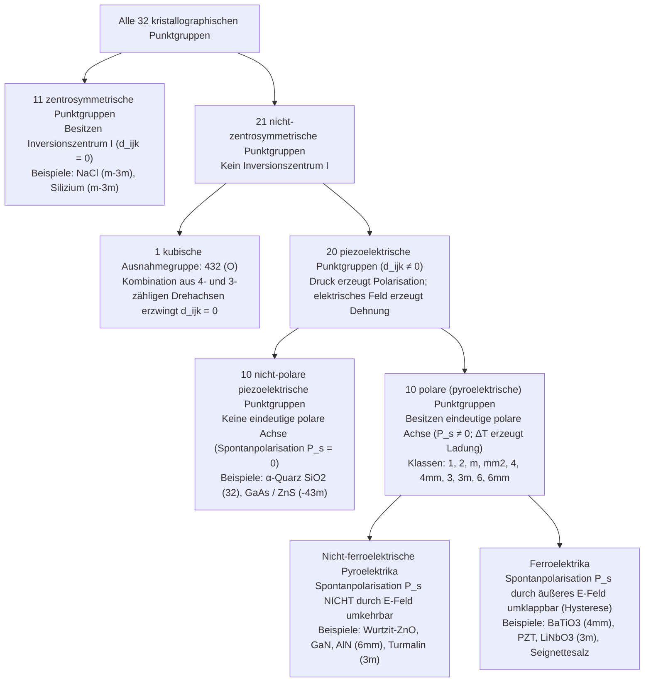
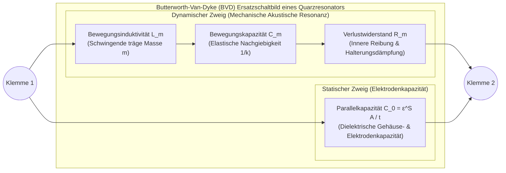

Wenn man den Zündknopf eines Gasherds oder eines elektronischen Feuerzeugs betätigt und ein scharfes Klicken hört, springt ein blauer Funke über eine Funkenstrecke und entzündet das Gas – ganz ohne Batterie oder Netzanschluss. In Armbanduhren und Smartphones schwingen winzige Kristallplättchen aus Quarz ($\text{SiO}_2$) oder dünne Schichten aus Aluminiumnitrid ($\text{AlN}$) zehntausende bis Milliarden Male pro Sekunde mit höchster Frequenzstabilität und geben den Takt der digitalen Welt sowie der 5G-Mobilfunkfilter vor. In der medizinischen Diagnostik senden Ultraschallköpfe unhörbare Schallimpulse in den Körper und empfangen deren Echos, während in der Nanotechnologie Rastertunnelmikroskope (STM) und Rasterkraftmikroskope (AFM) einzelne Atome mit einer Auflösung von unter einem Pikometer ($1\,\text{pm} = 10^{-12}\,\text{m}$) abtasten.

Die gemeinsame physikalische Grundlage all dieser Technologien ist der <strong>piezoelektrische Effekt (Piezoelectric Effect)</strong>. Geprägt im Jahr 1881 von Wilhelm Gottlieb Hankel nach dem altgriechischen Verb $\pi\iota\epsilon\zeta\epsilon\iota\nu$ (*piezein*, „drücken“ oder „pressen“), bezeichnet Piezoelektrizität die reversible, lineare elektromechanische Kopplung zwischen mechanischer Spannung und dielektrischer Polarisation in Kristallen ohne Inversionszentrum.

Warum erzeugt das Zusammendrücken eines Quarzkristalls oder einer Blei-Zirkonat-Titanat-Keramik (PZT) eine elektrische Spannung, während Kochsalz ($\text{NaCl}$), Silizium oder gewöhnliches Glas keinerlei elektrisches Signal liefern? In diesem Artikel untersuchen wir die Thermodynamik, die Tensorgleichungen, die Symmetriegruppen und die technischen Anwendungen des piezoelektrischen Effekts.

---

## Kapitel 1: Historische Entdeckung und thermodynamische Notwendigkeit — Die Brüder Curie und Lippmanns Vorhersage

### 1.1 1880: Pierre und Jacques Curie entdecken den direkten piezoelektrischen Effekt

Im Jahr 1880 untersuchten der 21-jährige <strong>Pierre Curie</strong> und sein 24-jähriger Bruder <strong>Jacques Curie</strong> an der Pariser Sorbonne die <strong>Pyroelektrizität</strong> (die Entstehung elektrischer Oberflächenladungen an Kristallen wie Turmalin bei Temperaturänderung). Sie erkannten, dass die Ursache in der asymmetrischen thermischen Ausdehnung des Kristallgitters lag, durch die sich die Schwerpunkte positiver und negativer Ionen gegeneinander verschieben. Daraus leiteten sie die Hypothese ab, dass auch ein rein mechanischer Druck entlang einer polaren oder asymmetrischen Kristallachse bei konstanter Temperatur elektrische Ladungen hervorrufen müsse.

Mit Stanniol-Elektroden und einem Kelvin-Quadrantenelektrometer wiesen die Brüder Curie 1880 an Einkristallen aus <strong>$\alpha$-Quarz ($\text{SiO}_2$)</strong>, <strong>Turmalin</strong>, <strong>Topas</strong>, <strong>Zinkblende ($\text{ZnS}$)</strong>, <strong>Rohrzucker</strong> und <strong>Seignettesalz (Rochelle-Salz, $\text{KNaC}_4\text{H}_4\text{O}_6 \cdot 4\text{H}_2\text{O}$)</strong> den <strong>direkten piezoelektrischen Effekt</strong> nach:
1. Mechanischer Druck erzeugt eine Oberflächenladung $Q$, die exakt proportional zur angelegten Kraft $F$ ist.
2. Ersetzt man Kompression durch Zugspannung, kehrt sich das Vorzeichen der Ladung exakt um.
3. Der Effekt tritt ausschließlich in Kristallen ohne Symmetriezentrum auf.

### 1.2 1881: Gabriel Lippmanns thermodynamische Herleitung des reziproken Effekts

Nur ein Jahr später, 1881, wandte der Physiker <strong>Gabriel Lippmann</strong> den ersten und zweiten Hauptsatz der Thermodynamik auf einen reversiblen elektromechanischen Kreisprozess an und sagte den <strong>reziproken (inversen) piezoelektrischen Effekt</strong> voraus: Ein äußeres elektrisches Feld $\mathbf{E}$ muss eine mechanische Dehnung $\mathbf{S}$ im Kristall bewirken, deren Kopplungskoeffizient exakt mit dem des direkten Effekts übereinstimmt.

Betrachten wir ein Einheitsvolumen eines Dielektrikums bei absoluter Temperatur $\Theta$, Entropiedichte $s$, mechanischem Spannungstensor $T_{jk}$ ($\text{Pa}$), Dehnungstensor $S_{jk}$, elektrischer Feldstärke $E_i$ ($\text{V/m}$) und elektrischer Flussdichte $D_i = \varepsilon_0 E_i + P_i$ ($\text{C/m}^2$). Das vollständige Differential der inneren Energiedichte $U(s, S_{jk}, D_i)$ lautet (unter Verwendung der Einsteinschen Summenkonvention):

$$dU = \Theta\,ds + T_{jk}\,dS_{jk} + E_i\,dD_i$$

Durch eine Legendre-Transformation auf die experimentell kontrollierten Variablen $(\Theta, T_{jk}, E_i)$ erhalten wir die elastisch-elektrische <strong>Gibbssche freie Enthalpiedichte</strong> $G(\Theta, T_{jk}, E_i)$:

$$G(\Theta, T_{jk}, E_i) = U - \Theta s - T_{jk} S_{jk} - E_i D_i \quad \Longrightarrow \quad dG = -s\,d\Theta - S_{jk}\,dT_{jk} - D_i\,dE_i$$

Bei konstanter Temperatur ($d\Theta = 0$) ergeben sich Dehnung und elektrische Flussdichte als erste partielle Ableitungen:

$$S_{jk} = -\left(\frac{\partial G}{\partial T_{jk}}\right)_{\mathbf{E}, \Theta}, \qquad D_i = -\left(\frac{\partial G}{\partial E_i}\right)_{\mathbf{T}, \Theta}$$

Da $G$ eine Zustandsfunktion ist, müssen nach dem Satz von Schwarz die gemischten zweiten Ableitungen vertauschen ($\frac{\partial^2 G}{\partial E_i \partial T_{jk}} = \frac{\partial^2 G}{\partial T_{jk} \partial E_i}$). Dies liefert unmittelbar die <strong>thermodynamische Maxwell-Relation der Piezoelektrizität</strong>:

$$d_{ijk} \equiv \left(\frac{\partial D_i}{\partial T_{jk}}\right)_{\mathbf{E}, \Theta} = \left(\frac{\partial S_{jk}}{\partial E_i}\right)_{\mathbf{T}, \Theta}$$

Der Koeffizient des direkten Effekts in Coulomb pro Newton ($\text{C/N}$) und der Koeffizienten des reziproken Effekts in Meter pro Volt ($\text{m/V}$) sind identisch ($\frac{\text{C}}{\text{N}} = \frac{\text{C}\cdot\text{m}}{\text{J}} = \frac{\text{m}}{\text{V}}$). Noch im selben Jahr bestätigten die Brüder Curie diese winzige Längenänderung experimentell an Quarzplatten und konstruierten das piezoelektrische Quarzelektrometer, mit dem Marie und Pierre Curie 1898 Polonium und Radium entdeckten.

---

## Kapitel 2: Konstitutive Tensorgleichungen und das Neumannsche Prinzip

### 2.1 Lineare Zustandsgleichungen und IEEE-Voigt-Notation

Entwickelt man $G(T_{jk}, E_i)$ bis zur zweiten Ordnung um den spannungs- und feldfreien Gleichgewichtszustand, folgen durch Ableitung die gekoppelten linearen <strong>piezoelektrischen Zustandsgleichungen</strong>:

$$D_i = d_{ijk} T_{jk} + \varepsilon_{ij}^T E_j, \qquad S_{jk} = s_{jklm}^E T_{lm} + d_{ijk} E_i$$

Hierbei ist $\varepsilon_{ij}^T$ der Permittivitätstensor bei konstanter Spannung ($\text{F/m}$), $s_{jklm}^E$ der elastische Nachgiebigkeitstensor (Compliance) bei konstantem elektrischem Feld ($\text{Pa}^{-1}$) und $d_{ijk}$ der piezoelektrische Tensor dritter Stufe. Wegen der Symmetrie von Spannung und Dehnung ($T_{jk} = T_{kj}, S_{jk} = S_{kj}$) gilt $d_{ijk} = d_{ikj}$, wodurch sich die Anzahl unabhängiger Komponenten von $27$ auf maximal $3 \times 6 = 18$ reduziert. In der kompakten <strong>Voigt-Notation</strong> $(11\to 1, 22\to 2, 33\to 3, 23\to 4, 13\to 5, 12\to 6)$ mit technischen Scherdehnungen $S_m = 2S_{jk}$ und $d_{im} = 2d_{ijk}$ ($m=4,5,6$) schreiben wir:

$$D_i = d_{im} T_m + \varepsilon_{ij}^T E_j, \qquad S_m = s_{mn}^E T_n + d_{jm} E_j \qquad (i,j \in \{1,2,3\};\; m,n \in \{1,\dots,6\})$$

Der Wirkungsgrad der Energieumwandlung zwischen mechanischer und elektrischer Domäne wird durch den dimensionslosen <strong>elektromechanischen Kopplungsfaktor</strong> $k^2 = \frac{d^2}{\varepsilon^T s^E}$ beschrieben.

### 2.2 Strenger Beweis über das Neumannsche Prinzip: Warum Inversionssymmetrie Piezoelektrizität verbietet

Das <strong>Neumannsche Prinzip</strong> (Franz Ernst Neumann, 1885) besagt, dass jeder makroskopische Materialtensor unter allen Symmetrieoperationen $a_{ij}$ der Punktgruppe des Kristalls invariant sein muss.

Besitzt ein Kristall ein <strong>Inversionszentrum (Symmetriezentrum $\mathcal{I}$)</strong>, so bildet die Raumspiegelung jeden Ortsvektor $\mathbf{r}$ auf $-\mathbf{r}$ ab. Die orthogonale Transformationsmatrix lautet $a_{ij} = -\delta_{ij}$. Unter dieser Inversion transformieren sich die beteiligten Tensoren wie folgt:
1. <strong>Elektrische Flussdichte $D_i$ (polarer Vektor 1. Stufe)</strong>: Ein Dipolvektor kehrt unter $\mathbf{r} \to -\mathbf{r}$ seine Richtung um: $D'_i = a_{ip} D_p = -D_i$.
2. <strong>Mechanische Spannung $T_{jk}$ (polarer Tensor 2. Stufe)</strong>: Zwei entgegengesetzte Druckkräfte von $+x$ und $-x$ vertauschen unter Raumspiegelung lediglich ihre Plätze, sodass der Druckzustand unverändert bleibt: $T'_{jk} = a_{jq} a_{kr} T_{qr} = (-1)^2 T_{jk} = +T_{jk}$.
3. <strong>Piezoelektrischer Tensor $d_{ijk}$ (polarer Tensor 3. Stufe)</strong>: Unter der Inversion transformiert sich ein Tensor dritter Stufe mit drei Faktoren $a_{ij} = -\delta_{ij}$:
   $$d'_{ijk} = a_{ip} a_{jq} a_{kr} d_{pqr} = (-\delta_{ip})(-\delta_{jq})(-\delta_{kr}) d_{pqr} = (-1)^3 d_{ijk} = -d_{ijk}$$
   Gleichzeitig verlangt das Neumannsche Prinzip für einen zentrosymmetrischen Kristall Invarianz unter $\mathcal{I}$, also $d'_{ijk} = d_{ijk}$. Daraus folgt zwingend:
   $$d_{ijk} = -d_{ijk} \quad \Longrightarrow \quad 2d_{ijk} = 0 \quad \Longrightarrow \quad d_{ijk} \equiv 0 \quad (\forall i,j,k)$$

Damit ist bewiesen, dass <strong>in jedem zentrosymmetrischen Kristall der lineare piezoelektrische Effekt exakt verschwindet</strong>.

| Eigenschaft | Piezoelektrischer Effekt | Elektrostriktion | Triboelektrischer Effekt (Reibungselektrizität) |
| :--- | :--- | :--- | :--- |
| <strong>Mikroskopischer Ursprung</strong> | Reversible Verschiebung von Kationen- und Anionen-Untergittern im <strong>Kristallvolumen (Bulk)</strong> | Quadratische Gitterdeformation durch Polarisationskräfte im <strong>Volumen</strong> | <strong>Oberflächentransfer</strong> von Elektronen oder Ionen bei Kontakt und Trennung |
| <strong>Symmetriebedingung</strong> | Nur in den <strong>20 nicht-zentrosymmetrischen Punktgruppen</strong> (und gepolten Keramiken) | <strong>Keine</strong> (in allen Kristallen, Gläsern, Flüssigkeiten vorhanden) | <strong>Keine</strong> (tritt an beliebigen Grenzflächen von Isolatoren/Metallen auf) |
| <strong>Skalierungsgesetz</strong> | <strong>Linear (1. Ordnung)</strong>: $D \propto T,\; S \propto E$ (Vorzeichenwechsel bei $E \to -E$) | <strong>Quadratisch (2. Ordnung)</strong>: $S_{ij} = M_{ijkl} E_k E_l$ (kein Vorzeichenwechsel) | <strong>Nichtlinear und stochastisch</strong> (abhängig von Rauheit und Luftfeuchte) |
| <strong>Thermodynamische Reversibilität</strong> | <strong>Vollständig reversibel</strong> (Direkter $\Longleftrightarrow$ Reziproker Effekt) | <strong>Einseitig bei $E=0$</strong> (mechanischer Druck erzeugt keine Polarisation) | <strong>Irreversibel und dissipativ</strong> |

---

## Kapitel 3: Die Hierarchie der 32 Kristallklassen — Piezoelektrika, Pyroelektrika und Ferroelektrika

In der dreidimensionalen Kristallographie existieren genau <strong>32 kristallographische Punktgruppen (Kristallklassen)</strong>. Das Neumannsche Prinzip unterteilt sie in eine strikte Hierarchie:

Von den 21 nicht-zentrosymmetrischen Punktgruppen sind nur <strong>20 piezoelektrisch</strong>: In der chiralen kubischen Gruppe <strong>$432$ ($O$)</strong> löschen die vierzähligen ($90^\circ$) Drehachsen in Kombination mit den dreizähligen Raumdiagonalachsen auch die letzte verbleibende Scherkomponente $d_{312}$ aus ($d'_{312} = -d_{321} = -d_{312} \implies d_{312} = 0$). Unter den 20 piezoelektrischen Klassen besitzen genau <strong>10 polare (pyroelektrische) Klassen</strong> eine ausgezeichnete polare Achse mit permanenter Spontanpolarisation $\mathbf{P}_s \neq \mathbf{0}$. Ist diese Spontanpolarisation durch ein äußeres elektrisches Feld oberhalb der Koerzitivfeldstärke $E_c$ zwischen symmetrieäquivalenten Richtungen umschaltbar, spricht man von einem <strong>Ferroelektrikum</strong>.

---

## Kapitel 4: Mikroskopische Gittermechanismen — $\alpha$-Quarz vs. Perowskit-Ferroelektrika ($\text{BaTiO}_3$, PZT)

### 4.1 $\alpha$-Quarz ($\text{SiO}_2$, Punktgruppe $32$)

Unterhalb von $573\,^\circ\text{C}$ kristallisiert Quarz in der trigonalen Punktgruppe $32$ ($\alpha$-Quarz). Eckenverknüpfte $\text{SiO}_4$-Tetraeder bilden Spiralen entlang der optischen $Z$-Achse (dreizählige Schraubenachse). Senkrecht dazu liegen drei elektrische $X$-Achsen (zweizählige Drehachsen im Winkel von $120^\circ$) und drei mechanische $Y$-Achsen. Die Symmetrie der Gruppe $32$ reduziert den piezoelektrischen Tensor auf nur zwei unabhängige Komponenten ($d_{11} = 2{,}31\,\text{pC/N}$ und $d_{14} = -0{,}727\,\text{pC/N}$):

$$\mathbf{d}_{\text{Quarz (32)}} = \begin{pmatrix} d_{11} & -d_{11} & 0 & d_{14} & 0 & 0 \\ 0 & 0 & 0 & 0 & -d_{14} & -2d_{11} \\ 0 & 0 & 0 & 0 & 0 & 0 \end{pmatrix}$$

Im unbelasteten Zustand fallen die Ladungsschwerpunkte der $\text{Si}^{4+}$-Kationen und $\text{O}^{2-}$-Anionen zusammen ($\mathbf{P}_s = \mathbf{0}$). Drückt man entlang der $X$-Achse (Longitudinaleffekt $D_1 = d_{11} T_1$) oder zieht man entlang der $Y$-Achse (Transversaleffekt $D_1 = -d_{11} T_2$), verformen sich die Tetraederwinkel asymmetrisch und erzeugen ein Dipolmoment entlang $X$. Ein Feld $E_2$ entlang $Y$ regt über $d_{26} = -2d_{11}$ eine Dickenscherschwingung an.

### 4.2 Perowskit-Ferroelektrika ($\text{BaTiO}_3$, PZT), Polung und die Morphotrope Phasengrenze (MPB)

In Perowskit-Oxiden $\text{ABO}_3$ wie Bariumtitanat ($\text{BaTiO}_3$) und Blei-Zirkonat-Titanat ($\text{Pb(Zr}_x\text{Ti}_{1-x}\text{)O}_3$, PZT) ist die Struktur oberhalb der Curie-Temperatur $T_C$ kubisch-zentrosymmetrisch ($m\bar{3}m$, $d_{ijk}=0$). Unterhalb von $T_C$ verschiebt sich das zentrale $\text{Ti}^{4+}/\text{Zr}^{4+}$-Kation im Sauerstoffoktaeder aus dem Zentrum (Off-Centering), wodurch eine tetragonale ($4mm$) oder rhomboedrische ($3m$) Phase mit hoher Spontanpolarisation entsteht.

Da eine gesinterte Keramik zunächst aus statistisch orientierten Domänen besteht (makroskopisch isotrop, $\mathbf{P}_{\text{netto}} = \mathbf{0}$), muss sie durch ein starkes Gleichfeld gepolt werden (<strong>Poling</strong>, Symmetriebrechung zur Curie-Gruppe $\infty m$, isomorph zu $6mm$ mit $d_{33}, d_{31}, d_{15}$). An der <strong>morphotropen Phasengrenze (MPB)</strong> von PZT bei $x \approx 0{,}52$ koexistieren 6 tetragonale $\langle 100 \rangle$- und 8 rhomboedrische $\langle 111 \rangle$-Polarisationsrichtungen über eine monokline Brückenphase (Gruppe $m$). Die dadurch extrem flache Energielandschaft ermöglicht eine leichte <strong>Polarisationsrotation</strong> und führt zu gigantischen Piezokoeffizienten von $d_{33} \approx 300\text{–}600\,\text{pC/N}$.

---

## Kapitel 5: Resonanzphysik und Quarzoszillatoren — Das Butterworth-Van-Dyke-Ersatzschaltbild (BVD)

In der Nähe einer akustischen Eigenfrequenz ($t = n\lambda / 2$) wirkt ein schwingender Quarzkristall elektrisch wie ein extrem verlustarmer Serien-Schwingkreis ($L_m, C_m, R_m$), dem die statische Elektrodenkapazität $C_0$ parallel geschaltet ist – das <strong>Butterworth-Van-Dyke-Ersatzschaltbild (BVD)</strong>:

Aus der Gesamtreaktanz im verlustfreien Grenzfall ($R_m \to 0$) folgen die <strong>Serienresonanzfrequenz $f_s$</strong> und die <strong>Parallelresonanzfrequenz (Antiresonanz) $f_p$</strong>:

$$f_s = \frac{1}{2\pi\sqrt{L_m C_m}}, \qquad f_p = f_s \sqrt{1 + \frac{C_m}{C_0}} \approx f_s \left(1 + \frac{C_m}{2C_0}\right)$$

Nur im schmalen Intervall $f_s < f < f_p$ verhält sich der Quarz induktiv. Dank der extrem geringen inneren Dämpfung erreicht Quarz einen <strong>Gütefaktor von $Q = \frac{\omega_s L_m}{R_m} \sim 10^5\text{–}10^6$</strong> (gegenüber $Q \sim 100$ bei $LC$-Schaltkreisen). Uhrenquarze schwingen als Stimmgabelresonatoren bei exakt <strong>$32.768\,\text{Hz} = 2^{15}\,\text{Hz}$</strong> (sodass 15 Flipflop-Teilerstufen einen exakten $1\,\text{Hz}$-Sekundentakt liefern), während <strong>AT-Schnitt-Quarze</strong> (unter $35^\circ 15'$ zur $Z$-Achse geschnitten) eine kubische Temperaturkurve mit verschwindendem Temperaturkoeffizienten bei Raumtemperatur aufweisen. In modernen 5G-Smartphones übernehmen piezoelektrische <strong>SAW-</strong> und <strong>BAW/FBAR-Dünnschichtfilter</strong> ($\text{AlN}$) die Hochfrequenzfilterung im Gigahertz-Bereich.

---

## Kapitel 6: Ultraschall und Sub-Pikometer-Nanopositionierung

1. <strong>Medizinischer Phased-Array-Ultraschall und $\lambda/4$-Anpassungsschicht</strong>:
   Ein Ultraschallwandler nutzt den reziproken Effekt zum Senden von Schallimpulsen und den direkten Effekt zum Empfang der Echos. Da zwischen PZT ($Z_{\text{PZT}} \approx 30\,\text{MRayl}$) und menschlichem Gewebe ($Z_{\text{Gewebe}} \approx 1{,}5\,\text{MRayl}$) ein enormer akustischer Impedanzsprung besteht, würden ohne Anpassung $R = \left(\frac{Z_2 - Z_1}{Z_2 + Z_1}\right)^2 \approx 82\%$ der Schallenergie an der Haut reflektiert. Eine <strong>$\lambda/4$-Anpassungsschicht</strong> mit dem geometrischen Mittel $Z_{\text{match}} = \sqrt{Z_{\text{PZT}} Z_{\text{Gewebe}}} \approx 6{,}7\,\text{MRayl}$ ermöglicht die verlustarme Einkopplung.
2. <strong>STM/AFM-Rasterkraftmikroskopie und Piezo-Injektoren</strong>:
   Im Rastertunnelmikroskop (Binnig & Rohrer, Nobelpreis 1986) steuert ein gevierteltes PZT-Röhrchen (Tube Scanner) die Metallspitze völlig reibungs- und spielfrei mit einer vertikalen Auflösung von unter $0{,}01\,\text{\AA}$ ($1\,\text{pm}$), um den exponentiell vom Abstand abhängigen Tunnelstrom $I_t \propto V e^{-2\kappa z}$ konstant zu halten. Vielschicht-Piezostapelaktoren ($\Delta L = N d_{33} V$) schalten zudem Common-Rail-Dieselinjektoren innerhalb von Mikrosekunden und erzeugen in Piezo-Tintenstrahldruckern präzise Mikrotropfen.
