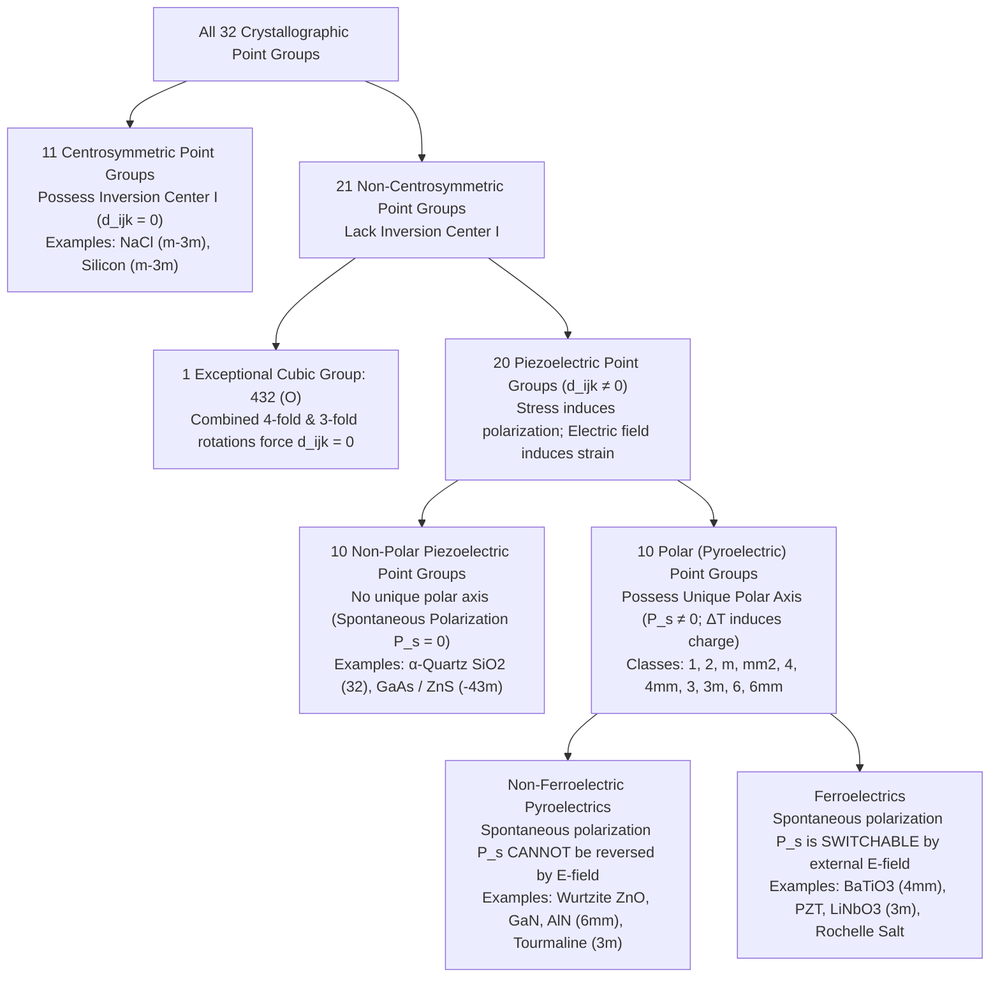
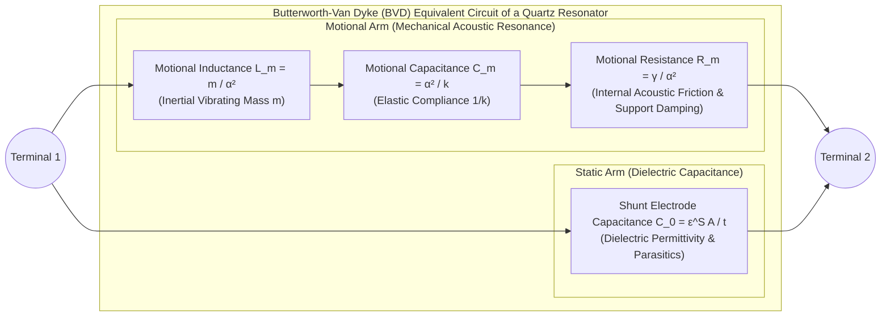

When you twist the knob of a kitchen gas stove and hear a sharp mechanical click, a brilliant blue spark leaps across a gap to ignite the fuel—without a battery, a capacitor bank, or a connection to the electrical grid. Inside the wristwatch on your arm and the smartphone in your pocket, microscopic slabs of crystalline quartz and thin-film aluminum nitride vibrate tens of thousands to billions of times per second with parts-per-billion stability, establishing the temporal heartbeat of digital computing and filtering fifth-generation (5G) radio frequencies. In hospital cardiology and obstetrics wards, a handheld probe pressed against the skin transmits silent ultrasonic pulses and listens to returning echoes to render real-time images of a beating fetal heart. And in the vibration-isolated basements of nanotechnology laboratories, scanning tunneling microscopes (STM) and atomic force microscopes (AFM) trace the electron clouds of individual surface atoms with vertical resolution finer than one-hundredth of an angstrom ($1\,\text{pm} = 10^{-12}\,\text{m}$).

Every one of these technologies is powered by a single, profound physical phenomenon: the <strong>piezoelectric effect</strong>. Coined in 1881 by Wilhelm Gottlieb Hankel from the Greek verb $\pi\iota\epsilon\zeta\epsilon\iota\nu$ (*piezein*, meaning "to press" or "to squeeze"), piezoelectricity is the reversible, linear electromechanical coupling between mechanical stress and dielectric polarization in crystals that lack a center of inversion symmetry.

Why does squeezing a crystal of quartz ($\text{SiO}_2$) or lead zirconate titanate (PZT) generate an electric voltage, whereas squeezing a block of table salt ($\text{NaCl}$), silicon, or ordinary glass produces no electrical signal whatsoever? Conversely, how can applying a few millivolts across a ceramic tube move a metallic needle by a fraction of an atomic nucleus diameter without a trace of mechanical friction or backlash?

The answer lies not merely in chemistry, but in the deep geometry of spatial symmetry breaking. In this comprehensive monograph, we trace the physics and engineering of piezoelectricity from its discovery by Pierre and Jacques Curie and its thermodynamic deduction by Gabriel Lippmann, through the rigorous tensor proof of Neumann's principle and the hierarchy of the 32 crystallographic point groups, to the atomic-scale dipole mechanics of $\alpha$-quartz and perovskite ferroelectrics, the Butterworth-Van Dyke (BVD) equivalent circuit of ultra-high-$Q$ resonators, and the frontier engineering of medical ultrasound and atomic-resolution scanning probe microscopy.

---

## Chapter 1: Historical Discovery and Thermodynamic Necessity — The Curie Brothers and Lippmann's Prediction

### 1.1 1880: Pierre and Jacques Curie Discover the Direct Piezoelectric Effect

Unlike many nineteenth-century discoveries born of serendipity, the discovery of piezoelectricity was the triumph of a deliberate theoretical hypothesis about crystal symmetry. In 1880, twenty-one-year-old <strong>Pierre Curie</strong> and his twenty-four-year-old brother <strong>Jacques Curie</strong> were working in the mineralogy laboratory of the Sorbonne in Paris, investigating <strong>pyroelectricity</strong>—the phenomenon whereby certain crystals, such as tourmaline, develop opposite electric charges on their ends when heated or cooled.

Prevailing theories attributed pyroelectricity to a direct thermal excitation of electricity. The Curie brothers, however, looked closely at the crystallographic symmetry of pyroelectric minerals and hypothesized that the true physical link was mechanical deformation: a change in temperature causes anisotropic thermal expansion of the crystal lattice, which in turn shifts the internal positions of charged ions. If this hypothesis were correct, then applying a mechanical stress directly along an asymmetric crystal axis at constant temperature should induce surface electric charges in a predictable, quantitative manner.

Using tin-foil electrodes, calibrated weights, and a quadrants electrometer invented by Lord Kelvin, Pierre and Jacques Curie tested single crystals of <strong>$\alpha$-quartz ($\text{SiO}_2$)</strong>, <strong>tourmaline</strong>, <strong>topaz</strong>, <strong>calamine (hemimorphite)</strong>, <strong>cane sugar</strong>, <strong>sphalerite ($\text{ZnS}$)</strong>, and <strong>Rochelle salt ($\text{KNaC}_4\text{H}_4\text{O}_6 \cdot 4\text{H}_2\text{O}$)</strong>. Their 1880 paper to the French Academy of Sciences established the fundamental laws of the <strong>direct piezoelectric effect</strong>:

1. Applying compressive stress along specific crystallographic axes generates surface electric charge $Q$ strictly proportional to the applied force $F$.
2. Replacing compression with tension (or releasing the load) reverses the algebraic sign of the induced charge with exact quantitative equality.
3. The effect appears <strong>only in hemihedral crystals lacking a center of symmetry</strong>, and exclusively along axes where the crystal geometry distinguishes one direction from its opposite.

### 1.2 1881: Gabriel Lippmann's Thermodynamic Deduction of the Converse Effect

While the Curie brothers investigated how mechanical stress produces electric charge, physicist <strong>Gabriel Lippmann</strong> asked the inverse question in 1881 from the standpoint of fundamental thermodynamics: if a piezoelectric crystal is placed in an external electric field $\mathbf{E}$, must it mechanically deform?

By applying the first and second laws of thermodynamics to a reversible electromechanical cycle, Lippmann proved mathematically that a <strong>converse piezoelectric effect</strong>—strain induced linearly by an applied electric field—not only must exist, but its proportionality coefficient must be identically equal to the direct piezoelectric coefficient measured by the Curies.

Let us derive Lippmann's result rigorously using modern tensor thermodynamics. Consider a homogeneous unit volume of a dielectric crystal subjected to a mechanical stress tensor $T_{jk}$ (in $\text{N/m}^2$ or $\text{Pa}$), a mechanical strain tensor $S_{jk}$ (dimensionless), an electric field vector $E_i$ (in $\text{V/m}$), and an electric displacement (flux density) vector $D_i = \varepsilon_0 E_i + P_i$ (in $\text{C/m}^2$), at absolute temperature $\Theta$ and entropy density $s$. By conservation of energy, the differential of the internal energy density $U(s, S_{jk}, D_i)$ in a reversible process is the sum of thermal, elastic, and electrical work (employing the Einstein summation convention over repeated indices $i, j, k \in \{1, 2, 3\}$):

$$dU = \Theta\,ds + T_{jk}\,dS_{jk} + E_i\,dD_i$$

In experimental physics and engineering, the natural independent variables controlled at the boundaries of a crystal are temperature $\Theta$, stress $T_{jk}$, and electric field $E_i$ (controlled via applied voltage). We therefore perform a Legendre transformation to define the <strong>elastic-electric Gibbs free energy density</strong> (also termed the electrical enthalpy) $G(\Theta, T_{jk}, E_i)$:

$$G(\Theta, T_{jk}, E_i) = U - \Theta s - T_{jk} S_{jk} - E_i D_i$$

Taking the total differential of $G$ and substituting $dU$ yields:

$$dG = -s\,d\Theta - S_{jk}\,dT_{jk} - D_i\,dE_i$$

Under isothermal conditions ($d\Theta = 0$), the strain $S_{jk}$ and electric displacement $D_i$ are obtained as first partial derivatives of the thermodynamic state function $G$:

$$S_{jk} = -\left(\frac{\partial G}{\partial T_{jk}}\right)_{\mathbf{E}, \Theta}, \qquad D_i = -\left(\frac{\partial G}{\partial E_i}\right)_{\mathbf{T}, \Theta}$$

Because $G(\Theta, T_{jk}, E_i)$ is an exact differential (a single-valued state function of the crystal), Schwarz's theorem dictates that the mixed second partial derivatives must commute:

$$-\frac{\partial^2 G}{\partial E_i \partial T_{jk}} = -\frac{\partial^2 G}{\partial T_{jk} \partial E_i}$$

Substituting the first derivatives into this identity immediately yields the fundamental <strong>thermodynamic Maxwell relation for piezoelectricity</strong>:

$$d_{ijk} \equiv \left(\frac{\partial D_i}{\partial T_{jk}}\right)_{\mathbf{E}, \Theta} = \left(\frac{\partial S_{jk}}{\partial E_i}\right)_{\mathbf{T}, \Theta}$$

This equation is a cornerstone of solid-state physics. The left-hand side, $(\partial D_i / \partial T_{jk})_{\mathbf{E}}$, defines the <strong>direct piezoelectric charge coefficient</strong> measured at constant electric field (short-circuit electrodes), with SI units of coulombs per newton ($\text{C/N}$). The right-hand side, $(\partial S_{jk} / \partial E_i)_{\mathbf{T}}$, defines the <strong>converse piezoelectric strain coefficient</strong> measured at constant stress (mechanically free crystal), with SI units of meters per volt ($\text{m/V}$). Dimensional analysis confirms their exact equivalence:

$$\frac{\text{C}}{\text{N}} = \frac{\text{C}}{\text{J}/\text{m}} = \frac{\text{C}\cdot\text{m}}{\text{V}\cdot\text{C}} = \frac{\text{m}}{\text{V}}$$

Thus, a crystal with a direct piezoelectric coefficient of $d_{11} = 2.31\,\text{pC/N}$ (such as $\alpha$-quartz) is thermodynamically guaranteed to expand or contract by exactly $2.31\,\text{pm}$ ($2.31 \times 10^{-12}\,\text{m}$) per applied volt!

Within months of Lippmann's publication, Pierre and Jacques Curie experimentally verified the converse effect by applying high voltage to a long quartz plate and measuring its microscopic elongation with an optical lever microscope. They immediately harnessed both effects to build the <strong>piezoelectric quartz electrometer</strong>, in which an unknown ionization current was balanced against the precise charge generated by hanging calibrated weights from a quartz lamina—the very instrument that enabled Marie and Pierre Curie in 1898 to measure the minuscule radioactivity of pitchblende fractions and isolate polonium and radium.

---

## Chapter 2: Tensor Constitutive Equations and Neumann's Principle — Why Centrosymmetric Crystals Cannot Be Piezoelectric

### 2.1 Coupled Linear Constitutive Equations and IEEE Voigt Notation

Expanding the Gibbs free energy density $G(\Theta, T_{jk}, E_i)$ in a Taylor series around the unstressed, field-free equilibrium state ($T_{jk} = 0, E_i = 0$) up to quadratic terms at constant temperature gives:

$$G(T_{jk}, E_i) = -\frac{1}{2} s_{jklm}^E T_{jk} T_{lm} - d_{ijk} E_i T_{jk} - \frac{1}{2} \varepsilon_{ij}^T E_i E_j$$

Differentiating $G$ with respect to $-E_i$ and $-T_{jk}$ yields the coupled linear <strong>piezoelectric constitutive equations</strong> (in tensor form):

$$\begin{aligned}
D_i &= d_{ijk} T_{jk} + \varepsilon_{ij}^T E_j \\
S_{jk} &= s_{jklm}^E T_{lm} + d_{ijk} E_i
\end{aligned}$$

Here:
* $\varepsilon_{ij}^T = \left(\partial D_i / \partial E_j\right)_{\mathbf{T}}$ is the second-rank <strong>permittivity tensor at constant (free) stress</strong> ($\text{F/m}$),
* $s_{jklm}^E = \left(\partial S_{jk} / \partial T_{lm}\right)_{\mathbf{E}}$ is the fourth-rank <strong>elastic compliance tensor at constant electric field</strong> ($\text{m}^2/\text{N} = \text{Pa}^{-1}$), and
* $d_{ijk}$ is the third-rank <strong>piezoelectric tensor</strong> ($\text{C/N}$ or $\text{m/V}$).

In three-dimensional space, a general third-rank tensor $d_{ijk}$ possesses $3^3 = 27$ components. However, mechanical rotational equilibrium requires the stress tensor to be symmetric ($T_{jk} = T_{kj}$), and the definition of infinitesimal strain $S_{jk} = \frac{1}{2}(\partial u_j/\partial x_k + \partial u_k/\partial x_j)$ is likewise symmetric ($S_{jk} = S_{kj}$). Consequently, $d_{ijk}$ is intrinsically symmetric under exchange of its last two indices:

$$d_{ijk} = d_{ikj}$$

This reduces the maximum number of independent components of $d_{ijk}$ in the lowest-symmetry crystal (triclinic point group $1$) from $27$ to $3 \times 6 = 18$. To avoid cumbersome multi-index notation, the <strong>IEEE Standard on Piezoelectricity</strong> adopts <strong>Voigt matrix notation</strong>, mapping each symmetric pair of Cartesian indices $(jk)$ onto a single matrix index $m \in \{1, 2, 3, 4, 5, 6\}$:

$$(11) \to 1, \quad (22) \to 2, \quad (33) \to 3, \quad (23, 32) \to 4, \quad (13, 31) \to 5, \quad (12, 21) \to 6$$

Indices $1, 2, 3$ represent normal tensile or compressive stresses and strains along the orthogonal axes $X, Y, Z$, while indices $4, 5, 6$ represent shear stresses and strains about the $X, Y, Z$ axes, respectively. Defining the engineering shear strains as $S_m = 2S_{jk}$ and the corresponding shear piezoelectric moduli as $d_{im} = 2d_{ijk}$ for $m = 4, 5, 6$ allows the constitutive equations to be written compactly in matrix form ($i, j \in \{1,2,3\}$; $m, n \in \{1,\dots,6\}$):

$$D_i = d_{im} T_m + \varepsilon_{ij}^T E_j, \qquad S_m = s_{mn}^E T_n + d_{jm} E_j$$

Or explicitly as partitioned matrix equations:

$$\begin{pmatrix} D_1 \\ D_2 \\ D_3 \end{pmatrix} = \begin{pmatrix} d_{11} & d_{12} & d_{13} & d_{14} & d_{15} & d_{16} \\ d_{21} & d_{22} & d_{23} & d_{24} & d_{25} & d_{26} \\ d_{31} & d_{32} & d_{33} & d_{34} & d_{35} & d_{36} \end{pmatrix} \begin{pmatrix} T_1 \\ T_2 \\ T_3 \\ T_4 \\ T_5 \\ T_6 \end{pmatrix} + \begin{pmatrix} \varepsilon_{11}^T & \varepsilon_{12}^T & \varepsilon_{13}^T \\ \varepsilon_{21}^T & \varepsilon_{22}^T & \varepsilon_{23}^T \\ \varepsilon_{31}^T & \varepsilon_{32}^T & \varepsilon_{33}^T \end{pmatrix} \begin{pmatrix} E_1 \\ E_2 \\ E_3 \end{pmatrix}$$

Depending on which mechanical and electrical boundary conditions are held constant, four equivalent sets of piezoelectric constitutive relations are employed in device physics:
1. <strong>Strain-Charge ($d$-form)</strong>: $D = d T + \varepsilon^T E$, $S = s^E T + d^t E$ (used for free actuators and charge amplifiers).
2. <strong>Stress-Charge ($e$-form)</strong>: $D = e S + \varepsilon^S E$, $T = c^E S - e^t E$, where $c^E = (s^E)^{-1}$ is the elastic stiffness tensor and $e_{im} = d_{in} c_{nm}^E$ (ideal for acoustic wave propagation in thin-film BAW resonators).
3. <strong>Strain-Voltage ($g$-form)</strong>: $E = -g T + (\varepsilon^T)^{-1} D$, $S = s^D T + g^t D$, where $g_{im} = d_{im}/\varepsilon^T$ is the <strong>piezoelectric voltage constant</strong> (crucial for open-circuit voltage generation in gas igniters and hydrophones).
4. <strong>Stress-Voltage ($h$-form)</strong>: $E = -h S + (\varepsilon^S)^{-1} D$, $T = c^D S - h^t D$.

The efficiency of energy conversion between the mechanical and electrical domains in a given mode is governed by the dimensionless <strong>electromechanical coupling factor $k$</strong>:

$$k^2 = \frac{d^2}{\varepsilon^T s^E} = \frac{\text{Converted mechanical (or electrical) energy}}{\text{Total input electrical (or mechanical) energy}}$$

Because of this coupling, the elastic stiffness under open-circuit electrical conditions ($D = 0$) is higher than under short-circuit conditions ($E = 0$): $c^D = c^E / (1 - k^2)$—a phenomenon known as <strong>piezoelectric stiffening</strong>.

### 2.2 Rigorous Proof via Neumann's Principle: Why Inversion Symmetry Forbids Piezoelectricity

Why do most common crystals (such as $\text{NaCl}$, diamond, silicon, copper, or iron) exhibit zero piezoelectricity? The answer follows from <strong>Neumann's Principle</strong> (formulated by Franz Ernst Neumann in 1885), the foundational axiom of crystal physics:

> <strong>Neumann's Principle</strong>: The symmetry elements of any macroscopic physical property of a crystal must include all the symmetry elements of the crystallographic point group to which the crystal belongs. Equivalently, any physical property tensor must remain strictly invariant under every coordinate transformation $a_{ij}$ that belongs to the crystal's point group.

Suppose a crystal possesses a <strong>center of inversion symmetry (centrosymmetry)</strong>, denoted by the inversion operator $\mathcal{I}$. Spatial inversion maps every position vector $\mathbf{r} = (x_1, x_2, x_3)$ to its opposite $-\mathbf{r} = (-x_1, -x_2, -x_3)$. In terms of an orthogonal coordinate transformation matrix $a_{ij}$, spatial inversion is represented by the negative identity matrix:

$$x'_i = a_{ij} x_j, \qquad a_{ij} = -\delta_{ij} = \begin{pmatrix} -1 & 0 & 0 \\ 0 & -1 & 0 \\ 0 & 0 & -1 \end{pmatrix}$$

Let us examine how each physical tensor in the piezoelectric constitutive relation transforms under spatial inversion $\mathcal{I}$:

1. <strong>Transformation of Polarization $P_i$ and Electric Displacement $D_i$ (First-Rank Polar Vectors)</strong>:
   An electric dipole vector points from negative to positive charge. Under spatial inversion $\mathbf{r} \to -\mathbf{r}$, the direction of every vector reverses:
   $$D'_i = a_{ip} D_p = (-\delta_{ip}) D_p = -D_i$$
2. <strong>Transformation of Mechanical Stress $T_{jk}$ and Strain $S_{jk}$ (Second-Rank Polar Tensors)</strong>:
   A uniaxial compressive stress consists of two equal and opposite forces pushing inward from $+x$ and $-x$. Inverting space swaps the two opposing forces, leaving the state of compression completely unchanged! Mathematically, a second-rank polar tensor transforms with two factors of $a_{ij}$:
   $$T'_{jk} = a_{jq} a_{kr} T_{qr} = (-\delta_{jq})(-\delta_{kr}) T_{qr} = (-1)^2 T_{jk} = +T_{jk}$$
3. <strong>Transformation of the Third-Rank Piezoelectric Tensor $d_{ijk}$</strong>:
   Because $d_{ijk}$ couples a first-rank odd vector $D_i$ to a second-rank even tensor $T_{jk}$, it is a <strong>third-rank polar tensor</strong>. Under any orthogonal coordinate transformation $a_{ij}$, a third-rank polar tensor transforms according to:
   $$d'_{ijk} = a_{ip} a_{jq} a_{kr} d_{pqr}$$
   Substituting the inversion matrix $a_{ij} = -\delta_{ij}$ gives:
   $$d'_{ijk} = (-\delta_{ip})(-\delta_{jq})(-\delta_{kr}) d_{pqr} = (-1)^3 d_{ijk} = -d_{ijk}$$
   Now apply <strong>Neumann's Principle</strong>: if the crystal lattice is centrosymmetric (invariant under $\mathcal{I}$), then the transformed material property tensor $d'_{ijk}$ must be identical to the original tensor $d_{ijk}$:
   $$d'_{ijk} = d_{ijk}$$
   Combining these two requirements forces every single component of the tensor to satisfy:
   $$d_{ijk} = -d_{ijk} \quad \Longrightarrow \quad 2 d_{ijk} = 0 \quad \Longrightarrow \quad d_{ijk} \equiv 0 \quad (\forall i, j, k \in \{1, 2, 3\})$$

This completes the rigorous mathematical proof: <strong>any crystal possessing a center of inversion symmetry cannot exhibit a linear piezoelectric effect</strong> (in fact, *every* odd-rank polar tensor—including first-rank pyroelectric vectors $p_i$ and third-rank Pockels electro-optic tensors $r_{ijk}$—vanishes identically in centrosymmetric media).

### 2.3 Contrast with Electrostriction and Triboelectricity

To prevent common conceptual confusions, we must distinguish piezoelectricity from two related electromechanical phenomena: <strong>electrostriction</strong> and <strong>triboelectricity</strong>.

#### (1) Piezoelectricity vs. Electrostriction
If we carry the expansion of strain $S_{ij}$ in powers of the electric field $E_k$ to second order, we obtain:

$$S_{ij} = d_{kij} E_k + M_{ijkl} E_k E_l$$

The quadratic term $S_{ij}^{\text{elec}} = M_{ijkl} E_k E_l$ (or in terms of polarization, $S_{ij}^{\text{elec}} = Q_{ijkl} P_k P_l$) is <strong>electrostriction</strong>. Because the electrostrictive tensor $M_{ijkl}$ is a <strong>fourth-rank polar tensor (an even-rank tensor)</strong>, under spatial inversion $\mathcal{I}$ ($a_{ij} = -\delta_{ij}$) it transforms as:

$$M'_{ijkl} = a_{ip} a_{jq} a_{kr} a_{ls} M_{pqrs} = (-1)^4 M_{ijkl} = +M_{ijkl}$$

Thus, $M'_{ijkl} = M_{ijkl}$ is satisfied automatically in *all* point groups! Unlike piezoelectricity, <strong>electrostriction occurs universally in all dielectrics</strong>—including centrosymmetric crystals ($\text{NaCl}$, $\text{Si}$), amorphous glasses, polymers, and liquids. However, electrostriction differs fundamentally from piezoelectricity in three ways:
1. <strong>Quadratic (Even) Field Dependence</strong>: Because $S \propto E^2$, reversing the polarity of the applied electric field ($E \to -E$) does *not* reverse the sign of the strain; an electrostrictive material elongates (or contracts) in the same direction regardless of field polarity, and when driven by an AC field at frequency $\omega$, it vibrates at the doubled frequency $2\omega$.
2. <strong>Absence of a Direct Effect</strong>: While an electric field produces strain ($S = M E^2$), applying mechanical stress $T$ to an unbiased electrostrictive material ($E = 0$) produces zero electric polarization ($\partial S / \partial E|_{E=0} = 2 M E|_{E=0} = 0$).
3. <strong>Magnitude</strong>: In ordinary dielectrics electrostriction is minuscule, though in high-permittivity relaxor ferroelectrics such as lead magnesium niobate ($\text{Pb(Mg}_{1/3}\text{Nb}_{2/3}\text{)O}_3$, PMN) it reaches strains comparable to PZT with near-zero hysteresis.

#### (2) Piezoelectricity vs. Triboelectricity (Contact Electrification)
When two materials rub or touch and separate—such as walking across a wool carpet or rubbing amber with fur—high voltages arise via the <strong>triboelectric effect</strong> (static electricity). Although both phenomena convert mechanical action into electricity, their physical mechanisms are entirely distinct:

| Physical Attribute | Piezoelectric Effect | Electrostriction | Triboelectric Effect (Static Electricity) |
| :--- | :--- | :--- | :--- |
| <strong>Microscopic Origin</strong> | Reversible elastic displacement of cationic and anionic sublattices within the <strong>bulk crystal unit cell</strong> | Quadratic elastic deformation of the <strong>bulk lattice</strong> driven by electrostatic polarization forces | Interfacial transfer of <strong>electrons, ions, or material fragments</strong> across contacting surfaces due to work-function differences |
| <strong>Spatial Region</strong> | Uniform throughout the entire <strong>3D crystal volume (bulk property)</strong> | Uniform throughout the entire <strong>3D dielectric volume (bulk property)</strong> | Strictly confined to the <strong>2D contact surface / interface</strong> (top few nanometers) |
| <strong>Symmetry Requirement</strong> | Restricted to the <strong>20 non-centrosymmetric piezoelectric point groups</strong> (and poled ferroelectrics) | <strong>None</strong> (present in all crystalline, amorphous, liquid, and gaseous dielectrics) | <strong>None</strong> (occurs between any dissimilar or even identical insulator/metal surfaces) |
| <strong>Mathematical Scaling</strong> | <strong>Linear (first-order)</strong>: $D_i = d_{ijk} T_{jk}$ and $S_{jk} = d_{ijk} E_i$ (sign-reversible) | <strong>Quadratic (second-order)</strong>: $S_{ij} = M_{ijkl} E_k E_l$ (no sign reversal under $E \to -E$) | <strong>Nonlinear, stochastic, and history-dependent</strong> (sensitive to humidity, roughness, and surface adsorbates) |
| <strong>Thermodynamic Reversibility</strong> | <strong>Strictly reversible</strong> (Direct effect $\Longleftrightarrow$ Converse effect via Maxwell relation) | <strong>One-way coupling</strong> at $E=0$ (stress alone does not generate polarization) | <strong>Irreversible and dissipative</strong> (applying voltage does not reverse friction) |

---

## Chapter 3: The Hierarchy of the 32 Crystallographic Point Groups — Piezoelectrics, Pyroelectrics, and Ferroelectrics

In three-dimensional crystallography, the compatible combinations of rotational axes ($1, 2, 3, 4, 6$), mirror planes ($m$), and rotoinversion axes ($\bar{1}, \bar{2}\equiv m, \bar{3}, \bar{4}, \bar{6}$) yield exactly <strong>32 crystallographic point groups</strong> (crystal classes). Applying Neumann's principle to these 32 classes establishes a rigorous hierarchical classification of dielectric crystals.

### 3.1 From 32 Point Groups to 20 Piezoelectric Classes: The Cubic $432$ ($O$) Exception

Of the 32 point groups, <strong>11 groups are centrosymmetric</strong> (triclinic $\bar{1}$; monoclinic $2/m$; orthorhombic $mmm$; tetragonal $4/m, 4/mmm$; trigonal $\bar{3}, \bar{3}m$; hexagonal $6/m, 6/mmm$; cubic $m\bar{3}, m\bar{3}m$). By the proof in Section 2.2, all 11 have $d_{ijk} \equiv 0$.

The remaining <strong>21 point groups are non-centrosymmetric</strong>. Remarkably, however, only <strong>20 of these 21 groups are piezoelectric</strong>. The single exception is the chiral cubic <strong>point group $432$ (Schoenflies symbol $O$)</strong>, which lacks a center of inversion and lacks mirror planes, yet still has $d_{ijk} \equiv 0$ for every component!

Why does $d_{ijk}$ vanish in point group $432$? Group $432$ contains three mutually perpendicular fourfold ($90^\circ$) rotation axes along $X_1, X_2, X_3$ and four threefold ($120^\circ$) rotation axes along the cube body diagonals $\langle 111 \rangle$:
1. Applying the twofold ($180^\circ$) rotations about $X_1, X_2, X_3$ (which send two coordinates to their negatives while preserving the third) eliminates all components of $d_{ijk}$ except those where all three indices are distinct: $d_{123} = \frac{1}{2}d_{14}$, $d_{231} = \frac{1}{2}d_{25}$, and $d_{312} = \frac{1}{2}d_{36}$.
2. Applying the threefold ($120^\circ$) cyclic permutation $1 \to 2 \to 3 \to 1$ along the body diagonal requires these three shear components to be equal: $d_{123} = d_{231} = d_{312}$ (or $d_{14} = d_{25} = d_{36}$). In tetrahedral cubic groups $23$ and $\bar{4}3m$ (such as $\text{GaAs}$ and $\text{ZnS}$), no further independent constraint exists, so $d_{14}$ survives as the sole piezoelectric constant.
3. Point group $432$, however, possesses an additional <strong>fourfold ($90^\circ$) rotation about the $X_3$ axis</strong>, which transforms the coordinates as $x'_1 = x_2,\; x'_2 = -x_1,\; x'_3 = x_3$. Under this $90^\circ$ rotation, $d_{312}$ transforms as:
   $$d'_{312} = a_{3p} a_{1q} a_{2r} d_{pqr} = (1)(1)(-1) d_{321} = -d_{321}$$
   Because stress is symmetric ($T_{12} = T_{21}$), we have $d_{321} = d_{312}$. Neumann's principle requires $d'_{312} = d_{312}$, so $d_{312} = -d_{312} \implies d_{312} = 0$, annihilating the last surviving component!

Thus, exactly $32 - 11 - 1 = \mathbf{20}$ crystallographic point groups permit piezoelectricity.

### 3.2 The 10 Polar (Pyroelectric) Classes and Ferroelectric Switching

Among the 20 piezoelectric point groups, a further symmetry division occurs based on whether the crystal can sustain a non-zero <strong>spontaneous polarization vector $\mathbf{P}_s$</strong> in the absence of external stress or electric field:

* <strong>10 Non-Polar Piezoelectric Point Groups</strong> ($222, \bar{4}, \bar{4}2m, 32, \bar{6}, \bar{6}m2, 622, 23, \bar{4}3m$):
  These groups possess multiple intersecting symmetry axes that leave no single spatial direction invariant. Consequently, a first-rank vector must vanish ($\mathbf{P}_s = \mathbf{0}$) at zero stress. Dipole polarization appears *only* when mechanical stress breaks the balance between symmetry-equivalent axes (e.g., $\alpha$-quartz in group $32$, or $\text{GaAs}$ in group $\bar{4}3m$).
* <strong>10 Polar (Pyroelectric) Point Groups</strong> ($1, 2, m, mm2, 4, 4mm, 3, 3m, 6, 6mm$):
  Each of these 10 classes possesses a <strong>unique polar axis</strong> that is not duplicated or inverted by any symmetry operation of the group. Therefore, crystals in these 10 classes exhibit a permanent <strong>spontaneous polarization $\mathbf{P}_s \neq \mathbf{0}$</strong> even at zero applied stress. Because $|\mathbf{P}_s(\Theta)|$ varies with temperature $\Theta$, heating or cooling the crystal generates an uncompensated surface charge $\Delta D_i = p_i \Delta \Theta$, where $p_i = \partial P_{s,i}/\partial \Theta$ is the <strong>pyroelectric coefficient</strong> (used in passive infrared motion detectors and thermal imaging cameras).
* <strong>Ferroelectrics (A Switchable Subset of Pyroelectrics)</strong>:
  Every ferroelectric crystal must belong to one of the 10 polar (pyroelectric) point groups. However, not every pyroelectric crystal is ferroelectric. In wurtzite crystals such as $\text{ZnO}$, $\text{AlN}$, and $\text{GaN}$ (point group $6mm$), the covalent tetrahedral network is locked in place up to the melting point; applying an external electric field opposing $\mathbf{P}_s$ causes dielectric breakdown before the crystal lattice can invert. A <strong>ferroelectric</strong> is a polar crystal positioned close to a high-symmetry paraelectric phase transition, such that an external electric field exceeding the <strong>coercive field $E_c$</strong> can reversibly switch the direction of $\mathbf{P}_s$ between two or more symmetry-equivalent energy minima, tracing out a characteristic $P\text{–}E$ hysteresis loop.

---

## Chapter 4: Microscopic Crystal Structures and Dipole Mechanisms — $\alpha$-Quartz vs. Perovskite Ferroelectrics ($\text{BaTiO}_3$, PZT)

### 4.1 $\alpha$-Quartz ($\text{SiO}_2$): Trigonal Point Group $32$ and Tetrahedral Network Distortion

Single-crystal quartz ($\text{SiO}_2$) is the archetype of a non-polar piezoelectric crystal. Above $573\,^\circ\text{C}$ at atmospheric pressure, quartz crystallizes in the hexagonal <strong>$\beta$-quartz</strong> structure (point group $622$). Upon cooling below the $573\,^\circ\text{C}$ transition temperature, the corner-sharing $\text{SiO}_4$ tetrahedra undergo a cooperative tilt, lowering the symmetry to trigonal <strong>$\alpha$-quartz</strong> in <strong>point group $32$</strong> (chiral space groups $P3_121$ for right-handed quartz and $P3_221$ for left-handed quartz).

The orthogonal crystallographic reference frame $(X, Y, Z)$ of $\alpha$-quartz is defined by:
* <strong>The $Z$-axis (Optical Axis, $c$-axis)</strong>: The threefold helical screw axis along which $\text{SiO}_4$ tetrahedra spiral. Because of the threefold rotational symmetry combined with perpendicular twofold axes, pressing along the $Z$-axis produces zero net polarization ($d_{3m} = 0$).
* <strong>The $X$-axes (Electrical Axes, $a_1, a_2, a_3$)</strong>: Three twofold rotation axes lying in the plane perpendicular to $Z$, separated by $120^\circ$ and passing through the corners of the hexagonal prism.
* <strong>The $Y$-axes (Mechanical Axes)</strong>: Three axes lying in the $XY$-plane perpendicular to the prism faces (orthogonal to $X$ and $Z$).

Applying the symmetry operations of point group $32$ (a threefold rotation about $Z$ and a twofold rotation about $X$) reduces the $3 \times 6$ piezoelectric matrix of $\alpha$-quartz to just <strong>two independent non-zero moduli ($d_{11}$ and $d_{14}$)</strong>:

$$\mathbf{d}_{\text{Quartz (32)}} = \begin{pmatrix} d_{11} & -d_{11} & 0 & d_{14} & 0 & 0 \\ 0 & 0 & 0 & 0 & -d_{14} & -2d_{11} \\ 0 & 0 & 0 & 0 & 0 & 0 \end{pmatrix}$$

For right-handed $\alpha$-quartz at room temperature, $d_{11} = +2.31\,\text{pC/N}$ and $d_{14} = -0.727\,\text{pC/N}$.

Microscopically, we can visualize the projected unit cell in the $XY$-plane as an alternating hexagonal ring of three $\text{Si}^{4+}$ cations and three $\text{O}^{2-}$ anion pairs arranged at $120^\circ$ intervals:
1. <strong>Unstressed Equilibrium</strong>: The center of gravity of the three positive $\text{Si}^{4+}$ charges coincides exactly with the center of gravity of the three negative $\text{O}^{2-}$ charge pairs at the center of the ring ($\mathbf{P} = \mathbf{0}$).
2. <strong>Longitudinal Effect ($D_1 = d_{11} T_1$)</strong>: When a compressive stress $T_1$ is applied along the electrical $X$-axis, the $\text{Si}^{4+}$ and $\text{O}^{2-}$ ions lying on the $X$-axis are pushed inward while the remaining tetrahedral bonds splay outward, shifting the positive charge centroid toward one $X$-face and the negative charge centroid toward the opposite $X$-face.
3. <strong>Transverse Effect ($D_1 = d_{12} T_2 = -d_{11} T_2$)</strong>: When a compressive stress $T_2$ is applied along the mechanical $Y$-axis, the hexagonal ring elongates along $X$, shifting the positive and negative charge centroids along $X$ in the exact opposite sense to longitudinal compression! Thus, tension along $Y$ produces the same polarity of charge on the $X$-electrodes as compression along $X$.
4. <strong>Thickness-Shear Coupling ($S_6 = d_{26} E_2 = -2d_{11} E_2$)</strong>: Applying an electric field $E_2$ along the $Y$-axis drives an in-plane shear strain $S_6$, the fundamental mechanism exploited in Y-cut and AT-cut quartz shear resonators.

### 4.2 Perovskite Ferroelectrics ($\text{BaTiO}_3$ and PZT): $B$-Site Off-Centering, Poling, and the Morphotropic Phase Boundary (MPB)

While $\alpha$-quartz excels in mechanical stability, its piezoelectric coefficient ($d_{11} = 2.31\,\text{pC/N}$) and coupling factor ($k \approx 0.10$) are small because the rigid covalent $\text{SiO}_4$ framework resists distortion. Massive piezoelectric responses—hundreds of times larger than quartz—are achieved in <strong>$\text{ABO}_3$ perovskite oxide ferroelectrics</strong>, notably <strong>barium titanate ($\text{BaTiO}_3$)</strong> and <strong>lead zirconate titanate ($\text{Pb(Zr}_x\text{Ti}_{1-x}\text{)O}_3$, PZT)</strong>.

In the ideal perovskite unit cell, large divalent $A^{2+}$ cations ($\text{Ba}^{2+}$ or $\text{Pb}^{2+}$) occupy the cube corners, oxygen anions $\text{O}^{2-}$ occupy the six face centers forming a corner-sharing $\text{BO}_6$ octahedron, and a small tetravalent transition-metal cation $B^{4+}$ ($\text{Ti}^{4+}$ or $\text{Zr}^{4+}$) sits at the center of the oxygen octahedron.

* <strong>Above the Curie Temperature $T_C$ ($120\,^\circ\text{C}$ for $\text{BaTiO}_3$; $\sim 350\,^\circ\text{C}$ for PZT)</strong>:
  Thermal agitation keeps the time-averaged position of the $\text{Ti}^{4+}$ ion at the exact geometric center of the $\text{O}_6$ octahedron. The crystal belongs to the <strong>centrosymmetric cubic point group $m\bar{3}m$</strong>, which is paraelectric and strictly non-piezoelectric ($d_{ijk} = 0$).
* <strong>Below the Curie Temperature $T_C$ (Displacive Ferroelectric Phase Transition)</strong>:
  Hybridization between the empty $\text{Ti } 3d$ orbitals and the filled $\text{O } 2p$ orbitals (a second-order Jahn-Teller effect, enhanced in PZT by the stereochemically active $6s^2$ lone-pair electrons of $\text{Pb}^{2+}$) softens a transverse optical phonon mode. At $\Theta < T_C$, the $B^{4+}$ cation shifts off-center by $\sim 0.1\,\text{\AA}$ toward an adjacent oxygen ion, elongating the cubic cell into a <strong>polar tetragonal structure (point group $4mm$)</strong> or rhombohedral structure (point group $3m$) with a huge spontaneous polarization $P_s \sim 0.26\text{–}0.50\,\text{C/m}^2$.

#### The Physics of Ceramic Poling (Symmetry Breaking to $\infty m$)
When a perovskite ceramic is synthesized by sintering powder grains, the resulting polycrystalline body contains millions of randomly oriented crystallites, each subdivided into $180^\circ$ and $90^\circ$ <strong>ferroelectric domains</strong> whose polarization vectors cancel out macroscopically. Thus, an <strong>as-sintered ferroelectric ceramic is macroscopically isotropic (symmetry group $\infty\infty m$, possessing an inversion center) and exhibits zero net piezoelectricity</strong>.

To activate piezoelectricity, the ceramic is subjected to <strong>poling</strong>: heating it near $T_C$ and applying a strong DC electric field ($E_{\text{pole}} \sim 2\text{–}4\,\text{kV/mm} > E_c$) along the $Z$ ($3$) axis. Domain walls sweep through the grains, aligning the spontaneous polarization vectors into the field-favored orientation. After cooling and removing the field, a large remanent polarization $\mathbf{P}_r$ remains locked in along the $3$-axis. This poling process breaks the macroscopic symmetry from $\infty\infty m$ down to the <strong>polar Curie limit group $\infty m$ ($C_{\infty v}$)</strong>—which has the exact same piezoelectric tensor matrix as hexagonal point group $6mm$, characterized by three independent moduli ($d_{33}, d_{31}, d_{15}$):

$$\mathbf{d}_{\text{Poled Ceramic }(\infty m / 6mm)} = \begin{pmatrix} 0 & 0 & 0 & 0 & d_{15} & 0 \\ 0 & 0 & 0 & d_{15} & 0 & 0 \\ d_{31} & d_{31} & d_{33} & 0 & 0 & 0 \end{pmatrix}$$

#### The Morphotropic Phase Boundary (MPB) in PZT at $x \approx 0.52$
Why does $\text{Pb(Zr}_x\text{Ti}_{1-x}\text{)O}_3$ (PZT) exhibit giant piezoelectric coefficients ($d_{33} \approx 300\text{–}600\,\text{pC/N}$, and over $2000\,\text{pC/N}$ in relaxor single crystals like PMN-PT) precisely when the zirconium-to-titanium ratio is near $x \approx 0.52$ ($\text{PbZr}_{0.52}\text{Ti}_{0.48}\text{O}_3$)?

In the PZT phase diagram, Ti-rich compositions ($x < 0.52$) adopt a <strong>tetragonal ($4mm$)</strong> structure with <strong>6 equivalent $\langle 100 \rangle$ polarization directions</strong>, whereas Zr-rich compositions ($x > 0.52$) adopt a <strong>rhombohedral ($3m$)</strong> structure with <strong>8 equivalent $\langle 111 \rangle$ polarization directions</strong>. At $x \approx 0.52$, an almost temperature-independent structural boundary—the <strong>Morphotropic Phase Boundary (MPB)</strong>—separates these two ferroelectric phases:
1. <strong>Degeneracy of 14 Domain States</strong>: Coexistence of the 6 tetragonal and 8 rhombohedral directions provides 14 nearly degenerate orientations, enabling exceptionally efficient domain alignment during poling.
2. <strong>Monoclinic Bridge Phase and Polarization Rotation</strong>: High-resolution synchrotron X-ray diffraction (Noheda et al., 1999) revealed an intermediate <strong>monoclinic phase (point group $m$)</strong> at the MPB whose mirror plane bridges the $\langle 100 \rangle$ and $\langle 111 \rangle$ axes. Because the Landau-Devonshire free energy surface becomes extraordinarily flat along this monoclinic pathway, an applied electric field effortlessly tilts the polarization vector (<strong>polarization rotation</strong>) rather than merely stretching the bond length, generating giant lattice shear and longitudinal strains.

---

## Chapter 5: Physics of Resonance and Quartz Crystal Oscillators — The Butterworth-Van Dyke (BVD) Equivalent Circuit

### 5.1 Electromechanical Wave Resonance and the BVD Model

When an alternating voltage $V(\omega) = V_0 e^{j\omega t}$ is applied across the electrodes of a piezoelectric plate of thickness $t$ and area $A$, the converse piezoelectric effect launches an acoustic wave into the crystal. At arbitrary frequencies, the plate behaves merely as a parallel-plate capacitor with <strong>static (clamped) capacitance</strong> $C_0 = \varepsilon^S A / t$.

However, when the driving frequency $f = \omega / 2\pi$ approaches an acoustic standing-wave eigenfrequency of the plate—where the thickness $t$ equals an odd integer multiple of the acoustic half-wavelength ($t = n \frac{\lambda}{2} = n \frac{v_a}{2f}$, with acoustic velocity $v_a = \sqrt{c^D / \rho}$)—resonant mechanical vibrations build up to large amplitudes. By the direct piezoelectric effect, this oscillating strain generates a powerful <strong>motional current $I_m$</strong> in phase with the mechanical velocity.

Mapping the 1D damped harmonic oscillator equation of the fundamental acoustic mode ($m \ddot{x} + \gamma \dot{x} + k x = \alpha V$, with motional current $I_m = \alpha \dot{x}$) into the electrical domain yields the celebrated <strong>Butterworth-Van Dyke (BVD) equivalent circuit</strong>:

In a typical $10\,\text{MHz}$ fundamental AT-cut quartz resonator:
* <strong>Motional Inductance $L_m$</strong> represents the vibrating inertial mass of the quartz plate ($L_m \approx 10\text{–}50\,\text{mH}$; in $32.768\,\text{kHz}$ tuning forks, $L_m \approx 4,000\text{–}7,000\,\text{H}$, an inductance impossible to build with copper wire!).
* <strong>Motional Capacitance $C_m$</strong> represents the mechanical elasticity (compliance) coupled via $d_{ij}$ ($C_m \approx 10\text{–}25\,\text{fF} = 10^{-14}\,\text{F}$).
* <strong>Motional Resistance $R_m$</strong> represents internal phonon dissipation (Akhiezer damping) and mounting losses ($R_m \approx 5\text{–}30\,\Omega$).
* <strong>Static Capacitance $C_0$</strong> is the physical electrode capacitance ($C_0 \approx 3\text{–}5\,\text{pF}$), giving a capacitance ratio $r = C_0 / C_m \approx 200\text{–}300$.

### 5.2 Derivation of Series ($f_s$) and Parallel ($f_p$) Resonance Frequencies

Neglecting the tiny dissipation $R_m \to 0$ near resonance, the total input admittance $Y(\omega) = 1/Z(\omega)$ of the BVD network is the sum of the static branch admittance and the motional branch admittance:

$$Y(\omega) = j\omega C_0 + \frac{1}{j\omega L_m + \frac{1}{j\omega C_m}} = j\omega \left( C_0 + \frac{C_m}{1 - \omega^2 L_m C_m} \right)$$

Inverting $Y(\omega)$ gives the total reactance $X(\omega) = \text{Im}[Z(\omega)]$:

$$X(\omega) = -\frac{1}{\omega C_0} \left( \frac{1 - (\omega / \omega_s)^2}{1 + \frac{C_m}{C_0} - (\omega / \omega_s)^2} \right)$$

This reactance exhibits two critical characteristic frequencies:

1. <strong>Series Resonance Frequency ($f_s$)</strong>:
   The frequency at which the inductive reactance $\omega L_m$ and capacitive reactance $1/(\omega C_m)$ in the motional arm cancel out completely, making $X(\omega_s) = 0$ and reducing the total impedance to a pure resistive minimum $Z(\omega_s) \approx R_m$:
   $$f_s = \frac{1}{2\pi\sqrt{L_m C_m}}$$
2. <strong>Parallel (Antiresonance) Frequency ($f_p$)</strong>:
   Slightly above $f_s$, the motional branch becomes net inductive and resonates in parallel with the static capacitance $C_0$, driving the total admittance $Y(\omega_p) \to 0$ and the impedance $Z(\omega_p) \to \infty$:
   $$f_p = \frac{1}{2\pi\sqrt{L_m \left(\frac{C_m C_0}{C_m + C_0}\right)}} = f_s \sqrt{1 + \frac{C_m}{C_0}} \approx f_s \left( 1 + \frac{C_m}{2C_0} \right)$$

For all frequencies $f < f_s$ and $f > f_p$, the crystal reactance is negative ($X < 0$, capacitive). <strong>Only within the razor-thin frequency window $f_s < f < f_p$ (the "parallel resonance region," typically $\Delta f / f_s \approx C_m / 2C_0 \approx 0.2\%$) is the crystal reactance positive ($X > 0$, inductive)</strong>. Electronic oscillators (such as the Pierce oscillator) operate inside this narrow window, where the crystal acts as a super-inductor resonating with external load capacitors $C_L$.

### 5.3 Ultra-High Quality Factor ($Q \sim 10^5\text{–}10^6$), $32,768\,\text{Hz}$ Watch Crystals, AT-Cut Compensation, and RF MEMS (SAW/BAW/FBAR)

Why do engineers use quartz crystals instead of standard $LC$ tank circuits? An ordinary electrical $LC$ circuit has a quality factor $Q = \omega_s L / R \sim 50\text{–}200$. By contrast, single-crystal quartz exhibits remarkably low internal acoustic loss ($R_m$) and a huge $L_m / C_m$ ratio, achieving:

$$Q = \frac{\omega_s L_m}{R_m} = \frac{1}{\omega_s C_m R_m} \sim 10^5 \text{ to } 10^6$$

Because the phase slope at resonance scales as $|d\phi/df| = 2Q/f_s$, a $Q$ of $10^6$ locks the oscillation frequency ten thousand times more tightly against circuit phase noise than an $LC$ tank.

Even more remarkably, the anisotropic elasticity of trigonal $\alpha$-quartz allows engineers to eliminate thermal frequency drift by slicing the crystal wafer at specific crystallographic orientations:
* <strong>$32,768\,\text{Hz}$ ($2^{15}\,\text{Hz}$) Tuning-Fork Watch Crystals</strong>:
  First commercialized in wristwatch form in 1969 (Seiko Astron), the miniature photolithographic quartz tuning fork vibrates in a fundamental flexural mode at exactly $32,768\,\text{Hz}$. Why $32,768$? Because it lies above the $20\,\text{kHz}$ human hearing threshold while equaling exactly $2^{15}\,\text{Hz}$—allowing a simple chain of 15 binary toggle flip-flops ($\div 2$ counters) to divide the signal down to a $1\,\text{Hz}$ (one-second) pulse with sub-microwatt power consumption! Its cut angle yields a parabolic frequency-temperature curve $\Delta f / f_0 = -B(\Theta - \Theta_0)^2$ with its zero-slope turnover point $\Theta_0$ right at wrist temperature ($\sim 25\,^\circ\text{C}$).
* <strong>AT-Cut Quartz ($35^\circ 15'$ from the $Z$-axis)</strong>:
  Discovered in 1934 at Bell Labs, a quartz plate sliced so its normal makes an angle of $35^\circ 15'$ with the optical $Z$-axis operates in a thickness-shear mode where the positive temperature coefficient of one elastic stiffness component cancels the negative temperature coefficient of another. Both the first and second temperature derivatives of frequency vanish near $25\,^\circ\text{C}$, producing a <strong>cubic inflection curve</strong> that keeps frequency drift within a few parts per million ($\text{ppm}$) across $-20\,^\circ\text{C}$ to $+70\,^\circ\text{C}$.
* <strong>GHz RF MEMS Filters (SAW and BAW/FBAR)</strong>:
  At smartphone 4G/5G carrier frequencies ($1\text{–}6\,\text{GHz}$), a fundamental bulk quartz plate would have to be thinner than $1\,\mu\text{m}$ and too fragile to manufacture. Instead, modern smartphones integrate dozens of <strong>Surface Acoustic Wave (SAW)</strong> filters (interdigital transducers on $\text{LiTaO}_3$ or $\text{LiNbO}_3$ single crystals) and <strong>Film Bulk Acoustic Resonator (FBAR / BAW)</strong> filters—sputtered sub-micron membranes of wurtzite <strong>aluminum nitride ($\text{AlN}$ or scandium-doped $\text{Sc}_x\text{Al}_{1-x}\text{N}$, point group $6mm$)</strong> suspended over silicon micromachined cavities or Acoustic Bragg Reflectors—converting GHz electromagnetic waves into slow acoustic waves ($v_a \sim 10^{-5} c$) to achieve ultra-sharp bandpass filtering in a millimeter footprint.

---

## Chapter 6: Ultrasound and Sub-Picometer Positioning — From Deep-Sea SONAR and Medical Imaging to Atomic Manipulation

### 6.1 Paul Langevin's 1917 SONAR and Medical Phased-Array Ultrasound

During World War I in 1917, facing the devastating threat of German U-boats, French physicist <strong>Paul Langevin</strong> (a former student of Pierre Curie) realized that while electromagnetic waves attenuate rapidly in seawater, high-frequency acoustic waves propagate for kilometers. Langevin bolted a mosaic of thin X-cut quartz crystals between two heavy steel plates—creating the <strong>Langevin sandwich transducer</strong>—to lower the mechanical resonance to $\sim 40\,\text{kHz}$ and amplify acoustic output. Using the converse piezoelectric effect to emit an intense underwater sound pulse and the direct piezoelectric effect in the same crystal to detect the returning echo, Langevin invented active <strong>SONAR (Sound Navigation and Ranging)</strong>.

Today, this exact pulse-echo duality forms the heart of <strong>medical phased-array ultrasound imaging</strong>. A clinical ultrasound probe contains an array of $128$ to $256$ micro-diced PZT or PMN-PT single-crystal elements operating at $2\text{–}15\,\text{MHz}$:
1. <strong>Electronic Beam Steering and Focusing</strong>: By firing the elements with programmable nanosecond time delays during transmission (converse effect) and applying dynamic delay-and-sum beamforming to the microvolt echoes during reception (direct effect), the probe sweeps and focuses the acoustic beam electronically in real time.
2. <strong>Quarter-Wave ($\lambda/4$) Acoustic Impedance Matching</strong>: PZT has a high specific acoustic impedance $Z_{\text{PZT}} = \rho v \approx 30\,\text{MRayl}$ ($30 \times 10^6\,\text{kg}/(\text{m}^2\cdot\text{s})$), whereas human soft tissue (mostly water) has $Z_{\text{tissue}} \approx 1.5\,\text{MRayl}$. Without matching, the interfacial intensity reflection coefficient $R = \left(\frac{Z_{\text{PZT}} - Z_{\text{tissue}}}{Z_{\text{PZT}} + Z_{\text{tissue}}}\right)^2 \approx 82\%$ would reflect over four-fifths of the acoustic energy right at the skin! By bonding one or more <strong>$\lambda/4$ acoustic matching layers</strong> of intermediate impedance $Z_{\text{match}} = \sqrt{Z_{\text{PZT}} Z_{\text{tissue}}} \approx 6.7\,\text{MRayl}$ to the front face and a lossy damping backing block to the rear face, destructive wave interference eliminates front-surface reflection and yields broadband, short-duration pulses for sub-millimeter axial resolution.

### 6.2 Scanning Tunneling Microscopy (STM), Atomic Force Microscopy (AFM), and Sub-Picometer Control

In 1981, <strong>Gerd Binnig</strong> and <strong>Heinrich Rohrer</strong> at IBM Zurich invented the <strong>Scanning Tunneling Microscope (STM)</strong> (earning the 1986 Nobel Prize in Physics), followed in 1986 by the <strong>Atomic Force Microscope (AFM)</strong>. For the first time in history, humanity could image and manipulate individual atoms in real space.

In an STM, an atomically sharp tungsten or $\text{Pt-Ir}$ tip is held at a gap $z \approx 0.5\,\text{nm}$ ($5\,\text{\AA}$) above a conducting surface under a bias voltage $V$. Quantum mechanical electrons tunnel across the vacuum barrier with a tunneling current $I_t$ that depends exponentially on the tip-sample separation $z$:

$$I_t \propto V \exp(-2\kappa z), \qquad \kappa = \frac{\sqrt{2m_e \phi}}{\hbar} \approx 1.0\,\text{\AA}^{-1} \text{ (for work function } \phi \approx 4\,\text{eV)}$$

Because $\exp(-2\kappa \Delta z)$ changes by <strong>an order of magnitude (a factor of 10) for every $1\,\text{\AA}$ ($0.1\,\text{nm}$) change in height</strong>, maintaining a constant tunneling current while raster-scanning across a corrugated atomic lattice requires controlling the tip position in $X, Y, Z$ with a vertical resolution finer than <strong>$0.01\,\text{\AA}$ ($1\,\text{pm} = 10^{-12}\,\text{m}$, one-hundredth of an atomic diameter)</strong>.

No mechanical leadscrew, gear train, or bearing could ever achieve picometer motion: static friction (stiction), stick-slip jumps, mechanical backlash, and thermal expansion are millions of times larger than a picometer. Binnig and Rohrer solved this by mounting the STM tip on a <strong>piezoelectric PZT scanner</strong> (perfected by Binnig and Smith in 1986 as the <strong>single-tube four-quadrant piezoelectric scanner</strong>). Because the converse piezoelectric strain $S = d \cdot E$ arises from continuous, elastic sub-angstrom shifts of every unit cell throughout the solid crystal without any sliding interfaces, it is <strong>completely free of stiction and mechanical backlash</strong>. Applying a $100\,\mu\text{V}$ control signal to a PZT tube with sensitivity $3\,\text{\AA/V}$ smoothly displaces the tip by $0.0003\,\text{\AA}$ ($30\,\text{fm}$)—unlocking the atomic world.

### 6.3 Multilayer Piezoelectric Actuators (Diesel Common-Rail Injectors, Inkjet Printheads) and High-Voltage Igniters

* <strong>Co-Fired Multilayer Actuators</strong>: Because a single plate of thickness $t$ requires high voltage $V = E t$ to produce micrometers of displacement ($\Delta L = d_{33} V$), industrial actuators stack $N \sim 200\text{–}500$ thin PZT ceramic layers ($t_{\text{layer}} \sim 20\text{–}50\,\mu\text{m}$) interleaved with internal $\text{Ag/Pd}$ or $\text{Cu}$ electrodes wired in parallel electrically and in series mechanically. The total stroke multiplies to $\Delta L_{\text{total}} = N d_{33} V$, delivering $30\text{–}100\,\mu\text{m}$ displacement, kilonewtons of blocking force, and microsecond response at modest voltages ($100\text{–}150\,\text{V}$). In modern <strong>piezoelectric common-rail diesel injectors</strong>, these stacks open and close fuel needles against $2,000\,\text{bar}$ ($200\,\text{MPa}$) pressure in less than $100\,\mu\text{s}$, executing 5 to 7 precise pilot, main, and post-injections per engine cycle to slash emissions and noise. Similarly, <strong>piezoelectric inkjet printheads</strong> flex micro-machined PZT diaphragms to eject picoliter ($10^{-12}\,\text{L}$) droplets at tens of kilohertz without boiling the ink.
* <strong>High-Voltage Impact Igniters</strong>: In a battery-free gas stove igniter or pocket lighter, a spring-driven hammer strikes a PZT cylinder of length $L \approx 5\text{–}10\,\text{mm}$ with a compressive stress $T_3 \approx 30\text{–}50\,\text{MPa}$. Under open-circuit conditions ($D_3 = 0$), the $g$-form constitutive equation $E_3 = -g_{33} T_3 = -(d_{33}/\varepsilon_{33}^T) T_3$ generates an instantaneous voltage $V = E_3 L \approx 10\text{–}20\,\text{kV}$ across the cylinder ends, ionizing the air gap ($E_{\text{breakdown}} \approx 3\,\text{kV/mm}$) to create an ignition arc.

---

## Conclusion: The Symphony of Broken Symmetry

From Pierre and Jacques Curie's weights on quartz crystals in 1880 and Gabriel Lippmann's thermodynamic Maxwell relation in 1881, to modern 5G FBAR filters and atomic-resolution microscopes, the story of piezoelectricity is a triumph of symmetry physics:

1. <strong>Thermodynamic Duality</strong>: The direct effect ($D_i = d_{ijk} T_{jk}$ at constant $\mathbf{E}$) and the converse effect ($S_{jk} = d_{ijk} E_i$ at constant $\mathbf{T}$) are bound together as identical mixed second derivatives of the Gibbs free energy $G(\Theta, \mathbf{T}, \mathbf{E})$.
2. <strong>Neumann's Principle and the 32 Point Groups</strong>: Because a third-rank polar tensor reverses sign under spatial inversion ($d'_{ijk} = (-1)^3 d_{ijk} = -d_{ijk}$), any centrosymmetric crystal must have $d_{ijk} \equiv 0$. Out of the 32 crystallographic point groups, 11 centrosymmetric groups and the single chiral cubic group $432$ forbid piezoelectricity, leaving <strong>20 piezoelectric groups</strong>, which contain the <strong>10 polar (pyroelectric) groups</strong> and the switchable <strong>ferroelectrics</strong>.
3. <strong>Complementary Champions of Crystal Engineering</strong>: Trigonal $\alpha$-quartz (point group $32$) sacrifices coupling magnitude for covalent rigidity, zero-temperature-coefficient AT cuts, and $Q \sim 10^6$ resonance in the BVD circuit, governing global timekeeping and frequency control; meanwhile, perovskite ferroelectrics like PZT at the Morphotropic Phase Boundary ($x \approx 0.52$) harness $B$-site cation off-centering and polarization rotation to power underwater SONAR, medical ultrasound, fuel injectors, and the sub-picometer scanners that reveal individual atoms.
