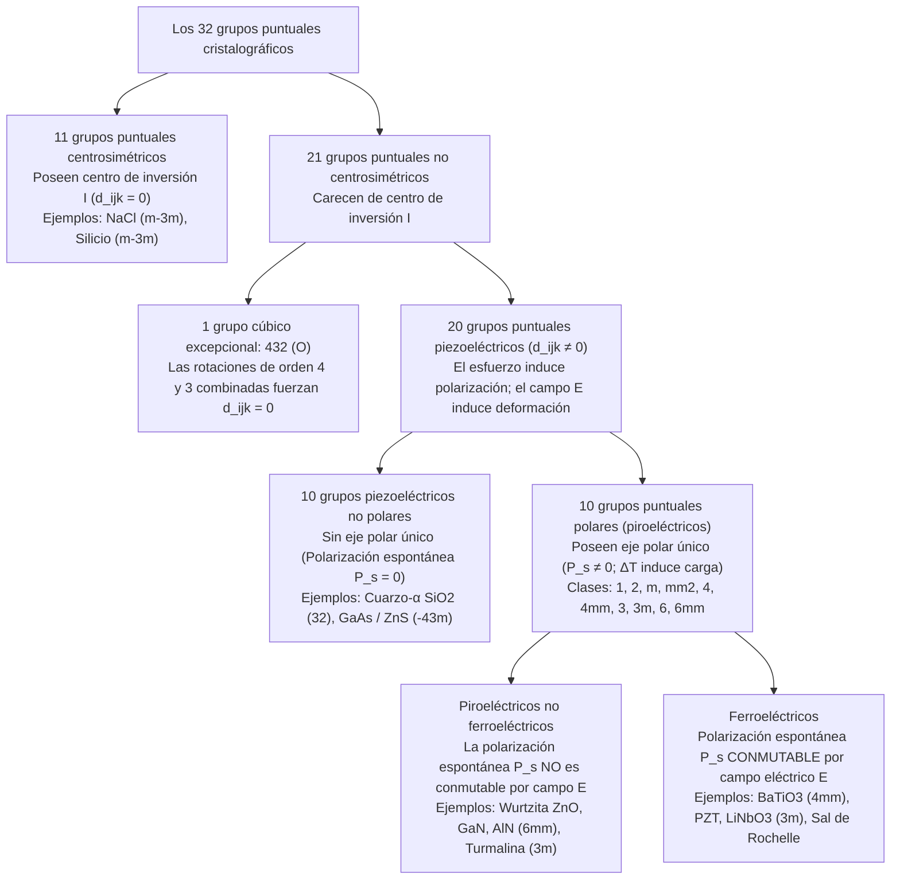
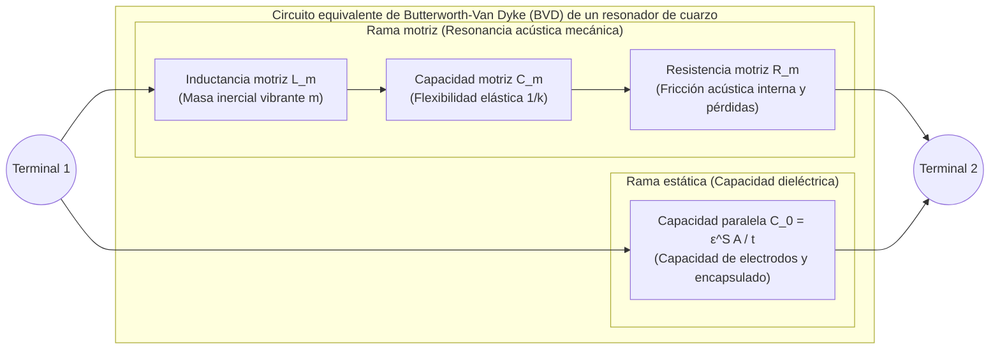

Cuando giramos el mando de encendido de una cocina de gas o pulsamos un encendedor electrónico y escuchamos un chasquido mecánico, salta una chispa azul que inflama el combustible sin necesidad de baterías ni conexión a la red eléctrica. En el interior de los relojes de pulsera y de los teléfonos inteligentes, diminutas láminas de cristal de cuarzo ($\text{SiO}_2$) y películas delgadas de nitruro de aluminio ($\text{AlN}$) vibran desde decenas de miles hasta miles de millones de veces por segundo con una estabilidad extraordinaria, marcando el pulso de los procesadores digitales y filtrando las señales de radiofrecuencia 5G. En los hospitales, los transductores ecográficos emiten pulsos ultrasónicos y escuchan sus ecos para reconstruir imágenes en tiempo real del corazón fetal, mientras que en los laboratorios de nanotecnología los microscopios de efecto túnel (STM) y de fuerza atómica (AFM) rastrean átomos individuales con una resolución vertical inferior a un picómetro ($1\,\text{pm} = 10^{-12}\,\text{m}$).

Todas estas tecnologías están impulsadas por un mismo fenómeno físico fundamental: el <strong>efecto piezoeléctrico (Piezoelectric Effect)</strong>. Acuñado en 1881 por Wilhelm Gottlieb Hankel a partir del verbo griego $\pi\iota\epsilon\zeta\epsilon\iota\nu$ (*piezein*, «presionar» o «apretar»), la piezoelectricidad es el acoplamiento electromecánico lineal y reversible entre el esfuerzo mecánico y la polarización dieléctrica en cristales que carecen de centro de simetría de inversión.

¿Por qué al comprimir un cristal de cuarzo o una cerámica de titanato circonato de plomo (PZT) se genera un voltaje eléctrico, mientras que al comprimir sal común ($\text{NaCl}$), silicio o vidrio ordinario no aparece señal eléctrica alguna? En este artículo analizamos la termodinámica, las ecuaciones tensoriales, la teoría de grupos cristalográficos y las aplicaciones de ingeniería de la piezoelectricidad.

---

## Capítulo 1: Descubrimiento histórico y necesidad termodinámica — Los hermanos Curie y la predicción de Lippmann

### 1.1 1880: Pierre y Jacques Curie descubren el efecto piezoeléctrico directo

En 1880, en el laboratorio de mineralogía de la Sorbona de París, <strong>Pierre Curie</strong> (21 años) y su hermano <strong>Jacques Curie</strong> (24 años) investigaban la <strong>piroelectricidad</strong> (la aparición de cargas eléctricas superficiales en cristales como la turmalina al calentarse o enfriarse). Los hermanos Curie dedujeron que el cambio de temperatura provocaba una dilatación térmica anisotrópica de la red cristalina que desplazaba los centros de gravedad de los iones positivos y negativos. Si esta hipótesis era cierta, aplicar directamente una presión mecánica a lo largo de un eje cristalográfico asimétrico a temperatura constante debía inducir cargas eléctricas superficiales de forma cuantitativa.

Utilizando electrodos de papel de estaño y un electrómetro de cuadrantes de Kelvin, los hermanos Curie demostraron en 1880 el <strong>efecto piezoeléctrico directo</strong> en cristales de <strong>cuarzo-$\alpha$ ($\text{SiO}_2$)</strong>, <strong>turmalina</strong>, <strong>topacio</strong>, <strong>esfalerita ($\text{ZnS}$)</strong>, <strong>azúcar de caña</strong> y <strong>sal de Rochelle (sal de Seignette, $\text{KNaC}_4\text{H}_4\text{O}_6 \cdot 4\text{H}_2\text{O}$)</strong>:
1. El esfuerzo mecánico genera una carga superficial $Q$ estrictamente proporcional a la fuerza aplicada $F$.
2. Al sustituir la compresión por tracción se invierte exactamente el signo algebraico de la carga inducida.
3. El fenómeno ocurre únicamente en cristales hemiedros desprovistos de centro de inversión.

### 1.2 1881: La deducción termodinámica de Gabriel Lippmann del efecto inverso

En 1881, el físico <strong>Gabriel Lippmann</strong> aplicó el primer y segundo principio de la termodinámica a un ciclo electromecánico reversible y demostró matemáticamente la existencia del <strong>efecto piezoeléctrico inverso (converso)</strong>: un cristal piezoeléctrico situado en un campo eléctrico externo $\mathbf{E}$ debe experimentar una deformación mecánica $\mathbf{S}$ cuyo coeficiente de proporcionalidad es idéntico al coeficiente directo.

Consideremos una unidad de volumen de un cristal dieléctrico a temperatura absoluta $\Theta$, densidad de entropía $s$, tensor de esfuerzos $T_{jk}$ ($\text{Pa}$), tensor de deformaciones $S_{jk}$, campo eléctrico $E_i$ ($\text{V/m}$) y vector desplazamiento eléctrico $D_i = \varepsilon_0 E_i + P_i$ ($\text{C/m}^2$). La diferencial de la densidad de energía interna $U(s, S_{jk}, D_i)$ es (con el convenio de suma de Einstein):

$$dU = \Theta\,ds + T_{jk}\,dS_{jk} + E_i\,dD_i$$

Mediante una transformación de Legendre hacia las variables naturales controladas en el laboratorio $(\Theta, T_{jk}, E_i)$, definimos la densidad de energía libre de Gibbs elástico-eléctrica $G(\Theta, T_{jk}, E_i)$:

$$G(\Theta, T_{jk}, E_i) = U - \Theta s - T_{jk} S_{jk} - E_i D_i \quad \Longrightarrow \quad dG = -s\,d\Theta - S_{jk}\,dT_{jk} - D_i\,dE_i$$

En condiciones isotérmicas ($d\Theta = 0$), la deformación y el desplazamiento eléctrico se obtienen como primeras derivadas parciales de $G$:

$$S_{jk} = -\left(\frac{\partial G}{\partial T_{jk}}\right)_{\mathbf{E}, \Theta}, \qquad D_i = -\left(\frac{\partial G}{\partial E_i}\right)_{\mathbf{T}, \Theta}$$

Por el teorema de Schwarz sobre la igualdad de las derivadas parciales segundas cruzadas ($\frac{\partial^2 G}{\partial E_i \partial T_{jk}} = \frac{\partial^2 G}{\partial T_{jk} \partial E_i}$), se obtiene de inmediato la <strong>relación de Maxwell termodinámica para la piezoelectricidad</strong>:

$$d_{ijk} \equiv \left(\frac{\partial D_i}{\partial T_{jk}}\right)_{\mathbf{E}, \Theta} = \left(\frac{\partial S_{jk}}{\partial E_i}\right)_{\mathbf{T}, \Theta}$$

El coeficiente piezoeléctrico directo en culombios por newton ($\text{C/N}$) y el coeficiente inverso en metros por voltio ($\text{m/V}$) son exactamente iguales ($\frac{\text{C}}{\text{N}} = \frac{\text{C}\cdot\text{m}}{\text{J}} = \frac{\text{m}}{\text{V}}$). Los hermanos Curie confirmaron experimentalmente esta elongación microscópica e inventaron el electrómetro de cuarzo piezoeléctrico, instrumento con el que Marie y Pierre Curie lograron medir la radiactividad de la pechblenda y aislar el polonio y el radio en 1898.

---

## Capítulo 2: Ecuaciones constitutivas tensoriales y el principio de Neumann

### 2.1 Ecuaciones constitutivas lineales y notación matricial de Voigt (IEEE)

Expandiendo $G(T_{jk}, E_i)$ en serie de Taylor hasta segundo orden alrededor del equilibrio ($T_{jk}=0, E_i=0$), obtenemos las <strong>ecuaciones constitutivas piezoeléctricas acopladas</strong>:

$$D_i = d_{ijk} T_{jk} + \varepsilon_{ij}^T E_j, \qquad S_{jk} = s_{jklm}^E T_{lm} + d_{ijk} E_i$$

donde $\varepsilon_{ij}^T$ es el tensor de permitividad a esfuerzo constante ($\text{F/m}$), $s_{jklm}^E$ el tensor de flexibilidad elástica (compliance) a campo constante ($\text{Pa}^{-1}$) y $d_{ijk}$ el tensor piezoeléctrico de tercer orden. La simetría del esfuerzo y la deformación ($T_{jk} = T_{kj}, S_{jk} = S_{kj}$) impone $d_{ijk} = d_{ikj}$, reduciendo el número máximo de componentes independientes de $27$ a $3 \times 6 = 18$. En la <strong>notación de Voigt</strong> $(11\to 1, 22\to 2, 33\to 3, 23\to 4, 13\to 5, 12\to 6)$ con $S_m = 2S_{jk}$ y $d_{im} = 2d_{ijk}$ para los modos de cizalla ($m=4,5,6$), escribimos:

$$D_i = d_{im} T_m + \varepsilon_{ij}^T E_j, \qquad S_m = s_{mn}^E T_n + d_{jm} E_j \qquad (i,j \in \{1,2,3\};\; m,n \in \{1,\dots,6\})$$

La eficiencia de conversión de energía entre los dominios mecánico y eléctrico viene dada por el <strong>factor de acoplamiento electromecánico</strong> adimensional $k^2 = \frac{d^2}{\varepsilon^T s^E}$.

### 2.2 Demostración rigurosa mediante el principio de Neumann: por qué la simetría de inversión prohíbe la piezoelectricidad

El <strong>principio de Neumann</strong> (1885) establece que cualquier tensor de propiedades físicas macroscópicas de un cristal debe permanecer invariante bajo todas las transformaciones de simetría $a_{ij}$ del grupo puntual del cristal.

Supongamos que un cristal posee un <strong>centro de inversión $\mathcal{I}$</strong> ($\mathbf{r} \to -\mathbf{r}$), cuya matriz de transformación ortogonal es $a_{ij} = -\delta_{ij}$:
1. <strong>Desplazamiento eléctrico $D_i$ (vector polar de rango 1)</strong>: Bajo inversión espacial, todo vector polar invierte su sentido: $D'_i = a_{ip} D_p = -D_i$.
2. <strong>Esfuerzo mecánico $T_{jk}$ (tensor polar de rango 2)</strong>: Dos fuerzas opuestas de compresión se intercambian bajo inversión sin alterar el estado de compresión: $T'_{jk} = a_{jq} a_{kr} T_{qr} = (-1)^2 T_{jk} = +T_{jk}$.
3. <strong>Tensor piezoeléctrico $d_{ijk}$ (tensor polar de rango 3)</strong>: Bajo la operación de inversión $\mathcal{I}$, un tensor de tercer rango se transforma multiplicándose tres veces por $(-1)$:
   $$d'_{ijk} = a_{ip} a_{jq} a_{kr} d_{pqr} = (-\delta_{ip})(-\delta_{jq})(-\delta_{kr}) d_{pqr} = (-1)^3 d_{ijk} = -d_{ijk}$$
   Si el cristal es centrosimétrico, el principio de Neumann exige invarianza: $d'_{ijk} = d_{ijk}$. Igualando ambas expresiones resulta:
   $$d_{ijk} = -d_{ijk} \quad \Longrightarrow \quad 2d_{ijk} = 0 \quad \Longrightarrow \quad d_{ijk} \equiv 0 \quad (\forall i,j,k)$$

Queda demostrado que <strong>ningún cristal con centro de simetría de inversión puede presentar efecto piezoeléctrico lineal</strong>.

| Atributo físico | Efecto piezoeléctrico | Electrostricción | Efecto triboeléctrico (Electricidad estática) |
| :--- | :--- | :--- | :--- |
| <strong>Origen microscópico</strong> | Desplazamiento elástico reversible de subredes iónicas en el <strong>volumen (bulk) de la celda unidad</strong> | Deformación cuadrática de la <strong>red en volumen</strong> inducida por polarización | Transferencia interfacial de electrones o iones en la <strong>superficie de contacto</strong> |
| <strong>Requisito de simetría</strong> | Exclusivo de los <strong>20 grupos puntuales piezoeléctricos</strong> sin centro de inversión | <strong>Ninguno</strong> (presente en todos los cristales, vidrios y líquidos) | <strong>Ninguno</strong> (ocurre en cualquier interfaz entre aislantes o metales) |
| <strong>Escalamiento matemático</strong> | <strong>Lineal (1.er orden)</strong>: $D \propto T,\; S \propto E$ (invierte signo si $E \to -E$) | <strong>Cuadrático (2.º orden)</strong>: $S_{ij} = M_{ijkl} E_k E_l$ (sin inversión de signo) | <strong>No lineal y estocástico</strong> (depende de la humedad y la rugosidad superficial) |
| <strong>Reversibilidad</strong> | <strong>Estrictamente reversible</strong> (Efecto directo $\Longleftrightarrow$ Efecto inverso) | <strong>Unidireccional en $E=0$</strong> (el esfuerzo por sí solo no crea polarización) | <strong>Irreversible y disipativo</strong> |

---

## Capítulo 3: La jerarquía de los 32 grupos puntuales cristalográficos

En la cristalografía tridimensional existen exactamente <strong>32 grupos puntuales (clases cristalinas)</strong>, clasificados por el principio de Neumann en la siguiente jerarquía:

De los 21 grupos sin centro de inversión, <strong>20 son piezoeléctricos</strong>: la única excepción es el grupo cúbico quiral <strong>$432$ ($O$)</strong>, donde la combinación de ejes de rotación cuaternarios ($90^\circ$) y ternarios ($120^\circ$) anula incluso la componente de cizalla $d_{312}$ ($d'_{312} = -d_{321} = -d_{312} \implies d_{312} = 0$). Dentro de los 20 grupos piezoeléctricos, los <strong>10 grupos polares (piroeléctricos)</strong> poseen un eje polar único con polarización espontánea permanente $\mathbf{P}_s \neq \mathbf{0}$. Cuando dicha polarización $\mathbf{P}_s$ puede invertirse mediante un campo eléctrico externo superior al campo coercitivo $E_c$ (ciclo de histéresis), el material es un <strong>ferroeléctrico</strong>.

---

## Capítulo 4: Mecanismos microscópicos — Cuarzo-$\alpha$ frente a perovskitas ferroeléctricas ($\text{BaTiO}_3$, PZT)

### 4.1 Cuarzo-$\alpha$ ($\text{SiO}_2$, grupo puntual trigonal $32$)

Por debajo de $573\,^\circ\text{C}$, el cuarzo cristaliza en el grupo puntual trigonal $32$ (cuarzo-$\alpha$), formado por cadenas helicoidales de tetraedros $\text{SiO}_4$ a lo largo del eje óptico $Z$ (eje ternario), con tres ejes eléctricos $X$ (ejes binarios separados $120^\circ$) y tres ejes mecánicos $Y$ en el plano $XY$. La simetría del grupo $32$ reduce la matriz piezoeléctrica a solo dos módulos independientes ($d_{11} = 2,31\,\text{pC/N}$ y $d_{14} = -0,727\,\text{pC/N}$):

$$\mathbf{d}_{\text{Cuarzo (32)}} = \begin{pmatrix} d_{11} & -d_{11} & 0 & d_{14} & 0 & 0 \\ 0 & 0 & 0 & 0 & -d_{14} & -2d_{11} \\ 0 & 0 & 0 & 0 & 0 & 0 \end{pmatrix}$$

En equilibrio sin esfuerzo, los baricentros de carga de los cationes $\text{Si}^{4+}$ y los aniones $\text{O}^{2-}$ coinciden ($\mathbf{P}_s = \mathbf{0}$). Al comprimir según el eje eléctrico $X$ (efecto longitudinal $D_1 = d_{11} T_1$) o traccionar según el eje mecánico $Y$ (efecto transversal $D_1 = -d_{11} T_2$), el anillo hexagonal de tetraedros se deforma asimétricamente y separa los centros de carga positiva y negativa a lo largo de $X$. Un campo $E_2$ según $Y$ excita una deformación de cizalla en espesor mediante $d_{26} = -2d_{11}$.

### 4.2 Perovskitas ferroeléctricas ($\text{BaTiO}_3$, PZT), polarización (Poling) y límite morfotrópico de fase (MPB)

Los óxidos con estructura perovskita $\text{ABO}_3$, como el titanato de bario ($\text{BaTiO}_3$) y el titanato circonato de plomo ($\text{Pb(Zr}_x\text{Ti}_{1-x}\text{)O}_3$, PZT), son cúbicos centrosimétricos ($m\bar{3}m$, $d_{ijk}=0$) por encima de la temperatura de Curie $T_C$. Por debajo de $T_C$, el catión central $\text{Ti}^{4+}/\text{Zr}^{4+}$ se desplaza fuera del centro del octaedro de oxígeno $\text{O}_6$, dando lugar a una fase tetragonal ($4mm$) o romboédrica ($3m$) con enorme polarización espontánea.

Una cerámica policristalina recién sinterizada tiene sus dominios ferroeléctricos orientados al azar y es macroscópicamente isótropa ($d_{ijk}=0$). Mediante el proceso de <strong>polarización bajo campo continuo (Poling)</strong> se alinean los dominios, reduciendo la simetría al grupo de Curie $\infty m$ (isomorfo a $6mm$, con coeficientes $d_{33}, d_{31}, d_{15}$). En el PZT, justo en el <strong>límite morfotrópico de fase (MPB, $x \approx 0,52$)</strong>, coexisten las 6 direcciones tetragonales $\langle 100 \rangle$ y las 8 direcciones romboédricas $\langle 111 \rangle$ a través de una fase puente monoclínica (grupo $m$), lo que aplana la superficie de energía libre y facilita la <strong>rotación de la polarización</strong>, alcanzando coeficientes gigantes de $d_{33} \approx 300\text{–}600\,\text{pC/N}$.

---

## Capítulo 5: Física de la resonancia y osciladores de cuarzo — El circuito equivalente de Butterworth-Van Dyke (BVD)

Cerca de una frecuencia propia de onda estacionaria acústica ($t = n\lambda/2$), un cristal de cuarzo vibrante equivale eléctricamente a una rama motriz en serie ($L_m, C_m, R_m$) en paralelo con la capacidad estática de los electrodos $C_0$, formando el <strong>circuito equivalente de Butterworth-Van Dyke (BVD)</strong>:

Despreciando las pérdidas ($R_m \to 0$), la admitancia $Y(\omega) = j\omega C_0 + \left(j\omega L_m + \frac{1}{j\omega C_m}\right)^{-1}$ define dos frecuencias críticas:
1. <strong>Frecuencia de resonancia serie ($f_s$)</strong> (impedancia mínima $Z \approx R_m$):
   $$f_s = \frac{1}{2\pi\sqrt{L_m C_m}}$$
2. <strong>Frecuencia de resonancia paralela o antirresonancia ($f_p$)</strong> (admitancia nula $Y(\omega_p) = 0$):
   $$f_p = f_s \sqrt{1 + \frac{C_m}{C_0}} \approx f_s \left(1 + \frac{C_m}{2C_0}\right)$$

El cristal presenta reactancia inductiva únicamente dentro de la estrecha banda $f_s < f < f_p$. Gracias a su bajísima fricción interna, el cuarzo alcanza un <strong>factor de calidad $Q = \frac{\omega_s L_m}{R_m} \sim 10^5\text{–}10^6$</strong>. Los relojes de cuarzo emplean diapasones tallados a <strong>$32.768\,\text{Hz} = 2^{15}\,\text{Hz}$</strong> (que tras 15 etapas divisoras binarias generan pulsos exactos de $1\,\text{Hz}$), mientras que el <strong>corte AT</strong> ($35^\circ 15'$ respecto al eje $Z$) logra una curva cúbica de temperatura con deriva casi nula a temperatura ambiente. En las telecomunicaciones 5G, los resonadores acústicos de película delgada <strong>SAW</strong> y <strong>BAW/FBAR</strong> ($\text{AlN}$) actúan como filtros de paso de banda en gigahercios.

---

## Capítulo 6: Ultrasonido médico y nanoposicionamiento sub-picométrico (STM/AFM)

1. <strong>Sonar de Langevin, ecografía Phased-Array y capa de adaptación $\lambda/4$</strong>:
   Los transductores ultrasónicos médicos emiten pulsos mediante el efecto inverso y detectan los ecos mediante el efecto directo. Para evitar que el $82\%$ de la energía acústica se refleje en la interfaz entre el PZT ($Z_{\text{PZT}} \approx 30\,\text{MRayl}$) y el tejido blando humano ($Z_{\text{tejido}} \approx 1,5\,\text{MRayl}$), se incorpora una <strong>capa de adaptación acústica de espesor $\lambda/4$</strong> con impedancia media geométrica $Z_{\text{match}} = \sqrt{Z_{\text{PZT}} Z_{\text{tejido}}} \approx 6,7\,\text{MRayl}$.
2. <strong>Escáneres STM/AFM e inyectores piezoeléctricos multicapa</strong>:
   En el microscopio de efecto túnel (Binnig y Rohrer, Premio Nobel 1986), un tubo piezoeléctrico de PZT dividido en cuatro cuadrantes desplaza la punta atómica sin fricción ni holgura mecánica con una resolución inferior a $0,01\,\text{\AA}$ ($1\,\text{pm}$) para mantener constante la corriente túnel $I_t \propto V e^{-2\kappa z}$. Asimismo, los actuadores apilados multicapa ($\Delta L = N d_{33} V$) gobiernan los inyectores diésel Common-Rail a $200\,\text{MPa}$ y los cabezales de impresión de inyección de tinta.
