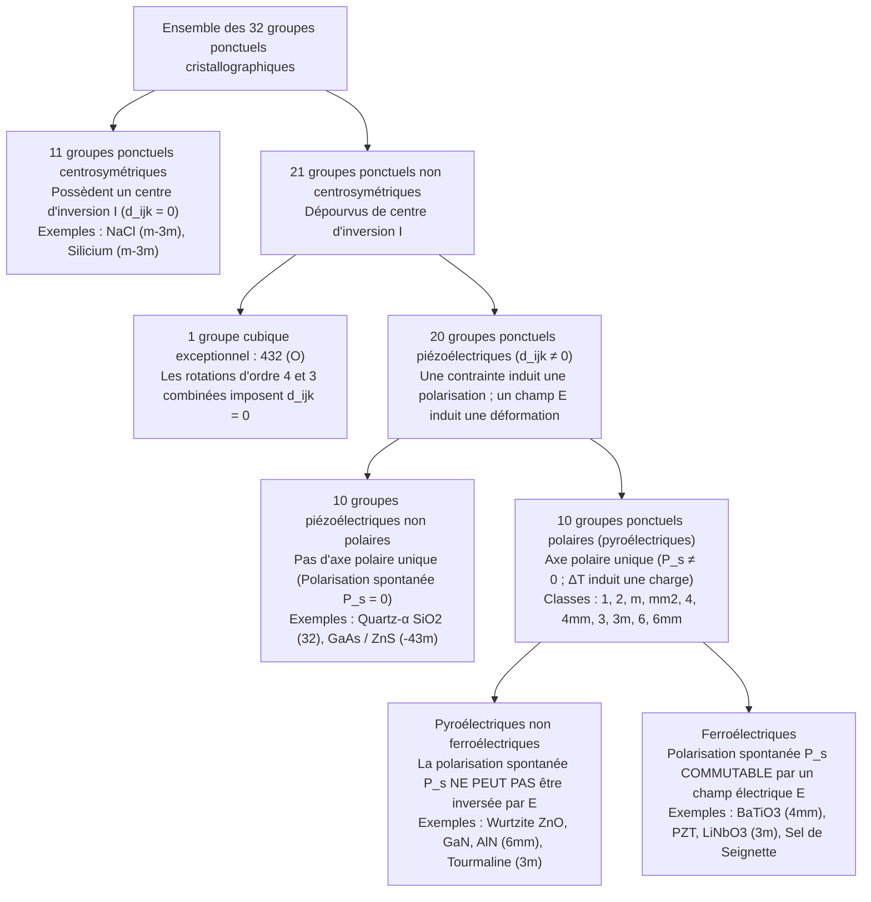
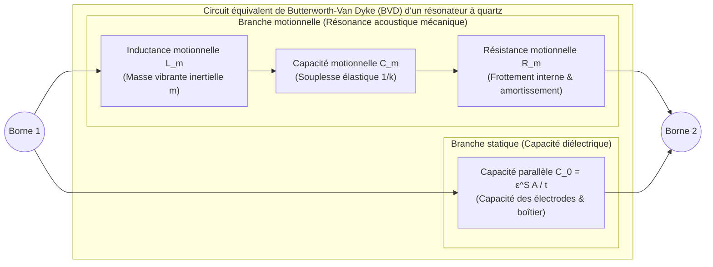

Lorsque vous appuyez sur l'allumeur d'une cuisinière à gaz ou d'un briquet électronique et entendez un claquement sec, une étincelle bleue jaillit sans pile ni raccordement électrique. Dans votre montre-bracelet et votre smartphone, de minuscules lamelles de quartz ($\text{SiO}_2$) et des couches minces de nitrure d'aluminium ($\text{AlN}$) vibrent des dizaines de milliers à des milliards de fois par seconde pour cadencer les processeurs numériques et filtrer les fréquences 5G. À l'hôpital, les sondes d'échographie émettent des impulsions ultrasonores et écoutent leurs échos pour visualiser le cœur d'un fœtus en temps réel, tandis que les microscopes à effet tunnel (STM) et à force atomique (AFM) cartographient les atomes individuels avec une résolution inférieure au picomètre ($1\,\text{pm} = 10^{-12}\,\text{m}$).

Toutes ces technologies reposent sur un même phénomène physique fondamental : <strong>l'effet piézoélectrique (Piezoelectric Effect)</strong>. Du grec $\pi\iota\epsilon\zeta\epsilon\iota\nu$ (*piezein*, « presser » ou « comprimer »), la piézoélectricité désigne le couplage électromécanique linéaire et réversible entre une contrainte mécanique et la polarisation diélectrique au sein des cristaux dépourvus de centre d'inversion.

Pourquoi la compression d'un cristal de quartz ou d'une céramique de titano-zirconate de plomb (PZT) produit-elle une tension électrique, alors que le sel gemme ($\text{NaCl}$), le silicium ou le verre ordinaire restent électriquement inertes ? Cet article explore la thermodynamique, l'algèbre tensorielle, la cristallographie et les applications d'ingénierie de l'effet piézoélectrique.

---

## Chapitre 1 : Découverte historique et nécessité thermodynamique — Les frères Curie et la prédiction de Lippmann

### 1.1 1880 : Pierre et Jacques Curie découvrent l'effet piézoélectrique direct

En 1880, à la Sorbonne à Paris, <strong>Pierre Curie</strong> (21 ans) et son frère <strong>Jacques Curie</strong> (24 ans) étudiaient la <strong>pyroélectricité</strong> (l'apparition de charges électriques à la surface de cristaux comme la tourmaline lors d'un changement de température) et la symétrie cristalline. Ils comprirent que la variation thermique agissait par dilatation anisotrope du réseau cristallin, déplaçant les barycentres des charges positives et négatives. Ils en déduisirent qu'une contrainte mécanique appliquée directement selon un axe cristallographique asymétrique à température constante devait induire une polarisation électrique proportionnelle.

À l'aide d'électrodes en feuilles d'étain et d'un électromètre à quadrants de Kelvin, ils démontrèrent en 1880 <strong>l'effet piézoélectrique direct</strong> sur le <strong>quartz-$\alpha$ ($\text{SiO}_2$)</strong>, la <strong>tourmaline</strong>, la <strong>topaze</strong>, la <strong>blende ($\text{ZnS}$)</strong>, le <strong>sucre de canne</strong> et le <strong>sel de Seignette (sel de La Rochelle, $\text{KNaC}_4\text{H}_4\text{O}_6 \cdot 4\text{H}_2\text{O}$)</strong> :
1. La charge électrique induite $Q$ est strictement proportionnelle à la force appliquée $F$.
2. Remplacer une compression par une traction inverse exactement le signe algébrique de la charge.
3. L'effet n'apparaît que dans les cristaux hémièdres dépourvus de centre de symétrie.

### 1.2 1881 : La déduction thermodynamique de Gabriel Lippmann et l'effet inverse

En 1881, le physicien <strong>Gabriel Lippmann</strong> appliqua les premier et deuxième principes de la thermodynamique à un cycle électromécanique réversible et prédit théoriquement <strong>l'effet piézoélectrique inverse (converse)</strong> : un cristal piézoélectrique soumis à un champ électrique externe $\mathbf{E}$ doit subir une déformation mécanique linéaire $\mathbf{S}$ dont le coefficient est rigoureusement égal au coefficient direct.

Considérons une unité de volume d'un cristal diélectrique à la température $\Theta$, de densité d'entropie $s$, soumise au tenseur des contraintes $T_{jk}$ ($\text{Pa}$), au tenseur des déformations $S_{jk}$, au champ électrique $E_i$ ($\text{V/m}$) et à l'induction électrique (déplacement) $D_i = \varepsilon_0 E_i + P_i$ ($\text{C/m}^2$). La différentielle de la densité d'énergie interne $U(s, S_{jk}, D_i)$ s'écrit (avec la convention de sommation d'Einstein) :

$$dU = \Theta\,ds + T_{jk}\,dS_{jk} + E_i\,dD_i$$

Par une transformation de Legendre vers les variables intensives contrôlées expérimentalement $(\Theta, T_{jk}, E_i)$, nous définissons l'enthalpie libre élastique-électrique de Gibbs $G(\Theta, T_{jk}, E_i)$ :

$$G(\Theta, T_{jk}, E_i) = U - \Theta s - T_{jk} S_{jk} - E_i D_i \quad \Longrightarrow \quad dG = -s\,d\Theta - S_{jk}\,dT_{jk} - D_i\,dE_i$$

À température constante ($d\Theta = 0$), la déformation et le déplacement électrique sont les dérivées partielles premières de $G$ :

$$S_{jk} = -\left(\frac{\partial G}{\partial T_{jk}}\right)_{\mathbf{E}, \Theta}, \qquad D_i = -\left(\frac{\partial G}{\partial E_i}\right)_{\mathbf{T}, \Theta}$$

En vertu du théorème de Schwarz sur l'égalité des dérivées secondes croisées ($\frac{\partial^2 G}{\partial E_i \partial T_{jk}} = \frac{\partial^2 G}{\partial T_{jk} \partial E_i}$), on obtient immédiatement la <strong>relation de Maxwell thermodynamique de la piézoélectricité</strong> :

$$d_{ijk} \equiv \left(\frac{\partial D_i}{\partial T_{jk}}\right)_{\mathbf{E}, \Theta} = \left(\frac{\partial S_{jk}}{\partial E_i}\right)_{\mathbf{T}, \Theta}$$

Le coefficient piézoélectrique direct en coulombs par newton ($\text{C/N}$) et le coefficient inverse en mètres par volt ($\text{m/V}$) sont identiques ($\frac{\text{C}}{\text{N}} = \frac{\text{C}\cdot\text{m}}{\text{J}} = \frac{\text{m}}{\text{V}}$). Les frères Curie vérifièrent aussitôt cette élongation sub-micrométrique sur une lame de quartz et mirent au point l'électromètre à quartz piézoélectrique, instrument qui permit en 1898 à Marie et Pierre Curie de mesurer les courants d'ionisation infimes de la pechblende et d'isoler le polonium et le radium.

---

## Chapitre 2 : Équations constitutives tensorielles et principe de Neumann

### 2.1 Équations constitutives linéaires et notation matricielle de Voigt (IEEE)

Un développement de Taylor de $G(T_{jk}, E_i)$ à l'ordre quadratique autour de l'état d'équilibre ($T_{jk}=0, E_i=0$) fournit les <strong>équations constitutives piézoélectriques linéaires</strong> :

$$D_i = d_{ijk} T_{jk} + \varepsilon_{ij}^T E_j, \qquad S_{jk} = s_{jklm}^E T_{lm} + d_{ijk} E_i$$

où $\varepsilon_{ij}^T$ est le tenseur de permittivité à contrainte constante ($\text{F/m}$), $s_{jklm}^E$ le tenseur de souplesse élastique (compliance) à champ constant ($\text{Pa}^{-1}$) et $d_{ijk}$ le tenseur piézoélectrique d'ordre 3. La symétrie mécanique $T_{jk} = T_{kj}$ et $S_{jk} = S_{kj}$ impose $d_{ijk} = d_{ikj}$, réduisant le nombre maximal de composantes indépendantes de $27$ à $3 \times 6 = 18$. En utilisant la <strong>notation de Voigt</strong> $(11\to 1, 22\to 2, 33\to 3, 23\to 4, 13\to 5, 12\to 6)$ avec $S_m = 2S_{jk}$ et $d_{im} = 2d_{ijk}$ pour les cisaillements ($m=4,5,6$), les équations s'écrivent :

$$D_i = d_{im} T_m + \varepsilon_{ij}^T E_j, \qquad S_m = s_{mn}^E T_n + d_{jm} E_j \qquad (i,j \in \{1,2,3\};\; m,n \in \{1,\dots,6\})$$

L'efficacité de conversion énergétique entre les domaines électrique et mécanique est gouvernée par le <strong>facteur de couplage électromécanique</strong> sans dimension $k^2 = \frac{d^2}{\varepsilon^T s^E}$.

### 2.2 Démonstration rigoureuse par le principe de Neumann : pourquoi la centrosymétrie interdit la piézoélectricité

Le <strong>principe de Neumann</strong> (1885) stipule que tout tenseur représentant une propriété physique macroscopique d'un cristal doit être invariant sous toutes les opérations de symétrie $a_{ij}$ du groupe ponctuel de ce cristal.

Supposons qu'un cristal possède un <strong>centre d'inversion $\mathcal{I}$</strong> ($\mathbf{r} \to -\mathbf{r}$), représenté par la matrice orthogonale $a_{ij} = -\delta_{ij}$ :
1. <strong>Induction électrique $D_i$ (vecteur polaire de rang 1)</strong> : Sous l'inversion spatiale, un vecteur polaire change de signe : $D'_i = a_{ip} D_p = -D_i$.
2. <strong>Contrainte mécanique $T_{jk}$ (tenseur polaire de rang 2)</strong> : Deux forces opposées de compression s'échangent sous l'inversion sans modifier l'état de contrainte : $T'_{jk} = a_{jq} a_{kr} T_{qr} = (-1)^2 T_{jk} = +T_{jk}$.
3. <strong>Tenseur piézoélectrique $d_{ijk}$ (tenseur polaire de rang 3)</strong> : Sous l'opération d'inversion $\mathcal{I}$, un tenseur de rang 3 se transforme avec trois facteurs $(-1)$ :
   $$d'_{ijk} = a_{ip} a_{jq} a_{kr} d_{pqr} = (-\delta_{ip})(-\delta_{jq})(-\delta_{kr}) d_{pqr} = (-1)^3 d_{ijk} = -d_{ijk}$$
   Or, si le cristal est centrosymétrique, le principe de Neumann exige que le tenseur matériel reste invariant après transformation : $d'_{ijk} = d_{ijk}$. On en déduit :
   $$d_{ijk} = -d_{ijk} \quad \Longrightarrow \quad 2d_{ijk} = 0 \quad \Longrightarrow \quad d_{ijk} \equiv 0 \quad (\forall i,j,k)$$

Ainsi, <strong>aucun cristal possédant un centre d'inversion ne peut présenter d'effet piézoélectrique linéaire</strong>.

| Propriété physique | Effet piézoélectrique | Électrostriction | Effet triboélectrique (Électricité statique) |
| :--- | :--- | :--- | :--- |
| <strong>Origine microscopique</strong> | Déplacement élastique réversible des sous-réseaux ioniques dans le <strong>volume (bulk) de la maille</strong> | Déformation quadratique du <strong>réseau en volume</strong> sous l'effet de la polarisation | Transfert interfacial d'électrons ou d'ions à la <strong>surface de contact</strong> |
| <strong>Exigence de symétrie</strong> | Restreint aux <strong>20 groupes ponctuels piézoélectriques</strong> sans centre d'inversion | <strong>Aucune</strong> (présent dans tous les solides, verres, liquides) | <strong>Aucune</strong> (toute interface entre isolants ou métaux) |
| <strong>Loi mathématique</strong> | <strong>Linéaire (1er ordre)</strong> : $D \propto T,\; S \propto E$ (inversion de signe si $E \to -E$) | <strong>Quadratique (2e ordre)</strong> : $S_{ij} = M_{ijkl} E_k E_l$ (pas d'inversion de signe) | <strong>Non linéaire et stochastique</strong> (sensible à l'humidité et à l'état de surface) |
| <strong>Réversibilité</strong> | <strong>Strictement réversible</strong> (Effet direct $\Longleftrightarrow$ Effet inverse) | <strong>Couplage unidirectionnel à $E=0$</strong> (une contrainte ne crée pas de polarisation) | <strong>Irréversible et dissipatif</strong> |

---

## Chapitre 3 : La hiérarchie des 32 groupes ponctuels cristallographiques

La cristallographie tridimensionnelle dénombre exactement <strong>32 groupes ponctuels (classes cristallines)</strong>, que le principe de Neumann organise selon une hiérarchie stricte :

Sur les 21 classes non centrosymétriques, <strong>20 sont piézoélectriques</strong> : la classe cubique chirale <strong>$432$ ($O$)</strong> fait exception car la combinaison de ses axes de rotation d'ordre 4 ($90^\circ$) et d'ordre 3 ($120^\circ$) annule même la composante de cisaillement $d_{312}$ ($d'_{312} = -d_{321} = -d_{312} \implies d_{312} = 0$). Parmi ces 20 classes, les <strong>10 classes polaires (pyroélectriques)</strong> possèdent un axe polaire unique autorisant une polarisation spontanée permanente $\mathbf{P}_s \neq \mathbf{0}$. Lorsque cette polarisation $\mathbf{P}_s$ peut être renversée par un champ électrique externe supérieur au champ coercitif $E_c$ (cycle d'hystérésis $P\text{–}E$), le cristal est dit <strong>ferroélectrique</strong>.

---

## Chapitre 4 : Structures cristallines microscopiques — Quartz-$\alpha$ vs Pérovskites ferroélectriques ($\text{BaTiO}_3$, PZT)

### 4.1 Le quartz-$\alpha$ ($\text{SiO}_2$, groupe ponctuel trigonal $32$)

En dessous de $573\,^\circ\text{C}$, le quartz cristallise dans la classe trigonale $32$ (quartz-$\alpha$). Les tétraèdres $\text{SiO}_4$ forment des hélices le long de l'axe optique $Z$ (axe d'ordre 3), tandis que trois axes électriques $X$ (axes binaires à $120^\circ$) et trois axes mécaniques $Y$ résident dans le plan perpendiculaire. La symétrie du groupe $32$ réduit la matrice piézoélectrique à deux seules constantes indépendantes ($d_{11} = 2{,}31\,\text{pC/N}$ et $d_{14} = -0{,}727\,\text{pC/N}$) :

$$\mathbf{d}_{\text{Quartz (32)}} = \begin{pmatrix} d_{11} & -d_{11} & 0 & d_{14} & 0 & 0 \\ 0 & 0 & 0 & 0 & -d_{14} & -2d_{11} \\ 0 & 0 & 0 & 0 & 0 & 0 \end{pmatrix}$$

Au repos, les barycentres des ions $\text{Si}^{4+}$ et $\text{O}^{2-}$ coïncident ($\mathbf{P}_s = \mathbf{0}$). Une compression le long de l'axe électrique $X$ (effet longitudinal $D_1 = d_{11} T_1$) ou une traction le long de l'axe mécanique $Y$ (effet transversal $D_1 = -d_{11} T_2$) déforme l'anneau hexagonal des tétraèdres et sépare les barycentres de charges selon $X$. Par ailleurs, un champ $E_2$ selon $Y$ excite un cisaillement d'épaisseur via $d_{26} = -2d_{11}$.

### 4.2 Pérovskites ferroélectriques ($\text{BaTiO}_3$, PZT), polarisation (Poling) et frontière morphotropique (MPB)

Les oxydes pérovskites $\text{ABO}_3$ comme le titanate de baryum ($\text{BaTiO}_3$) et le titano-zirconate de plomb ($\text{Pb(Zr}_x\text{Ti}_{1-x}\text{)O}_3$, PZT) sont cubiques et centrosymétriques ($m\bar{3}m$, $d_{ijk}=0$) au-dessus de la température de Curie $T_C$. En dessous de $T_C$, le cation central $\text{Ti}^{4+}/\text{Zr}^{4+}$ se décentre dans son octaèdre d'oxygène $\text{O}_6$, créant une phase tétragonale ($4mm$) ou rhomboédrique ($3m$) dotée d'une forte polarisation spontanée.

Une céramique polycristalline brute de frittage est macroscopiquement isotrope ($\mathbf{P}_{\text{net}} = \mathbf{0}$) car ses domaines ferroélectriques sont orientés aléatoirement. Une étape de <strong>polarisation électrique (Poling)</strong> sous fort champ continu aligne les domaines et abaisse la symétrie macroscopique au groupe de Curie $\infty m$ (isomorphe à $6mm$, avec les coefficients $d_{33}, d_{31}, d_{15}$). Dans le PZT, au voisinage de la <strong>frontière de phase morphotropique (MPB, $x \approx 0{,}52$)</strong>, la coexistence des 6 directions tétragonales $\langle 100 \rangle$ et des 8 directions rhomboédriques $\langle 111 \rangle$ via une phase monoclinique intermédiaire (groupe $m$) aplatit le potentiel thermodynamique et facilite la <strong>rotation de la polarisation</strong>, portant $d_{33}$ à $300\text{–}600\,\text{pC/N}$.

---

## Chapitre 5 : Physique de la résonance et oscillateurs à quartz — Le modèle de Butterworth-Van Dyke (BVD)

Au voisinage d'une résonance acoustique d'ondes stationnaires ($t = n\lambda/2$), une lame de quartz se comporte électriquement comme une branche motionnelle série ($L_m, C_m, R_m$) en parallèle avec la capacité électrostatique des électrodes $C_0$ : c'est le <strong>circuit équivalent de Butterworth-Van Dyke (BVD)</strong> :

En négligeant les pertes ($R_m \to 0$), l'admittance $Y(\omega) = j\omega C_0 + \left(j\omega L_m + \frac{1}{j\omega C_m}\right)^{-1}$ fait apparaître deux fréquences caractéristiques :
1. <strong>Fréquence de résonance série ($f_s$)</strong> (impédance minimale $Z \approx R_m$) :
   $$f_s = \frac{1}{2\pi\sqrt{L_m C_m}}$$
2. <strong>Fréquence de résonance parallèle ou antirésonance ($f_p$)</strong> (admittance nulle $Y(\omega_p) = 0$) :
   $$f_p = f_s \sqrt{1 + \frac{C_m}{C_0}} \approx f_s \left(1 + \frac{C_m}{2C_0}\right)$$

Le cristal n'est inductif que dans l'étroite fenêtre $f_s < f < f_p$. Grâce à sa très faible dissipation acoustique, le quartz atteint un <strong>facteur de qualité $Q = \frac{\omega_s L_m}{R_m} \sim 10^5\text{–}10^6$</strong>. Les montres à quartz utilisent un diapason miniature réglé sur <strong>$32\,768\,\text{Hz} = 2^{15}\,\text{Hz}$</strong> (divisé par 15 bascules binaires pour obtenir $1\,\text{Hz}$), tandis que la <strong>coupe AT</strong> ($35^\circ 15'$ par rapport à l'axe $Z$) annule la dérive thermique au premier et au second ordre autour de $25\,^\circ\text{C}$. Dans les smartphones 5G, des filtres <strong>SAW</strong> et <strong>BAW/FBAR</strong> ($\text{AlN}$) assurent le filtrage radiofréquence aux gigahertz.

---

## Chapitre 6 : Échographie médicale et nanopositionnement sub-picométrique (STM/AFM)

1. <strong>Sonar de Langevin, échographie multi-éléments (Phased Array) et couche d'adaptation $\lambda/4$</strong> :
   Inventé par Paul Langevin en 1917 pour la détection sous-marine, le transducteur ultrasonore piézoélectrique a révolutionné l'imagerie médicale. Pour éviter que $82\%$ de l'énergie acoustique ne soit réfléchie à l'interface entre le PZT ($Z_{\text{PZT}} \approx 30\,\text{MRayl}$) et les tissus humains ($Z_{\text{tissu}} \approx 1{,}5\,\text{MRayl}$), on interpose une <strong>couche d'adaptation d'épaisseur $\lambda/4$</strong> d'impédance géométrique moyenne $Z_{\text{match}} = \sqrt{Z_{\text{PZT}} Z_{\text{tissu}}} \approx 6{,}7\,\text{MRayl}$.
2. <strong>Microscopes STM/AFM et actionneurs multicouches</strong> :
   Dans le microscope à effet tunnel (Binnig et Rohrer, prix Nobel 1986), un tube piézoélectrique PZT segmenté en quatre quadrants déplace la pointe métallique sans aucun frottement ni jeu mécanique avec une résolution verticale inférieure à $0{,}01\,\text{\AA}$ ($1\,\text{pm}$), maintenant constant le courant tunnel $I_t \propto V e^{-2\kappa z}$. Enfin, les actionneurs PZT multicouches ($\Delta L = N d_{33} V$) pilotent les injecteurs diesel Common-Rail à $200\,\text{MPa}$ ainsi que les têtes d'impression à jet d'encre.
