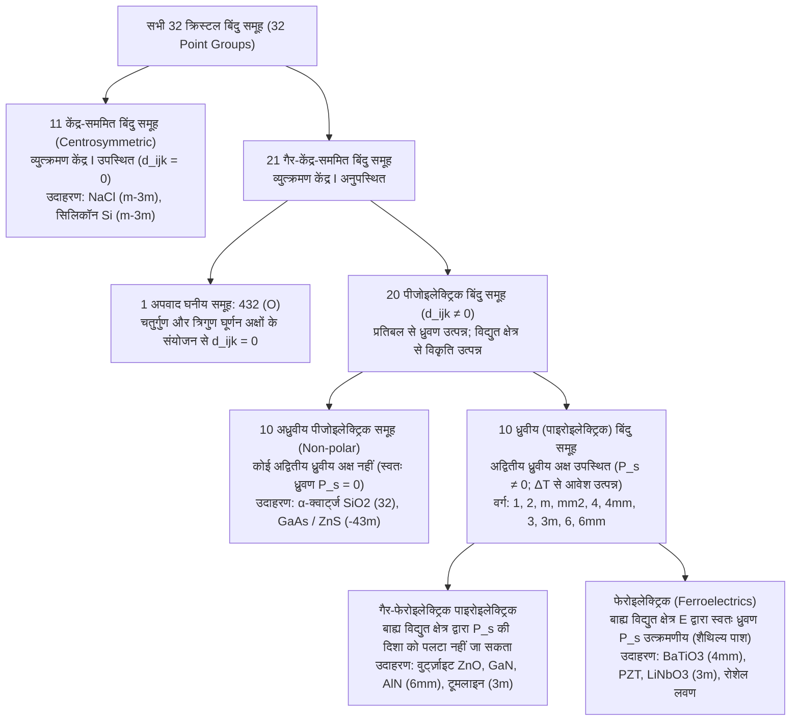
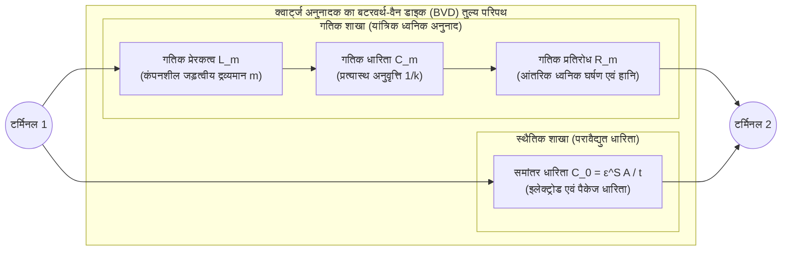

जब आप रसोई के गैस लाइटर या स्टोव के इग्निशन नॉब को दबाते हैं और एक तीखी यांत्रिक 'क्लिक' की आवाज़ आती है, तो बिना किसी बैटरी या बिजली के तार के एक नीली चिंगारी निकलती है और गैस जल उठती है। आपकी कलाई पर बंधी क्वार्ट्ज घड़ी और आपकी जेब में रखे स्मार्टफोन के भीतर, क्रिस्टलीय क्वार्ट्ज ($\text{SiO}_2$) और एल्युमिनियम नाइट्राइड ($\text{AlN}$) की सूक्ष्म परतें प्रति सेकंड हज़ारों से लेकर अरबों बार कंपन करती हैं, जो डिजिटल प्रोसेसर को सटीक समय मानक देती हैं और 5G रेडियो तरंगों को फ़िल्टर करती हैं। अस्पतालों में अल्ट्रासाउंड प्रोब त्वचा के भीतर ध्वनि तरंगें भेजकर गर्भस्थ शिशु के धड़कते हृदय का वास्तविक समय (real-time) में चित्र बनाता है, और नैनो-प्रौद्योगिकी प्रयोगशालाओं में स्कैनिंग टनलिंग माइक्रोस्कोप (STM) तथा एटॉमिक फोर्स माइक्रोस्कोप (AFM) एक पिकोमीटर ($1\,\text{pm} = 10^{-12}\,\text{m}$) से भी सूक्ष्म विभेदन (resolution) के साथ एकल परमाणुओं की सतह को मापते हैं।

इन सभी प्रौद्योगिकियों के मूल में एक ही भौतिक परिघटना काम करती है: <strong>पीजोइलेक्ट्रिक प्रभाव (Piezoelectric Effect / दाब-विद्युत प्रभाव)</strong>। 1881 में विल्हेम गॉटलीब हैंकेल द्वारा ग्रीक शब्द $\pi\iota\epsilon\zeta\epsilon\iota\nu$ (*piezein*, जिसका अर्थ है «दबाना») से गढ़ा गया यह शब्द उन क्रिस्टलों में यांत्रिक प्रतिबल (mechanical stress) और परावैद्युत ध्रुवण (dielectric polarization) के बीच के रेखीय तथा उत्क्रमणीय (reversible) युग्मन को दर्शाता है जिनमें व्युत्क्रमण सममिति केंद्र (center of inversion symmetry) नहीं होता।

आखिर क्वार्ट्ज या लेड जिरकोनेट टाइटेनेट (PZT) क्रिस्टल को दबाने पर वोल्टेज क्यों उत्पन्न होता है, जबकि साधारण नमक ($\text{NaCl}$), सिलिकॉन या काँच को दबाने पर कोई विद्युत संकेत नहीं मिलता? इस लेख में हम ऊष्मागतिकी, टेंसर बीजगणित, क्रिस्टल सममिति समूह सिद्धांत और आधुनिक अभियांत्रिकी के दृष्टिकोण से पीजोइलेक्ट्रिक प्रभाव का गहन विश्लेषण करेंगे।

---

## अध्याय 1: ऐतिहासिक खोज और ऊष्मागतिकीय अनिवार्यता — क्यूरी बंधु और लिपमैन की भविष्यवाणी

### 1.1 1880: पियरे और जैक्स क्यूरी द्वारा प्रत्यक्ष पीजोइलेक्ट्रिक प्रभाव की खोज

1880 में पेरिस के सोरबोन विश्वविद्यालय की खनिज विज्ञान प्रयोगशाला में 21 वर्षीय <strong>पियरे क्यूरी (Pierre Curie)</strong> और उनके 24 वर्षीय भाई <strong>जैक्स क्यूरी (Jacques Curie)</strong> <strong>पाइरोइलेक्ट्रिसिटी (Pyroelectricity / ताप-विद्युत)</strong> का अध्ययन कर रहे थे, जिसमें टूमलाइन (Tourmaline) जैसे क्रिस्टलों को गर्म या ठंडा करने पर उनकी सतह पर विद्युत आवेश उत्पन्न होता है। क्यूरी बंधुओं ने निष्कर्ष निकाला कि तापमान में परिवर्तन से क्रिस्टल जालक का असममित ऊष्मीय प्रसार होता है, जिससे धनायनों और ऋणायनों के आवेश केंद्र एक-दूसरे से खिसक जाते हैं। यदि यह तर्क सही था, तो स्थिर तापमान पर असममित क्रिस्टल अक्ष के अनुदिश सीधे यांत्रिक दबाव डालने पर भी सतह पर आवेश उत्पन्न होना चाहिए।

टिन की पन्नी के इलेक्ट्रोड और केल्विन क्वाड्रंट इलेक्ट्रोमीटर की सहायता से क्यूरी बंधुओं ने 1880 में <strong>$\alpha$-क्वार्ट्ज ($\text{SiO}_2$)</strong>, <strong>टूमलाइन</strong>, <strong>पुखराज (Topaz)</strong>, <strong>स्फैलेराइट ($\text{ZnS}$)</strong>, <strong>गन्ने की शर्करा</strong> और <strong>रोशेल लवण (Rochelle salt, $\text{KNaC}_4\text{H}_4\text{O}_6 \cdot 4\text{H}_2\text{O}$)</strong> में <strong>प्रत्यक्ष पीजोइलेक्ट्रिक प्रभाव (Direct Piezoelectric Effect)</strong> को प्रमाणित किया:
1. यांत्रिक संपीड़न (compression) से उत्पन्न पृष्ठीय आवेश $Q$ लगाए गए बल $F$ के पूर्णतः समानुपाती होता है।
2. संपीड़न के स्थान पर तनाव (tension) लगाने पर आवेश का चिह्न (ध्रुवता) ठीक उलट जाता है।
3. यह प्रभाव केवल उन्हीं क्रिस्टलों में पाया जाता है जिनमें सममिति का केंद्र (inversion center) अनुपस्थित होता है।

### 1.2 1881: गैब्रियल लिपमैन का ऊष्मागतिकीय निगमन और व्युत्क्रम प्रभाव

1881 में भौतिक विज्ञानी <strong>गैब्रियल लिपमैन (Gabriel Lippmann)</strong> ने एक उत्क्रमणीय विद्युत-यांत्रिक चक्र पर ऊष्मागतिकी के प्रथम और द्वितीय नियमों को लागू किया और गणितीय रूप से <strong>व्युत्क्रम पीजोइलेक्ट्रिक प्रभाव (Converse Piezoelectric Effect)</strong> की भविष्यवाणी की: यदि किसी पीजोइलेक्ट्रिक क्रिस्टल को बाह्य विद्युत क्षेत्र $\mathbf{E}$ में रखा जाए, तो उसमें रेखीय यांत्रिक विकृति (strain) $\mathbf{S}$ उत्पन्न होनी ही चाहिए, और उसका गुणांक प्रत्यक्ष प्रभाव के गुणांक के ठीक बराबर होगा।

मान लीजिए किसी परावैद्युत क्रिस्टल के एकांक आयतन का परम ताप $\Theta$, एन्ट्रॉपी घनत्व $s$, प्रतिबल टेंसर $T_{jk}$ ($\text{Pa}$), विकृति टेंसर $S_{jk}$, विद्युत क्षेत्र $E_i$ ($\text{V/m}$) और विद्युत विस्थापन सदिश $D_i = \varepsilon_0 E_i + P_i$ ($\text{C/m}^2$) है। आइंस्टीन योग परिपाटी के अंतर्गत आंतरिक ऊर्जा घनत्व $U(s, S_{jk}, D_i)$ का पूर्ण अवकलज है:

$$dU = \Theta\,ds + T_{jk}\,dS_{jk} + E_i\,dD_i$$

प्रयोगशाला में नियंत्रित किए जाने वाले चरों $(\Theta, T_{jk}, E_i)$ में लेजेंड्रे रूपांतरण (Legendre transformation) करने पर प्रत्यास्थ-विद्युत <strong>गिब्स मुक्त ऊर्जा घनत्व</strong> $G(\Theta, T_{jk}, E_i)$ प्राप्त होता है:

$$G(\Theta, T_{jk}, E_i) = U - \Theta s - T_{jk} S_{jk} - E_i D_i \quad \Longrightarrow \quad dG = -s\,d\Theta - S_{jk}\,dT_{jk} - D_i\,dE_i$$

समतापीय अवस्था ($d\Theta = 0$) में विकृति और विद्युत विस्थापन $G$ के प्रथम आंशिक अवकलज होते हैं:

$$S_{jk} = -\left(\frac{\partial G}{\partial T_{jk}}\right)_{\mathbf{E}, \Theta}, \qquad D_i = -\left(\frac{\partial G}{\partial E_i}\right)_{\mathbf{T}, \Theta}$$

चूँकि $G$ एक अवस्था फलन है, श्वार्ज़ प्रमेय ($\frac{\partial^2 G}{\partial E_i \partial T_{jk}} = \frac{\partial^2 G}{\partial T_{jk} \partial E_i}$) से तुरंत <strong>पीजोइलेक्ट्रिसिटी का ऊष्मागतिक मैक्सवेल संबंध</strong> प्राप्त होता है:

$$d_{ijk} \equiv \left(\frac{\partial D_i}{\partial T_{jk}}\right)_{\mathbf{E}, \Theta} = \left(\frac{\partial S_{jk}}{\partial E_i}\right)_{\mathbf{T}, \Theta}$$

अर्थात् प्रत्यक्ष आवेश गुणांक ($\text{C/N}$) और व्युत्क्रम विकृति गुणांक ($\text{m/V}$) विमीय और संख्यात्मक रूप से सर्वथा समान हैं ($\frac{\text{C}}{\text{N}} = \frac{\text{C}\cdot\text{m}}{\text{J}} = \frac{\text{m}}{\text{V}}$)। क्यूरी बंधुओं ने तुरंत प्रयोग द्वारा क्वार्ट्ज की इस सूक्ष्म लंबाई वृद्धि को मापा और पीजोइलेक्ट्रिक क्वार्ट्ज इलेक्ट्रोमीटर का निर्माण किया, जिसकी मदद से 1898 में मैरी और पियरे क्यूरी ने पिचब्लेंड से पोलोनियम और रेडियम की खोज की।

---

## अध्याय 2: टेंसर संघटक समीकरण और न्यूमैन का सिद्धांत

### 2.1 रेखीय संघटक समीकरण और IEEE वॉइट (Voigt) मैट्रिक्स संकेतन

संतुलन अवस्था ($T_{jk}=0, E_i=0$) के परितः $G(T_{jk}, E_i)$ का द्वितीय कोटि तक टेलर प्रसार करने पर युग्मित रेखीय <strong>पीजोइलेक्ट्रिक संघटक समीकरण (Constitutive Equations)</strong> मिलते हैं:

$$D_i = d_{ijk} T_{jk} + \varepsilon_{ij}^T E_j, \qquad S_{jk} = s_{jklm}^E T_{lm} + d_{ijk} E_i$$

यहाँ $\varepsilon_{ij}^T$ स्थिर प्रतिबल पर विद्युतशीलता टेंसर ($\text{F/m}$), $s_{jklm}^E$ स्थिर विद्युत क्षेत्र पर प्रत्यास्थ अनुवृत्ति (compliance) टेंसर ($\text{Pa}^{-1}$), और $d_{ijk}$ तृतीय कोटि का पीजोइलेक्ट्रिक टेंसर है। प्रतिबल और विकृति की सममिति ($T_{jk} = T_{kj}, S_{jk} = S_{kj}$) के कारण $d_{ijk} = d_{ikj}$ होता है, जिससे स्वतंत्र घटकों की अधिकतम संख्या $27$ से घटकर $3 \times 6 = 18$ रह जाती है। IEEE मानक <strong>वॉइट संकेतन (Voigt notation)</strong> $(11\to 1, 22\to 2, 33\to 3, 23\to 4, 13\to 5, 12\to 6)$ तथा अपरूपण (shear) के लिए $S_m = 2S_{jk}, d_{im} = 2d_{ijk}$ ($m=4,5,6$) का उपयोग करने पर:

$$D_i = d_{im} T_m + \varepsilon_{ij}^T E_j, \qquad S_m = s_{mn}^E T_n + d_{jm} E_j \qquad (i,j \in \{1,2,3\};\; m,n \in \{1,\dots,6\})$$

विद्युत और यांत्रिक ऊर्जा के बीच रूपांतरण दक्षता को विमाहीन <strong>विद्युत-यांत्रिक युग्मन गुणांक</strong> $k^2 = \frac{d^2}{\varepsilon^T s^E}$ द्वारा मापा जाता है।

### 2.2 न्यूमैन के सिद्धांत से कठोर प्रमाण: व्युत्क्रमण सममिति केंद्र पीजोइलेक्ट्रिसिटी को शून्य क्यों कर देता है?

<strong>न्यूमैन का सिद्धांत (Neumann's Principle, 1885)</strong> कहता है कि किसी क्रिस्टल के प्रत्येक स्थूल भौतिक गुण टेंसर में उस क्रिस्टल के बिंदु समूह (point group) की सभी सममिति संक्रियाओं $a_{ij}$ के सापेक्ष निश्चरता (invariance) होनी चाहिए।

मान लीजिए कि किसी क्रिस्टल में <strong>व्युत्क्रमण सममिति केंद्र (Inversion Center $\mathcal{I}: \mathbf{r} \to -\mathbf{r}$)</strong> है, जिसका लांबिक रूपांतरण आव्यूह $a_{ij} = -\delta_{ij}$ है:
1. <strong>विद्युत विस्थापन $D_i$ (प्रथम कोटि का ध्रुवीय सदिश)</strong>: स्थानिक व्युत्क्रमण के अंतर्गत सदिश की दिशा उलट जाती है: $D'_i = a_{ip} D_p = -D_i$.
2. <strong>यांत्रिक प्रतिबल $T_{jk}$ (द्वितीय कोटि का ध्रुवीय टेंसर)</strong>: $+x$ और $-x$ से अंदर की ओर लगने वाले दो बराबर और विपरीत संपीड़न बल व्युत्क्रमण के बाद केवल अपना स्थान बदलते हैं, संपीड़न की अवस्था अपरिवर्तित रहती है: $T'_{jk} = a_{jq} a_{kr} T_{qr} = (-1)^2 T_{jk} = +T_{jk}$.
3. <strong>पीजोइलेक्ट्रिक टेंसर $d_{ijk}$ (तृतीय कोटि का ध्रुवीय टेंसर)</strong>: व्युत्क्रमण $\mathcal{I}$ के अंतर्गत तृतीय कोटि का टेंसर तीन बार $(-1)$ से गुणा होता है:
   $$d'_{ijk} = a_{ip} a_{jq} a_{kr} d_{pqr} = (-\delta_{ip})(-\delta_{jq})(-\delta_{kr}) d_{pqr} = (-1)^3 d_{ijk} = -d_{ijk}$$
   परंतु न्यूमैन के सिद्धांत के अनुसार केंद्र-सममित क्रिस्टल के लिए $d'_{ijk} = d_{ijk}$ होना अनिवार्य है। दोनों समीकरणों को मिलाने पर:
   $$d_{ijk} = -d_{ijk} \quad \Longrightarrow \quad 2d_{ijk} = 0 \quad \Longrightarrow \quad d_{ijk} \equiv 0 \quad (\forall i,j,k)$$

इससे गणितीय रूप से सिद्ध होता है कि <strong>व्युत्क्रमण सममिति केंद्र वाले किसी भी क्रिस्टल में रेखीय पीजोइलेक्ट्रिक प्रभाव संभव नहीं है</strong>।

| भौतिक विशेषता | पीजोइलेक्ट्रिक प्रभाव | इलेक्ट्रोस्ट्रिक्शन (Electrostriction) | ट्राइबोइलेक्ट्रिक प्रभाव (घर्षण विद्युत) |
| :--- | :--- | :--- | :--- |
| <strong>सूक्ष्म भौतिक उत्पत्ति</strong> | एकांक कोष्ठिका के <strong>संपूर्ण आयतन (Bulk)</strong> में धनायन-ऋणायन उपजालकों का प्रत्यास्थ विस्थापन | ध्रुवण बलों द्वारा <strong>बल्क जालक</strong> का द्विघाती विरूपण | संपर्क और पृथक्करण के समय <strong>सतह (Interface)</strong> पर इलेक्ट्रॉनों या आयनों का स्थानांतरण |
| <strong>सममिति की शर्त</strong> | केवल <strong>20 गैर-केंद्र-सममित पीजोइलेक्ट्रिक बिंदु समूहों</strong> तक सीमित | <strong>कोई शर्त नहीं</strong> (सभी क्रिस्टलों, काँच और द्रवों में उपस्थित) | <strong>कोई शर्त नहीं</strong> (किन्हीं भी दो कुचालक/धातु सतहों के बीच) |
| <strong>गणितीय नियम</strong> | <strong>रेखीय (प्रथम कोटि)</strong>: $D \propto T,\; S \propto E$ ($E \to -E$ पर चिह्न परिवर्तन) | <strong>द्विघाती (द्वितीय कोटि)</strong>: $S_{ij} = M_{ijkl} E_k E_l$ (चिह्न अपरिवर्तित) | <strong>अरेखीय एवं यादृच्छिक</strong> (आर्द्रता और सतह के खुरदरेपन पर निर्भर) |
| <strong>ऊष्मागतिक उत्क्रमणीयता</strong> | <strong>पूर्णतः उत्क्रमणीय</strong> (प्रत्यक्ष $\Longleftrightarrow$ व्युत्क्रम प्रभाव) | <strong>$E=0$ पर एकदिशीय</strong> (केवल प्रतिबल से ध्रुवण उत्पन्न नहीं होता) | <strong>अनुत्क्रमणीय एवं क्षयकारी</strong> |

---

## अध्याय 3: 32 क्रिस्टल बिंदु समूहों का पदानुक्रम — पीजोइलेक्ट्रिक, पाइरोइलेक्ट्रिक और फेरोइलेक्ट्रिक

त्रिविमीय क्रिस्टल विज्ञान में कुल <strong>32 क्रिस्टल बिंदु समूह (Crystal Classes)</strong> होते हैं, जिन्हें न्यूमैन का सिद्धांत निम्नलिखित पदानुक्रम में विभाजित करता है:

21 गैर-केंद्र-सममित समूहों में से केवल <strong>20 समूह पीजोइलेक्ट्रिक</strong> हैं: घनीय समूह <strong>$432$ ($O$)</strong> एकमात्र अपवाद है, जहाँ चतुर्गुण ($90^\circ$) और त्रिगुण ($120^\circ$) घूर्णन अक्ष मिलकर अंतिम अपरूपण घटक $d_{312}$ को भी शून्य कर देते हैं ($d'_{312} = -d_{321} = -d_{312} \implies d_{312} = 0$)। इन 20 समूहों में से <strong>10 ध्रुवीय (पाइरोइलेक्ट्रिक) वर्गों</strong> में एक अद्वितीय ध्रुवीय अक्ष होता है जिसके कारण बाह्य बल के बिना भी स्थायी स्वतः ध्रुवण $\mathbf{P}_s \neq \mathbf{0}$ बना रहता है। जब इस $\mathbf{P}_s$ की दिशा को बाह्य विद्युत क्षेत्र (निग्राही क्षेत्र $E_c$ से अधिक) लगाकर उलटा जा सकता है, तो ऐसे क्रिस्टल को <strong>फेरोइलेक्ट्रिक (Ferroelectric / लोह-विद्युत)</strong> कहते हैं।

---

## अध्याय 4: सूक्ष्म क्रिस्टल संरचनाएं — $\alpha$-क्वार्ट्ज बनाम पेरोव्स्काइट फेरोइलेक्ट्रिक ($\text{BaTiO}_3$, PZT)

### 4.1 $\alpha$-क्वार्ट्ज ($\text{SiO}_2$, त्रिकोणीय बिंदु समूह $32$)

$573\,^\circ\text{C}$ से नीचे क्वार्ट्ज त्रिकोणीय बिंदु समूह $32$ ($\alpha$-क्वार्ट्ज) में क्रिस्टलीकृत होता है। इसमें $\text{SiO}_4$ चतुष्फलक प्रकाशिक अक्ष $Z$ (त्रिगुण पेंच अक्ष) के अनुदिश सर्पिल श्रृंखला बनाते हैं, जबकि $XY$ तल में $120^\circ$ के अंतराल पर तीन विद्युत अक्ष $X$ (द्विगुण घूर्णन अक्ष) और तीन यांत्रिक अक्ष $Y$ स्थित होते हैं। समूह $32$ की सममिति पीजोइलेक्ट्रिक आव्यूह को केवल दो स्वतंत्र गुणांकों ($d_{11} = 2.31\,\text{pC/N}$ और $d_{14} = -0.727\,\text{pC/N}$) में समेट देती है:

$$\mathbf{d}_{\text{Quartz (32)}} = \begin{pmatrix} d_{11} & -d_{11} & 0 & d_{14} & 0 & 0 \\ 0 & 0 & 0 & 0 & -d_{14} & -2d_{11} \\ 0 & 0 & 0 & 0 & 0 & 0 \end{pmatrix}$$

बिना प्रतिबल के $\text{Si}^{4+}$ धनायनों और $\text{O}^{2-}$ ऋणायनों के आवेश केंद्र एक ही बिंदु पर होते हैं ($\mathbf{P}_s = \mathbf{0}$)। विद्युत अक्ष $X$ के अनुदिश संपीड़न ($D_1 = d_{11} T_1$) अथवा यांत्रिक अक्ष $Y$ के अनुदिश तनाव ($D_1 = -d_{11} T_2$) लगाने पर चतुष्फलकीय वलय असममित रूप से दबता है और $X$ अक्ष पर ध्रुवण उत्पन्न करता है। वहीं $Y$ अक्ष पर विद्युत क्षेत्र $E_2$ लगाने पर $d_{26} = -2d_{11}$ के माध्यम से मोटाई-अपरूपण (thickness-shear) कंपन उत्पन्न होता है।

### 4.2 पेरोव्स्काइट फेरोइलेक्ट्रिक ($\text{BaTiO}_3$, PZT), ध्रुवण (Poling) और मॉर्फोट्रोपिक प्रावस्था सीमा (MPB)

बेरियम टाइटेनेट ($\text{BaTiO}_3$) और लेड जिरकोनेट टाइटेनेट ($\text{Pb(Zr}_x\text{Ti}_{1-x}\text{)O}_3$, PZT) जैसे $\text{ABO}_3$ पेरोव्स्काइट ऑक्साइड क्यूरी तापमान $T_C$ से ऊपर केंद्र-सममित घनीय ($m\bar{3}m$, $d_{ijk}=0$) होते हैं। $T_C$ से नीचे ठंडा होने पर केंद्रीय $\text{Ti}^{4+}/\text{Zr}^{4+}$ धनायन ऑक्सीजन अष्टफलक $\text{O}_6$ के केंद्र से खिसक जाता है (Off-centering), जिससे विशाल स्वतः ध्रुवण वाली चतुष्कोणीय ($4mm$) या त्रिसमनताक्ष ($3m$) प्रावस्था बनती है।

सिंटरिंग के तुरंत बाद बहुक्रिस्टलीय सिरेमिक में डोमेन यादृच्छिक दिशाओं में होते हैं, जिससे कुल पीजोइलेक्ट्रिक प्रभाव शून्य होता है। उच्च दिष्ट विद्युत क्षेत्र लगाकर <strong>पोलिंग (Poling)</strong> करने से डोमेन संरेखित हो जाते हैं और स्थूल सममिति क्यूरी समूह $\infty m$ ($6mm$ के समरूप, गुणांक $d_{33}, d_{31}, d_{15}$) में बदल जाती है। PZT में <strong>$x \approx 0.52$ पर मॉर्फोट्रोपिक प्रावस्था सीमा (MPB)</strong> के पास 6 चतुष्कोणीय $\langle 100 \rangle$ और 8 त्रिसमनताक्ष $\langle 111 \rangle$ दिशाएं एक एकनताक्ष (monoclinic, समूह $m$) सेतु प्रावस्था के माध्यम से सह-अस्तित्व में रहती हैं, जिससे ध्रुवण घूर्णन (Polarization Rotation) अत्यंत सुगम हो जाता है और $d_{33} \approx 300\text{–}600\,\text{pC/N}$ का विशाल मान प्राप्त होता है।

---

## अध्याय 5: अनुनाद का भौतिकी और क्वार्ट्ज क्रिस्टल दोलित्र — बटरवर्थ-वैन डाइक (BVD) तुल्य परिपथ

अप्रगामी ध्वनि तरंग अनुनाद ($t = n\lambda/2$) के निकट कंपन करता हुआ क्वार्ट्ज क्रिस्टल विद्युत रूप से एक श्रेणी गतिक शाखा ($L_m, C_m, R_m$) और समांतर इलेक्ट्रोड धारिता $C_0$ के संयोजन जैसा व्यवहार करता है, जिसे <strong>बटरवर्थ-वैन डाइक (Butterworth-Van Dyke - BVD) तुल्य परिपथ</strong> कहते हैं:

अल्प क्षय ($R_m \to 0$) को नगण्य मानने पर कुल प्रवेश्यता $Y(\omega) = j\omega C_0 + \left(j\omega L_m + \frac{1}{j\omega C_m}\right)^{-1}$ से दो मुख्य आवृत्तियाँ प्राप्त होती हैं:
1. <strong>श्रेणी अनुनाद आवृत्ति ($f_s$)</strong> (न्यूनतम प्रतिबाधा $Z \approx R_m$):
   $$f_s = \frac{1}{2\pi\sqrt{L_m C_m}}$$
2. <strong>समांतर (प्रति-अनुनाद) आवृत्ति ($f_p$)</strong> (शून्य प्रवेश्यता $Y(\omega_p) = 0$):
   $$f_p = f_s \sqrt{1 + \frac{C_m}{C_0}} \approx f_s \left(1 + \frac{C_m}{2C_0}\right)$$

केवल $f_s < f < f_p$ की अत्यंत संकीर्ण पट्टी में क्रिस्टल प्रेरणिक (inductive) व्यवहार करता है। न्यूनतम आंतरिक घर्षण के कारण क्वार्ट्ज का <strong>गुणवत्ता गुणांक $Q = \frac{\omega_s L_m}{R_m} \sim 10^5\text{–}10^6$</strong> होता है। क्वार्ट्ज घड़ियों में ट्यूनिंग फोर्क अनुनादक ठीक <strong>$32,768\,\text{Hz} = 2^{15}\,\text{Hz}$</strong> पर कंपन करता है (जिसे 15 बाइनरी फ्लिप-फ्लॉप चरणों से विभाजित कर सटीक $1\,\text{Hz}$ पल्स प्राप्त की जाती है), जबकि <strong>AT-कट क्वार्ट्ज</strong> ($Z$-अक्ष से $35^\circ 15'$ कोण पर कटा हुआ) कमरे के तापमान पर शून्य तापमान गुणांक वाला घनीय वक्र प्रदान करता है। आधुनिक 5G स्मार्टफोन में <strong>SAW</strong> और <strong>BAW/FBAR</strong> ($\text{AlN}$) पतली फिल्म अनुनादक गीगाहर्ट्ज़ फ़िल्टर के रूप में कार्य करते हैं।

---

## अध्याय 6: मेडिकल अल्ट्रासाउंड और सब-पिकोमीटर नैनो-पोजिशनिंग (STM/AFM)

1. <strong>लैंजेविन सोनार, फेज्ड-एरे अल्ट्रासाउंड और $\lambda/4$ ध्वनिक सुमेलन परत</strong>:
   मेडिकल अल्ट्रासाउंड ट्रांसड्यूसर व्युत्क्रम प्रभाव से पराश्रव्य स्पंद भेजता है और प्रत्यक्ष प्रभाव से प्रतिध्वनि (echo) ग्रहण करता है। PZT ($Z_{\text{PZT}} \approx 30\,\text{MRayl}$) और मानव शरीर के कोमल ऊतकों ($Z_{\text{tissue}} \approx 1.5\,\text{MRayl}$) के बीच भारी प्रतिबाधा अंतर के कारण होने वाले $82\%$ ऊर्जा परावर्तन को रोकने के लिए उनके बीच गुणोत्तर माध्य प्रतिबाधा $Z_{\text{match}} = \sqrt{Z_{\text{PZT}} Z_{\text{tissue}}} \approx 6.7\,\text{MRayl}$ वाली <strong>$\lambda/4$ मोटाई की ध्वनिक सुमेलन परत (Matching Layer)</strong> लगाई जाती है।
2. <strong>STM/AFM स्कैनर और बहु-परत पीजो एक्चुएटर</strong>:
   स्कैनिंग टनलिंग माइक्रोस्कोप (बिनिग और रोहरर, 1986 नोबेल पुरस्कार) में चार खंडों वाली PZT ट्यूब बिना किसी यांत्रिक घर्षण या बैकलैश के $0.01\,\text{\AA}$ ($1\,\text{pm}$) से भी बेहतर ऊर्ध्वाधर विभेदन के साथ धात्विक सुई को नियंत्रित करती है ताकि क्वांटम टनलिंग धारा $I_t \propto V e^{-2\kappa z}$ स्थिर रहे। इसके अतिरिक्त, बहु-परत पीजो स्टैक एक्चुएटर ($\Delta L = N d_{33} V$) $200\,\text{MPa}$ कॉमन-रेल डीजल इंजेक्टरों और इंकजेट प्रिंटर हेड को माइक्रोसेकंड की गति से संचालित करते हैं।
