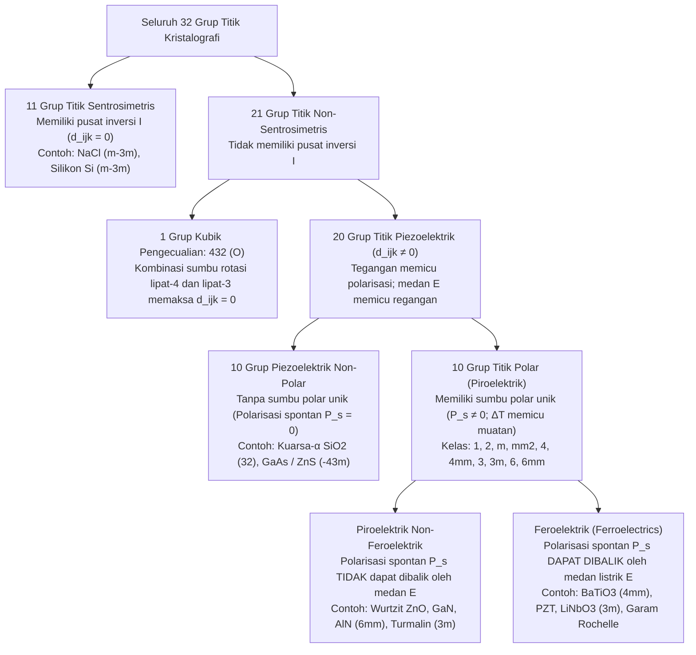
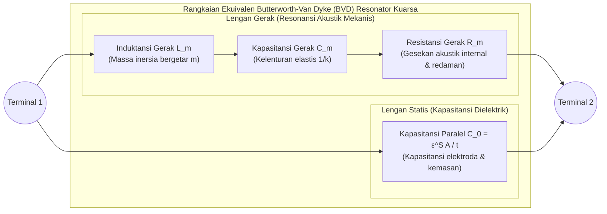

Saat Anda memutar kenop pemantik kompor gas atau menekan korek api elektrik hingga terdengar bunyi klik mekanis, percikan bunga api biru melompat menyalakan bahan bakar tanpa baterai maupun kabel listrik. Di dalam jam tangan kuarsa dan ponsel pintar Anda, kepingan mikroskopis kristal kuarsa ($\text{SiO}_2$) serta lapisan tipis aluminium nitrida ($\text{AlN}$) bergetar puluhan ribu hingga miliaran kali per detik dengan presisi luar biasa untuk menjaga detak waktu komputasi digital dan menyaring sinyal frekuensi radio 5G. Di rumah sakit, probe ultrasonografi (USG) memancarkan pulsa ultrasonik dan menangkap gemanya untuk menampilkan citra detak jantung janin secara *real-time*, sementara di laboratorium nanoteknologi, *Scanning Tunneling Microscope* (STM) dan *Atomic Force Microscope* (AFM) memetakan atom tunggal dengan resolusi vertikal lebih halus dari satu pikometer ($1\,\text{pm} = 10^{-12}\,\text{m}$).

Seluruh teknologi tersebut digerakkan oleh satu fenomena fisika fundamental: <strong>efek piezoelektrik (Piezoelectric Effect)</strong>. Diperkenalkan pada tahun 1881 oleh Wilhelm Gottlieb Hankel dari kata kerja bahasa Yunani $\pi\iota\epsilon\zeta\epsilon\iota\nu$ (*piezein*, yang berarti «menekan» atau «memeras»), piezoelektrik adalah kopling elektromekanis linier dan reversibel antara tegangan mekanis (*stress*) dan polarisasi dielektrik pada kristal yang tidak memiliki pusat simetri inversi.

Mengapa menekan kristal kuarsa atau keramik *lead zirconate titanate* (PZT) menghasilkan tegangan listrik, sedangkan menekan garam dapur ($\text{NaCl}$), silikon, atau kaca biasa sama sekali tidak menghasilkan sinyal listrik? Dalam artikel ini, kita membahas termodinamika, persamaan tensor konstitutif, teori grup simetri kristal, hingga rekayasa osilator kuarsa dan nanoposisitioning.

---

## Bab 1: Penemuan Historis dan Keharusan Termodinamika — Curie Bersaudara dan Prediksi Lippmann

### 1.1 1880: Pierre dan Jacques Curie Menemukan Efek Piezoelektrik Langsung

Pada tahun 1880 di laboratorium mineralogi Sorbonne, Paris, <strong>Pierre Curie</strong> (21 tahun) dan kakaknya <strong>Jacques Curie</strong> (24 tahun) meneliti <strong>piroelektrik</strong> (munculnya muatan listrik pada permukaan kristal seperti turmalin ketika dipanaskan atau didinginkan). Mereka menyadari bahwa perubahan suhu menyebabkan pemuaian termal anisotropik pada kisi kristal yang menggeser pusat muatan ion positif dan negatif. Berdasarkan hipotesis ini, pemberian tekanan mekanis secara langsung di sepanjang sumbu kristal yang asimetris pada suhu konstan juga harus menginduksi muatan listrik permukaan.

Menggunakan elektroda lembaran timah dan elektrometer kuadran Kelvin, Curie bersaudara pada tahun 1880 membuktikan <strong>efek piezoelektrik langsung (Direct Piezoelectric Effect)</strong> pada kristal tunggal <strong>kuarsa-$\alpha$ ($\text{SiO}_2$)</strong>, <strong>turmalin</strong>, <strong>topaz</strong>, <strong>sfalerit ($\text{ZnS}$)</strong>, <strong>gula tebu</strong>, dan <strong>garam Rochelle ($\text{KNaC}_4\text{H}_4\text{O}_6 \cdot 4\text{H}_2\text{O}$)</strong>:
1. Tegangan tekan mekanis menghasilkan muatan listrik permukaan $Q$ yang berbanding lurus dengan gaya $F$.
2. Mengganti tekanan (kompresi) dengan tarikan (tensi) membalikkan tanda aljabar muatan secara eksak.
3. Efek ini hanya muncul pada kristal yang tidak memiliki pusat simetri inversi.

### 1.2 1881: Deduksi Termodinamika Gabriel Lippmann tentang Efek Kebalikan (Konvers)

Pada tahun 1881, fisikawan <strong>Gabriel Lippmann</strong> menerapkan hukum pertama dan kedua termodinamika pada siklus elektromekanis reversibel dan membuktikan secara matematis keberadaan <strong>efek piezoelektrik kebalikan (Converse Piezoelectric Effect)</strong>: kristal piezoelektrik yang ditempatkan di dalam medan listrik eksternal $\mathbf{E}$ pasti mengalami regangan mekanis linier $\mathbf{S}$ dengan koefisien proporsionalitas yang identik dengan koefisien efek langsung.

Tinjau satu satuan volume kristal dielektrik pada suhu mutlak $\Theta$, rapat entropi $s$, tensor tegangan mekanis $T_{jk}$ ($\text{Pa}$), tensor regangan $S_{jk}$, vektor medan listrik $E_i$ ($\text{V/m}$), dan vektor perpindahan listrik $D_i = \varepsilon_0 E_i + P_i$ ($\text{C/m}^2$). Diferensial rapat energi dalam $U(s, S_{jk}, D_i)$ menurut konvensi penjumlahan Einstein adalah:

$$dU = \Theta\,ds + T_{jk}\,dS_{jk} + E_i\,dD_i$$

Melalui transformasi Legendre ke variabel bebas $(\Theta, T_{jk}, E_i)$, kita mendefinisikan rapat energi bebas Gibbs elastis-elektrik $G(\Theta, T_{jk}, E_i)$:

$$G(\Theta, T_{jk}, E_i) = U - \Theta s - T_{jk} S_{jk} - E_i D_i \quad \Longrightarrow \quad dG = -s\,d\Theta - S_{jk}\,dT_{jk} - D_i\,dE_i$$

Pada kondisi isotermal ($d\Theta = 0$), regangan dan perpindahan listrik diperoleh sebagai turunan parsial pertama dari fungsi keadaan $G$:

$$S_{jk} = -\left(\frac{\partial G}{\partial T_{jk}}\right)_{\mathbf{E}, \Theta}, \qquad D_i = -\left(\frac{\partial G}{\partial E_i}\right)_{\mathbf{T}, \Theta}$$

Berdasarkan teorema Schwarz tentang kesamaan turunan parsial kedua campuran ($\frac{\partial^2 G}{\partial E_i \partial T_{jk}} = \frac{\partial^2 G}{\partial T_{jk} \partial E_i}$), diperoleh <strong>relasi Maxwell termodinamika untuk piezoelektrik</strong>:

$$d_{ijk} \equiv \left(\frac{\partial D_i}{\partial T_{jk}}\right)_{\mathbf{E}, \Theta} = \left(\frac{\partial S_{jk}}{\partial E_i}\right)_{\mathbf{T}, \Theta}$$

Koefisien muatan piezoelektrik langsung dalam coulomb per newton ($\text{C/N}$) dan koefisien regangan kebalikan dalam meter per volt ($\text{m/V}$) bernilai identik ($\frac{\text{C}}{\text{N}} = \frac{\text{C}\cdot\text{m}}{\text{J}} = \frac{\text{m}}{\text{V}}$). Curie bersaudara segera memverifikasi pemanjangan mikroskopis ini dan menciptakan elektrometer kuarsa piezoelektrik, instrumen kunci yang digunakan Marie dan Pierre Curie pada tahun 1898 untuk mengukur arus ionisasi bijih uranium (*pitchblende*) serta mengisolasi polonium dan radium.

---

## Bab 2: Persamaan Konstitutif Tensor dan Prinsip Neumann

### 2.1 Persamaan Konstitutif Linier dan Notasi Matriks Voigt (IEEE)

Ekspansi deret Taylor dari $G(T_{jk}, E_i)$ hingga suku kuadratik di sekitar titik setimbang ($T_{jk}=0, E_i=0$) menghasilkan <strong>persamaan konstitutif piezoelektrik linier</strong>:

$$D_i = d_{ijk} T_{jk} + \varepsilon_{ij}^T E_j, \qquad S_{jk} = s_{jklm}^E T_{lm} + d_{ijk} E_i$$

di mana $\varepsilon_{ij}^T$ adalah tensor permitivitas pada tegangan konstan ($\text{F/m}$), $s_{jklm}^E$ adalah tensor kelenturan elastis (*compliance*) pada medan listrik konstan ($\text{Pa}^{-1}$), dan $d_{ijk}$ adalah tensor piezoelektrik tingkat tiga. Karena simetri $T_{jk} = T_{kj}$ dan $S_{jk} = S_{kj}$, berlaku $d_{ijk} = d_{ikj}$, sehingga jumlah komponen independen berkurang dari $27$ menjadi maksimal $3 \times 6 = 18$. Dalam <strong>notasi matriks Voigt</strong> $(11\to 1, 22\to 2, 33\to 3, 23\to 4, 13\to 5, 12\to 6)$ dengan $S_m = 2S_{jk}$ dan $d_{im} = 2d_{ijk}$ untuk geseran ($m=4,5,6$), persamaannya ditulis sebagai:

$$D_i = d_{im} T_m + \varepsilon_{ij}^T E_j, \qquad S_m = s_{mn}^E T_n + d_{jm} E_j \qquad (i,j \in \{1,2,3\};\; m,n \in \{1,\dots,6\})$$

Efisiensi konversi energi antara domain mekanis dan elektrik ditentukan oleh <strong>faktor kopling elektromekanis</strong> tak berdimensi $k^2 = \frac{d^2}{\varepsilon^T s^E}$.

### 2.2 Pembuktian Eksak melalui Prinsip Neumann: Mengapa Simetri Inversi Melarang Piezoelektrik

<strong>Prinsip Neumann</strong> (1885) menyatakan bahwa setiap tensor sifat fisis makroskopis suatu kristal harus tetap invarian di bawah seluruh operasi simetri $a_{ij}$ dari grup titik kristal tersebut.

Andaikan sebuah kristal memiliki <strong>pusat simetri inversi $\mathcal{I}$</strong> ($\mathbf{r} \to -\mathbf{r}$), yang direpresentasikan oleh matriks transformasi ortogonal $a_{ij} = -\delta_{ij}$:
1. <strong>Perpindahan listrik $D_i$ (vektor polar tingkat 1)</strong>: Di bawah inversi ruang, arah vektor berbalik tanda: $D'_i = a_{ip} D_p = -D_i$.
2. <strong>Tegangan mekanis $T_{jk}$ (tensor polar tingkat 2)</strong>: Dua gaya tekan berlawanan arah hanya bertukar tempat di bawah inversi tanpa mengubah keadaan kompresi: $T'_{jk} = a_{jq} a_{kr} T_{qr} = (-1)^2 T_{jk} = +T_{jk}$.
3. <strong>Tensor piezoelektrik $d_{ijk}$ (tensor polar tingkat 3)</strong>: Di bawah operasi inversi $\mathcal{I}$, tensor tingkat tiga bertransformasi dengan tiga faktor $(-1)$:
   $$d'_{ijk} = a_{ip} a_{jq} a_{kr} d_{pqr} = (-\delta_{ip})(-\delta_{jq})(-\delta_{kr}) d_{pqr} = (-1)^3 d_{ijk} = -d_{ijk}$$
   Namun menurut Prinsip Neumann, untuk kristal sentrosimetris tensor sifat material harus invarian: $d'_{ijk} = d_{ijk}$. Menggabungkan keduanya menghasilkan:
   $$d_{ijk} = -d_{ijk} \quad \Longrightarrow \quad 2d_{ijk} = 0 \quad \Longrightarrow \quad d_{ijk} \equiv 0 \quad (\forall i,j,k)$$

Terbukti secara matematis bahwa <strong>kristal apa pun yang memiliki pusat simetri inversi tidak mungkin memiliki efek piezoelektrik linier</strong>.

| Atribut Fisis | Efek Piezoelektrik | Elektrostrikasi | Efek Triboelektrik (Listrik Statis) |
| :--- | :--- | :--- | :--- |
| <strong>Asal Mikroskopis</strong> | Pergeseran elastis reversibel sub-kisi kation dan anion di dalam <strong>volume (bulk) sel satuan</strong> | Deformasi kuadratik <strong>kisi bulk</strong> akibat gaya polarisasi | Transfer elektron atau ion antarmuka pada <strong>permukaan kontak</strong> |
| <strong>Syarat Simetri</strong> | Terbatas pada <strong>20 grup titik piezoelektrik</strong> tanpa pusat inversi | <strong>Tidak ada</strong> (ada pada semua kristal, kaca, dan cairan) | <strong>Tidak ada</strong> (terjadi pada sembarang permukaan isolator/logam) |
| <strong>Skala Matematis</strong> | <strong>Linier (orde 1)</strong>: $D \propto T,\; S \propto E$ (berbalik tanda saat $E \to -E$) | <strong>Kuadratik (orde 2)</strong>: $S_{ij} = M_{ijkl} E_k E_l$ (tidak berbalik tanda) | <strong>Nonlinier dan stokastik</strong> (bergantung pada kelembapan dan kekasaran) |
| <strong>Reversibilitas</strong> | <strong>Sangat reversibel</strong> (Efek langsung $\Longleftrightarrow$ Efek kebalikan) | <strong>Satu arah pada $E=0$</strong> (tegangan mekanis saja tidak memicu polarisasi) | <strong>Ireversibel dan disipatif</strong> |

---

## Bab 3: Hierarki 32 Grup Titik Kristalografi

Dalam kristalografi tiga dimensi terdapat tepat <strong>32 grup titik (kelas kristal)</strong> yang diklasifikasikan oleh prinsip Neumann ke dalam hierarki berikut:

Dari 21 grup tanpa pusat inversi, <strong>20 grup bersifat piezoelektrik</strong>: satu-satunya pengecualian adalah grup kubik kiral <strong>$432$ ($O$)</strong>, di mana kombinasi sumbu rotasi lipat-4 ($90^\circ$) dan lipat-3 ($120^\circ$) melenyapkan komponen geser terakhir $d_{312}$ ($d'_{312} = -d_{321} = -d_{312} \implies d_{312} = 0$). Di antara 20 grup piezoelektrik tersebut, <strong>10 grup polar (piroelektrik)</strong> memiliki sumbu polar tunggal dengan polarisasi spontan permanen $\mathbf{P}_s \neq \mathbf{0}$. Apabila arah $\mathbf{P}_s$ dapat dibalik secara reversibel oleh medan listrik eksternal di atas medan koersif $E_c$ (kurva histeresis), kristal tersebut dinamakan <strong>feroelektrik</strong>.

---

## Bab 4: Struktur Kristal Mikroskopis — Kuarsa-$\alpha$ vs. Perovskit Feroelektrik ($\text{BaTiO}_3$, PZT)

### 4.1 Kuarsa-$\alpha$ ($\text{SiO}_2$, Grup Titik Trigonal $32$)

Di bawah suhu $573\,^\circ\text{C}$, kuarsa mengkristal dalam grup titik trigonal $32$ (kuarsa-$\alpha$) dengan tetrahedra $\text{SiO}_4$ membentuk rantai heliks di sepanjang sumbu optik $Z$ (sumbu lipat-3), disertai tiga sumbu elektrik $X$ (sumbu lipat-2 bersudut $120^\circ$) dan tiga sumbu mekanis $Y$ pada bidang $XY$. Simetri grup $32$ menyederhanakan matriks piezoelektrik menjadi hanya dua konstanta independen ($d_{11} = 2,31\,\text{pC/N}$ dan $d_{14} = -0,727\,\text{pC/N}$):

$$\mathbf{d}_{\text{Kuarsa (32)}} = \begin{pmatrix} d_{11} & -d_{11} & 0 & d_{14} & 0 & 0 \\ 0 & 0 & 0 & 0 & -d_{14} & -2d_{11} \\ 0 & 0 & 0 & 0 & 0 & 0 \end{pmatrix}$$

Tanpa beban mekanis, pusat muatan kation $\text{Si}^{4+}$ dan anion $\text{O}^{2-}$ berimpit ($\mathbf{P}_s = \mathbf{0}$). Tekanan di sepanjang sumbu elektrik $X$ (efek longitudinal $D_1 = d_{11} T_1$) atau tarikan di sepanjang sumbu mekanis $Y$ (efek transversal $D_1 = -d_{11} T_2$) mendistorsi cincin heksagonal tetrahedra dan memisahkan pusat muatan positif serta negatif di sepanjang sumbu $X$. Medan listrik $E_2$ pada sumbu $Y$ membangkitkan getaran geser-ketebalan (*thickness-shear*) melalui $d_{26} = -2d_{11}$.

### 4.2 Perovskit Feroelektrik ($\text{BaTiO}_3$, PZT), Poling, dan Batas Fase Morfotropik (MPB)

Oksida perovskit $\text{ABO}_3$ seperti barium titanat ($\text{BaTiO}_3$) dan *lead zirconate titanate* ($\text{Pb(Zr}_x\text{Ti}_{1-x}\text{)O}_3$, PZT) berstruktur kubik sentrosimetris ($m\bar{3}m$, $d_{ijk}=0$) di atas suhu Curie $T_C$. Di bawah $T_C$, kation pusat $\text{Ti}^{4+}/\text{Zr}^{4+}$ bergeser keluar dari pusat oktahedron oksigen $\text{O}_6$, menghasilkan fase tetragonal ($4mm$) atau rombohedral ($3m$) dengan polarisasi spontan yang besar.

Keramik polikristalin hasil sintering awalnya memiliki domain feroelektrik yang terorientasi acak sehingga bersifat isotropik secara makroskopis ($d_{ijk}=0$). Proses <strong>polarisasi tegangan tinggi searah (Poling)</strong> menyeragamkan arah domain dan menurunkan simetri ke grup Curie $\infty m$ (isomorfik dengan $6mm$, memiliki konstanta $d_{33}, d_{31}, d_{15}$). Pada PZT di <strong>batas fase morfotropik (MPB, $x \approx 0,52$)</strong>, koeksistensi 6 arah tetragonal $\langle 100 \rangle$ dan 8 arah rombohedral $\langle 111 \rangle$ melalui fase jembatan monoklinik (grup $m$) meratakan permukaan energi bebas dan memudahkan <strong>rotasi polarisasi</strong>, menghasilkan koefisien raksasa $d_{33} \approx 300\text{–}600\,\text{pC/N}$.

---

## Bab 5: Fisika Resonansi dan Osilator Kristal Kuarsa — Rangkaian Ekuivalen Butterworth-Van Dyke (BVD)

Di dekat frekuensi alami gelombang tegak akustik ($t = n\lambda/2$), keping kuarsa yang bergetar secara elektrik setara dengan lengan gerak seri ($L_m, C_m, R_m$) yang tersusun paralel dengan kapasitansi elektroda statis $C_0$, membentuk <strong>rangkaian ekuivalen Butterworth-Van Dyke (BVD)</strong>:

Dengan mengabaikan disipasi kecil ($R_m \to 0$), admitansi total $Y(\omega) = j\omega C_0 + \left(j\omega L_m + \frac{1}{j\omega C_m}\right)^{-1}$ memberikan dua frekuensi resonansi utama:
1. <strong>Frekuensi resonansi seri ($f_s$)</strong> (impedansi minimum $Z \approx R_m$):
   $$f_s = \frac{1}{2\pi\sqrt{L_m C_m}}$$
2. <strong>Frekuensi resonansi paralel atau antiresonansi ($f_p$)</strong> (admitansi nol $Y(\omega_p) = 0$):
   $$f_p = f_s \sqrt{1 + \frac{C_m}{C_0}} \approx f_s \left(1 + \frac{C_m}{2C_0}\right)$$

Kristal bersifat induktif hanya di dalam jendela frekuensi sempit $f_s < f < f_p$. Berkat redaman internal yang sangat rendah, kuarsa mencapai <strong>faktor kualitas $Q = \frac{\omega_s L_m}{R_m} \sim 10^5\text{–}10^6$</strong>. Jam tangan kuarsa menggunakan garpu tala miniatur pada frekuensi <strong>$32.768\,\text{Hz} = 2^{15}\,\text{Hz}$</strong> (dibagi oleh 15 tingkat *flip-flop* biner menjadi detak $1\,\text{Hz}$), sedangkan <strong>potongan AT (AT-cut)</strong> ($35^\circ 15'$ terhadap sumbu $Z$) menghasilkan kurva suhu kubik dengan koefisien suhu nol pada suhu ruang. Pada ponsel 5G, filter gelombang akustik <strong>SAW</strong> dan <strong>BAW/FBAR</strong> ($\text{AlN}$) menyaring sinyal radio gigahertz.

---

## Bab 6: Ultrasonografi Medis dan Nanopositioning Sub-Pikometer (STM/AFM)

1. <strong>Sonar Langevin, USG Phased-Array, dan Lapisan Penyesuai Impedansi $\lambda/4$</strong>:
   Transduser ultrasonik medis memancarkan pulsa lewat efek kebalikan dan mendeteksi gema lewat efek langsung. Untuk mencegah pantulan $82\%$ energi akustik akibat perbedaan impedansi antara PZT ($Z_{\text{PZT}} \approx 30\,\text{MRayl}$) dan jaringan lunak tubuh ($Z_{\text{jaringan}} \approx 1,5\,\text{MRayl}$), dipasang <strong>lapisan penyesuai akustik setebal $\lambda/4$</strong> dengan impedansi rata-rata geometrik $Z_{\text{match}} = \sqrt{Z_{\text{PZT}} Z_{\text{jaringan}}} \approx 6,7\,\text{MRayl}$.
2. <strong>Pemindai STM/AFM dan Aktuator Piezoelektrik Multilapis</strong>:
   Pada *Scanning Tunneling Microscope* (Binnig & Rohrer, Nobel Fisika 1986), tabung PZT empat kuadran menggerakkan jarum logam tanpa gesekan maupun *backlash* dengan resolusi vertikal lebih halus dari $0,01\,\text{\AA}$ ($1\,\text{pm}$) demi menjaga arus terowongan kuantum $I_t \propto V e^{-2\kappa z}$ tetap konstan. Aktuator tumpuk multilapis ($\Delta L = N d_{33} V$) juga menggerakkan injektor diesel *Common-Rail* $200\,\text{MPa}$ dan kepala cetak printer *inkjet*.
