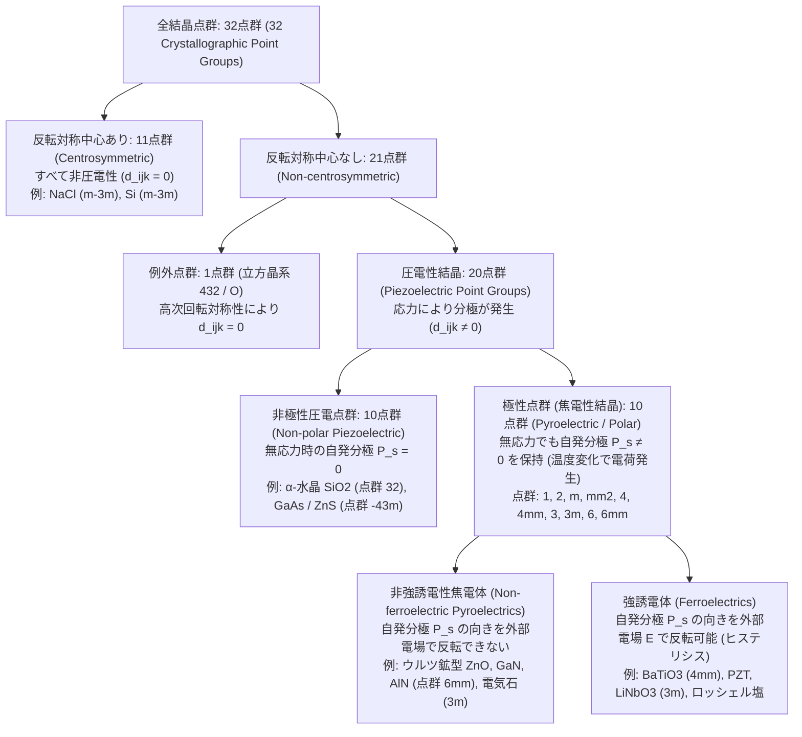
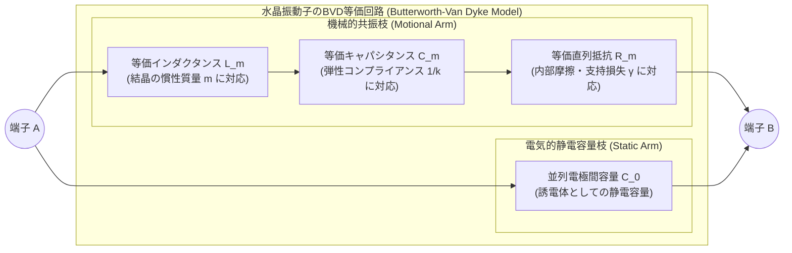

ガスコンロのつまみをひねって「カチッ」と鳴らすとき、電池もコンセントもないのに青い火花が飛んでガスに点火する。手首のクォーツ腕時計やスマートフォンの内部では、1秒間に何万回、あるいは何十億回という驚異的な精度で微小な結晶片が振動し、デジタル社会の時間の基準と無線通信の周波数フィルタを支えている。病院の産婦人科や循環器科では、プローブを肌に当てるだけで胎児の姿や心臓の弁の動きがリアルタイムの断層映像として描き出され、ナノテクノロジーの最先端研究所では、固体表面の単一原子の並びを100分の1オングストローム（$1\,\text{pm} = 10^{-12}\,\text{m}$）という途方もない精度でなぞり出す顕微鏡が稼働している。

これら一見するとまったく無関係に見える技術のすべてを、ただ一つの物理現象が根底で貫いている。それが<strong>圧電効果（Piezoelectric Effect：ピエゾ電気効果）</strong>である。ギリシャ語で「押す・圧迫する」を意味する $\pi\iota\epsilon\zeta\epsilon\iota\nu$（piezein）を語源とするこの現象は、<strong>「特定の結晶に機械的な力（応力）を加えると電圧（誘電分極）が発生し、逆に電圧（電場）を加えると結晶が機械的に変形（歪み）を起こす」</strong>という、力学系と電磁気学系の間の可逆的かつ直接的なエネルギー変換作用である。

なぜ、ただの石ころやガラス、あるいは食塩（$\text{NaCl}$）の結晶をいくら強く叩いても電気は生まれないのに、水晶（石英：$\text{SiO}_2$）やチタン酸ジルコン酸鉛（PZT）の結晶を押すと電気が生まれるのか？ そしてなぜ、歯車やモーターでは到底不可能な「原子1個のサイズよりはるかに小さな変位」を、圧電素子は摩擦もガタつき（バックラッシュ）もなしに自在に制御できるのか？

その答えは、単なる材料の化学組成の違いにあるのではなく、結晶格子という3次元空間の幾何学的な<strong>「対称性の破れ（反転対称中心の欠如）」</strong>にある。本稿では、1880年のキュリー兄弟による発見とリップマンによる熱力学的必然性の導出から出発し、テンソル解析とノイマンの原理による対称性禁止則の厳密な証明、32の結晶点群の分類階層、水晶とペロブスカイト型強誘電体のミクロな双極子機構、水晶振動子のバターワース・ヴァン・ダイク（BVD）等価回路と超高 $Q$ 値共振の物理、そしてソナー・医療用超音波から走査型プローブ顕微鏡（STM/AFM）に至る先端応用までを一貫した数理と物理の視点から徹底的に解き明かす。

---

## 第1章：歴史的発見と熱力学的必然性——キュリー兄弟の実験とリップマンの予言

### 1.1 1880年：ピエール・キュリーとジャック・キュリーによる正圧電効果の発見

圧電効果の発見は、経験的な偶然の産物ではなく、結晶の幾何学的対称性と物理現象の関係を見抜いた深い洞察の帰結であった。1880年、当時まだ21歳だった<strong>ピエール・キュリー（Pierre Curie）</strong>と24歳の兄<strong>ジャック・キュリー（Jacques Curie）</strong>は、パリ大学の鉱物学研究室において、結晶を加熱した際に表面に電荷が現れる<strong>焦電効果（Pyroelectricity）</strong>と結晶の対称性の関係を調査していた。

当時すでに、電気石（トルマリン：Tourmaline）などの結晶を加熱・冷却すると、結晶の特定の軸の両端に正負の電荷が現れることが知られていた。キュリー兄弟は、温度変化によって電荷が生じる原因が「熱膨張による結晶格子の非対称な変形（内部応力）」にあるのではないかと推論した。もしそうであるならば、温度を変えなくとも、結晶の対称軸に沿って外部から直接機械的な圧力（応力）を加えれば、まったく同じように表面電荷が誘起されるはずである。

彼らは直ちに錫箔（スズ箔）とトムソン電位計を用いた精巧な実験装置を組み立て、<strong>水晶（$\alpha$-Quartz, $\text{SiO}_2$）</strong>、<strong>電気石（Tourmaline）</strong>、<strong>閃亜鉛鉱（Sphalerite, $\text{ZnS}$）</strong>、<strong>異極鉱（Hemimorphite）</strong>、そして<strong>ロッシェル塩（Rochelle salt：酒石酸カリウムナトリウム四水和物 $\text{KNaC}_4\text{H}_4\text{O}_6 \cdot 4\text{H}_2\text{O}$）</strong>などの単結晶に重りを載せて圧縮応力を加えた。結果は彼らの予想を完璧に裏付けるものであった。

1. 結晶の特定の方向に機械的応力を加えると、応力の大きさに厳密に比例した電荷が結晶表面に発生する。
2. 圧縮応力を引張応力（減圧）に切り替えると、発生する電荷の符号（正負）が正確に反転する。
3. この現象はすべての結晶で起きるのではなく、<strong>結晶構造に「半面像性（Hemihedrism：後の結晶学における反転対称中心の欠如）」がある結晶においてのみ</strong>、しかも特定の結晶軸方向に沿ってのみ発現する。

これが機械的エネルギーを電気的エネルギーへと変換する<strong>正圧電効果（Direct Piezoelectric Effect）</strong>の発見である。

### 1.2 1881年：ガブリエル・リップマンの熱力学的予言と逆圧電効果

キュリー兄弟の発見の報に接した物理学者<strong>ガブリエル・リップマン（Gabriel Lippmann）</strong>は、翌1881年、熱力学のエネルギー保存則と可逆過程の原理（マクスウェルの関係式）を電気力学系へ拡張することで、驚くべき理論的帰結を導き出した。すなわち、「応力を加えて電荷（電気変位）が生じるならば、熱力学的な対称性から、<strong>逆に結晶に外部電場を印加すれば、電場の強さに比例して結晶が機械的に伸縮（歪み）しなければならない</strong>」という予言である。

この<strong>逆圧電効果（Converse Piezoelectric Effect）</strong>の必然性は、結晶の単位体積あたりの熱力学ポテンシャル（電気的ギブズ自由エネルギー密度 $G$）を考えることで、極めて美しく証明される。

結晶の温度を $\Theta$、エントロピー密度を $s$、機械的応力テンソルを $T_{jk}$（単位：$\text{N/m}^2 = \text{Pa}$）、機械的歪みテンソルを $S_{jk}$（無次元）、電場ベクトルを $E_i$（単位：$\text{V/m}$）、電束密度（電気変位）ベクトルを $D_i$（単位：$\text{C/m}^2$）とする。可逆過程における内部エネルギー密度 $U(s, S_{jk}, D_i)$ の全微分は、熱、弾性仕事、電気的仕事の和として次のように書ける（アインシュタインの縮約記法を用い、重複する添字については和をとるものとする）：

$$dU = \Theta\,ds + T_{jk}\,dS_{jk} + E_i\,dD_i$$

実験室で制御しやすい独立変数は、歪み $S_{jk}$ や電束密度 $D_i$ ではなく、外部から加える<strong>応力 $T_{jk}$</strong>、<strong>電場 $E_i$</strong>、および<strong>温度 $\Theta$</strong> である。そこでルジャンドル変換（Legendre transformation）を施し、電気的ギブズ自由エネルギー密度 $G(\Theta, T_{jk}, E_i)$ を次のように定義する：

$$G(\Theta, T_{jk}, E_i) = U - \Theta s - T_{jk} S_{jk} - E_i D_i$$

この両辺の全微分をとると、$dU$ の項が相殺して次の基本熱力学関係式が得られる：

$$dG = -s\,d\Theta - S_{jk}\,dT_{jk} - D_i\,dE_i$$

等温過程（$d\Theta = 0$）において、歪み $S_{jk}$ と電束密度 $D_i$ はそれぞれギブズ自由エネルギー $G$ の偏微分として与えられる：

$$S_{jk} = -\left(\frac{\partial G}{\partial T_{jk}}\right)_{\mathbf{E}, \Theta}, \qquad D_i = -\left(\frac{\partial G}{\partial E_i}\right)_{\mathbf{T}, \Theta}$$

ここで、状態関数 $G$ が滑らかであることから、二階偏微分の順序は交換可能である（シュワルツの定理：$\frac{\partial^2 G}{\partial E_i \partial T_{jk}} = \frac{\partial^2 G}{\partial T_{jk} \partial E_i}$）。したがって、直ちに次の<strong>熱力学的マクスウェル関係式（Thermodynamic Maxwell Relation）</strong>が成立する：

$$d_{ijk} \equiv \left(\frac{\partial D_i}{\partial T_{jk}}\right)_{\mathbf{E}, \Theta} = -\frac{\partial^2 G}{\partial T_{jk} \partial E_i} = -\frac{\partial^2 G}{\partial E_i \partial T_{jk}} = \left(\frac{\partial S_{jk}}{\partial E_i}\right)_{\mathbf{T}, \Theta}$$

この式が意味する物理的事実は極めて深遠である。左辺の $\left(\partial D_i / \partial T_{jk}\right)_{\mathbf{E}}$ は「一定電場（短絡条件）下で単位応力を加えたときに発生する電荷密度」、すなわち<strong>正圧電効果の圧電歪み定数（単位：$\text{C/N}$）</strong>である。一方、右辺の $\left(\partial S_{jk} / \partial E_i\right)_{\mathbf{T}}$ は「一定応力（自由境界条件）下で単位電場を印加したときに生じる機械的歪み」、すなわち<strong>逆圧電効果の圧電歪み定数（単位：$\text{m/V}$）</strong>である。

単位系を確認すると、

$$\frac{\text{C}}{\text{N}} = \frac{\text{C}}{\text{J}/\text{m}} = \frac{\text{C}\cdot\text{m}}{\text{V}\cdot\text{C}} = \frac{\text{m}}{\text{V}}$$

となり、両者は次元の上でも数値の上でも<strong>熱力学の第二法則とエネルギー保存則によって100%完全に同一のテンソル $d_{ijk}$</strong> でなければならないことが保証されるのである。

リップマンのこの理論発表を受けたキュリー兄弟は、直ちに水晶の薄片に電圧を印加する実験を行い、わずか数ナノメートルという極微小な結晶の伸縮を光学的てこ（拡大機構）によって検出し、逆圧電効果の実在を実験的に証明した。さらに彼らは、この原理を応用して<strong>「圧電石英電位計（Piezoelectric Quartz Electrometer）」</strong>を発明した。これは既知の重りで水晶板を引っ張ることで精密な基準電荷を発生させ、未知の微弱電流をゼロ位法で測定する装置であり、その約17年後、ピエール・キュリーと妻<strong>マリー・キュリー（Marie Curie）</strong>がピッチブレンド（瀝青ウラン鉱）の膨大な試料からポロニウムとラジウムの微弱な放射線電離電流を定量測定し、放射能（Radioactivity）の概念を確立する上で決定的な役割を果たしたのである。

---

## 第2章：テンソル構成方程式とノイマンの原理——なぜ反転対称中心を持つ結晶は圧電性を持たないのか

### 2.1 線形圧電構成方程式とフォークト表記（Voigt Notation）

電場 $\mathbf{E}$ と応力 $\mathbf{T}$ の周りでギブズ自由エネルギー $G$ を2次までテイラー展開し、線形応答領域における電束密度 $D_i$ と歪み $S_{jk}$ を書き下すと、弾性（フックの法則）と誘電性（ガウスの法則の構成方程式）が圧電テンソル $d_{ijk}$ によって結合した<strong>圧電基本構成方程式（Piezoelectric Constitutive Equations）</strong>が得られる：

$$\begin{aligned}
D_i &= d_{ijk} T_{jk} + \varepsilon_{ij}^T E_j \\
S_{jk} &= s_{jklm}^E T_{lm} + d_{ijk} E_i
\end{aligned}$$

ここで、
* $\varepsilon_{ij}^T$ は一定応力（機械的に自由な状態：$T = \text{const.}$）における2階の<strong>誘電率テンソル</strong>（単位：$\text{F/m}$）、
* $s_{jklm}^E$ は一定電場（電気的に短絡された状態：$E = \text{const.}$）における4階の<strong>弾性コンプライアンス・テンソル</strong>（ヤング率の逆数に対応、単位：$\text{m}^2/\text{N} = \text{Pa}^{-1}$）、
* $d_{ijk}$ は3階の<strong>圧電歪みテンソル</strong>（単位：$\text{C/N}$ または $\text{m/V}$）である。

3次元空間において、1階ベクトル（$E_i, D_i$）は3成分、2階テンソル（$T_{jk}, S_{jk}$）は $3 \times 3 = 9$ 成分、3階テンソル $d_{ijk}$ は $3^3 = 27$ 成分、4階テンソル $s_{jklm}^E$ は $3^4 = 81$ 成分を持つ。しかし、結晶の角運動量保存則および歪みの定義から、応力テンソルと歪みテンソルは常に対称テンソル（$T_{jk} = T_{kj}$、$S_{jk} = S_{kj}$）であるため、独立な機械的成分は9個ではなく<strong>6個</strong>である。この対称性により、圧電テンソル $d_{ijk}$ も後半の2つの添字について対称（$d_{ijk} = d_{ikj}$）となり、独立な成分数は最大でも $3 \times 6 = 18$ 個に縮約される。

工学および結晶物理学の標準規格（IEEE Standard on Piezoelectricity）では、対称な添字のペア $(jk)$ を $1$ から $6$ までの1つの添字 $m$ に置き換える<strong>フォークト表記（Voigt notation / 行列形式）</strong>が広く用いられる：

$$(11) \to 1, \quad (22) \to 2, \quad (33) \to 3, \quad (23, 32) \to 4, \quad (13, 31) \to 5, \quad (12, 21) \to 6$$

ここで $1, 2, 3$ はそれぞれ直交座標軸 $X, Y, Z$ に沿った垂直応力・垂直歪み（伸縮）を表し、$4, 5, 6$ はそれぞれ $X, Y, Z$ 軸周りの剪断応力・剪断歪み（ずり変形）を表す（なお、歪みテンソルと圧電定数については工学剪断歪み $S_m = 2S_{jk}$ $(m=4,5,6)$ に合わせて $d_{im} = 2d_{ijk}$ $(m=4,5,6)$ と定義することで、行列積の係数を統一する）。これにより、圧電構成方程式は $3 \times 6$ の圧電行列 $\mathbf{d}$ を用いて次のように簡潔な行列形式で記述される：

$$\begin{pmatrix} D_1 \\ D_2 \\ D_3 \end{pmatrix} = \begin{pmatrix} d_{11} & d_{12} & d_{13} & d_{14} & d_{15} & d_{16} \\ d_{21} & d_{22} & d_{23} & d_{24} & d_{25} & d_{26} \\ d_{31} & d_{32} & d_{33} & d_{34} & d_{35} & d_{36} \end{pmatrix} \begin{pmatrix} T_1 \\ T_2 \\ T_3 \\ T_4 \\ T_5 \\ T_6 \end{pmatrix} + \begin{pmatrix} \varepsilon_{11}^T & \varepsilon_{12}^T & \varepsilon_{13}^T \\ \varepsilon_{21}^T & \varepsilon_{22}^T & \varepsilon_{23}^T \\ \varepsilon_{31}^T & \varepsilon_{32}^T & \varepsilon_{33}^T \end{pmatrix} \begin{pmatrix} E_1 \\ E_2 \\ E_3 \end{pmatrix}$$

$$\begin{pmatrix} S_1 \\ S_2 \\ S_3 \\ S_4 \\ S_5 \\ S_6 \end{pmatrix} = \begin{pmatrix} s_{11}^E & s_{12}^E & s_{13}^E & s_{14}^E & s_{15}^E & s_{16}^E \\ s_{21}^E & s_{22}^E & s_{23}^E & s_{24}^E & s_{25}^E & s_{26}^E \\ s_{31}^E & s_{32}^E & s_{33}^E & s_{34}^E & s_{35}^E & s_{36}^E \\ s_{41}^E & s_{42}^E & s_{43}^E & s_{44}^E & s_{45}^E & s_{46}^E \\ s_{51}^E & s_{52}^E & s_{53}^E & s_{54}^E & s_{55}^E & s_{56}^E \\ s_{61}^E & s_{62}^E & s_{63}^E & s_{64}^E & s_{65}^E & s_{66}^E \end{pmatrix} \begin{pmatrix} T_1 \\ T_2 \\ T_3 \\ T_4 \\ T_5 \\ T_6 \end{pmatrix} + \begin{pmatrix} d_{11} & d_{21} & d_{31} \\ d_{12} & d_{22} & d_{32} \\ d_{13} & d_{23} & d_{33} \\ d_{14} & d_{24} & d_{34} \\ d_{15} & d_{25} & d_{35} \\ d_{16} & d_{26} & d_{36} \end{pmatrix} \begin{pmatrix} E_1 \\ E_2 \\ E_3 \end{pmatrix}$$

なお、独立変数の選び方（$(\mathbf{T}, \mathbf{E})$、$(\mathbf{S}, \mathbf{E})$、$(\mathbf{T}, \mathbf{D})$、$(\mathbf{S}, \mathbf{D})$ の4通り）に応じて、以下の4種類の圧電定数が使い分けられる：

* <strong>$d$-形式（圧電歪み定数 $d_{im}$）</strong>：$D_i = d_{im} T_m + \varepsilon_{ij}^T E_j$, $S_m = s_{mn}^E T_n + d_{jm} E_j$（アクチュエータの自由変位や短絡電荷検出に最適）
* <strong>$e$-形式（圧電応力定数 $e_{im}$）</strong>：$D_i = e_{im} S_m + \varepsilon_{ij}^S E_j$, $T_m = c_{mn}^E S_n - e_{jm} E_j$（薄膜共振器や波動方程式の解析に最適、$c_{mn}^E$ は弾性スティフネス定数）
* <strong>$g$-形式（圧電電圧定数 $g_{im}$）</strong>：$E_i = -g_{im} T_m + \beta_{ij}^T D_j$, $S_m = s_{mn}^D T_n + g_{jm} D_j$（開放回路での発生電圧や高電圧着火・圧力センサに最適、$g_{im} = d_{im}/\varepsilon^T$）
* <strong>$h$-形式（$h_{im}$）</strong>：$E_i = -h_{im} S_m + \beta_{ij}^S D_j$, $T_m = c_{mn}^D S_n - h_{jm} D_j$

また、電気エネルギーと機械エネルギーの相互変換効率を定量化する最も重要な無次元指標が<strong>電気機械結合係数（Electromechanical Coupling Factor） $k$</strong> であり、1次元モードでは次のように定義される：

$$k^2 = \frac{\text{変換された機械（または電気）エネルギー}}{\text{投入された全電気（または機械）エネルギー}} = \frac{d^2}{\varepsilon^T s^E}$$

この結合係数 $k$ の存在により、結晶を電気的に短絡したときの弾性コンプライアンス $s^E$ と、電気的に開放（絶縁：$D = \text{const.}$）したときの弾性コンプライアンス $s^D$ の間には、

$$s^D = s^E (1 - k^2), \qquad \varepsilon^S = \varepsilon^T (1 - k^2)$$

という<strong>「圧電硬化（Piezoelectric Stiffening）」</strong>の関係が成り立つ。すなわち、圧電結晶は電極をオープンにして変形させようとすると、変形によって自ら生み出した内部電場（反電場）が変形を妨げる方向に逆圧電応力を発生させるため、短絡状態のときよりも実効的に「硬く（ヤング率が高く）」なるのである。

### 2.2 ノイマンの原理と反転対称中心の禁止則の厳密証明

では、いかなる結晶において圧電テンソル $d_{ijk}$ が非ゼロの値を持つことができるのか？ それを決定するのが、1885年にフランツ・エルンスト・ノイマン（Franz Ernst Neumann）が定式化した結晶物理学の最高原理、<strong>ノイマンの原理（Neumann's Principle）</strong>である。

> <strong>ノイマンの原理</strong>：結晶が持ついかなる巨視的物理特性の対称要素も、その結晶が属する結晶点群（Point Group）の対称要素をすべて含んでいなければならない。すなわち、結晶格子を不変に保つ座標変換（点群の対称操作）のもとで、その結晶の物性テンソルは完全に不変でなければならない。

いま、結晶が<strong>反転対称中心（Center of Inversion Symmetry / Centrosymmetry）</strong>を持っていると仮定しよう。空間反転操作 $\mathcal{I}$ とは、原点を基準としてすべての位置ベクトル $\mathbf{r} = (x_1, x_2, x_3)$ を $-\mathbf{r} = (-x_1, -x_2, -x_3)$ へと写す座標変換である。直交座標変換行列 $a_{ij}$ を用いれば、空間反転操作はクロネッカーのデルタ $\delta_{ij}$ を使って次のように表される：

$$x'_i = a_{ij} x_j, \qquad a_{ij} = -\delta_{ij} = \begin{pmatrix} -1 & 0 & 0 \\ 0 & -1 & 0 \\ 0 & 0 & -1 \end{pmatrix}$$

この空間反転操作 $\mathcal{I}$ のもとで、物理量がどのように変換するかを調べよう。

1. <strong>誘電分極 $P_i$（および電束密度 $D_i$、電場 $E_i$）の変換</strong>：
   電気双極子モーメントは負電荷から正電荷へ向かう変位ベクトルに比例するため、1階の<strong>極性ベクトル（Polar vector）</strong>である。したがって、空間反転 $\mathbf{r} \to -\mathbf{r}$ のもとでは矢印の向きが完全に逆転し、符号が反転する：
   $$D'_i = a_{ip} D_p = (-\delta_{ip}) D_p = -D_i$$

2. <strong>機械的応力 $T_{jk}$（および歪み $S_{jk}$）の変換</strong>：
   応力は単位面積あたりの力であり、例えば両側から結晶を圧縮する（または引っ張る）操作を考えると、空間を $\mathbf{r} \to -\mathbf{r}$ と反転させても、「右から左へ押す力」と「左から右へ押す力」が入れ替わるだけであり、圧縮応力状態そのものはまったく変化しない。数学的にも、2階の極性テンソルは変換行列 $a$ が2回掛かるため、符号が反転しない<strong>偶テンソル</strong>となる：
   $$T'_{jk} = a_{jq} a_{kr} T_{qr} = (-\delta_{jq})(-\delta_{kr}) T_{qr} = (-1)^2 T_{jk} = +T_{jk}$$

3. <strong>3階の圧電テンソル $d_{ijk}$ の変換と消滅</strong>：
   一般に $n$ 階の極性テンソルは、座標変換 $a_{ij}$ のもとで $n$ 個の変換行列の積によって変換する。圧電テンソル $d_{ijk}$ は1階ベクトル $D_i$ と2階テンソル $T_{jk}$ を結ぶ<strong>3階の極性テンソル（奇数階テンソル）</strong>であるため、空間反転操作 $\mathcal{I}$ のもとでの変換則は次のようになる：
   $$d'_{ijk} = a_{ip} a_{jq} a_{kr} d_{pqr} = (-\delta_{ip})(-\delta_{jq})(-\delta_{kr}) d_{pqr} = (-1)^3 d_{ijk} = -d_{ijk}$$
   一方で、もしこの結晶が<strong>反転対称中心 $\mathcal{I}$ を持つ</strong>ならば、空間反転操作を行っても結晶格子は元の状態と完全に重なり合い、物理的に全く区別できない。したがってノイマンの原理により、反転後の圧電テンソル $d'_{ijk}$ は反転前の圧電テンソル $d_{ijk}$ と等しくなければならない：
   $$d'_{ijk} = d_{ijk}$$
   以上の2式を連立させると、すべての添字 $i, j, k \in \{1, 2, 3\}$ に対して、
   $$d_{ijk} = -d_{ijk} \quad \Longrightarrow \quad 2 d_{ijk} = 0 \quad \Longrightarrow \quad d_{ijk} \equiv 0$$
   が導かれる。

これが<strong>「反転対称中心を持つすべての結晶（食塩 $\text{NaCl}$、ダイヤモンド、シリコン、金属単結晶、および巨視的に等方的なガラスや未分極の多結晶体）において、圧電効果は数学的・対称性的に厳密にゼロとなる」</strong>ことの完全な証明である。直観的に言えば、反転対称中心を持つ結晶を上下から押し潰したとき、結晶内部のイオンが変位したとしても、上向きと下向きが完全に等価であるため、「上向きに分極すべきか、下向きに分極すべきか」を決める非対称な方向（極性）が結晶内部に一切存在せず、正電荷の重心と負電荷の重心は常に同じ位置に留まり続けるのである。

### 2.3 電歪効果（Electrostriction）および摩擦帯電（Triboelectricity）との決定的な違い

圧電効果の物理的本質をさらに浮き彫りにするため、しばしば混同される2つの現象——<strong>電歪効果（Electrostriction）</strong>と<strong>摩擦帯電（Triboelectricity）</strong>——との違いを明確にしておこう。

#### (1) 圧電効果 vs 電歪効果（Electrostriction）
電場 $E$ に対する歪み $S$ の応答を、1次の線形項（圧電効果）だけでなく2次の非線形項まで展開すると、次のようになる：

$$S_{ij} = d_{kij} E_k + M_{ijkl} E_k E_l$$

この第2項 $M_{ijkl} E_k E_l$（電場の2乗に比例する機械的歪み）が<strong>電歪効果（Electrostriction）</strong>である。ここで電歪係数 $M_{ijkl}$ は<strong>4階の極性テンソル（偶数階テンソル）</strong>である。空間反転操作 $\mathcal{I}: a_{ij} = -\delta_{ij}$ を作用させると、

$$M'_{ijkl} = a_{ip} a_{jq} a_{kr} a_{ls} M_{pqrs} = (-1)^4 M_{ijkl} = +M_{ijkl}$$

となり、反転対称性の有無にかかわらずノイマンの原理の要請 $M'_{ijkl} = M_{ijkl}$ を自動的に満たす！ したがって、<strong>電歪効果は反転対称中心を持つ結晶（シリコンや $\text{NaCl}$）、非晶質ガラス、高分子ポリマー、さらには液体や気体に至るまで、この世のすべての誘電体において普遍的に存在する</strong>。しかし、電歪効果には圧電効果とは異なる3つの決定的な特徴がある：

1. <strong>符号の非反転性（偶関数応答）</strong>：歪みが $E^2$ に比例するため、印加する電場の向き（正負）を反転させても、発生する歪みの向き（伸びるか縮むか）は変わらない。交流電場 $E(t) = E_0 \cos(\omega t)$ を印加すると、圧電効果は同じ周波数 $\omega$ で振動するのに対し、電歪効果は $E^2 \propto \cos^2(\omega t) = \frac{1}{2}(1 + \cos 2\omega t)$ より<strong>2倍の周波数 $2\omega$</strong> で振動する。
2. <strong>逆効果の不存在</strong>：電場を加えれば歪み（$S \propto E^2$）が生じるが、無電場下で機械的応力 $T$ を加えても自発的な電場や分極は一切発生しない（自由エネルギーの展開項が $\frac{1}{2} M_{ijkl} T_{ij} E_k E_l$ であるため、$E=0$ では $\partial G / \partial E = 0$ となる）。
3. <strong>大きさ</strong>：通常の誘電体では電歪による歪みは極めて微小であるが、リラクサー強誘電体（PMN: $\text{Pb(Mg}_{1/3}\text{Nb}_{2/3}\text{)O}_3$ など）のように比誘電率が数万に達する材料では、ヒステリシスの少ない高精度アクチュエータとして実用化されている。

#### (2) 圧電効果 vs 摩擦帯電（Triboelectricity / Static Electricity）
冬場にセーターを脱いだときや、プラスチックの下敷きを布でこすったときに静電気が発生する<strong>摩擦帯電（Triboelectric Effect）</strong>も、機械的な作用によって電気が生じる現象であるが、そのミクロな物理機構は圧電効果とは根本的に異なる。

| 比較項目 | 圧電効果（Piezoelectric Effect） | 電歪効果（Electrostriction） | 摩擦帯電（Triboelectricity） |
| :--- | :--- | :--- | :--- |
| <strong>物理的起源</strong> | 結晶単位格子内の陽イオン・陰イオン副格子の弾性的相対変位による<strong>バルク双極子モーメント</strong>の変化 | 誘電分極に伴うクーロン引力と弾性反発力の釣り合いによる<strong>バルク格子の2次変形</strong> | 異種（または同種）物質表面の接触・摩擦・剥離に伴う<strong>界面での電子・イオンの移動</strong> |
| <strong>発現領域</strong> | 結晶全体の<strong>体積（バルク）内部</strong>で一様に発生 | 誘電体全体の<strong>体積（バルク）内部</strong>で発生 | 接触する<strong>極表面（ナノメートル深さの界面）</strong>のみで発生 |
| <strong>対称性の要件</strong> | 反転対称中心を持たない<strong>20の結晶点群</strong>（および分極処理された強誘電体）に限定 | <strong>対称性の制限なし</strong>（すべての結晶・非晶質・液体・気体で発現） | <strong>結晶対称性の制限なし</strong>（仕事関数や電子親和力の異なるあらゆる固体・液体界面） |
| <strong>応答の数学的性質</strong> | 応力・電場の<strong>1次（線形）関数</strong>：$D \propto T,\; S \propto E$（符号反転あり） | 電場の<strong>2次（偶）関数</strong>：$S \propto E^2$（電場反転で歪み符号は不変） | <strong>非線形・閾値的・確率的</strong>（表面粗さ、湿度、吸着分子に強く依存） |
| <strong>熱力学的可逆性</strong> | <strong>完全に可逆</strong>（正圧電効果 $\Longleftrightarrow$ 逆圧電効果） | <strong>不可逆（一方向）</strong>（応力だけでは電場は発生しない） | <strong>非平衡・散逸的（不可逆）</strong>（電圧を加えても元の摩擦運動は再現されない） |

---

## 第3章：結晶点群32種の階層構造——圧電体・焦電体・強誘電体の分類学

3次元空間における結晶の巨視的な対称性（回転、鏡映、回反などの点対称操作の群）は、数学的に厳密に<strong>32種類の結晶点群（32 Crystallographic Point Groups）</strong>に分類される。前章で証明したノイマンの原理をこの32点群すべてに適用すると、誘電体結晶の美しい階層構造（ベン図的包含関係）が浮かび上がる。

### 3.1 32点群から20の圧電点群へ：なぜ点群 $432$ だけが例外なのか？

32の結晶点群のうち、反転対称中心 $\mathcal{I}$ を含むものは<strong>11点群</strong>（三斜晶系 $\bar{1}$、単斜晶系 $2/m$、直方晶系 $mmm$、正方晶系 $4/m, 4/mmm$、三方晶系 $\bar{3}, \bar{3}m$、六方晶系 $6/m, 6/mmm$、立方晶系 $m\bar{3}, m\bar{3}m$）であり、これらは先述の通りすべて圧電テンソルが恒等的にゼロとなる。

残る<strong>21の非反転対称点群（Non-centrosymmetric point groups）</strong>には反転中心が存在しない。しかし、驚くべきことに、この21点群のすべてが圧電性を持つわけではない。立方晶系に属する<strong>点群 $432$（シェーンフリース記号 $O$）</strong>のただ1つだけは、反転対称中心を持たないにもかかわらず、すべての圧電テンソル成分が $d_{ijk} = 0$ となってしまうのである。

なぜこのようなことが起きるのか？ 点群 $432$ は、鏡映面も反転中心も持たない純粋な回転群（キラルな立方対称群）であるが、互いに直交する $X, Y, Z$ 軸に沿った<strong>3本の4回回転軸（$90^\circ$ 回転対称）</strong>と、立方体の体対角線方向に沿った<strong>4本の3回回転軸（$120^\circ$ 回転対称）</strong>を同時に備えている。
まず、$Z$ 軸（第3軸）周りの $180^\circ$ 回転（4回回転を2回繰り返した2回回転操作：$x_1 \to -x_1, x_2 \to -x_2, x_3 \to +x_3$）を課すと、添字の中に $3$ を奇数個含む成分だけが生き残る。さらに $X$ 軸と $Y$ 軸周りの2回回転対称性を課すと、生き残る可能性のある圧電成分は剪断成分 $d_{14} (= 2d_{123})$, $d_{25} (= 2d_{231})$, $d_{36} (= 2d_{312})$ の3つだけに絞られる。さらに体対角線周りの3回回転対称性（$1 \to 2 \to 3 \to 1$ の巡回置換）により $d_{14} = d_{25} = d_{36}$ が要請される。ここまでは点群 $23$ や点群 $\bar{4}3m$（閃亜鉛鉱型構造）と同じである。
ところが、点群 $432$ には $Z$ 軸周りの<strong>$90^\circ$ 回転操作</strong>（$x_1 \to x_2,\; x_2 \to -x_1,\; x_3 \to x_3$）が存在する。この $90^\circ$ 回転を $d_{312}$ に作用させると、

$$d'_{312} = d_{32(-1)} = -d_{321} = -d_{312}$$

となる（最後の等号は応力テンソルの対称性 $T_{12} = T_{21}$ すなわち $d_{321} = d_{312}$ による）。ノイマンの原理 $d'_{312} = d_{312}$ から $d_{312} = -d_{312} \implies d_{36} = 0$ となり、結果として $d_{14} = d_{25} = d_{36} = 0$ となって、生き残っていた最後の成分までもが完全に消滅するのである。

こうして、$32 - 11 - 1 = \mathbf{20}$ 個の結晶点群が<strong>圧電点群（Piezoelectric Point Groups）</strong>として確定する。

### 3.2 10の非極性圧電点群と10の極性（焦電）点群、そして強誘電体

この20の圧電点群は、さらに「外部から応力も電場も加えていない自然状態において、自発的な電気分極 $\mathbf{P}_s$（1階極性ベクトル）を持てるか否か」によって、ちょうど10個ずつの2つのグループに二分される。

1. <strong>非極性圧電点群（Non-polar Piezoelectric Point Groups：10点群）</strong>
   点群：$222,\; \bar{4},\; \bar{4}2m,\; 32,\; \bar{6},\; \bar{6}m2,\; 622,\; 23,\; \bar{4}3m$（および三方・六方の重複を除いた計10群）。
   これらの点群では、複数の回転軸や回反軸が交差しているため、どの方向に向いたベクトルも対称操作によって別の方向へ移されてしまい、1階のベクトルである自発分極 $\mathbf{P}_s$ が不変に留まることができる「特異な極性軸（Unique Polar Axis）」が存在しない。そのため、<strong>無応力状態では正負の電荷重心は一致しており自発分極はゼロ（$\mathbf{P}_s = \mathbf{0}$）であるが、外部から応力を加えて対称性を低下させたときにのみ分極が誘起される</strong>。代表例が<strong>$\alpha$-水晶（$\text{SiO}_2$、点群 $32$）</strong>や<strong>ガリウムヒ素（$\text{GaAs}$、点群 $\bar{4}3m$）</strong>である。

2. <strong>極性点群＝焦電点群（Pyroelectric / Polar Point Groups：10点群）</strong>
   点群：$1,\; 2,\; m,\; mm2,\; 4,\; 4mm,\; 3,\; 3m,\; 6,\; 6mm$。
   これら10個の点群は、結晶のすべての対称操作によっても向きが反転しない<strong>唯一つの極性軸（Unique Polar Axis）</strong>を保持している。したがってノイマンの原理により、外力がゼロの状態でもその極性軸に沿った<strong>自発分極（Spontaneous Polarization） $\mathbf{P}_s \neq \mathbf{0}$</strong> が恒常的に存在する。
   通常の大気中では、結晶表面に空気中の浮遊イオンや吸着水分子が集まって自発分極の表面束縛電荷を中和（スクリーニング）しているため、外部に電場は現れない。しかし、結晶の<strong>温度 $\Theta$ を急激に変化させる</strong>と、熱膨張や熱振動の非調和性によって自発分極の大きさ $|\mathbf{P}_s(\Theta)|$ が変化し、中和電荷とのバランスが崩れて結晶表面に電圧が発生する。これが<strong>焦電効果（Pyroelectric Effect、焦電係数 $p_i = \partial P_{s,i} / \partial \Theta$）</strong>であり、自動ドアや防犯ライトの赤外線人感センサ、サーモグラフィなどに広く応用されている。

3. <strong>強誘電体（Ferroelectrics：焦電体の特別な部分集合）</strong>
   10の焦電点群に属する結晶はすべて自発分極 $\mathbf{P}_s$ を持つが、そのうちウルツ鉱型構造（点群 $6mm$）を持つ酸化亜鉛（$\text{ZnO}$）や窒化ガリウム（$\text{GaN}$）、窒化アルミニウム（$\text{AlN}$）などでは、結晶の共有結合ネットワークが強固すぎて、結晶が絶縁破壊（破壊電圧到達）を起こす前に外部電場によって $\mathbf{P}_s$ の向きを逆転させることができない（非強誘電性焦電体）。
   これに対し、結晶構造が反転対称な高対称相（常誘電相：プロトタイプ相）からわずかに歪んだ構造をしており、<strong>外部から抗電場（Coercive field） $E_c$ を超える電場を印加することで、自発分極 $\mathbf{P}_s$ の向きを双安定なエネルギー障壁を越えて反転（スイッチング）させることができる物質</strong>を<strong>強誘電体（Ferroelectrics）</strong>と呼ぶ。強誘電体はすべて焦電体であり、同時にすべて圧電体である（$\text{強誘電体} \subset \text{焦電体（10点群）} \subset \text{圧電体（20点群）} \subset \text{非反転対称結晶（21点群）}$）。

---

## 第4章：ミクロな結晶構造と分極発生メカニズム——$\alpha$-石英（水晶）とペロブスカイト型強誘電体（$\text{BaTiO}_3$, PZT）

対称性の群論が「なぜ圧電性が許されるか」という枠組みを与えたとすれば、実際の物質がどれほど大きな圧電定数を持つかは、結晶格子内のイオン配置と化学結合のミクロなメカニズムによって決まる。ここでは、周波数制御の絶対王者である<strong>水晶（$\alpha$-石英, $\text{SiO}_2$）</strong>と、高出力アクチュエータ・高感度センサの主役である<strong>ペロブスカイト型強誘電体（$\text{BaTiO}_3$ および PZT）</strong>の2大物質系を比較しながら、その微視的機構を解き明かす。

### 4.1 $\alpha$-石英（水晶, $\text{SiO}_2$）：点群 $32$ のらせん格子と電荷重心の変位

水晶（Quartz）は二酸化ケイ素（$\text{SiO}_2$）の単結晶である。高温（$573\,^\circ\text{C}$ 以上、常圧）では六方晶系の<strong>$\beta$-石英（点群 $622$）</strong>として存在するが、$573\,^\circ\text{C}$（$\alpha$-$\beta$ 転移点）以下に冷却されると、$\text{SiO}_4$ 正四面体の連結角度がわずかに傾く変位型相転移を起こし、対称性が低下して三方晶系（Trigonal system）の<strong>$\alpha$-石英（点群 $32$）</strong>となる。

$\alpha$-石英の結晶構造は、中心のケイ素イオン $\text{Si}^{4+}$ を4つの酸素イオン $\text{O}^{2-}$ が取り囲む $\text{SiO}_4$ 四面体が頂点の酸素を共有しながら3次元的に連なった骨格構造をしており、以下の3種類の結晶軸によって特徴づけられる：

* <strong>$Z$ 軸（光学軸 / Optical axis, $c$ 軸）</strong>：$\text{SiO}_4$ 四面体が3個で1周する<strong>3回らせん軸（Threefold screw axis）</strong>である（らせんの巻き方により右水晶：空間群 $P3_121$ と、左水晶：空間群 $P3_221$ の鏡像異性体が存在する）。この $Z$ 軸方向には圧電効果は一切現れない。
* <strong>$X$ 軸（電気軸 / Electrical axes, $a_1, a_2, a_3$ 軸）</strong>：$Z$ 軸に直交する面内に $120^\circ$ 間隔で3本存在する<strong>2回回転軸（Twofold rotation axes）</strong>であり、六角柱状の水晶結晶の「角（稜線）」を結ぶ方向に対応する。
* <strong>$Y$ 軸（機械軸 / Mechanical axes）</strong>：$Z$ 軸と $X$ 軸の両方に直交する方向（六角柱の「柱面」に垂直な方向）に3本存在する軸である。

この点群 $32$ の対称性により、$\alpha$-石英の $3 \times 6$ 圧電テンソル行列は劇的に単純化され、<strong>独立な非ゼロ成分はわずか2個（$d_{11}$ と $d_{14}$）のみ</strong>となる：

$$\mathbf{d}_{\text{Quartz (Point Group 32)}} = \begin{pmatrix} d_{11} & -d_{11} & 0 & d_{14} & 0 & 0 \\ 0 & 0 & 0 & 0 & -d_{14} & -2d_{11} \\ 0 & 0 & 0 & 0 & 0 & 0 \end{pmatrix}$$

（実測値は右水晶において $d_{11} \approx 2.31\,\text{pC/N}$、$d_{14} \approx -0.727\,\text{pC/N}$）。

この行列が語るミクロな物理過程は極めて明快である。無応力状態では、単位格子内の3組の $\text{Si}^{4+}$（正電荷）と $\text{O}^{2-}$ ペア（負電荷）が正三角形（$120^\circ$ 対称）をなすように配置されており、正電荷の重心と負電荷の重心は完全に一点で重なって全体の双極子モーメントはゼロ（$\mathbf{P} = \mathbf{0}$）となっている。

1. <strong>縦圧電効果（Longitudinal Effect, $d_{11}$）</strong>：
   $X$ 軸（電気軸）方向に圧縮応力 $T_1$ を加えると、$X$ 軸上に位置する $\text{Si}^{4+}$ イオンと $\text{O}^{2-}$ イオンが押し込まれ、斜めに配置された残りの $\text{Si}\text{--}\text{O}$ 結合の角度が開く。この結果、正電荷（$\text{Si}^{4+}$）の重心と負電荷（$\text{O}^{2-}$）の重心が $X$ 軸方向に沿って互いに逆向きにシフトし、<strong>力を加えたのと同じ $X$ 軸表面に電荷 $D_1 = d_{11} T_1$ が現れる</strong>。
2. <strong>横圧電効果（Transverse Effect, $d_{12} = -d_{11}$）</strong>：
   $Y$ 軸（機械軸）方向に圧縮応力 $T_2$ を加えると、ポアソン比的な四面体ネットワークの変形により、斜めの $\text{Si}\text{--}\text{O}$ 結合が今度は $X$ 軸を引き伸ばすように傾く。その結果、<strong>力を加えた $Y$ 軸と直交する $X$ 軸表面に、縦効果とちょうど逆符号で同じ大きさの電荷 $D_1 = -d_{11} T_2$ が現れる</strong>。
3. <strong>厚み滑り効果（Shear Effect, $d_{26} = -2d_{11}$ および $d_{14}$）</strong>：
   $Y$ 軸に垂直な面（YカットやATカット板）の表裏の電極に電場 $E_2$ を印加すると、$S_6 = d_{26} E_2 = -2d_{11} E_2$ に従って結晶が面内で平行四辺形状にずれる<strong>厚み滑り変形（Thickness-shear deformation）</strong>を起こす。これが後述する水晶振動子の最も重要な振動モードとなる。

### 4.2 ペロブスカイト型強誘電体（$\text{BaTiO}_3$, PZT）：陽イオンのオフセンタリングとモルフォトロピック相境界（MPB）

水晶の圧電定数（$d_{11} \approx 2.3\,\text{pC/N}$）は非常に小さく、その代わり弾性的・化学的に極めて安定であるため、高精度な周波数基準器（振動子）には理想的だが、大きな変位を必要とするアクチュエータや高感度な超音波送受波器には向かない。この限界を桁違いに突破したのが、一般式 $\text{ABO}_3$ で表される<strong>ペロブスカイト（Perovskite）型酸化物強誘電体</strong>である。

代表的な<strong>チタン酸バリウム（$\text{BaTiO}_3$）</strong>の単位格子を考えよう。立方体の頂点（Aサイト）に大きな2価陽イオン $\text{Ba}^{2+}$ が配置され、6つの面心位置に酸素陰イオン $\text{O}^{2-}$ が配置されて正八面体（$\text{TiO}_6$ 八面体）を形成し、その体心（Bサイト）に小さな4価遷移金属陽イオン $\text{Ti}^{4+}$ が収まっている。

* <strong>キュリー温度 $T_C$（$\text{BaTiO}_3$ では約 $120\,^\circ\text{C}$）以上の高温相（常誘電相）</strong>：
  激しい熱振動により、$\text{Ti}^{4+}$ イオンの平均位置は $\text{O}^{2-}$ 八面体の正確な中心（反転対称中心）にあり、結晶は<strong>立方晶系（点群 $m\bar{3}m$）</strong>をとる。反転対称中心が存在するため、自発分極はゼロであり、圧電効果も一切示さない。
* <strong>キュリー温度 $T_C$ 以下の強誘電相</strong>：
  温度が $T_C$ を下回ると、$\text{Ti}^{4+}$ の空の $3d$ 軌道と周囲の $\text{O}^{2-}$ の $2p$ 軌道との間の共有結合性（軌道混成：二次ヤーン・テラー効果）によるエネルギー利得が、短距離のイオン間反発力を上回るようになる。これにより光学フォノンモード（横光学モード：TOソフトモード）の周波数がゼロへと凍結し、中心の $\text{Ti}^{4+}$ イオンが6つの酸素のうちの1つに向かって約 $0.1\,\text{\AA}$（$10\,\text{pm}$）ほど中心からずれた位置（<strong>オフセンタリング：Off-centering</strong>）へ自発的に変位する。
  同時に単位格子自体もその変位軸（$c$ 軸）方向に約 $1\%$ 伸びて<strong>正方晶系（Tetragonal, 点群 $4mm$）</strong>へと構造相転移を起こす。これにより、すべての単位格子が巨大な電気双極子モーメント（自発分極 $P_s \approx 0.26\,\text{C/m}^2$）を持つ強誘電体となる。

#### 多結晶セラミックスにおける「分極処理（Poling）」の物理的役割
単結晶の育成には高いコストがかかるため、工業的には粉末を焼き固めた<strong>多結晶セラミックス（Polycrystalline ceramics）</strong>が用いられる。しかし、焼結したばかりの $\text{BaTiO}_3$ や PZT セラミックスは、多数の微結晶粒（グレイン）と、その内部で静電エネルギーや弾性歪みエネルギーを最小化するために異なる方向を向いた<strong>強誘電ドメイン（分域：$180^\circ$ ドメインおよび $90^\circ$ ドメイン）</strong>が完全にランダムに配向した集合体である。そのため、巨視的に平均をとると全方向の分極が相殺し合い、等方体（反転対称性を持つ極限群 $\infty\infty m$）として振る舞うため、<strong>焼結直後のセラミックスは圧電性をまったく示さない</strong>。

そこで不可欠となる工程が<strong>分極処理（ポーリング：Poling）</strong>である。セラミックスをキュリー温度に近い高温の絶縁油中に浸し、抗電場 $E_c$ を大きく超える数 $\text{kV/mm}$ の強力な直流電場を印加する。すると、各結晶粒内の $\text{Ti}^{4+}$ イオンが電場と最も近い結晶軸方向へと一斉にジャンプしてドメイン壁が移動・合体し、電場を取り去った後も強い残留分極（Remanent Polarization） $\mathbf{P}_r$ が固定される。
この分極処理によって、セラミックスの巨視的対称性は分極軸（$Z$ 軸 / 第3軸）を回転軸とする<strong>キュリー群 $\infty m$（Crystallographic limit group $C_{\infty v}$）</strong>へと劇的に低下する。数学的に、群 $\infty m$ の3階テンソル構造は六方晶系の極性点群 $6mm$ と完全に同型であり、以下の<strong>3つの独立な圧電定数（$d_{33}, d_{31}, d_{15}$）</strong>を持つ圧電テンソル行列が発現する：

$$\mathbf{d}_{\text{Poled Ceramics }(\infty m / 6mm)} = \begin{pmatrix} 0 & 0 & 0 & 0 & d_{15} & 0 \\ 0 & 0 & 0 & d_{15} & 0 & 0 \\ d_{31} & d_{31} & d_{33} & 0 & 0 & 0 \end{pmatrix}$$

* <strong>$d_{33}$（縦効果）</strong>：分極軸（第3軸）方向に電場 $E_3$ を加えたとき、同じ第3軸方向に伸び縮みする係数（一般に $d_{33} > 0$）。
* <strong>$d_{31}$（横効果）</strong>：分極軸（第3軸）方向に電場 $E_3$ を加えたとき、体積をほぼ一定に保つように、直交する面内方向（第1軸・第2軸）に逆符号で縮み（または伸び）が生じる係数（$d_{31} < 0,\; |d_{31}| \approx 0.4\,d_{33}$）。
* <strong>$d_{15}$（滑り効果）</strong>：分極軸に直交する電場 $E_1$ を加えたとき、分極軸が傾くことで剪断歪み $S_5$ が生じる係数。

#### PZTとモルフォトロピック相境界（MPB）の奇跡
1952年、東京工業大学の白根元、鈴木一雄、高木豊らによって状態図が確立され、後に米国国立標準局（NBS）の Jaffe らによって巨大圧電性が見出された<strong>チタン酸ジルコン酸鉛（PZT：$\text{Pb(Zr}_x\text{Ti}_{1-x}\text{)O}_3$）</strong>は、その後70年以上にわたって圧電材料の王座に君臨し続けている。

PZT は、強誘電体であるチタン酸鉛 $\text{PbTiO}_3$（正方晶 $4mm$：自発分極は立方晶の辺方向 $\langle 100 \rangle$ の<strong>6方向</strong>）と、反強誘電体であるジルコン酸鉛 $\text{PbZrO}_3$ の固溶体である。組成比 $x$ を変化させていくと、$\text{Zr}$ リッチ側（$x > 0.52$）では自発分極が立方晶の体対角線方向 $\langle 111 \rangle$ の<strong>8方向</strong>を向く<strong>菱面体晶（Rhombohedral, 点群 $3m$）</strong>となり、$\text{Ti}$ リッチ側（$x < 0.52$）では<strong>正方晶（Tetragonal, 点群 $4mm$）</strong>となる。

この両相がぶつかる<strong>組成比 $x \approx 0.52$（$\text{Zr} : \text{Ti} = 52 : 48$）</strong>には、温度にほとんど依存せず組成のみによって決まる垂直な相境界が存在する。これを<strong>モルフォトロピック相境界（Morphotropic Phase Boundary: MPB）</strong>と呼ぶ。この MPB 組成において、PZT の圧電定数 $d_{33}$ は $300 \sim 600\,\text{pC/N}$（水晶の約150〜300倍！）、電気機械結合係数 $k_{33}$ は $0.70 \sim 0.75$（投入エネルギーの50%以上が機械エネルギーに変換される）という極大値を記録する。

なぜ MPB でこれほど巨大な圧電性が現れるのか？ その理由は2つある。
第一に、正方晶の6つの等価な分極方向と菱面体晶の8つの等価な分極方向の計<strong>14方向</strong>のエネルギー準位がほぼ完全に縮退するため、ポーリング処理の際にどの角度を向いた結晶粒であっても電場方向に極めて高い配向度で分極が揃うこと。
第二に、1999年に Noheda らが放射光X線回折によって発見した通り、MPB 領域には正方晶と菱面体晶の間を繋ぐ結晶学的な鏡映面内の<strong>単斜晶相（Monoclinic phase, 点群 $m$）</strong>が架橋相として存在し、自由エネルギー曲面の異方性が極限まで平坦化していることである。そのため、外部電場や応力を加えた際、イオンが元の分極軸に沿って無理に伸縮（Polarization extension）するだけでなく、<strong>分極ベクトル自体が低エネルギーの単斜晶面を通って滑らかに回転（分極回転機構：Polarization Rotation Mechanism）</strong>し、格子の巨大な歪みを引き起こすのである（この分極回転機構を単結晶で究極まで追求した $\text{Pb(Mg}_{1/3}\text{Nb}_{2/3}\text{)O}_3\text{--}\text{PbTiO}_3$ [PMN-PT] 単結晶では、$d_{33} > 2000\,\text{pC/N}$、$k_{33} > 0.92$ という驚異的な値に達している。また近年では、鉛の環境負荷を排除するため、ニオブ酸カリウムナトリウム $(\text{K},\text{Na})\text{NbO}_3$ [KNN] 系などにおいて擬似的な相境界を人工設計した非鉛系圧電セラミックスの研究開発も急速に進んでいる）。

---

## 第5章：共振の物理学と水晶振動子——バターワース・ヴァン・ダイク（BVD）等価回路と温度補償の極致

圧電効果のもう一つの華麗なる応用舞台が、時間と周波数の絶対基準を作り出す<strong>圧電共振子（Piezoelectric Resonator）</strong>、とりわけ<strong>水晶振動子（Quartz Crystal Resonator）</strong>である。

### 5.1 機械的振動からBVD等価回路への変換

厚さ $t$ の圧電結晶板の両面に金属電極を形成し、角周波数 $\omega = 2\pi f$ の交流電圧 $V(\omega)$ を印加する状況を考えよう。まず、結晶が変形しない（機械的にクランプされた）状態であれば、この素子は単なる誘電体平行平板コンデンサであり、その<strong>並列静電容量（Static Capacitance） $C_0$</strong> は面積 $A$、歪み一定誘電率 $\varepsilon^S$ を用いて $C_0 = \varepsilon^S A / t$ と表される。そこを流れる変位電流は $I_0 = j\omega C_0 V$ である。

ところが、印加する交流の周波数 $f$ が、結晶板の寸法と音速 $v_a = \sqrt{c/\rho}$（$c$ は弾性スティフネス、$\rho$ は密度）で決まる機械的な固有振動数（基本モードでは板厚 $t$ が半波長 $\lambda/2$ に一致する周波数 $f_0 = \frac{v_a}{2t}$）に近づくと、<strong>逆圧電効果によって励振された弾性定在波が激しく共振し、その巨大な機械的歪みが正圧電効果によって再び大電流（運動電流 $I_m$）となって電極にフィードバックされる</strong>。

実効質量 $m$、実効バネ定数 $k$、機械的減衰係数 $\gamma$ を持つ1自由度の減衰調和振動子の運動方程式：

$$m \frac{d^2 x}{dt^2} + \gamma \frac{dx}{dt} + k x = F_{\text{piezo}} = \alpha V$$

（ここで $\alpha$ は電気機械変換係数、運動電流は $I_m = \alpha \frac{dx}{dt}$）を電気インピーダンス $Z_m = V / I_m$ で書き直すと、

$$Z_m(\omega) = \frac{\gamma}{\alpha^2} + j\omega \left(\frac{m}{\alpha^2}\right) + \frac{1}{j\omega (\alpha^2 / k)} \equiv R_m + j\omega L_m + \frac{1}{j\omega C_m}$$

となる。すなわち、結晶の機械的な弾性共振は、電気回路網から見ると<strong>直列RLC共振枝（Motional Arm：機械枝）</strong>と数学的に1対1で完全に等価になるのである！ これを並列静電容量 $C_0$ と組み合わせた回路が、1915年の S. Butterworth と 1925年の K. S. Van Dyke によって確立された<strong>バターワース・ヴァン・ダイク（BVD）等価回路</strong>である。

ここで各等価回路パラメータの物理的対応と典型的な数値（数 $\text{MHz}$ のATカット水晶振動子の場合）は以下の通りである：
* <strong>$L_m$（等価運動インダクタンス）</strong>：振動する結晶の<strong>質量（慣性）</strong>に対応。数値は数 $\text{mH}$ から数 $\text{H}$（低周波の音叉型では数千 $\text{H}$！）という、通常のコイルでは到底実現不可能な巨大インダクタンスとなる。
* <strong>$C_m$（等価運動キャパシタンス）</strong>：結晶の<strong>弾性的柔らかさ（コンプライアンス $1/k$）</strong>に対応。水晶は非常に硬く圧電結合が小さいため、$C_m$ は数 $\text{fF}$（フェムトファラド：$10^{-15}\,\text{F}$）という極小値となる。
* <strong>$R_m$（等価直列抵抗 / ESR）</strong>：結晶内部のフォノン粘性散乱、表面粗さ、および電極・保持具への音響エネルギー漏洩による<strong>機械的摩擦損失</strong>に対応。わずか数 $\Omega$ 〜数十 $\Omega$ である。
* <strong>$C_0$（並列静電容量）</strong>：電極間の純粋な静電容量であり、数 $\text{pF}$（$10^{-12}\,\text{F}$）程度である。したがって容量比 $r = C_0 / C_m$ は通常 $200 \sim 500$ 程度となる（なお $C_m / C_0 \approx \frac{8}{\pi^2} \frac{k_{\text{eff}}^2}{1 - k_{\text{eff}}^2}$ として電気機械結合係数と直結している）。

### 5.2 直列共振周波数 $f_s$ と並列共振（反共振）周波数 $f_p$ の厳密導出

BVD等価回路において、損失が極めて小さい理想極限（$R_m \to 0$）での合成アドミタンス $Y(\omega) = 1/Z(\omega)$ を計算しよう。機械枝のアドミタンスと並列容量 $C_0$ のアドミタンスの和をとると、

$$\begin{aligned}
Y(\omega) &= j\omega C_0 + \frac{1}{j\omega L_m + \frac{1}{j\omega C_m}} \\
&= j\omega C_0 + \frac{j\omega C_m}{1 - \omega^2 L_m C_m} \\
&= j\omega \left( C_0 + \frac{C_m}{1 - (\omega / \omega_s)^2} \right)
\end{aligned}$$

したがって、回路全体のリアクタンス $X(\omega) = \text{Im}[Z(\omega)] = -\frac{1}{\text{Im}[Y(\omega)]}$ は次式で与えられる：

$$X(\omega) = -\frac{1}{\omega C_0} \left( \frac{1 - (\omega / \omega_s)^2}{1 + \frac{C_m}{C_0} - (\omega / \omega_s)^2} \right)$$

この式から、水晶振動子には性質の全く異なる<strong>2つの固有共振周波数</strong>が存在することが直ちに読み取れる：

1. <strong>直列共振周波数（Series Resonance Frequency） $f_s$</strong>：
   機械枝の $L_m$ と $C_m$ のリアクタンスが完全に打ち消し合い、リアクタンス $X(\omega_s) = 0$（インピーダンスが最小値 $Z \approx R_m$）となる周波数である：
   $$f_s = \frac{\omega_s}{2\pi} = \frac{1}{2\pi\sqrt{L_m C_m}}$$

2. <strong>並列共振周波数 / 反共振周波数（Parallel / Antiresonance Frequency） $f_p$</strong>：
   誘導性となった機械枝のリアクタンスと並列静電容量 $C_0$ が並列共振を起こし、アドミタンス $Y(\omega_p) = 0$（リアクタンス $X(\omega_p) \to \infty$、インピーダンスが極大）となる周波数である：
   $$f_p = \frac{\omega_p}{2\pi} = \frac{1}{2\pi\sqrt{L_m \left(\frac{C_m C_0}{C_m + C_0}\right)}} = f_s \sqrt{1 + \frac{C_m}{C_0}} \approx f_s \left( 1 + \frac{C_m}{2C_0} \right)$$

* $f < f_s$ および $f > f_p$ の領域では、リアクタンスは負（$X(\omega) < 0$）であり、水晶は通常の<strong>コンデンサ（容量性：Capacitive）</strong>として振る舞う。
* しかし、<strong>$f_s < f < f_p$ という極めて狭い周波数帯域（例えば $f_s = 10\,\text{MHz}$, $C_0/C_m = 250$ ならば、帯域幅 $\Delta f = f_p - f_s \approx \frac{10\,\text{MHz}}{500} = 20\,\text{kHz}$、比率にしてわずか $0.2\%$ の隙間）においてのみ、リアクタンスが正（$X(\omega) > 0$）となり、水晶はコイル（誘導性：Inductive）として振る舞う</strong>！

ピアース発振回路（Pierce Oscillator）などの水晶発振器は、この $f_s < f < f_p$ の誘導性領域で水晶を「超高純度のインダクタ」として外部負荷容量 $C_L$ と組み合わせ、リアクタンスがゼロから無限大へ垂直に近い角度で立ち上がる急峻な位相勾配 $\left|\frac{d\phi}{df}\right| = \frac{2Q}{f_s}$ によって、発振周波数をピンポイントでロックしているのである。

### 5.3 驚異的な $Q$ 値（$10^5 \sim 10^6$）と $32,768\,\text{Hz}$ 音叉型・ATカットの温度補償

共振器の性能を決定づける<strong>品質係数（Quality Factor） $Q$</strong> は、1周期あたりに蓄えられる最大エネルギーと散逸エネルギーの比であり、BVD回路では次式で表される：

$$Q = \frac{\omega_s L_m}{R_m} = \frac{1}{\omega_s C_m R_m}$$

通常の銅線コイルとコンデンサで作った電気的LC共振回路では、銅線の表皮効果抵抗のため $Q$ 値はせいぜい $50 \sim 200$ 程度にしかならない。そのため周囲の温度変化や電源電圧の揺らぎで発振周波数が数パーセント（$10^4\,\text{ppm}$）も簡単にずれてしまう。
これに対し、単結晶 $\alpha$-石英は不純物や格子欠陥が極めて少なく、共有結合性の強い $\text{SiO}_4$ ネットワークの内部摩擦（フォノン粘性減衰）が極小であるため、$R_m$ が非常に小さく、かつ $L_m / C_m$ 比が巨大である。その結果、水晶振動子の $Q$ 値は真空封止状態で <strong>$Q \sim 10^5 \text{〜} 10^6$（10万〜100万）</strong> という、電気回路素子の常識を4桁も超越する値に達する。

さらに水晶が他のあらゆる圧電材料（PZTなど）を凌駕する決定的な理由が、<strong>結晶の切り出し角度（カット角）の選択による「ゼロ温度係数（Zero Temperature Coefficient of Frequency）」の実現</strong>である。
一般の固体は温度が上がると熱膨張し、かつ弾性定数が軟化（ヤング率が低下）するため、共振周波数は温度とともに単調に低下する（負の温度係数）。ところが $\alpha$-石英は三方晶系の異方性結晶であり、弾性テンソル $c_{ijkl}$ の成分の中には温度上昇とともに逆に硬くなる（正の温度係数を持つ）成分が存在する。

1. <strong>腕時計用の音叉型水晶振動子（XY'カット：$32,768\,\text{Hz}$）</strong>：
   1927年にベル研究所の Marrison によって最初のクォーツ時計が作られ、1969年にセイコー（諏訪精工舎）が世界初のクォーツ腕時計「アストロン」で実用化した微小な<strong>音叉型（Tuning-fork）水晶振動子</strong>は、屈曲振動モード（Flexural mode）を用いることで長さ数ミリメートルのサイズで<strong>$32,768\,\text{Hz}$</strong>の共振を実現している。
   なぜ半端に見える $32,768\,\text{Hz}$ という数字が選ばれたのか？ それは、人間の耳に聞こえる可聴音の上限（約 $20\,\text{kHz}$）を超えて無音であり、かつ<strong>2の15乗（$2^{15} = 32,768$）</strong>に正確に一致する最小の周波数だからである。これにより、最も単純なデジタル回路であるTフリップフロップ（周波数を $1/2$ にする2分周回路）を15段直列に繋ぐだけで、一切の複雑な演算なしに $32,768 / 2^{15} = \mathbf{1\,\text{Hz}}$（正確な1秒周期のパルス）を作り出すことができる！ この音叉型水晶の周波数温度特性は、人間の腕に装着したときの温度に近い $25\,^\circ\text{C}$ 付近を頂点とする<strong>2次関数（放物線：$\Delta f / f_0 = -B (\Theta - \Theta_0)^2$、$B \approx 0.035\,\text{ppm}/^\circ\text{C}^2$）</strong>を描くよう角度設計されており、日差0.5秒以内（月差15秒以内）という精度を極めて低い消費電力（サブマイクロワット）で達成している。
2. <strong>通信・コンピュータ基準クロック用のATカット水晶振動子（3次曲線補償）</strong>：
   数 $\text{MHz}$ 〜数十 $\text{MHz}$ の高周波領域では、1934年にベル研究所の Lack らが見出した<strong>ATカット（AT-cut）</strong>が用いられる。これは水晶の $Z$ 軸（光学軸）から $Y$ 軸方向に正確に <strong>$35^\circ 15'$（35度15分）</strong> 傾けた角度で切り出したウェハであり、厚み滑り振動（Thickness-shear mode）を利用する。
   この奇跡的な角度 $35^\circ 15'$ においては、周波数の温度に対する<strong>1次微分の係数だけでなく2次微分の係数までもが同時にゼロ</strong>となり、温度特性が $25\,^\circ\text{C}$ 付近を変曲点とする平坦な<strong>3次曲線（Cubic curve：S字カーブ）</strong>となる。その結果、$-20\,^\circ\text{C} \sim +70\,^\circ\text{C}$ という広い温度範囲にわたって周波数変動がわずか $\pm 10 \sim 30\,\text{ppm}$ 以下（さらに恒温槽に入れた OCXO や温度補償回路付きの TCXO では $0.001 \sim 0.5\,\text{ppm}$ 以下）に抑え込まれるのである。

なお、現代のスマートフォンが数 $\text{GHz}$ 帯の 4G/5G 電波を送受信するRFフロントエンド回路では、水晶板をこれ以上薄く研磨することが物理的に困難（数 $\text{GHz}$ では板厚が $1\,\mu\text{m}$ 以下になる）であるため、タンタル酸リチウム（$\text{LiTaO}_3$）やニオブ酸リチウム（$\text{LiNbO}_3$）基板上のくし形電極（IDT）で表面波を励振する<strong>SAW（表面弾性波：Surface Acoustic Wave）フィルタ</strong>や、シリコン基板上にキャビティ（空洞）を設けてスパッタ成膜した窒化アルミニウム（$\text{AlN}$ や圧電性を高めたスカンジウム添加 $\text{Sc}_x\text{Al}_{1-x}\text{N}$）の自立圧電薄膜を厚み縦共振させる<strong>BAW / FBAR（バルク弾性波：Film Bulk Acoustic Resonator）フィルタ</strong>が1台のスマホに数十個も搭載され、隣り合う周波数バンドの干渉を急峻に切り分けている。

---

## 第6章：超音波とナノメートル精密位置決め——深海から人体内部、そして単一原子の操作へ

圧電効果の応用は、エレクトロニクスの周波数制御にとどまらない。機械的波動と変位を直接やり取りするその能力は、「目に見えない内部を透視する超音波イメージング」と「原子1個を触って動かすナノテクノロジー」の双方を切り拓いた。

### 6.1 ランジュバン型ソナー（SONAR）と医療用フェーズドアレイ超音波エコー

圧電効果が初めて歴史の表舞台に大規模な実用的デバイスとして登場したのは、第一次世界大戦中の1917年のことである。ドイツ軍のUボート（潜水艦）による商船撃沈に苦しんでいた連合国側において、かつてピエール・キュリーの愛弟子であったフランスの物理学者<strong>ポール・ランジュバン（Paul Langevin）</strong>は、水中では電波や光がすぐに減衰してしまうのに対し、音波（超音波）ならば数キロメートル先まで伝播することに着目した。

ランジュバンは、薄い水晶板を2枚の厚い鋼鉄ブロックの間に挟み込み（ボルト締めランジュバン型振動子）、逆圧電効果によって約 $40\,\text{kHz}$ の強力な超音波パルスを海中に放射し、潜水艦の船体から跳ね返ってきた微弱な反射音（エコー）を同じ水晶板の正圧電効果によって電気信号として検出する装置を完成させた。これが現代の<strong>ソナー（SONAR: Sound Navigation and Ranging）</strong>および超音波工学の直接の誕生である。

この原理は今日、産婦人科の胎児エコーや循環器科の心エコーなどの<strong>医療用超音波診断装置（Medical Ultrasound Imaging）</strong>へと高度に進化している。医療用プローブの先端には、髪の毛ほどの幅に微細加工された $128 \sim 256$ 個のPZT（またはPMN-PT単結晶）の圧電素子が一列（または2次元マトリクス状）に並んだ<strong>フェーズドアレイ（Phased Array）</strong>が搭載されている。

1. <strong>送信（逆圧電効果）と電子フォーカシング</strong>：各圧電素子に印加する高電圧パルス（数 $\text{MHz} \sim 15\,\text{MHz}$）のタイミングにナノ秒（$10^{-9}\,\text{s}$）単位の精密な遅延時間差（フェーズシフト）を与えることで、ホイヘンスの原理による波面の干渉を制御し、プローブを機械的に動かすことなく超音波ビームの焦点位置と走査角度を電子的に高速スイープする。
2. <strong>受信（正圧電効果）</strong>：送信直後、同じ圧電素子群が今度は超高感度なマイクロフォン（受波器）へと切り替わり、体内の臓器境界（音響インピーダンスの異なる界面）から戻ってくる微弱な反射波をミリボルト〜マイクロボルトの電気信号へと変換して断層画像（Bモード像）や血流のドップラー速度像を再構成する。
3. <strong>$\lambda/4$ 音響整合層（Acoustic Matching Layer）の物理</strong>：ここで決定的に重要なのが<strong>音響インピーダンス $Z = \rho v$</strong>（密度 $\rho \times$ 音速 $v$）のマッチングである。圧電セラミックス PZT の音響インピーダンスは $Z_{\text{PZT}} \approx 30 \times 10^6\,\text{kg}/(\text{m}^2\cdot\text{s}) = 30\,\text{MRayl}$ と非常に大きいのに対し、水分を主成分とする人間の生体軟組織の音響インピーダンスは $Z_{\text{tissue}} \approx 1.5\,\text{MRayl}$ しかない。もし PZT を直接肌に当てると、界面でのエネルギー反射率 $R = \left(\frac{Z_1 - Z_2}{Z_1 + Z_2}\right)^2 = \left(\frac{30 - 1.5}{30 + 1.5}\right)^2 \approx 82\%$ となり、超音波の8割以上が体表で跳ね返されて体内に入らない。
   これを解決するため、プローブの表面には厚さをちょうど4分の1波長（$d = \lambda / 4$）に設計し、音響インピーダンスを幾何平均値：
   $$Z_{\text{match}} = \sqrt{Z_{\text{PZT}} Z_{\text{tissue}}} \approx \sqrt{30 \times 1.5} \approx 6.7\,\text{MRayl}$$
   に調整した<strong>音響整合層</strong>（光学レンズの無反射コーティングと全く同じ波動干渉原理）が設けられ、さらに背面には不要な残響を吸収して短いパルス幅（高い距離分解能）を実現するためのバッキング材（ダンパー）が配置されている。

### 6.2 走査型トンネル顕微鏡（STM）・原子間力顕微鏡（AFM）とサブピコメートル制御

人類が初めて実空間で「固体表面の原子1個1個」を直接目で見て、さらには原子を1個ずつピンセットのようにつまんで動かすことを可能にしたのは、1981年にIBMチューリッヒ研究所の<strong>ゲルト・ビーニッヒ（Gerd Binnig）</strong>と<strong>ハインリヒ・ローラー（Heinrich Rohrer）</strong>が発明した<strong>走査型トンネル顕微鏡（STM: Scanning Tunneling Microscope、1986年ノーベル物理学賞受賞）</strong>、および1986年に発明された<strong>原子間力顕微鏡（AFM: Atomic Force Microscope）</strong>である。

STM では、先端を原子1個分まで尖らせた金属探針（ティップ）を導電性試料の表面から約 $0.5 \sim 1\,\text{nm}$（$5 \sim 10\,\text{\AA}$）という極限の距離まで近づけ、量子力学的な<strong>トンネル電流 $I_t$</strong> を検出する。トンネル電流は探針と試料間の距離 $z$ に対して指数関数的に変化する：

$$I_t \propto V \exp\left(-2 \kappa z\right), \qquad \kappa = \frac{\sqrt{2m_e \phi}}{\hbar} \approx 1\,\text{\AA}^{-1}$$

（仕事関数 $\phi \approx 4\,\text{eV}$ のとき、距離 $z$ がわずか $1\,\text{\AA} = 0.1\,\text{nm}$ 変化するだけでトンネル電流は<strong>約10倍</strong>も変化する！）。したがって、トンネル電流を一定に保つように探針の高さをフィードバック制御しながら表面を走査するには、探針の $X, Y, Z$ 座標を原子サイズ（約 $2\,\text{\AA}$）の100分の1以下、すなわち<strong>サブピコメートル（$0.1\,\text{pm} = 0.001\,\text{\AA} = 10^{-13}\,\text{m}$、原子核のサイズに迫るスケール！）</strong>の分解能で滑らかに動かすアクチュエータが不可欠であった。

なぜモーターや歯車、マイクロメータねじではこれが絶対に不可能なのか？ 機械的な接触部品には必ず<strong>静止摩擦と動摩擦の差によるスティックスリップ（引っかかりと飛び跳ね）</strong>、<strong>バックラッシュ（歯車の遊び・ガタ）</strong>、および熱膨張が存在し、ナノメートル領域では制御が完全に破綻するからである。
ビーニッヒとローラーがこの壁を突破するために採用したのが、<strong>圧電セラミックス（PZT）の逆圧電効果を用いたスキャナ（後に単一円筒の外周電極を4分割して1本で $X, Y, Z$ の3次元走査を行う「ピエゾチューブスキャナ」へと発展）</strong>であった。

圧電結晶の逆圧電変形 $S = d \cdot E$ は、結晶格子全体のイオン間距離が電場によって連続的かつ一様に伸縮する現象であるため、<strong>機械的な摺動部も摩擦もバックラッシュも原理的にゼロ</strong>である。例えば $d_{33} = 300\,\text{pC/N} = 300\,\text{pm/V} = 3\,\text{\AA/V}$ の圧電素子であれば、$1\,\text{V}$ の電圧で $3\,\text{\AA}$（原子1個分）変位し、ローノイズな電子回路で印加電圧を $100\,\mu\text{V}$（$10^{-4}\,\text{V}$）単位で制御すれば、<strong>$0.0003\,\text{\AA}$（$0.03\,\text{pm}$）</strong> という連続的な位置決めが瞬時に実現されるのである。

### 6.3 積層型圧電アクチュエータ（コモンレール燃料噴射・インクジェット）と高電圧着火

さらに日常および産業機械の領域でも、圧電効果は他の追随を許さない独自の地位を築いている。

* <strong>積層型圧電アクチュエータ（Multilayer Piezo Actuator）とディーゼル燃料噴射・インクジェット</strong>：
  逆圧電効果による1層あたりの変位量は $\Delta L = d_{33} V$ であり、$d_{33} = 500\,\text{pm/V}$ のPZTに $1000\,\text{V}$ をかけても変位は $0.5\,\mu\text{m}$ にとどまる。しかし、厚さ数十 $\mu\text{m}$ の薄いPZTグリーンシートと内部電極（$\text{Ag/Pd}$ や $\text{Cu}$）を交互に数百層（$N$ 層）積み重ね、電気的には並列、機械的には直列になるように同時焼成（Co-firing）すると、総変位量は $\Delta L_{\text{total}} = N d_{33} V$ へと $N$ 倍に増幅され、わずか $100 \sim 150\,\text{V}$ の駆動電圧で数十 $\mu\text{m}$ の変位と、数千ニュートン（数百キログラム重）という強大な発生力、さらに $0.1\,\text{ms}$（100マイクロ秒）以下の超高速応答を同時に達成できる。
  この特性を活かしたのが、クリーンディーゼルエンジンの<strong>ピエゾ式コモンレール燃料噴射インジェクタ</strong>である。従来の電磁ソレノイド弁では応答が遅くて不可能だった「ピストン1回の燃焼サイクル中に $200\,\text{MPa}$（2000気圧）の超高圧燃料を5回〜7回に細かく分割して噴射するマルチ噴射」を実現し、燃焼騒音の劇的な低減と窒素酸化物（$\text{NO}_x$）・粒子状物質（PM）の削減を達成した。また、写真画質の<strong>ピエゾ方式インクジェットプリンタ</strong>では、PZT薄膜や積層素子のナノ秒〜マイクロ秒の屈曲変形でインク室の容積を瞬間的に収縮させ、数ピコリットル（$10^{-12}\,\text{L}$）の微小インク滴を熱変質させることなく精密な速度で吐出している。
* <strong>圧電点火栓（ガスコンロ・ライターの着火機構）</strong>：
  冒頭で触れたガスコンロや100円ライターの着火装置（カチッという音とともに火花が飛ぶ機構）は、正圧電効果の最もシンプルかつ豪快な応用である。バネで蓄えた弾性エネルギーを解放してハンマーを撃ち出し、長さ数ミリメートルのPZT円柱に瞬間的に大きな圧縮応力 $T_3$（数十 $\text{MPa}$）を加える。外部回路がオープン（$D_3 = 0$）の状態では、構成方程式 $E_3 = -g_{33} T_3 = -\frac{d_{33}}{\varepsilon_{33}^T} T_3$ に従い、素子の長さ $L$ の両端に発生する電圧 $V = E_3 L$ は<strong>10,000 V 〜 20,000 V（$10 \sim 20\,\text{kV}$）</strong>に達する。この高電圧が空気の絶縁破壊電界（約 $3\,\text{kV/mm}$）を突破して放電ギャップ間にアーク火花を飛ばし、電池を一切使わずに半永久的にガスへ着火するのである。

---

## 結論：対称性の破れが紡ぐ物理と工学の交響曲

本稿で辿ってきた圧電効果の体系を振り返ると、物理学における最も抽象的な「対称性と群論」が、いかにして現実世界の最も具体的な「テクノロジー」へと直結しているかが鮮やかに浮かび上がる。

1. <strong>熱力学の双対性</strong>：キュリー兄弟が結晶の対称性から発見した正圧電効果（応力 $\to$ 分極）と、リップマンがギブズ自由エネルギーの二階偏微分の交換可能性（マクスウェル関係式）から予言した逆圧電効果（電場 $\to$ 歪み）は、同じ圧電テンソル $d_{ijk}$ の表と裏である。
2. <strong>ノイマンの原理と反転対称性の破れ</strong>：3階極性テンソルである $d_{ijk}$ は空間反転操作 $\mathcal{I}: \mathbf{r} \to -\mathbf{r}$ のもとで符号を変える（$d'_{ijk} = -d_{ijk}$）ため、反転対称中心を持つ11の結晶点群（および高次回転対称性を持つ点群 $432$）では数学的に厳密にゼロとなる。反転対称性が破れた20の圧電点群、その中の10の極性（焦電）点群、そして自発分極が反転可能な強誘電体という美しい階層構造が、あらゆる誘電体物質の機能を支配している。
3. <strong>結晶構造の個性が拓く二極の応用</strong>：共有結合性の強いらせん格子（点群 $32$）を持ち、圧電結合は小さいものの内部損失が極小でゼロ温度係数カット（ATカット・音叉型）が可能な<strong>$\alpha$-水晶（$\text{SiO}_2$）</strong>は、BVD等価回路における $Q \sim 10^6$ の超高安定共振器として人類の時間と通信周波数の基準となった。一方、ペロブスカイト格子の陽イオンのオフセンタリングとモルフォトロピック相境界（MPB）での分極回転によって巨大な圧電定数を示す<strong>PZTや強誘電体セラミックス</strong>は、分極処理（ポーリング）を経て、深海のソナーから医療用超音波エコー、そして原子1個を操作するSTM/AFMのサブピコメートル・スキャナに至るまで、ミクロとマクロの世界を自在に結ぶ変換器となった。

私たちが日々スマートフォンで通信し、時計で時刻を知り、医療画像で命を守り、ナノスケールの物質科学を探究するとき、その背後では常に、反転対称性を破った結晶格子の中のイオンたちが、ニュートンの力学とマクスウェルの電磁気学の境界をまたいで精緻なダンスを踊り続けているのである。
