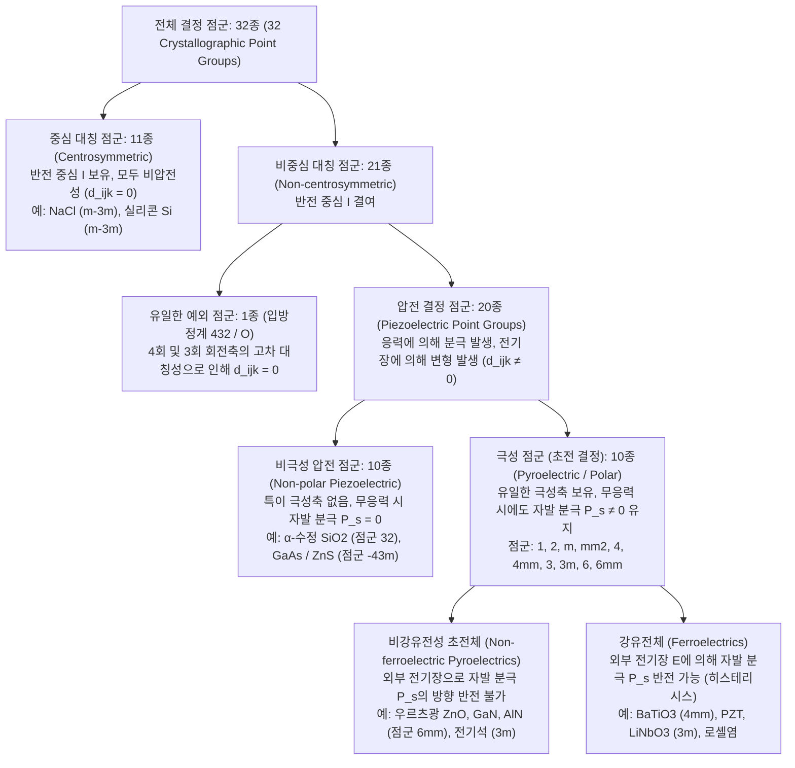
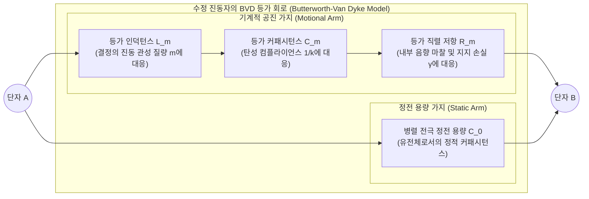

가스레인지 점화 손잡이를 돌려 ‘딱’ 소리가 날 때 배터리나 전원선 없이도 푸른 불꽃이 튀어 가스에 불이 붙는다. 손목 위의 쿼츠 시계와 스마트폰 내부에서는 미세한 수정($\text{SiO}_2$) 조각과 질화알루미늄($\text{AlN}$) 박막이 1초에 수만 번에서 수십억 번에 이르는 초정밀 주파수로 진동하며 디지털 문명의 시간 표준과 5G 무선 통신 필터를 지탱한다. 병원의 산부인과와 심장내과에서는 탐촉자(프로브)를 피부에 대는 것만으로 태아와 심장 판막의 움직임을 실시간 초음파 영상으로 그려내고, 나노기술 연구소에서는 주사 터널링 현미경(STM)과 원자간력 현미경(AFM)이 고체 표면의 단일 원자 배열을 $0.01\,\text{\AA}$($1\,\text{pm} = 10^{-12}\,\text{m}$) 이하의 분해능으로 더듬어 낸다.

이 모든 기술을 근저에서 하나로 관통하는 물리 현상이 바로 <strong>압전 효과(Piezoelectric Effect, 피에조 전기 효과)</strong>이다. 그리스어로 ‘누르다, 압박하다’를 뜻하는 $\pi\iota\epsilon\zeta\epsilon\iota\nu$(*piezein*)에서 유래한 이 현상은 <strong>“공간 반전 대칭 중심이 결여된 특정 결정에 기계적 응력을 가하면 유전 분극(전압)이 발생하고, 반대로 외부 전기장을 인가하면 결정이 선형적으로 기계적 변형(변형률)을 일으키는 가역적 전기기계 결합 현상”</strong>이다.

왜 평범한 유리나 소금($\text{NaCl}$), 실리콘 단결정은 아무리 강하게 눌러도 전기가 생기지 않는 반면, 수정($\text{SiO}_2$)이나 티탄산 지르콘산 연(PZT)을 누르면 고전압이 발생하는가? 또한 왜 기계식 기어나 볼나사로는 불가능한 서브 피코미터 단위의 위치 제어가 압전 소자에서는 마찰이나 백래시(유격) 없이 가능한가? 본고에서는 열역학, 텐서 대칭성 군론, 고체물리학 및 전자공학의 관점에서 압전 효과의 본질을 심층적으로 해명한다.

---

## 제1장: 역사적 발견과 열역학적 필연성 — 퀴리 형제와 리프만의 예언

### 1.1 1880년: 피에르 퀴리와 자크 퀴리의 정압전 효과 발견

압전 효과의 발견은 우연이 아니라 결정의 기하학적 대칭성과 물리 현상 사이의 관계에 대한 깊은 통찰에서 비롯되었다. 1880년 파리 소르본 대학 광물학 연구실에서 21세의 <strong>피에르 퀴리(Pierre Curie)</strong>와 24세의 형 <strong>자크 퀴리(Jacques Curie)</strong>는 전기석(Tourmaline) 같은 결정의 온도를 변화시킬 때 표면에 전하가 나타나는 <strong>초전 효과(Pyroelectricity)</strong>를 연구하고 있었다.

퀴리 형제는 온도 변화에 의해 전하가 유도되는 근본 원인이 ‘열팽창에 따른 비대칭 결정 격자의 역학적 변형’ 때문이라고 추론했다. 그렇다면 온도를 바꾸지 않더라도 결정의 비대칭 축을 따라 직접 기계적 압력(응력)을 가하면 동일한 표면 전하가 발생해야 한다. 그들은 주석박 전극과 전위계를 사용하여 <strong>$\alpha$-석영(수정, $\text{SiO}_2$)</strong>, <strong>전기석</strong>, <strong>섬아연석($\text{ZnS}$)</strong>, <strong>이극광</strong>, 그리고 <strong>로셸염(Rochelle salt, $\text{KNaC}_4\text{H}_4\text{O}_6 \cdot 4\text{H}_2\text{O}$)</strong> 단결정에 추를 올려 압축 응력을 가하는 실험을 수행하여 <strong>정압전 효과(Direct Piezoelectric Effect)</strong>의 법칙을 확립했다.

1. 특정 결정축 방향으로 응력을 가하면 응력의 크기에 정확히 비례하는 표면 전하가 발생한다.
2. 압축 응력을 인장 응력으로 바꾸면 발생하는 전하의 부호(극성)가 정확히 반전된다.
3. 이 현상은 오직 <strong>반전 대칭 중심이 없는 결정(반면상 결정)</strong>에서만 나타난다.

### 1.2 1881년: 가브리엘 리프만의 열역학적 유도와 역압전 효과

1881년 물리학자 <strong>가브리엘 리프만(Gabriel Lippmann)</strong>은 열역학 제1법칙과 제2법칙을 가역적 전기역학계에 적용하여, 외부 전기장이 결정을 변형시키는 <strong>역압전 효과(Converse Piezoelectric Effect)</strong>의 존재를 이론적으로 예언하고 두 계수의 열역학적 항등성을 증명했다.

단위 부피당 결정의 온도를 $\Theta$, 엔트로피 밀도를 $s$, 응력 텐서를 $T_{jk}$($\text{Pa}$), 변형률 텐서를 $S_{jk}$, 전기장 벡터를 $E_i$($\text{V/m}$), 전속밀도(전기변위) 벡터를 $D_i = \varepsilon_0 E_i + P_i$($\text{C/m}^2$)라 하자. 내부 에너지 밀도 $U(s, S_{jk}, D_i)$의 전미분은 아인슈타인 합 규약 하에서 다음과 같다:

$$dU = \Theta\,ds + T_{jk}\,dS_{jk} + E_i\,dD_i$$

르장드르 변환(Legendre transformation)을 통해 온도 $\Theta$, 응력 $T_{jk}$, 전기장 $E_i$를 독립변수로 하는 탄성-전기 깁스 자유 에너지 밀도 $G(\Theta, T_{jk}, E_i)$를 정의하면:

$$G(\Theta, T_{jk}, E_i) = U - \Theta s - T_{jk} S_{jk} - E_i D_i \quad \Longrightarrow \quad dG = -s\,d\Theta - S_{jk}\,dT_{jk} - D_i\,dE_i$$

등온 과정($d\Theta = 0$)에서 변형률과 전속밀도는 $G$의 1계 편미분으로 주어진다:

$$S_{jk} = -\left(\frac{\partial G}{\partial T_{jk}}\right)_{\mathbf{E}, \Theta}, \qquad D_i = -\left(\frac{\partial G}{\partial E_i}\right)_{\mathbf{T}, \Theta}$$

상태함수 $G$의 2계 혼합 편미분 순서 교환 가능성(슈바르츠 정리 $\frac{\partial^2 G}{\partial E_i \partial T_{jk}} = \frac{\partial^2 G}{\partial T_{jk} \partial E_i}$)에 의해 즉시 다음의 <strong>열역학적 맥스웰 관계식(Thermodynamic Maxwell Relation)</strong>이 도출된다:

$$d_{ijk} \equiv \left(\frac{\partial D_i}{\partial T_{jk}}\right)_{\mathbf{E}, \Theta} = \left(\frac{\partial S_{jk}}{\partial E_i}\right)_{\mathbf{T}, \Theta}$$

좌변의 정압전 전하 계수($\text{C/N}$)와 우변의 역압전 변형률 계수($\text{m/V}$)는 차원($\text{C/N} = \text{C}/(\text{J/m}) = \text{m/V}$)과 수치 모두에서 100% 동일한 텐서 $d_{ijk}$임이 열역학적으로 보장된다. 퀴리 형제는 곧바로 수정 박판에 전압을 인가하여 미세한 신축을 실험적으로 검증했고, 이를 응용해 <strong>압전 수정 전위계</strong>를 발명했다. 이 장치는 훗날 마리 퀴리와 피에르 퀴리가 피치블렌드에서 폴로늄과 라듐의 미약한 방사선 전리 전류를 정밀 측정하는 결정적 도구가 되었다.

---

## 제2장: 텐서 구성 방정식과 노이만 원리 — 반전 대칭 중심의 엄밀한 금지 증명

### 2.1 선형 압전 구성 방정식과 IEEE 포크트(Voigt) 행렬 표기법

깁스 자유 에너지를 2차항까지 테일러 전개하여 편미분하면 선형 압전 구성 방정식을 얻는다:

$$D_i = d_{ijk} T_{jk} + \varepsilon_{ij}^T E_j, \qquad S_{jk} = s_{jklm}^E T_{lm} + d_{ijk} E_i$$

여기서 $\varepsilon_{ij}^T$는 일정 응력 유전율 텐서($\text{F/m}$), $s_{jklm}^E$는 일정 전기장 탄성 컴플라이언스 텐서($\text{m}^2/\text{N}$), $d_{ijk}$는 3계 압전 텐서이다. 응력과 변형률의 대칭성($T_{jk} = T_{kj}, S_{jk} = S_{kj}$)에 의해 $d_{ijk} = d_{ikj}$가 성립하므로, 독립 성분 수는 $27$개에서 최대 $3 \times 6 = 18$개로 줄어든다. IEEE 표준 <strong>포크트 표기법(Voigt notation)</strong>에 따라 대칭 첨자 쌍 $(jk)$를 단일 첨자 $m \in \{1, 2, 3, 4, 5, 6\}$으로 대응시키면($11\to 1, 22\to 2, 33\to 3, 23\to 4, 13\to 5, 12\to 6$, 공학 전단 변형률 $S_m = 2S_{jk}$ 및 $d_{im} = 2d_{ijk}$ 적용):

$$D_i = d_{im} T_m + \varepsilon_{ij}^T E_j, \qquad S_m = s_{mn}^E T_n + d_{jm} E_j \qquad (i,j = 1..3;\; m,n = 1..6)$$

전기와 기계 에너지 간 상호 변환 효율을 나타내는 무차원 지표는 <strong>전기기계 결합 계수(Electromechanical Coupling Factor)</strong> $k^2 = \frac{d^2}{\varepsilon^T s^E}$이다.

### 2.2 노이만의 원리(Neumann's Principle)와 반전 대칭 금지 법칙 증명

왜 $\text{NaCl}$, 다이아몬드, 실리콘 단결정은 압전성이 완전히 0인가? 이는 결정물리학의 대원칙인 <strong>노이만의 원리</strong>(*결정의 모든 거시적 물리 특성 텐서는 그 결정이 속한 점군의 모든 대칭 조작 하에서 불변이어야 한다*)로 증명된다.

결정이 <strong>반전 대칭 중심(Center of Inversion Symmetry, $\mathcal{I}: \mathbf{r} \to -\mathbf{r}$)</strong>을 가진다고 가정하자. 직교 좌표 변환 행렬은 $a_{ij} = -\delta_{ij}$($x'_i = -x_i$)이다. 공간 반전 $\mathcal{I}$ 하에서 각 물리량의 변환 법칙을 살펴보자:

1. <strong>분극 $P_i$ 및 전속밀도 $D_i$ (1계 극성 벡터)</strong>: 공간 반전 시 화살표 방향이 역전되므로 부호가 바뀐다: $D'_i = a_{ip} D_p = -D_i$.
2. <strong>기계적 응력 $T_{jk}$ 및 변형률 $S_{jk}$ (2계 대칭 극성 텐서)</strong>: 양쪽에서 누르는 압축력은 공간을 반전시켜도 서로 맞바뀔 뿐 압축 상태 자체는 그대로 유지된다: $T'_{jk} = a_{jq} a_{kr} T_{qr} = (-1)^2 T_{jk} = +T_{jk}$.
3. <strong>3계 압전 텐서 $d_{ijk}$의 변환과 소멸</strong>: 3계 극성 텐서인 $d_{ijk}$는 공간 반전 조작 $\mathcal{I}$ 하에서 변환 행렬이 3번 곱해진다:
   $$d'_{ijk} = a_{ip} a_{jq} a_{kr} d_{pqr} = (-\delta_{ip})(-\delta_{jq})(-\delta_{kr}) d_{pqr} = (-1)^3 d_{ijk} = -d_{ijk}$$
   반면 결정이 반전 대칭 중심 $\mathcal{I}$를 가진다면, 노이만의 원리에 의해 반전 후의 물성 텐서는 원래 텐서와 완전히 같아야 한다:
   $$d'_{ijk} = d_{ijk}$$
   두 식을 연립하면 모든 성분 $i, j, k \in \{1, 2, 3\}$에 대해 다음이 성립한다:
   $$d_{ijk} = -d_{ijk} \quad \Longrightarrow \quad d_{ijk} \equiv 0$$

이로써 <strong>반전 대칭 중심을 가진 모든 결정에서는 압전 효과가 수학적으로 엄밀히 0이 된다</strong>는 사실이 증명된다.

### 2.3 전왜 효과(Electrostriction) 및 마찰 대전(Triboelectricity)과의 결정적 차이

* <strong>전왜 효과(Electrostriction)</strong>: 전기장의 제곱에 비례하는 2차 변형률 $S_{ij} = M_{ijkl} E_k E_l$이다. 4계 텐서 $M_{ijkl}$은 공간 반전 하에서 $M'_{ijkl} = (-1)^4 M_{ijkl} = +M_{ijkl}$인 우텐서이므로 대칭성 제약 없이 <strong>모든 유전체(결정, 유리, 액체, 기체)</strong>에 보편적으로 존재한다. 단, 전기장 방향을 반전시켜도 변형 부호가 바뀌지 않으며 역효과(응력에 의한 분극 유도)가 없다.
* <strong>마찰 대전(Triboelectricity)</strong>: 이종 물질의 접촉·마찰·분리 시 일함수 차이에 의해 <strong>계면(표면 수 나노미터 영역)에서 전자나 이온이 이동</strong>하는 비평형·비가역 표면 현상이다. 반면 압전 효과는 결정 <strong>벌크(Bulk) 단위포 내부의 양이온·음이온 부격자 간 탄성적·가역적 상대 변위</strong>에 기인한다.

| 비교 항목 | 압전 효과 (Piezoelectricity) | 전왜 효과 (Electrostriction) | 마찰 대전 (Triboelectricity) |
| :--- | :--- | :--- | :--- |
| <strong>미시적 물리 기원</strong> | 단위 격자 내 양·음이온 부격자의 탄성 변위에 의한 <strong>벌크 쌍극자 모멘트 변화</strong> | 유전 분극 정전기력에 의한 <strong>벌크 격자의 2차 변형</strong> | 접촉·분리 계면에서의 <strong>표면 전자 및 이온 이동</strong> |
| <strong>발현 공간 영역</strong> | 결정 전체의 <strong>3차원 체적(Bulk) 내부</strong>에서 균일 발생 | 유전체 전체의 <strong>3차원 체적(Bulk)</strong> | 접촉하는 <strong>극표면/계면(수 nm 깊이)</strong>에 국한 |
| <strong>대칭성 요건</strong> | 반전 중심이 없는 <strong>20개 압전 점군</strong>(및 분극 처리된 강유전체)에 한정 | <strong>대칭성 제한 없음</strong> (모든 결정, 비정질, 액체에서 발현) | <strong>결정 대칭성 제한 없음</strong> (임의의 고체·액체 표면) |
| <strong>수학적 응답 특성</strong> | <strong>1차 선형 함수</strong>: $D \propto T,\; S \propto E$ (부호 반전 가능) | <strong>2차 우함수</strong>: $S \propto E^2$ (전기장 반전 시 부호 불변) | <strong>비선형적·확률적</strong> (습도, 표면 거칠기, 흡착물에 민감) |
| <strong>열역학적 가역성</strong> | <strong>완전 가역적</strong> (정압전 효과 $\Longleftrightarrow$ 역압전 효과) | <strong>단방향 결합</strong> ($E=0$에서 응력만으로 분극 미발생) | <strong>비가역적 소산 과정</strong> (전압 인가로 마찰 운동 복원 불가) |

---

## 제3장: 32개 결정 점군의 계층 구조 — 압전체, 초전체, 강유전체

3차원 결정학의 거시적 점 대칭군은 정확히 <strong>32개 결정 점군(32 Crystallographic Point Groups)</strong>으로 분류되며, 노이만 원리에 따라 다음과 같은 엄밀한 계층 구조를 형성한다:

1. <strong>11개 중심 대칭 점군</strong>: 반전 중심 $\mathcal{I}$를 포함하므로 $d_{ijk} \equiv 0$이다.
2. <strong>입방 점군 $432$($O$군)의 예외적 소멸</strong>: 21개 비중심 대칭 점군 중 입방정계 점군 $432$는 반전 중심이 없으나, 직교하는 3개의 4회 회전축($90^\circ$)과 4개의 3회 회전축($120^\circ$)을 동시에 가진다. 2회 및 3회 대칭 조작에 의해 살아남는 유일한 전단 성분 $d_{312}$마저 $Z$축 주위의 $90^\circ$ 회전($x_1 \to x_2, x_2 \to -x_1$)에 의해 $d'_{312} = -d_{321} = -d_{312}$가 되어 $d_{312} = 0$으로 소멸한다. 따라서 <strong>$32 - 11 - 1 = 20$개의 압전 점군</strong>만이 존재한다.
3. <strong>10개 극성(초전) 점군과 강유전체</strong>: 20개 압전 점군 중 유일한 극성축을 가진 10개 점군($1, 2, m, mm2, 4, 4mm, 3, 3m, 6, 6mm$)은 외력이 없어도 <strong>자발 분극 $\mathbf{P}_s \neq \mathbf{0}$</strong>을 유지하며 온도 변화에 따라 표면 전하가 변하는 <strong>초전성(Pyroelectricity)</strong>을 보인다. 이 중 외부 전기장 $\mathbf{E}$에 의해 $\mathbf{P}_s$의 방향을 스위칭할 수 있는 물질을 <strong>강유전체(Ferroelectrics)</strong>라 부른다.

---

## 제4장: 미시적 결정 구조와 분극 메커니즘 — $\alpha$-석영(수정)과 페로브스카이트 강유전체($\text{BaTiO}_3$, PZT)

### 4.1 $\alpha$-석영($\text{SiO}_2$, 삼방정계 점군 $32$)의 나선 격자와 전하 중심 이동

수정은 $573\,^\circ\text{C}$ 이상에서는 육방정계 $\beta$-석영(점군 $622$)이지만, 실온에서는 삼방정계 <strong>$\alpha$-석영(점군 $32$)</strong> 구조를 가진다. $\text{SiO}_4$ 사면체가 정점 산소를 공유하며 광학축($Z$축, 3회 나선축)을 따라 나선형으로 연결되고, $XY$ 평면 내에 $120^\circ$ 간격으로 3개의 전기축($X$축, 2회 회전축)과 3개의 기계축($Y$축)이 존재한다. 점군 $32$의 대칭성에 의해 압전 행렬은 단 <strong>2개의 독립 성분</strong>($d_{11} \approx 2.31\,\text{pC/N}$, $d_{14} \approx -0.727\,\text{pC/N}$)만을 가진다:

$$\mathbf{d}_{\text{Quartz (32)}} = \begin{pmatrix} d_{11} & -d_{11} & 0 & d_{14} & 0 & 0 \\ 0 & 0 & 0 & 0 & -d_{14} & -2d_{11} \\ 0 & 0 & 0 & 0 & 0 & 0 \end{pmatrix}$$

무응력 상태에서는 3쌍의 $\text{Si}^{4+}$ 양전하 중심과 $\text{O}^{2-}$ 음전하 중심이 정확히 일치하지만($\mathbf{P}_s = \mathbf{0}$), 전기축 $X$ 방향으로 압축 응력 $T_1$을 가하거나(종효과 $D_1 = d_{11} T_1$) 기계축 $Y$ 방향으로 인장 응력 $T_2$를 가하면(횡효과 $D_1 = -d_{11} T_2$) 사면체 결합각이 비대칭적으로 찌그러지며 $X$축 표면에 전하가 유도된다. 또한 $Y$축 방향 전기장 $E_2$는 $d_{26} = -2d_{11}$을 통해 <strong>두께 전단 진동(Thickness-shear mode)</strong>을 일으킨다.

### 4.2 페로브스카이트 강유전체($\text{BaTiO}_3$, PZT), 분극 처리(Poling) 및 상경계(MPB)

$\text{ABO}_3$ 페로브스카이트 산화물(티탄산 바륨 $\text{BaTiO}_3$ 및 티탄산 지르콘산 연 $\text{Pb(Zr}_x\text{Ti}_{1-x}\text{)O}_3$ [PZT])은 퀴리 온도 $T_C$ 이상에서는 반전 중심이 있는 입방정계($m\bar{3}m$, 상유전상, $d_{ijk}=0$)이나, $T_C$ 이하로 냉각되면 산소 팔면체 중심의 $\text{Ti}^{4+}/\text{Zr}^{4+}$ 양이온이 $\text{Ti } 3d - \text{O } 2p$ 궤도 혼성에 의해 중심에서 벗어나는 <strong>오프센터링(Off-centering)</strong> 변위를 일으켜 정방정계($4mm$) 또는 능면체정계($3m$)로 상전이하며 거대한 자발 분극 $\mathbf{P}_s$를 획득한다.

소결 직후의 다결정 세라믹스는 내부 강유전 도메인(분역)이 무작위로 배향되어 거시적으로 등방성($\infty\infty m$)이므로 압전성이 0이다. 따라서 고온에서 강한 직류 전기장을 인가하여 도메인을 정렬시키는 <strong>분극 처리(Poling)</strong>를 통해 거시적 대칭성을 <strong>퀴리 군 $\infty m$($6mm$과 동형, 독립 성분 $d_{33}, d_{31}, d_{15}$)</strong>으로 낮추어야 한다. 특히 PZT의 <strong>조성 상경계(Morphotropic Phase Boundary, MPB, $x \approx 0.52$)</strong>에서는 정방정계(6개 $\langle 100 \rangle$ 분극 방향)와 능면체정계(8개 $\langle 111 \rangle$ 분극 방향)가 단사정계(점군 $m$) 가교상을 통해 공존하며 자유 에너지 곡면이 평탄화되어, 전기장 인가 시 <strong>분극 회전(Polarization Rotation)</strong>이 용이하게 일어나 수정의 수백 배에 달하는 거대 압전 상수($d_{33} \sim 300\text{–}600\,\text{pC/N}$)를 발현한다.

---

## 제5장: 공진의 물리학과 수정 진동자 — BVD 등가 회로와 온도 보상

### 5.1 버터워스-반 다이크(BVD) 등가 회로와 직·병렬 공진 주파수 유도

교류 전압에 의해 여기된 수정 결정판의 탄성 정상파 공진은 전기 회로적으로 직렬 $L_m C_m R_m$ 기계적 공진 가지(Motional Arm)와 정전 용량 $C_0$(Static Arm)의 병렬 결합인 <strong>버터워스-반 다이크(Butterworth-Van Dyke, BVD) 등가 회로</strong>로 완벽히 표현된다:

손실이 극히 작은 극한($R_m \to 0$)에서 회로 전체의 어드미턴스 $Y(\omega) = j\omega C_0 + \left(j\omega L_m + \frac{1}{j\omega C_m}\right)^{-1}$로부터 두 개의 고유 공진 주파수가 도출된다:

1. <strong>직렬 공진 주파수(Series Resonance Frequency, $f_s$)</strong>: 기계적 가지의 리액턴스가 상쇄되어 임피던스가 최소($Z \approx R_m$)가 되는 주파수:
   $$f_s = \frac{1}{2\pi\sqrt{L_m C_m}}$$
2. <strong>병렬(반) 공진 주파수(Parallel / Antiresonance Frequency, $f_p$)</strong>: 유도성으로 변한 기계적 가지와 병렬 용량 $C_0$가 병렬 공진을 일으켜 어드미턴스 $Y(\omega_p) = 0$(임피던스 극대)이 되는 주파수:
   $$f_p = \frac{1}{2\pi\sqrt{L_m \frac{C_m C_0}{C_m + C_0}}} = f_s \sqrt{1 + \frac{C_m}{C_0}} \approx f_s \left(1 + \frac{C_m}{2C_0}\right)$$

오직 $f_s < f < f_p$의 좁은 주파수 영역에서만 수정 진동자는 <strong>유도성(Inductive)</strong>을 띠며 발진 회로의 주파수를 정밀하게 고정한다.

### 5.2 초고 $Q$값($10^5\text{–}10^6$), $32,768\,\text{Hz}$ 음차형 진동자, AT 컷 및 5G BAW/FBAR 필터

단결정 석영은 내부 포논 산란 손실($R_m$)이 극소이고 $L_m/C_m$ 비가 거대하여 일반 $LC$ 회로($Q \sim 100$)를 압도하는 <strong>$Q = \frac{\omega_s L_m}{R_m} \sim 10^5\text{–}10^6$</strong>을 달성한다.
* <strong>$32,768\,\text{Hz}$($2^{15}\,\text{Hz}$) 음차형 수정 진동자</strong>: 가청 주파수($20\,\text{kHz}$)보다 높으면서 정확히 $2^{15}$과 일치하여 15단 T 플립플롭(2분주 회로)만으로 정확한 $1\,\text{Hz}$(1초 펄스)를 생성한다.
* <strong>AT 컷 수정($Z$축에서 $35^\circ 15'$ 경사 절단)</strong>: 두께 전단 모드를 활용하여 실온($25\,^\circ\text{C}$) 부근에서 주파수 온도 계수의 1차 및 2차 미분항이 동시에 0이 되는 <strong>3차 곡선(Cubic curve)</strong> 특성을 구현해 온도 드리프트를 수 $\text{ppm}$ 이내로 억제한다.
* <strong>RF MEMS 필터(SAW 및 BAW/FBAR)</strong>: 스마트폰의 GHz 대역에서는 $\text{LiTaO}_3/\text{LiNbO}_3$ 기반 표면탄성파(SAW) 필터와 질화알루미늄($\text{AlN}$ / $\text{ScAlN}$) 박막 체적탄성파 공진기(FBAR)가 핵심 대역통과 필터로 작동한다.

---

## 제6장: 초음파와 서브 피코미터 정밀 위치 제어 — 심해 소나와 의료 영상에서 단일 원자 조작까지

1. <strong>랑주뱅 소나(SONAR)와 의료용 위상배열 초음파(Medical Phased-Array Ultrasound)</strong>:
   1917년 폴 랑주뱅(Paul Langevin)은 강철 블록 사이에 수정판을 볼트로 죄어 잠수함 탐지용 능동 소나를 발명했다. 현대 의료용 초음파 프로브는 $128\text{–}256$개 PZT/PMN-PT 소자에 나노초 단위의 지연 시간차를 부여해 초음파 빔을 전자적으로 주사·집속(역압전 송신 및 정압전 에코 수신)하며, PZT($Z_{\text{PZT}} \approx 30\,\text{MRayl}$)와 인체 연조직($Z_{\text{tissue}} \approx 1.5\,\text{MRayl}$) 사이의 반사 손실($82\%$)을 막기 위해 표면에 기하평균 임피던스 $Z_{\text{match}} = \sqrt{Z_{\text{PZT}} Z_{\text{tissue}}} \approx 6.7\,\text{MRayl}$을 갖는 <strong>$\lambda/4$ 음향 정합층(Acoustic Matching Layer)</strong>을 배치한다.
2. <strong>주사 터널링 현미경(STM) 및 원자간력 현미경(AFM)의 서브 피코미터 스캐너</strong>:
   1981년 게르트 비니히(Gerd Binnig)와 하인리히 로러(Heinrich Rohrer)가 발명한 STM(1986년 노벨 물리학상)에서는 양자 터널링 전류 $I_t \propto V \exp(-2\kappa z)$가 거리 $z$가 $1\,\text{\AA}$ 변할 때마다 10배씩 급변한다. 기계적 마찰과 백래시가 전혀 없는 <strong>4분할 PZT 압전 튜브 스캐너</strong>에 마이크로볼트 단위의 전압을 인가하여 <strong>$0.01\,\text{\AA}$($1\,\text{pm}$) 이하의 원자 분해능 3차원 주사</strong>를 실현했다.
3. <strong>적층형 압전 액추에이터와 고전압 점화기</strong>:
   수백 층의 얇은 PZT 시트를 내부 전극과 동시 소성한 적층형 액추에이터($\Delta L = N d_{33} V$)는 디젤 엔진의 $200\,\text{MPa}$ 커먼레일 인젝터(사이클당 5~7회 다단 분사)와 피에조 잉크젯 프린터 헤드를 구동하며, 가스레인지 압전 점화기는 해머 타격에 의한 정압전 개방 회로 전압 $E_3 = -g_{33} T_3 = -(d_{33}/\varepsilon_{33}^T)T_3$를 통해 순간적으로 $10\text{–}20\,\text{kV}$의 방전 스파크를 생성한다.
