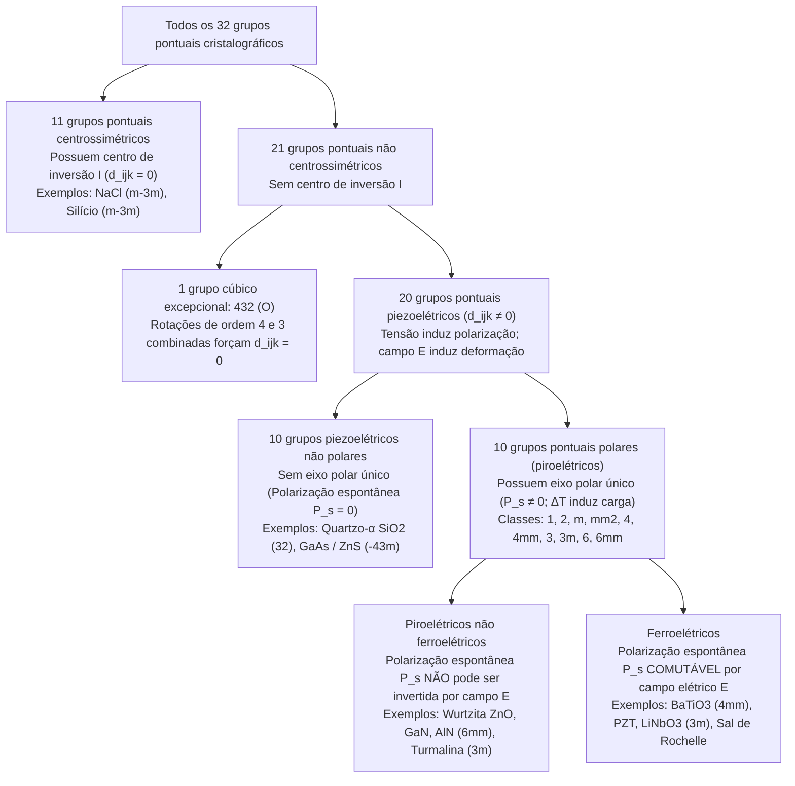
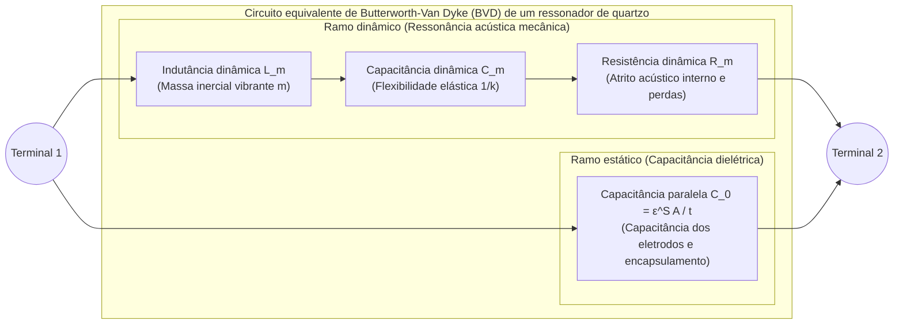

Quando você gira o botão de ignição de um fogão a gás ou aperta um isqueiro eletrônico e ouve um estalo mecânico, uma faísca azul salta para acender o combustível sem bateria ou tomada elétrica. Dentro do relógio de pulso e do smartphone, minúsculas lâminas de cristal de quartzo ($\text{SiO}_2$) e filmes finos de nitreto de alumínio ($\text{AlN}$) vibram de dezenas de milhares a bilhões de vezes por segundo com estabilidade extraordinária, definindo o ritmo dos processadores digitais e filtrando frequências de rádio 5G. Nos hospitais, transdutores de ultrassom emitem pulsos acústicos e escutam seus ecos para formar imagens em tempo real do coração fetal, enquanto em laboratórios de nanotecnologia os microscópios de tunelamento por varredura (STM) e de força atômica (AFM) mapeiam átomos individuais com resolução vertical inferior a um picômetro ($1\,\text{pm} = 10^{-12}\,\text{m}$).

Todas essas tecnologias baseiam-se em um único fenômeno físico fundamental: o <strong>efeito piezoelétrico (Piezoelectric Effect)</strong>. Cunhado em 1881 por Wilhelm Gottlieb Hankel a partir do verbo grego $\pi\iota\epsilon\zeta\epsilon\iota\nu$ (*piezein*, «pressionar» ou «comprimir»), a piezoeletricidade é o acoplamento eletromecânico linear e reversível entre tensão mecânica e polarização dielétrica em cristais desprovidos de centro de inversão.

Por que comprimir um cristal de quartzo ou uma cerâmica de titanato zirconato de chumbo (PZT) gera tensão elétrica, enquanto comprimir sal de cozinha ($\text{NaCl}$), silício ou vidro comum não produz nenhum sinal elétrico? Neste artigo exploramos a termodinâmica, as equações tensoriais, os grupos cristalográficos e as aplicações de engenharia da piezoeletricidade.

---

## Capítulo 1: Descoberta histórica e necessidade termodinâmica — Os irmãos Curie e a previsão de Lippmann

### 1.1 1880: Pierre e Jacques Curie descobrem o efeito piezoelétrico direto

Em 1880, na Sorbonne, em Paris, <strong>Pierre Curie</strong> (21 anos) e seu irmão <strong>Jacques Curie</strong> (24 anos) investigavam a <strong>piroeletricidade</strong> (o surgimento de cargas elétricas na superfície de cristais como a turmalina quando aquecidos ou resfriados). Eles perceberam que a variação térmica causava uma expansão anisotrópica da rede cristalina que deslocava os centros de carga positiva e negativa. Deduziram então que aplicar pressão mecânica diretamente ao longo de um eixo cristalográfico assimétrico a temperatura constante deveria induzir cargas superficiais de maneira proporcional.

Usando eletrodos de folha de estanho e um eletrômetro de quadrantes de Kelvin, os irmãos Curie comprovaram em 1880 o <strong>efeito piezoelétrico direto</strong> em cristais de <strong>quartzo-$\alpha$ ($\text{SiO}_2$)</strong>, <strong>turmalina</strong>, <strong>topázio</strong>, <strong>blenda ($\text{ZnS}$)</strong>, <strong>açúcar de cana</strong> e <strong>sal de Rochelle (sal de Seignette, $\text{KNaC}_4\text{H}_4\text{O}_6 \cdot 4\text{H}_2\text{O}$)</strong>:
1. A tensão mecânica gera uma carga superficial $Q$ estritamente proporcional à força aplicada $F$.
2. Substituir compressão por tração inverte exatamente o sinal algébrico da carga induzida.
3. O efeito ocorre exclusivamente em cristais sem centro de simetria de inversão.

### 1.2 1881: A dedução termodinâmica de Gabriel Lippmann do efeito inverso

Em 1881, o físico <strong>Gabriel Lippmann</strong> aplicou a primeira e a segunda leis da termodinâmica a um ciclo eletromecânico reversível e previu matematicamente o <strong>efeito piezoelétrico inverso (converso)</strong>: um cristal piezoelétrico submetido a um campo elétrico externo $\mathbf{E}$ deve sofrer uma deformação mecânica linear $\mathbf{S}$ cujo coeficiente é identicamente igual ao coeficiente direto.

Considere uma unidade de volume de um cristal dielétrico à temperatura absoluta $\Theta$, densidade de entropia $s$, tensor de tensões mecânicas $T_{jk}$ ($\text{Pa}$), tensor de deformações $S_{jk}$, campo elétrico $E_i$ ($\text{V/m}$) e deslocamento elétrico $D_i = \varepsilon_0 E_i + P_i$ ($\text{C/m}^2$). A diferencial da densidade de energia interna $U(s, S_{jk}, D_i)$ é (usando a convenção de somatório de Einstein):

$$dU = \Theta\,ds + T_{jk}\,dS_{jk} + E_i\,dD_i$$

Aplicando uma transformação de Legendre para as variáveis intensivas controladas experimentalmente $(\Theta, T_{jk}, E_i)$, definimos a densidade de energia livre de Gibbs elástico-elétrica $G(\Theta, T_{jk}, E_i)$:

$$G(\Theta, T_{jk}, E_i) = U - \Theta s - T_{jk} S_{jk} - E_i D_i \quad \Longrightarrow \quad dG = -s\,d\Theta - S_{jk}\,dT_{jk} - D_i\,dE_i$$

Sob condições isotérmicas ($d\Theta = 0$), a deformação e o deslocamento elétrico são dados pelas primeiras derivadas parciais de $G$:

$$S_{jk} = -\left(\frac{\partial G}{\partial T_{jk}}\right)_{\mathbf{E}, \Theta}, \qquad D_i = -\left(\frac{\partial G}{\partial E_i}\right)_{\mathbf{T}, \Theta}$$

Pelo teorema de Schwarz sobre a igualdade das derivadas parciais segundas mistas ($\frac{\partial^2 G}{\partial E_i \partial T_{jk}} = \frac{\partial^2 G}{\partial T_{jk} \partial E_i}$), obtém-se imediatamente a <strong>relação de Maxwell termodinâmica da piezoeletricidade</strong>:

$$d_{ijk} \equiv \left(\frac{\partial D_i}{\partial T_{jk}}\right)_{\mathbf{E}, \Theta} = \left(\frac{\partial S_{jk}}{\partial E_i}\right)_{\mathbf{T}, \Theta}$$

O coeficiente piezoelétrico direto em coulombs por newton ($\text{C/N}$) e o coeficiente inverso em metros por volt ($\text{m/V}$) são idênticos ($\frac{\text{C}}{\text{N}} = \frac{\text{C}\cdot\text{m}}{\text{J}} = \frac{\text{m}}{\text{V}}$). Os irmãos Curie confirmaram experimentalmente essa deformação microscópica e construíram o eletrômetro de quartzo piezoelétrico, instrumento essencial com o qual Marie e Pierre Curie mediram a radioatividade da pechblenda e isolaram o polônio e o rádio em 1898.

---

## Capítulo 2: Equações constitutivas tensoriais e o princípio de Neumann

### 2.1 Equações constitutivas lineares e notação matricial de Voigt (IEEE)

Expandindo $G(T_{jk}, E_i)$ em série de Taylor até segunda ordem em torno do equilíbrio ($T_{jk}=0, E_i=0$), obtemos as <strong>equações constitutivas piezoelétricas lineares</strong>:

$$D_i = d_{ijk} T_{jk} + \varepsilon_{ij}^T E_j, \qquad S_{jk} = s_{jklm}^E T_{lm} + d_{ijk} E_i$$

onde $\varepsilon_{ij}^T$ é o tensor de permissividade a tensão constante ($\text{F/m}$), $s_{jklm}^E$ é o tensor de compliância (flexibilidade) elástica a campo constante ($\text{Pa}^{-1}$) e $d_{ijk}$ é o tensor piezoelétrico de terceira ordem. Pela simetria de $T_{jk} = T_{kj}$ e $S_{jk} = S_{kj}$, vale $d_{ijk} = d_{ikj}$, reduzindo as componentes independentes de $27$ para no máximo $3 \times 6 = 18$. Na <strong>notação de Voigt</strong> $(11\to 1, 22\to 2, 33\to 3, 23\to 4, 13\to 5, 12\to 6)$ com $S_m = 2S_{jk}$ e $d_{im} = 2d_{ijk}$ ($m=4,5,6$), escrevemos:

$$D_i = d_{im} T_m + \varepsilon_{ij}^T E_j, \qquad S_m = s_{mn}^E T_n + d_{jm} E_j \qquad (i,j \in \{1,2,3\};\; m,n \in \{1,\dots,6\})$$

A eficiência de conversão de energia entre os domínios elétrico e mecânico é expressa pelo <strong>fator de acoplamento eletromecânico</strong> adimensional $k^2 = \frac{d^2}{\varepsilon^T s^E}$.

### 2.2 Demonstração rigorosa pelo princípio de Neumann: por que a simetria de inversão proíbe a piezoeletricidade

O <strong>princípio de Neumann</strong> (1885) afirma que todo tensor de propriedade física macroscópica de um cristal deve ser invariante sob todas as operações de simetria $a_{ij}$ do grupo pontual do cristal.

Suponha que um cristal possua um <strong>centro de inversão $\mathcal{I}$</strong> ($\mathbf{r} \to -\mathbf{r}$), representado pela matriz ortogonal $a_{ij} = -\delta_{ij}$:
1. <strong>Deslocamento elétrico $D_i$ (vetor polar de 1.ª ordem)</strong>: Sob inversão espacial, um vetor polar inverte seu sentido: $D'_i = a_{ip} D_p = -D_i$.
2. <strong>Tensão mecânica $T_{jk}$ (tensor polar de 2.ª ordem)</strong>: Duas forças opostas de compressão apenas trocam de posição sob inversão, mantendo o estado de tensão inalterado: $T'_{jk} = a_{jq} a_{kr} T_{qr} = (-1)^2 T_{jk} = +T_{jk}$.
3. <strong>Tensor piezoelétrico $d_{ijk}$ (tensor polar de 3.ª ordem)</strong>: Sob a inversão $\mathcal{I}$, um tensor de 3.ª ordem transforma-se com três fatores $(-1)$:
   $$d'_{ijk} = a_{ip} a_{jq} a_{kr} d_{pqr} = (-\delta_{ip})(-\delta_{jq})(-\delta_{kr}) d_{pqr} = (-1)^3 d_{ijk} = -d_{ijk}$$
   Se o cristal é centrossimétrico, o princípio de Neumann exige invariância: $d'_{ijk} = d_{ijk}$. Logo:
   $$d_{ijk} = -d_{ijk} \quad \Longrightarrow \quad 2d_{ijk} = 0 \quad \Longrightarrow \quad d_{ijk} \equiv 0 \quad (\forall i,j,k)$$

Isso prova rigorosamente que <strong>nenhum cristal centrossimétrico pode apresentar efeito piezoelétrico linear</strong>.

| Atributo físico | Efeito piezoelétrico | Eletrostrição | Efeito triboelétrico (Eletricidade estática) |
| :--- | :--- | :--- | :--- |
| <strong>Origem microscópica</strong> | Deslocamento elástico reversível de sub-redes iônicas no <strong>volume (bulk) da célula unitária</strong> | Deformação quadrática da <strong>rede em volume</strong> induzida por polarização | Transferência interfacial de elétrons ou íons na <strong>superfície de contato</strong> |
| <strong>Requisito de simetria</strong> | Restrito aos <strong>20 grupos pontuais piezoelétricos</strong> sem centro de inversão | <strong>Nenhum</strong> (presente em todos os cristais, vidros e líquidos) | <strong>Nenhum</strong> (ocorre em qualquer interface entre isolantes ou metais) |
| <strong>Lei matemática</strong> | <strong>Linear (1.ª ordem)</strong>: $D \propto T,\; S \propto E$ (inverte o sinal se $E \to -E$) | <strong>Quadrática (2.ª ordem)</strong>: $S_{ij} = M_{ijkl} E_k E_l$ (não inverte o sinal) | <strong>Não linear e estocástica</strong> (sensível à umidade e rugosidade) |
| <strong>Reversibilidade</strong> | <strong>Estritamente reversível</strong> (Efeito direto $\Longleftrightarrow$ Efeito inverso) | <strong>Unidirecional em $E=0$</strong> (tensão mecânica isolada não gera polarização) | <strong>Irreversível e dissipativa</strong> |

---

## Capítulo 3: A hierarquia dos 32 grupos pontuais cristalográficos

Na cristalografia tridimensional existem exatamente <strong>32 grupos pontuais (classes cristalinas)</strong>, organizados pelo princípio de Neumann na seguinte hierarquia:

Dos 21 grupos sem centro de inversão, <strong>20 são piezoelétricos</strong>: a única exceção é o grupo cúbico quiral <strong>$432$ ($O$)</strong>, no qual os eixos de rotação de ordem 4 ($90^\circ$) e ordem 3 ($120^\circ$) combinados anulam até a componente de cisalhamento $d_{312}$ ($d'_{312} = -d_{321} = -d_{312} \implies d_{312} = 0$). Entre os 20 grupos piezoelétricos, os <strong>10 grupos polares (piroelétricos)</strong> possuem um eixo polar único com polarização espontânea permanente $\mathbf{P}_s \neq \mathbf{0}$. Quando $\mathbf{P}_s$ pode ser comutada por um campo elétrico externo acima do campo coercitivo $E_c$ (ciclo de histerese), o cristal é chamado de <strong>ferroelétrico</strong>.

---

## Capítulo 4: Estruturas cristalinas microscópicas — Quartzo-$\alpha$ vs. Perovskitas ferroelétricas ($\text{BaTiO}_3$, PZT)

### 4.1 Quartzo-$\alpha$ ($\text{SiO}_2$, grupo pontual trigonal $32$)

Abaixo de $573\,^\circ\text{C}$, o quartzo cristaliza no grupo trigonal $32$ (quartzo-$\alpha$), com tetraedros $\text{SiO}_4$ formando hélices ao longo do eixo óptico $Z$ (eixo ternário), três eixos elétricos $X$ (eixos binários a $120^\circ$) e três eixos mecânicos $Y$ no plano $XY$. A simetria do grupo $32$ reduz a matriz piezoelétrica a apenas duas constantes independentes ($d_{11} = 2,31\,\text{pC/N}$ e $d_{14} = -0,727\,\text{pC/N}$):

$$\mathbf{d}_{\text{Quartzo (32)}} = \begin{pmatrix} d_{11} & -d_{11} & 0 & d_{14} & 0 & 0 \\ 0 & 0 & 0 & 0 & -d_{14} & -2d_{11} \\ 0 & 0 & 0 & 0 & 0 & 0 \end{pmatrix}$$

Sem tensão aplicada, os baricentros de carga dos íons $\text{Si}^{4+}$ e $\text{O}^{2-}$ coincidem ($\mathbf{P}_s = \mathbf{0}$). Uma compressão ao longo do eixo elétrico $X$ (efeito longitudinal $D_1 = d_{11} T_1$) ou uma tração ao longo do eixo mecânico $Y$ (efeito transversal $D_1 = -d_{11} T_2$) deforma o anel hexagonal de tetraedros e separa os centros de carga ao longo de $X$. Já um campo elétrico $E_2$ ao longo de $Y$ aciona o cisalhamento de espessura via $d_{26} = -2d_{11}$.

### 4.2 Perovskitas ferroelétricas ($\text{BaTiO}_3$, PZT), Poling e o Contorno de Fase Morfotrópico (MPB)

Óxidos perovskita $\text{ABO}_3$ como o titanato de bário ($\text{BaTiO}_3$) e o titanato zirconato de chumbo ($\text{Pb(Zr}_x\text{Ti}_{1-x}\text{)O}_3$, PZT) são cúbicos centrossimétricos ($m\bar{3}m$, $d_{ijk}=0$) acima da temperatura de Curie $T_C$. Abaixo de $T_C$, o cátion central $\text{Ti}^{4+}/\text{Zr}^{4+}$ desloca-se do centro do octaedro $\text{O}_6$, gerando uma fase tetragonal ($4mm$) ou romboédrica ($3m$) com forte polarização espontânea.

Uma cerâmica policristalina recém-sinterizada possui domínios orientados aleatoriamente e é macroscopicamente isotrópica ($d_{ijk}=0$). O processo de <strong>polarização sob alto campo elétrico contínuo (Poling)</strong> alinha os domínios e reduz a simetria ao grupo de Curie $\infty m$ (isomorfo a $6mm$, com módulos $d_{33}, d_{31}, d_{15}$). No PZT, junto ao <strong>contorno de fase morfotrópico (MPB, $x \approx 0,52$)</strong>, a coexistência das 6 direções tetragonais $\langle 100 \rangle$ e 8 direções romboédricas $\langle 111 \rangle$ através de uma fase ponte monoclínica (grupo $m$) achata a superfície de energia livre e facilita a <strong>rotação de polarização</strong>, elevando $d_{33}$ a $300\text{–}600\,\text{pC/N}$.

---

## Capítulo 5: Física da ressonância e osciladores de quartzo — O circuito de Butterworth-Van Dyke (BVD)

Próximo a uma frequência natural de onda estacionária acústica ($t = n\lambda/2$), um cristal de quartzo vibrante comporta-se eletricamente como um ramo dinâmico em série ($L_m, C_m, R_m$) em paralelo com a capacitância estática dos eletrodos $C_0$, formando o <strong>circuito equivalente de Butterworth-Van Dyke (BVD)</strong>:

Desprezando as perdas ($R_m \to 0$), a admitância $Y(\omega) = j\omega C_0 + \left(j\omega L_m + \frac{1}{j\omega C_m}\right)^{-1}$ define duas frequências fundamentais:
1. <strong>Frequência de ressonância série ($f_s$)</strong> (impedância mínima $Z \approx R_m$):
   $$f_s = \frac{1}{2\pi\sqrt{L_m C_m}}$$
2. <strong>Frequência de ressonância paralela ou antirressonância ($f_p$)</strong> (admitância nula $Y(\omega_p) = 0$):
   $$f_p = f_s \sqrt{1 + \frac{C_m}{C_0}} \approx f_s \left(1 + \frac{C_m}{2C_0}\right)$$

O cristal atua de modo indutivo apenas na estreita janela $f_s < f < f_p$. Graças à baixíssima dissipação acústica, o quartzo atinge um <strong>fator de qualidade $Q = \frac{\omega_s L_m}{R_m} \sim 10^5\text{–}10^6$</strong>. Relógios de quartzo utilizam diapasões sintonizados em <strong>$32.768\,\text{Hz} = 2^{15}\,\text{Hz}$</strong> (divididos por 15 flip-flops binários para gerar $1\,\text{Hz}$), enquanto o <strong>corte AT</strong> ($35^\circ 15'$ em relação ao eixo $Z$) apresenta variação térmica cúbica nula à temperatura ambiente. Nos smartphones 5G, filtros de filmes finos <strong>SAW</strong> e <strong>BAW/FBAR</strong> ($\text{AlN}$) realizam a filtragem de radiofrequência em gigahertz.

---

## Capítulo 6: Ultrassom médico e nanoposicionamento sub-picométrico (STM/AFM)

1. <strong>Sonar de Langevin, ultrassom Phased-Array e camada de casamento acústico $\lambda/4$</strong>:
   Transdutores médicos emitem pulsos acústicos pelo efeito inverso e recebem ecos pelo efeito direto. Para evitar que $82\%$ da energia seja refletida na interface entre o PZT ($Z_{\text{PZT}} \approx 30\,\text{MRayl}$) e o tecido humano ($Z_{\text{tecido}} \approx 1,5\,\text{MRayl}$), aplica-se uma <strong>camada de casamento acústico de espessura $\lambda/4$</strong> com impedância média geométrica $Z_{\text{match}} = \sqrt{Z_{\text{PZT}} Z_{\text{tecido}}} \approx 6,7\,\text{MRayl}$.
2. <strong>Microscópios STM/AFM e atuadores piezoelétricos multicamadas</strong>:
   No microscópio de tunelamento por varredura (Binnig e Rohrer, Prêmio Nobel de 1986), um tubo de PZT dividido em quatro quadrantes move a ponta metálica sem atrito ou folga mecânica com resolução inferior a $0,01\,\text{\AA}$ ($1\,\text{pm}$), mantendo constante a corrente de tunelamento $I_t \propto V e^{-2\kappa z}$. Atuadores empilhados multicamadas ($\Delta L = N d_{33} V$) também acionam injetores diesel Common-Rail a $200\,\text{MPa}$ e cabeçotes de impressão a jato de tinta.
