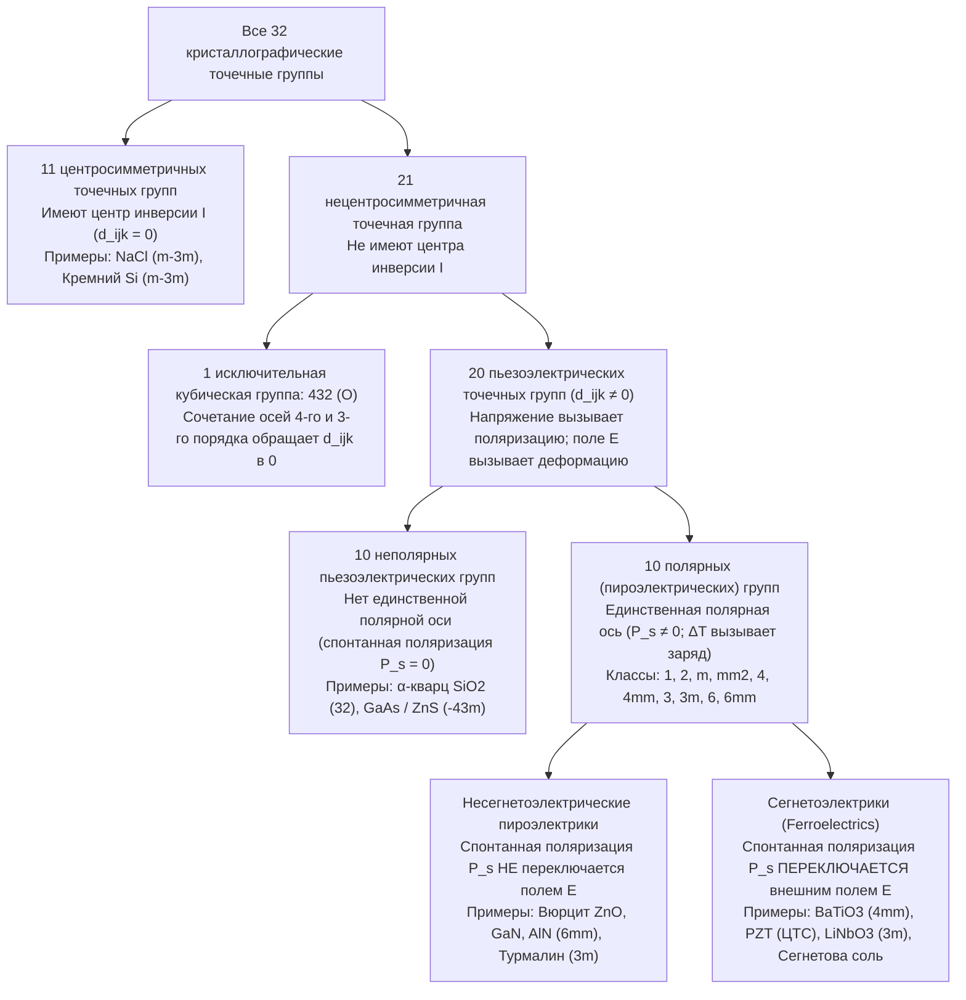
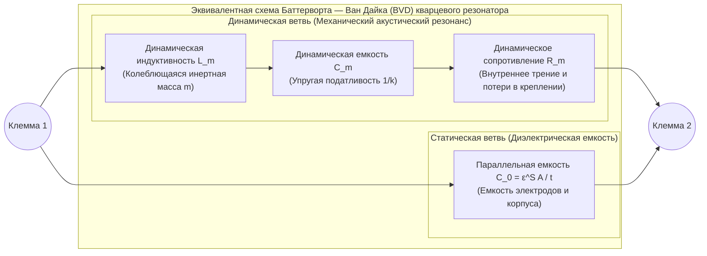

Когда вы поворачиваете ручку газовой плиты или нажимаете кнопку пьезозажигалки и слышите резкий щелчок, между контактами без всякой батарейки проскакивает голубая искра. Внутри наручных кварцевых часов и смартфонов крошечные пластинки кристаллического кварца ($\text{SiO}_2$) и тонкие пленки нитрида алюминия ($\text{AlN}$) колеблются с частотой от десятков тысяч до миллиардов раз в секунду, задавая эталон времени для цифровых процессоров и фильтруя радиочастоты сетей 5G. В медицинских клиниках ультразвуковые датчики излучают акустические импульсы и принимают их эхо, строя изображение бьющегося сердца в реальном времени, а в нанотехнологических лабораториях сканирующие туннельные (СТМ) и атомно-силовые (АСМ) микроскопы различают отдельные атомы с разрешением лучше одного пикометра ($1\,\text{пм} = 10^{-12}\,\text{м}$).

В основе всех этих технологий лежит единое физическое явление — <strong>пьезоэлектрический эффект (Piezoelectric Effect)</strong>. Термин, предложенный в 1881 году Вильгельмом Готлибом Ханкелем от греческого глагола $\pi\iota\epsilon\zeta\epsilon\iota\nu$ (*piezein* — «давить», «сжимать»), означает обратимую линейную электромеханическую связь между механическим напряжением и диэлектрической поляризацией в кристаллах, лишенных центра инверсии.

Почему сжатие кристалла кварца или керамики цирконата-титаната свинца (ЦТС / PZT) порождает электрическое напряжение, тогда как сжатие каменной соли ($\text{NaCl}$), кремния или обычного стекла не дает никакого электрического отклика? В этой статье мы подробно разберем термодинамику, тензорный аппарат, кристаллографическую симметрию и инженерные применения пьезоэффекта.

---

## Глава 1: Историческое открытие и термодинамическая необходимость — братья Кюри и предсказание Липпмана

### 1.1 1880 год: Пьер и Жак Кюри открывают прямой пьезоэлектрический эффект

В 1880 году в минералогической лаборатории Сорбонны в Париже 21-летний <strong>Пьер Кюри</strong> и его 24-летний брат <strong>Жак Кюри</strong> исследовали <strong>пироэлектричество</strong> (возникновение электрических зарядов на поверхности кристаллов, таких как турмалин, при нагревании или охлаждении) и его связь с симметрией кристаллов. Братья Кюри предположили, что первопричиной пироэффекта служит анизотропное тепловое расширение решетки, смещающее центры тяжести положительных и отрицательных ионов. Следовательно, прямое механическое сжатие вдоль асимметричной оси кристалла при постоянной температуре также должно вызывать появление поверхностных зарядов.

Используя оловянные электроды и квадрантный электрометр Кельвина, Пьер и Жак Кюри в 1880 году экспериментально открыли <strong>прямой пьезоэлектрический эффект</strong> на монокристаллах <strong>$\alpha$-кварца ($\text{SiO}_2$)</strong>, <strong>турмалина</strong>, <strong>топаза</strong>, <strong>сфалерита ($\text{ZnS}$)</strong>, <strong>тростникового сахара</strong> и <strong>сегнетовой соли ($\text{KNaC}_4\text{H}_4\text{O}_6 \cdot 4\text{H}_2\text{O}$)</strong>:
1. Механическое напряжение порождает поверхностный заряд $Q$, строго пропорциональный приложенной силе $F$.
2. Замена сжатия на растяжение меняет знак индуцированного заряда на противоположный при сохранении его величины.
3. Эффект наблюдается исключительно в кристаллах, не имеющих центра симметрии (инверсии).

### 1.2 1881 год: термодинамический вывод Габриэля Липпмана и обратный пьезоэффект

В 1881 году физик <strong>Габриэль Липпман</strong> применил первое и второе начала термодинамики к обратимому электромеханическому циклу и математически доказал существование <strong>обратного пьезоэлектрического эффекта</strong>: помещение пьезоэлектрического кристалла во внешнее электрическое поле $\mathbf{E}$ обязано вызывать его линейную механическую деформацию $\mathbf{S}$, причем коэффициент пропорциональности должен в точности равняться коэффициенту прямого эффекта.

Рассмотрим единичный объем диэлектрического кристалла при абсолютной температуре $\Theta$, плотности энтропии $s$, тензоре механических напряжений $T_{jk}$ ($\text{Па}$), тензоре деформаций $S_{jk}$, векторе напряженности электрического поля $E_i$ ($\text{В/м}$) и векторе электрического смещения (индукции) $D_i = \varepsilon_0 E_i + P_i$ ($\text{Кл/м}^2$). Полный дифференциал плотности внутренней энергии $U(s, S_{jk}, D_i)$ по правилу суммирования Эйнштейна равен:

$$dU = \Theta\,ds + T_{jk}\,dS_{jk} + E_i\,dD_i$$

Выполнив преобразование Лежандра к экспериментально контролируемым переменным $(\Theta, T_{jk}, E_i)$, определим упруго-электрический <strong>термодинамический потенциал Гиббса</strong> $G(\Theta, T_{jk}, E_i)$:

$$G(\Theta, T_{jk}, E_i) = U - \Theta s - T_{jk} S_{jk} - E_i D_i \quad \Longrightarrow \quad dG = -s\,d\Theta - S_{jk}\,dT_{jk} - D_i\,dE_i$$

При изотермическом процессе ($d\Theta = 0$) деформация и электрическая индукция выражаются как первые частные производные потенциала $G$:

$$S_{jk} = -\left(\frac{\partial G}{\partial T_{jk}}\right)_{\mathbf{E}, \Theta}, \qquad D_i = -\left(\frac{\partial G}{\partial E_i}\right)_{\mathbf{T}, \Theta}$$

В силу теоремы Шварца о равенстве смешанных вторых производных ($\frac{\partial^2 G}{\partial E_i \partial T_{jk}} = \frac{\partial^2 G}{\partial T_{jk} \partial E_i}$) немедленно получаем фундаментальное <strong>термодинамическое соотношение Максвелла для пьезоэлектричества</strong>:

$$d_{ijk} \equiv \left(\frac{\partial D_i}{\partial T_{jk}}\right)_{\mathbf{E}, \Theta} = \left(\frac{\partial S_{jk}}{\partial E_i}\right)_{\mathbf{T}, \Theta}$$

Пьезомодуль прямого эффекта в кулонах на ньютон ($\text{Кл/Н}$) и пьезомодуль обратного эффекта в метрах на вольт ($\text{м/В}$) тождественно равны ($\frac{\text{Кл}}{\text{Н}} = \frac{\text{Кл}\cdot\text{м}}{\text{Дж}} = \frac{\text{м}}{\text{В}}$). Братья Кюри сразу же экспериментально подтвердили обратный эффект и сконструировали пьезоэлектрический кварцевый электрометр, с помощью которого Мария и Пьер Кюри в 1898 году измерили радиоактивность урановой смолки и открыли полоний и радий.

---

## Глава 2: Материальные тензорные уравнения и принцип Неймана

### 2.1 Линейные уравнения состояния и матричная запись Фогта (IEEE)

Разложение потенциала $G(T_{jk}, E_i)$ в ряд Тейлора до квадратичных членов вблизи равновесия ($T_{jk}=0, E_i=0$) дает связанные линейные <strong>уравнения пьезоэффекта</strong>:

$$D_i = d_{ijk} T_{jk} + \varepsilon_{ij}^T E_j, \qquad S_{jk} = s_{jklm}^E T_{lm} + d_{ijk} E_i$$

где $\varepsilon_{ij}^T$ — тензор диэлектрической проницаемости при постоянном напряжении ($\text{Ф/м}$), $s_{jklm}^E$ — тензор упругой податливости при постоянном электрическом поле ($\text{Па}^{-1}$), а $d_{ijk}$ — тензор пьезоэлектрических модулей 3-го ранга. Из симметрии напряжений и деформаций ($T_{jk} = T_{kj}, S_{jk} = S_{kj}$) следует $d_{ijk} = d_{ikj}$, что сокращает число независимых компонент с $27$ до максимум $3 \times 6 = 18$. Используя <strong>матричные обозначения Фогта</strong> $(11\to 1, 22\to 2, 33\to 3, 23\to 4, 13\to 5, 12\to 6)$ с техническими сдвигами $S_m = 2S_{jk}$ и $d_{im} = 2d_{ijk}$ ($m=4,5,6$), получаем:

$$D_i = d_{im} T_m + \varepsilon_{ij}^T E_j, \qquad S_m = s_{mn}^E T_n + d_{jm} E_j \qquad (i,j \in \{1,2,3\};\; m,n \in \{1,\dots,6\})$$

Эффективность взаимного преобразования электрической и механической энергии определяется безразмерным <strong>коэффициентом электромеханической связи</strong> $k^2 = \frac{d^2}{\varepsilon^T s^E}$.

### 2.2 Строгое доказательство по принципу Неймана: почему центр инверсии запрещает пьезоэффект

<strong>Принцип Неймана</strong> (1885) гласит, что группа симметрии любого макроскопического физического свойства кристалла должна включать в себя все элементы симметрии $a_{ij}$ точечной группы этого кристалла.

Предположим, что кристалл обладает <strong>центром инверсии $\mathcal{I}$</strong> ($\mathbf{r} \to -\mathbf{r}$), которому соответствует ортогональная матрица преобразования координат $a_{ij} = -\delta_{ij}$:
1. <strong>Электрическая индукция $D_i$ (полярный вектор 1-го ранга)</strong>: При пространственной инверсии вектор меняет направление на противоположное: $D'_i = a_{ip} D_p = -D_i$.
2. <strong>Механическое напряжение $T_{jk}$ (полярный тензор 2-го ранга)</strong>: Две встречные сжимающие силы при инверсии просто меняются местами, оставляя состояние сжатия неизменным: $T'_{jk} = a_{jq} a_{kr} T_{qr} = (-1)^2 T_{jk} = +T_{jk}$.
3. <strong>Пьезоэлектрический тензор $d_{ijk}$ (полярный тензор 3-го ранга)</strong>: При инверсии $\mathcal{I}$ тензор нечетного 3-го ранга умножается на $(-1)^3 = -1$:
   $$d'_{ijk} = a_{ip} a_{jq} a_{kr} d_{pqr} = (-\delta_{ip})(-\delta_{jq})(-\delta_{kr}) d_{pqr} = (-1)^3 d_{ijk} = -d_{ijk}$$
   Но согласно принципу Неймана для центросимметричного кристалла тензор свойств обязан оставаться инвариантным: $d'_{ijk} = d_{ijk}$. Объединяя оба условия, получаем:
   $$d_{ijk} = -d_{ijk} \quad \Longrightarrow \quad 2d_{ijk} = 0 \quad \Longrightarrow \quad d_{ijk} \equiv 0 \quad (\forall i,j,k)$$

Таким образом, <strong>в любом центросимметричном кристалле линейный пьезоэлектрический эффект строго равен нулю</strong>.

| Физический признак | Пьезоэлектрический эффект | Электрострикция | Трибоэлектрический эффект (статическое электричество) |
| :--- | :--- | :--- | :--- |
| <strong>Микроскопическая природа</strong> | Обратимое упругое смещение подрешеток катионов и анионов в <strong>объеме (bulk) элементарной ячейки</strong> | Квадратичная деформация <strong>объемной решетки</strong> под действием поляризации | Поверхностный перенос электронов или ионов через <strong>границу контакта</strong> |
| <strong>Требование к симметрии</strong> | Только в <strong>20 нецентросимметричных точечных группах</strong> (и поляризованной керамике) | <strong>Отсутствует</strong> (есть во всех кристаллах, стеклах и жидкостях) | <strong>Отсутствует</strong> (на любой границе раздела диэлектриков/металлов) |
| <strong>Математический закон</strong> | <strong>Линейный (1-го порядка)</strong>: $D \propto T,\; S \propto E$ (меняет знак при $E \to -E$) | <strong>Квадратичный (2-го порядка)</strong>: $S_{ij} = M_{ijkl} E_k E_l$ (знак не меняется) | <strong>Нелинейный и стохастический</strong> (зависит от влажности и шероховатости) |
| <strong>Обратимость</strong> | <strong>Строго обратим</strong> (Прямой $\Longleftrightarrow$ Обратный эффект) | <strong>Односторонняя связь при $E=0$</strong> (напряжение не вызывает поляризацию) | <strong>Необратимый диссипативный процесс</strong> |

---

## Глава 3: Иерархия 32 кристаллографических точечных групп

В трехмерной кристаллографии существует ровно <strong>32 точечных группы (класса симметрии)</strong>, которые принцип Неймана выстраивает в строгую иерархию:

Из 21 группы без центра инверсии <strong>20 групп являются пьезоэлектрическими</strong>: единственное исключение составляет аксиальная кубическая группа <strong>$432$ ($O$)</strong>, где сочетание осей 4-го ($90^\circ$) и 3-го ($120^\circ$) порядков зануляет даже сдвиговую компоненту $d_{312}$ ($d'_{312} = -d_{321} = -d_{312} \implies d_{312} = 0$). Среди 20 пьезоэлектрических групп <strong>10 полярных (пироэлектрических) классов</strong> обладают единственной полярной осью и сохраняют спонтанную поляризацию $\mathbf{P}_s \neq \mathbf{0}$ в отсутствие внешних воздействий. Если направление $\mathbf{P}_s$ можно обратимо переключать внешним электрическим полем, превышающим коэрцитивное поле $E_c$ (петля гистерезиса), кристалл называется <strong>сегнетоэлектриком (ферроэлектриком)</strong>.

---

## Глава 4: Микроскопические механизмы — $\alpha$-кварц против перовскитных сегнетоэлектриков ($\text{BaTiO}_3$, ЦТС/PZT)

### 4.1 $\alpha$-кварц ($\text{SiO}_2$, тригональная группа $32$)

Ниже $573\,^\circ\text{C}$ кварц кристаллизуется в тригональной группе $32$ ($\alpha$-кварц). Тетраэдры $\text{SiO}_4$ образуют спиральные цепочки вдоль оптической оси $Z$ (ось 3-го порядка), а в перпендикулярной плоскости $XY$ под углом $120^\circ$ расположены три электрические оси $X$ (оси 2-го порядка) и три механические оси $Y$. Симметрия группы $32$ оставляет в матрице пьезомодулей лишь две независимые компоненты ($d_{11} = 2{,}31\,\text{пКл/Н}$ и $d_{14} = -0{,}727\,\text{пКл/Н}$):

$$\mathbf{d}_{\text{Кварц (32)}} = \begin{pmatrix} d_{11} & -d_{11} & 0 & d_{14} & 0 & 0 \\ 0 & 0 & 0 & 0 & -d_{14} & -2d_{11} \\ 0 & 0 & 0 & 0 & 0 & 0 \end{pmatrix}$$

В отсутствие нагрузки центры тяжести зарядов $\text{Si}^{4+}$ и $\text{O}^{2-}$ совпадают ($\mathbf{P}_s = \mathbf{0}$). При сжатии вдоль оси $X$ (продольный эффект $D_1 = d_{11} T_1$) или растяжении вдоль оси $Y$ (поперечный эффект $D_1 = -d_{11} T_2$) гексагональное кольцо тетраэдров деформируется, раздвигая центры положительного и отрицательного зарядов вдоль оси $X$. Поле $E_2$ вдоль оси $Y$ возбуждает сдвиговые колебания по толщине через модуль $d_{26} = -2d_{11}$.

### 4.2 Перовскитные сегнетоэлектрики ($\text{BaTiO}_3$, ЦТС/PZT), поляризация и морфотропная фазовая граница (МПГ)

Оксиды со структурой перовскита $\text{ABO}_3$, такие как титанат бария ($\text{BaTiO}_3$) и цирконат-титанат свинца ($\text{Pb(Zr}_x\text{Ti}_{1-x}\text{)O}_3$, ЦТС / PZT), выше температуры Кюри $T_C$ имеют центросимметричную кубическую решетку ($m\bar{3}m$, $d_{ijk}=0$). Ниже $T_C$ центральный катион $\text{Ti}^{4+}/\text{Zr}^{4+}$ смещается из центра кислородного октаэдра $\text{O}_6$, формируя полярную тетрагональную ($4mm$) или ромбоэдрическую ($3m$) фазу с гигантской спонтанной поляризацией.

После спекания поликристаллическая керамика состоит из хаотично ориентированных доменов и макроскопически изотропна ($d_{ijk}=0$). Процесс <strong>поляризации (Poling)</strong> в сильном постоянном поле выстраивает домены и понижает макроскопическую симметрию до предельной группы Кюри $\infty m$ (изоморфной $6mm$, с модулями $d_{33}, d_{31}, d_{15}$). В керамике ЦТС на <strong>морфотропной фазовой границе (МПГ / MPB, $x \approx 0{,}52$)</strong> сосуществуют 6 тетрагональных направлений $\langle 100 \rangle$ и 8 ромбоэдрических направлений $\langle 111 \rangle$ через промежуточную моноклинную фазу (группа $m$), что уплощает поверхность свободной энергии и облегчает <strong>вращение вектора поляризации</strong>, обеспечивая огромные пьезомодули $d_{33} \approx 300\text{–}600\,\text{пКл/Н}$.

---

## Глава 5: Физика резонанса и кварцевые генераторы — схема Баттерворта — Ван Дайка (BVD)

Вблизи частоты стоячей акустической волны ($t = n\lambda/2$) колеблющаяся кварцевая пластина электрически эквивалентна последовательной динамической ветви ($L_m, C_m, R_m$), включенной параллельно со статической емкостью электродов $C_0$, — <strong>эквивалентной схеме Баттерворта — Ван Дайка (BVD)</strong>:

Пренебрегая малыми потерями ($R_m \to 0$), из полной проводимости $Y(\omega) = j\omega C_0 + \left(j\omega L_m + \frac{1}{j\omega C_m}\right)^{-1}$ находим две ключевые резонансные частоты:
1. <strong>Частота последовательного резонанса ($f_s$)</strong> (минимум импеданса $Z \approx R_m$):
   $$f_s = \frac{1}{2\pi\sqrt{L_m C_m}}$$
2. <strong>Частота параллельного резонанса или антирезонанса ($f_p$)</strong> (нулевая проводимость $Y(\omega_p) = 0$):
   $$f_p = f_s \sqrt{1 + \frac{C_m}{C_0}} \approx f_s \left(1 + \frac{C_m}{2C_0}\right)$$

Кварц обладает индуктивным характером реактивного сопротивления только в узком окне $f_s < f < f_p$. Благодаря ничтожному внутреннему затуханию кварцевый резонатор достигает <strong>добротности $Q = \frac{\omega_s L_m}{R_m} \sim 10^5\text{–}10^6$</strong>. В наручных часах камертонный резонатор настроен ровно на <strong>$32\,768\,\text{Гц} = 2^{15}\,\text{Гц}$</strong> (15 каскадов двоичных триггеров-делителей дают точный импульс $1\,\text{Гц}$), а <strong>AT-срез</strong> ($35^\circ 15'$ к оси $Z$) обеспечивает кубическую температурную характеристику с нулевым температурным коэффициентом вблизи комнатной температуры. В смартфонах 5G фильтрацию гигагерцовых частот выполняют пьезоэлектрические фильтры на поверхностных (<strong>ПАВ / SAW</strong>) и объемных (<strong>ОАВ / BAW / FBAR</strong> на пленках $\text{AlN}$) акустических волнах.

---

## Глава 6: Медицинский ультразвук и субпикометровое нанопозиционирование (СТМ/АСМ)

1. <strong>Гидролокатор Ланжевена, медицинское УЗИ с фазированной решеткой и четвертьволновый слой $\lambda/4$</strong>:
   Ультразвуковой датчик излучает импульсы за счет обратного пьезоэффекта и принимает эхо-сигналы за счет прямого эффекта. Чтобы предотвратить отражение $82\%$ акустической энергии на границе между керамикой ЦТС ($Z_{\text{PZT}} \approx 30\,\text{МРэйл}$) и мягкими тканями тела ($Z_{\text{ткань}} \approx 1{,}5\,\text{МРэйл}$), между ними размещают <strong>четвертьволновый согласующий слой толщиной $\lambda/4$</strong> с импедансом $Z_{\text{match}} = \sqrt{Z_{\text{PZT}} Z_{\text{ткань}}} \approx 6{,}7\,\text{МРэйл}$.
2. <strong>Сканеры СТМ/АСМ и многослойные пьезоактюаторы</strong>:
   В сканирующем туннельном микроскопе (Бинниг и Рорер, Нобелевская премия 1986 года) четырехсекционная пьезотрубка из ЦТС перемещает иглу без трения и люфта с вертикальным разрешением лучше $0{,}01\,\text{\AA}$ ($1\,\text{пм}$), стабилизируя экспоненциально зависящий от зазора туннельный ток $I_t \propto V e^{-2\kappa z}$. Многослойные пакетные пьезоактюаторы ($\Delta L = N d_{33} V$) управляют дизельными форсунками Common-Rail под давлением $200\,\text{МПа}$ и печатающими головками струйных принтеров.
