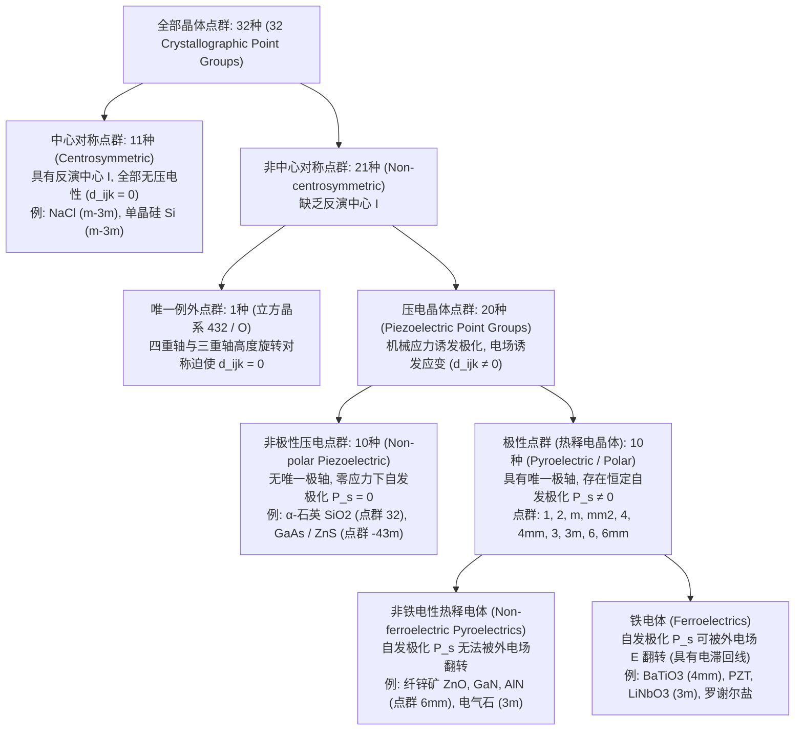
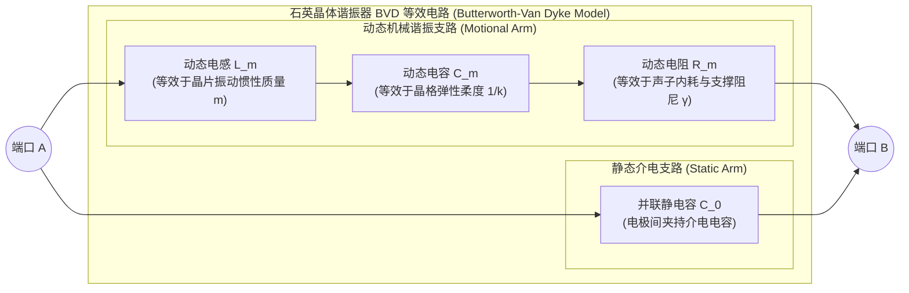

当我们旋转燃气灶旋钮听到清脆的“咔哒”声时，无需电池或外接电源，一道耀眼的蓝紫色电火花便会击穿空气点燃燃气；在我们腕间的石英表与口袋里的智能手机内部，微小的石英晶片与氮化铝薄膜正以每秒数万次乃至数十亿次的精准频率持续振动，构筑起现代数字文明的时间基准与5G射频滤波屏障；在医院的超声诊断室里，探头紧贴皮肤即可通过无声的超声波回波实时呈现胎儿的跳动心脏；而在纳米科学实验室的隔振平台上，扫描隧道显微镜（STM）与原子力显微镜（AFM）正以优于百分之一埃（$1\,\text{pm} = 10^{-12}\,\text{m}$）的惊人分辨率描绘出固体表面的单个原子排列。

将这些跨越宏观与微观的技术紧密联结在一起的核心物理机制，正是<strong>压电效应（Piezoelectric Effect）</strong>。该词源于希腊语 $\pi\iota\epsilon\zeta\epsilon\iota\nu$（*piezein*，意为“按压、挤压”），指<strong>不具备空间反演对称中心的特定晶体在受到机械应力作用时产生电极化（正压电效应），反之在外部电场作用下产生线性机械形变（逆压电效应）</strong>的可逆机电耦合现象。

为什么敲击普通的玻璃、食盐（$\text{NaCl}$）或单晶硅不会产生任何电压，而按压石英（$\text{SiO}_2$）或锆钛酸铅（PZT）却能瞬间生电？为什么齿轮与丝杠无法克服摩擦死区，而压电陶瓷却能平滑地操控亚皮米量级的原子位移？本文将从热力学、张量群论、固体物理与电子工程四个维度，系统揭示压电效应与晶体对称性的物理本质。

---

## 第一章：历史发现与热力学必然性——居里兄弟与李普曼的预言

### 1.1 1880年：皮埃尔·居里与雅克·居里发现正压电效应

压电效应的发现并非偶然，而是基于对晶体对称性与物理性质关系的深刻洞察。1880年，年仅21岁的<strong>皮埃尔·居里（Pierre Curie）</strong>与24岁的兄长<strong>雅克·居里（Jacques Curie）</strong>在巴黎索邦大学矿物学实验室研究晶体的<strong>热释电效应（Pyroelectricity）</strong>——即电气石（Tourmaline）等晶体在温度变化时两端出现正负电荷的现象。

居里兄弟敏锐地意识到，温度变化之所以诱发表面电荷，本质上是因为非对称晶格在热膨胀过程中发生了各向异性的力学形变，导致正负离子电荷重心发生相对位移。由此他们推断：即便保持温度恒定，只要沿着晶体的非对称轴直接施加机械应力，也必然会诱导表面电荷。他们利用锡箔电极和汤姆逊象限静电计对<strong>$\alpha$-石英（$\text{SiO}_2$）</strong>、<strong>电气石</strong>、<strong>闪锌矿（$\text{ZnS}$）</strong>、<strong>异极矿</strong>和<strong>罗谢尔盐（酒石酸钾钠，$\text{KNaC}_4\text{H}_4\text{O}_6 \cdot 4\text{H}_2\text{O}$）</strong>进行了系统的力学加载实验，确立了<strong>正压电效应（Direct Piezoelectric Effect）</strong>的基本定律：

1. 沿特定晶轴施加压缩或拉伸应力时，晶体表面产生的电荷量与外力严格成正比；
2. 将压缩应力改为拉伸应力时，诱导电荷的极性（正负号）精确反转；
3. 该效应仅存在于<strong>缺乏反演对称中心（半面晶象，Hemihedral）</strong>的晶体中。

### 1.2 1881年：加布里埃尔·李普曼的热力学推导与逆压电效应

1881年，物理学家<strong>加布里埃尔·李普曼（Gabriel Lippmann）</strong>将热力学第一、第二定律应用于可逆机电系统，从理论上预言了<strong>逆压电效应（Converse Piezoelectric Effect）</strong>的存在，并证明其应变-电场系数在数值上必然严格等于正压电效应的电荷-应力系数。

设单位体积晶体的温度为 $\Theta$，熵密度为 $s$，机械应力张量为 $T_{jk}$（单位：$\text{Pa} = \text{N/m}^2$），机械应变张量为 $S_{jk}$（无量纲），电场矢量为 $E_i$（单位：$\text{V/m}$），电位移矢量为 $D_i = \varepsilon_0 E_i + P_i$（单位：$\text{C/m}^2$）。在可逆过程中，内能密度 $U(s, S_{jk}, D_i)$ 的全微分为（采用爱因斯坦求和约定）：

$$dU = \Theta\,ds + T_{jk}\,dS_{jk} + E_i\,dD_i$$

以实验中直接控制的温度 $\Theta$、应力 $T_{jk}$ 和电场 $E_i$ 为自变量，通过勒让德变换（Legendre transformation）定义弹性-电吉布斯自由能密度 $G(\Theta, T_{jk}, E_i)$：

$$G(\Theta, T_{jk}, E_i) = U - \Theta s - T_{jk} S_{jk} - E_i D_i \quad \Longrightarrow \quad dG = -s\,d\Theta - S_{jk}\,dT_{jk} - D_i\,dE_i$$

在等温条件下（$d\Theta = 0$），应变与电位移分别为吉布斯自由能的一阶偏导数：

$$S_{jk} = -\left(\frac{\partial G}{\partial T_{jk}}\right)_{\mathbf{E}, \Theta}, \qquad D_i = -\left(\frac{\partial G}{\partial E_i}\right)_{\mathbf{T}, \Theta}$$

由于状态函数 $G$ 的二阶混合偏导数与求导次序无关（施瓦茨定理 $\frac{\partial^2 G}{\partial E_i \partial T_{jk}} = \frac{\partial^2 G}{\partial T_{jk} \partial E_i}$），立即导出压电学最核心的<strong>热力学麦克斯韦关系（Thermodynamic Maxwell Relation）</strong>：

$$d_{ijk} \equiv \left(\frac{\partial D_i}{\partial T_{jk}}\right)_{\mathbf{E}, \Theta} = \left(\frac{\partial S_{jk}}{\partial E_i}\right)_{\mathbf{T}, \Theta}$$

左端为短路恒定电场下的<strong>正压电系数</strong>（单位：$\text{C/N}$），右端为自由恒定应力下的<strong>逆压电系数</strong>（单位：$\text{m/V}$）。从量纲分析可知 $\text{C/N} = \text{C}/(\text{J/m}) = \text{m/V}$，两者在热力学上完全等价。居里兄弟随即通过光学杠杆测量石英晶片在高压电下的微米级伸长，实验证实了李普曼的预言，并据此发明了<strong>压电石英静电计</strong>——正是这一仪器帮助玛丽·居里与皮埃尔·居里在1898年精确测定了沥青铀矿的微弱电离电流，从而发现了钋（Polonium）与镭（Radium）。

---

## 第二章：张量本构方程与诺伊曼原理——反演对称中心的严格禁戒证明

### 2.1 线性压电本构方程与 IEEE 沃伊特（Voigt）矩阵记法

将吉布斯自由能 $G(T_{jk}, E_i)$ 在平衡态附近展开至二次项并求偏导，可得耦合的线性压电本构方程：

$$D_i = d_{ijk} T_{jk} + \varepsilon_{ij}^T E_j, \qquad S_{jk} = s_{jklm}^E T_{lm} + d_{ijk} E_i$$

其中 $\varepsilon_{ij}^T$ 为恒定应力介电常数张量（$\text{F/m}$），$s_{jklm}^E$ 为恒定电场弹性顺度张量（$\text{m}^2/\text{N}$），$d_{ijk}$ 为三阶压电张量。由于应力与应变张量具有对称性（$T_{jk} = T_{kj}, S_{jk} = S_{kj}$），压电张量满足 $d_{ijk} = d_{ikj}$，独立分量数从 $3^3 = 27$ 缩减为最多 $3 \times 6 = 18$ 个。按照 IEEE 标准采用<strong>沃伊特记法（Voigt notation）</strong>，将对称指标对 $(jk)$ 映射为单指标 $m \in \{1, 2, 3, 4, 5, 6\}$：

$$(11)\to 1,\quad (22)\to 2,\quad (33)\to 3,\quad (23,32)\to 4,\quad (13,31)\to 5,\quad (12,21)\to 6$$

（其中 $m=4,5,6$ 对应工程切应变 $S_m = 2S_{jk}$ 及 $d_{im} = 2d_{ijk}$），本构方程即可简写为矩阵形式：

$$D_i = d_{im} T_m + \varepsilon_{ij}^T E_j, \qquad S_m = s_{mn}^E T_n + d_{jm} E_j \qquad (i,j = 1..3;\; m,n = 1..6)$$

衡量机电能量转换效率的无量纲参数为<strong>机电耦合系数（Electromechanical Coupling Factor） $k$</strong>，定义为 $k^2 = \frac{d^2}{\varepsilon^T s^E}$。

### 2.2 诺伊曼原理（Neumann's Principle）与反演对称禁戒定则的严格证明

为何食盐（$\text{NaCl}$）、金刚石、单晶硅等晶体完全没有压电效应？这由晶体物理学的最高准则——<strong>诺伊曼原理</strong>决定：*晶体的任何宏观物理性质张量，在该晶体所属点群的一切对称操作下必须保持不变。*

设晶体具有<strong>空间反演对称中心（Center of Inversion Symmetry, $\mathcal{I}: \mathbf{r} \to -\mathbf{r}$）</strong>。在直角坐标系下，反演操作对应的正交变换矩阵为 $a_{ij} = -\delta_{ij}$（即 $x'_i = -x_i$）。考察各物理量在空间反演 $\mathcal{I}$ 下的变换规律：

1. <strong>电极化强度 $P_i$ 与电位移 $D_i$（一阶极性矢量）</strong>：在空间反演下方向完全反转，属于奇宇称张量：$D'_i = a_{ip} D_p = -D_i$。
2. <strong>机械应力 $T_{jk}$ 与应变 $S_{jk}$（二阶对称极性张量）</strong>：两侧对向挤压的力在空间反演下互换位置，但挤压状态本身完全不变，属于偶宇称张量：$T'_{jk} = a_{jq} a_{kr} T_{qr} = (-1)^2 T_{jk} = +T_{jk}$。
3. <strong>三阶压电张量 $d_{ijk}$ 的变换</strong>：作为连接一阶奇矢量与二阶偶张量的三阶极性张量，$d_{ijk}$ 在反演操作 $\mathcal{I}$ 下满足：
   $$d'_{ijk} = a_{ip} a_{jq} a_{kr} d_{pqr} = (-\delta_{ip})(-\delta_{jq})(-\delta_{kr}) d_{pqr} = (-1)^3 d_{ijk} = -d_{ijk}$$
   然而，若晶体本身具有反演对称中心 $\mathcal{I}$，根据诺伊曼原理，反演操作后晶体的物理性质张量必须保持严格不变，即：
   $$d'_{ijk} = d_{ijk}$$
   联立两式可得：
   $$d_{ijk} = -d_{ijk} \quad \Longrightarrow \quad d_{ijk} \equiv 0 \quad (\forall i, j, k \in \{1, 2, 3\})$$

这就从数学上严格证明了：<strong>任何具有反演对称中心的晶体，其压电张量的所有分量恒等于零！</strong>

### 2.3 压电效应与电致伸缩（Electrostriction）、摩擦起电（Triboelectricity）的本质区别

* <strong>电致伸缩效应（Electrostriction）</strong>：应变对电场的二阶响应 $S_{ij} = M_{ijkl} E_k E_l$。由于电致伸缩系数 $M_{ijkl}$ 是<strong>四阶极性张量</strong>，在空间反演下 $M'_{ijkl} = (-1)^4 M_{ijkl} = +M_{ijkl}$，不受反演中心限制，因而<strong>存在于一切固体、液体和气体电介质中</strong>。但电致伸缩与电场平方成正比（电场反向时形变方向不变），且不存在逆效应（纯应力无法诱发电极化）。
* <strong>摩擦起电（Triboelectricity）</strong>：两种材料接触摩擦并分离时，由于表面功函数或电子亲和能差异导致的<strong>界面电子/离子转移</strong>。它是局限于纳米表层的非平衡、不可逆耗散过程；而压电效应则是晶体<strong>体相（Bulk）晶格内阴阳离子亚晶格的弹性可逆相对位移</strong>。

| 对比维度 | 压电效应 (Piezoelectricity) | 电致伸缩效应 (Electrostriction) | 摩擦起电 (Triboelectricity) |
| :--- | :--- | :--- | :--- |
| <strong>微观物理机制</strong> | 晶胞内阴阳离子亚晶格弹性位移引起的<strong>体相偶极矩线性变化</strong> | 极化静电力引起的<strong>体相晶格二阶弹性形变</strong> | 接触与分离界面处的<strong>表面电子或离子转移</strong> |
| <strong>空间作用范围</strong> | 整个晶体<strong>三维体相（Bulk）</strong>均匀发生 | 整个电介质<strong>三维体相（Bulk）</strong> | 仅限于<strong>接触表面/界面</strong>（数纳米深度） |
| <strong>对称性要求</strong> | 仅限无反演中心的<strong>20种压电点群</strong>（及极化铁电陶瓷） | <strong>无对称性限制</strong>（所有晶体、非晶与液体均存在） | <strong>无晶体对称性限制</strong>（任意异质或同质材料表面） |
| <strong>数学响应关系</strong> | <strong>一阶线性函数</strong>：$D \propto T,\; S \propto E$（符号可逆） | <strong>二阶偶函数</strong>：$S \propto E^2$（电场反向形变符号不变） | <strong>非线性、随机性强</strong>（受湿度、表面粗糙度强烈影响） |
| <strong>热力学可逆性</strong> | <strong>严格可逆</strong>（正压电效应 $\Longleftrightarrow$ 逆压电效应） | <strong>单向耦合</strong>（无偏置电场时纯应力不产生极化） | <strong>不可逆耗散过程</strong>（施加电压无法还原机械摩擦） |

---

## 第三章：32种晶体点群的层级结构——压电体、热释电体与铁电体

三维空间晶体的宏观对称性严格划分为<strong>32种晶体点群（32 Crystallographic Point Groups）</strong>。运用诺伊曼原理，我们可以构建出电介质晶体的完整分类层级：

1. <strong>11种中心对称点群</strong>：包含反演中心 $\mathcal{I}$，满足 $d_{ijk} \equiv 0$。
2. <strong>立方点群 $432$（$O$ 群）的例外消亡</strong>：在21种非中心对称点群中，立方晶系的 $432$ 点群虽然没有反演中心和镜面，但同时拥有3根相互正交的四重旋转轴（$90^\circ$ 旋转）和4根体对角线方向的三重旋转轴（$120^\circ$ 旋转）。二重轴与三重轴对称性先将18个压电分量削减为单一剪切分量 $d_{14} = d_{25} = d_{36} = 2d_{312}$；然而绕 $Z$ 轴旋转 $90^\circ$（$x_1 \to x_2, x_2 \to -x_1, x_3 \to x_3$）使 $d'_{312} = -d_{321} = -d_{312}$，从而迫使 $d_{312} = 0$。因此仅剩 <strong>$32 - 11 - 1 = 20$ 种压电点群</strong>。
3. <strong>10种极性（热释电）点群与铁电体</strong>：20种压电点群中，有10种具有不受对称操作改变方向的<strong>唯一极性轴（Unique Polar Axis）</strong>（$1, 2, m, mm2, 4, 4mm, 3, 3m, 6, 6mm$），因而在无外力下仍保持<strong>自发极化 $\mathbf{P}_s \neq \mathbf{0}$</strong>，温度变化 $\Delta\Theta$ 会产生热释电电荷 $\Delta D_i = p_i \Delta\Theta$。其中，若自发极化 $\mathbf{P}_s$ 的方向还能在击穿前被大于矫顽场 $E_c$ 的外部电场可逆翻转（呈现 $P\text{–}E$ 电滞回线），则称为<strong>铁电体（Ferroelectrics）</strong>。

---

## 第四章：微观晶体结构与极化机制——$\alpha$-石英与钙钛矿铁电体（$\text{BaTiO}_3$, PZT）

### 4.1 $\alpha$-石英（$\text{SiO}_2$，三方点群 $32$）的螺旋四面体网络

常压下高于 $573\,^\circ\text{C}$ 时石英为六方晶系的 $\beta$-石英（点群 $622$），冷却至 $573\,^\circ\text{C}$ 以下则相变为三方晶系的<strong>$\alpha$-石英（点群 $32$）</strong>。其晶格由共顶点的 $\text{SiO}_4$ 四面体沿光学轴（$Z$ 轴，三重螺旋轴）螺旋排列而成，垂直于 $Z$ 轴的平面内分布着3根互成 $120^\circ$ 的二重旋转轴（电轴 $X$ 轴）以及与之正交的3根机械轴（$Y$ 轴）。

点群 $32$ 的对称性使 $\alpha$-石英的压电矩阵仅有<strong>2个独立非零分量</strong>（$d_{11} \approx 2.31\,\text{pC/N}$，$d_{14} \approx -0.727\,\text{pC/N}$）：

$$\mathbf{d}_{\text{Quartz (32)}} = \begin{pmatrix} d_{11} & -d_{11} & 0 & d_{14} & 0 & 0 \\ 0 & 0 & 0 & 0 & -d_{14} & -2d_{11} \\ 0 & 0 & 0 & 0 & 0 & 0 \end{pmatrix}$$

无应力时，三个 $\text{Si}^{4+}$ 正电荷中心与三个 $\text{O}^{2-}$ 负电荷对中心完全重合（$\mathbf{P}_s = \mathbf{0}$）。当沿电轴 $X$ 施加压缩应力 $T_1$（纵向效应 $D_1 = d_{11} T_1$）或沿机械轴 $Y$ 施加拉伸应力 $T_2$（横向效应 $D_1 = -d_{11} T_2$）时，四面体键角发生非对称畸变，正负电荷中心沿 $X$ 轴反向偏移从而产生电极化；而沿 $Y$ 轴施加电场 $E_2$ 则通过 $d_{26} = -2d_{11}$ 激发<strong>厚度切变振动（Thickness-shear mode）</strong>。

### 4.2 钙钛矿铁电体（$\text{BaTiO}_3$, PZT）、极化处理（Poling）与准同型相界（MPB）

通式为 $\text{ABO}_3$ 的钙钛矿型铁电氧化物（如钛酸钡 $\text{BaTiO}_3$ 和锆钛酸铅 $\text{Pb(Zr}_x\text{Ti}_{1-x}\text{)O}_3$ [PZT]）在居里温度 $T_C$ 以上为具有反演中心的立方晶系（点群 $m\bar{3}m$，顺电相，$d_{ijk}=0$）。当冷却至 $T_C$ 以下时，八面体中心的高价小阳离子 $\text{Ti}^{4+}/\text{Zr}^{4+}$ 因 $\text{Ti } 3d - \text{O } 2p$ 轨道杂化（二阶姜-泰勒效应）发生<strong>偏心位移（Off-centering）</strong>，晶格畸变为四方相（点群 $4mm$）或三方/菱方相（点群 $3m$），产生巨大的自发极化 $\mathbf{P}_s$。

烧结后的多晶陶瓷内部铁电畴取向随机，宏观各向同性（$\infty\infty m$）且无压电性。必须通过高温强直流电场下的<strong>人工极化处理（Poling）</strong>迫使电畴定向排列，将宏观对称性破缺为<strong>居里点群 $\infty m$（与 $6mm$ 同构，含 $d_{33}, d_{31}, d_{15}$ 三个独立系数）</strong>。特别是在 PZT 的<strong>准同型相界（Morphotropic Phase Boundary, MPB，$x \approx 0.52$）</strong>处，四方相（6个 $\langle 100 \rangle$ 极化方向）与菱方相（8个 $\langle 111 \rangle$ 极化方向）通过单斜桥接相（点群 $m$）共存，吉布斯自由能曲面高度平坦化，外电场极易驱动<strong>极化矢量旋转（Polarization Rotation）</strong>，使 $d_{33}$ 高达 $300\text{–}600\,\text{pC/N}$（弛豫铁电单晶 PMN-PT 甚至超过 $2000\,\text{pC/N}$），达到石英的数百倍。

---

## 第五章：谐振物理与石英晶体谐振器——BVD等效电路与零温度系数设计

### 5.1 巴特沃斯-范戴克（BVD）等效电路与串并联谐振推导

当交变电压激励石英晶片时，其声学驻波的机械振动方程在电路上严格等价于一个串联 $L_m C_m R_m$ 动态支路（Motional Arm）与电极静电容 $C_0$（Static Arm）的并联组合，即<strong>巴特沃斯-范戴克（Butterworth-Van Dyke, BVD）等效电路</strong>：

忽略微小的损耗电阻 $R_m \to 0$ 时，BVD 电路的总导纳为 $Y(\omega) = j\omega C_0 + \left(j\omega L_m + \frac{1}{j\omega C_m}\right)^{-1}$，由此导出两个特征谐振频率：

1. <strong>串联谐振频率（Series Resonance Frequency, $f_s$）</strong>：动态支路电抗抵消（$\omega_s L_m = \frac{1}{\omega_s C_m}$），总阻抗降至极小值 $Z \approx R_m$：
   $$f_s = \frac{1}{2\pi\sqrt{L_m C_m}}$$
2. <strong>并联（反）谐振频率（Parallel / Antiresonance Frequency, $f_p$）</strong>：呈感性的动态支路与静电容 $C_0$ 发生并联谐振，总导纳 $Y(\omega_p) = 0$（总阻抗趋于无穷大）：
   $$f_p = \frac{1}{2\pi\sqrt{L_m \frac{C_m C_0}{C_m + C_0}}} = f_s \sqrt{1 + \frac{C_m}{C_0}} \approx f_s \left(1 + \frac{C_m}{2C_0}\right)$$

仅在 $f_s < f < f_p$ 这一极窄的频率窗口内（因 $C_0/C_m \sim 250$，带宽仅约 $0.2\%$），石英晶体呈现<strong>纯电感性（Inductive）</strong>。

### 5.2 超高 $Q$ 值（$10^5\text{–}10^6$）、$32,768\,\text{Hz}$ 音叉晶振、AT切型与 5G BAW/FBAR 滤波器

单晶石英极低的声子耗散（小 $R_m$）和巨大的等效电感-电容比赋予其高达 <strong>$Q = \frac{\omega_s L_m}{R_m} \sim 10^5\text{–}10^6$</strong> 的品质因数，比普通 $LC$ 电路高出4个数量级。
* <strong>$32,768\,\text{Hz}$（$2^{15}\,\text{Hz}$）音叉型石英晶振</strong>：高于人耳听觉上限（$20\,\text{kHz}$）且恰好等于 $2^{15}$，仅需15级二分频触发器即可精确获得 $1\,\text{Hz}$ 秒脉冲，其抛物线温度特性顶点位于室温 $25\,^\circ\text{C}$。
* <strong>AT切型石英（与光轴 $Z$ 成 $35^\circ 15'$ 角）</strong>：利用厚度切变模态，使弹性常数的一阶与二阶温度系数在 $25\,^\circ\text{C}$ 附近同时抵消，形成平坦的三次曲线（Cubic curve），实现全温区 $\text{ppm}$ 级超低频漂。
* <strong>射频声学滤波器（SAW 与 BAW/FBAR）</strong>：在智能手机 GHz 频段，基于 $\text{LiTaO}_3/\text{LiNbO}_3$ 的声表面波（SAW）滤波器和基于纤锌矿氮化铝（$\text{AlN}$ / $\text{ScAlN}$）悬空薄膜的体声波谐振器（FBAR）实现了陡峭的射频信道选择。

---

## 第六章：超声探测与亚皮米精密定位——从深海声呐、医学成像到单原子操控

1. <strong>朗之万声呐（SONAR）与医学相控阵超声（Medical Phased-Array Ultrasound）</strong>：
   1917年保罗·朗之万（Paul Langevin）利用钢块夹持石英晶片发明主动声呐。现代医学超声探头集成了 $128\text{–}256$ 阵元 PZT/PMN-PT 相控阵，通过纳秒级延时发射（逆压电效应）与回波接收（正压电效应）实现电子动态聚焦；并在探头表面引入厚度为<strong>四分之一波长（$\lambda/4$）、声阻抗为几何平均值 $Z_{\text{match}} = \sqrt{Z_{\text{PZT}} Z_{\text{tissue}}} \approx \sqrt{30 \times 1.5} \approx 6.7\,\text{MRayl}$ 的声学匹配层</strong>，消除界面高达 $82\%$ 的声反射损失。
2. <strong>扫描隧道显微镜（STM）与原子力显微镜（AFM）的亚皮米扫描器</strong>：
   1981年宾尼希（Gerd Binnig）与罗雷尔（Heinrich Rohrer）发明 STM（获1986年诺贝尔物理学奖）。由于量子隧穿电流 $I_t \propto V \exp(-2\kappa z)$ 随针尖-样品间距 $z$ 变化 $1\,\text{\AA}$ 即改变10倍，必须利用无摩擦、无回程死区的<strong>四象限 PZT 压电管扫描器</strong>，通过毫伏至微伏级电压调控晶格连续应变，实现优于 <strong>$0.01\,\text{\AA}$（$1\,\text{pm}$）</strong> 的三维原子级定位。
3. <strong>共烧多层压电执行器与高压点火器</strong>：
   将数百层微米级 PZT 薄层交替叠层共烧（$\Delta L = N d_{33} V$），可在 $100\text{–}150\,\text{V}$ 下输出微秒级响应与数千牛顿推力，驱动柴油机 $200\,\text{MPa}$ 高压共轨喷油器实现单循环5–7次精密喷射，以及压电喷墨打印头的皮升（$\text{pL}$）级墨滴喷射；而燃气灶压电点火器则利用弹簧锤冲击 PZT 圆柱，在开路条件下由 $E_3 = -g_{33} T_3 = -(d_{33}/\varepsilon_{33}^T)T_3$ 瞬间产生 $10\text{–}20\,\text{kV}$ 高压电弧。

从诺伊曼原理的群论禁戒到 BVD 谐振器与原子显微镜，压电效应完美诠释了晶体空间对称性破缺如何转化为驱动现代科技文明的核心力量。
