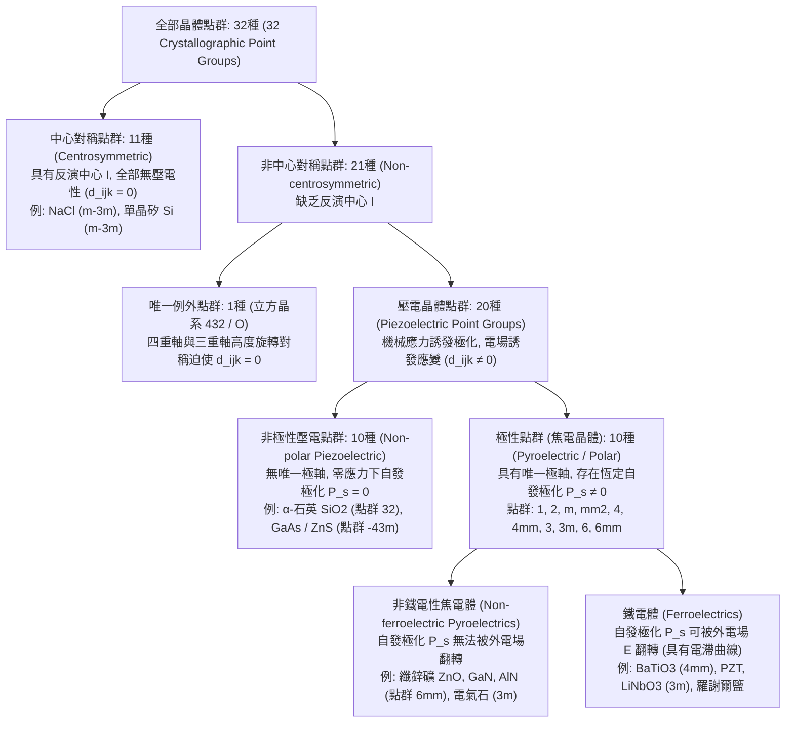
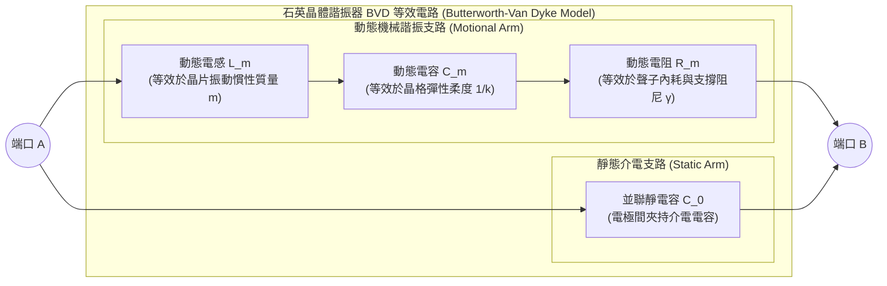

當我們轉動瓦斯爐旋鈕聽到清脆的「咔哒」聲時，無需電池或外接電源，一道耀眼的藍紫色電火花便會擊穿空氣點燃瓦斯；在我們腕間的石英錶與口袋裡的智慧型手機內部，微小的石英晶片與氮化鋁薄膜正以每秒數萬次乃至數十億次的精準頻率持續振動，構築起現代數位文明的時間基準與5G射頻濾波屏障；在醫院的超音波室裡，探頭緊貼皮膚即可透過無聲的超音波回波即時呈現胎兒跳動的心臟；而在奈米科學實驗室的隔振平台上，掃描穿隧顯微鏡（STM）與原子力顯微鏡（AFM）正以優於百分之一埃（$1\,\text{pm} = 10^{-12}\,\text{m}$）的驚人解析度描繪出固體表面的單個原子排列。

將這些跨越巨觀與微觀的技術緊密聯結在一起的核心物理機制，正是<strong>壓電效應（Piezoelectric Effect）</strong>。該詞源於希臘語 $\pi\iota\epsilon\zeta\epsilon\iota\nu$（*piezein*，意為「按壓、擠壓」），指<strong>不具備空間反演對稱中心的特定晶體在受到機械應力作用時產生電極化（正壓電效應），反之在外部電場作用下產生線性機械形變（逆壓電效應）</strong>的可逆機電耦合現象。

為什麼敲擊普通的玻璃、食鹽（$\text{NaCl}$）或單晶矽不會產生任何電壓，而按壓石英（$\text{SiO}_2$）或鋯鈦酸鉛（PZT）卻能瞬間生電？為什麼齒輪與導螺桿無法克服摩擦死區，而壓電陶瓷卻能平滑地操控亞皮米量級的原子位移？本文將從熱力學、張量群論、固態物理與電子工程四個維度，系統揭示壓電效應與晶體對稱性的物理本質。

---

## 第一章：歷史發現與熱力學必然性——居禮兄弟與李普曼的預言

### 1.1 1880年：皮埃爾·居禮與雅克·居禮發現正壓電效應

壓電效應的發現並非偶然，而是基於對晶體對稱性與物理性質關係的深刻洞察。1880年，年僅21歲的<strong>皮埃爾·居禮（Pierre Curie）</strong>與24歲的兄長<strong>雅克·居禮（Jacques Curie）</strong>在巴黎索邦大學礦物學實驗室研究晶體的<strong>焦電效應（Pyroelectricity，又稱熱釋電效應）</strong>——即電氣石（Tourmaline）等晶體在溫度變化時兩端出現正負電荷的現象。

居禮兄弟敏銳地意識到，溫度變化之所以誘發表面電荷，本質上是因為非對稱晶格在熱膨脹過程中發生了非均向性的力學形變，導致正負離子電荷重心發生相對位移。由此他們推斷：即便保持溫度恆定，只要沿著晶體的非對稱軸直接施加機械應力，也必然會誘導表面電荷。他們利用錫箔電極和湯姆森象限靜電計對<strong>$\alpha$-石英（$\text{SiO}_2$）</strong>、<strong>電氣石</strong>、<strong>閃鋅礦（$\text{ZnS}$）</strong>、<strong>異極礦</strong>和<strong>羅謝爾鹽（酒石酸鉀鈉，$\text{KNaC}_4\text{H}_4\text{O}_6 \cdot 4\text{H}_2\text{O}$）</strong>進行了系統的力學載荷實驗，確立了<strong>正壓電效應（Direct Piezoelectric Effect）</strong>的基本定律：

1. 沿特定晶軸施加壓縮或拉伸應力時，晶體表面產生的電荷量與外力嚴格成正比；
2. 將壓縮應力改為拉伸應力時，誘導電荷的極性（正負號）精確反轉；
3. 該效應僅存在於<strong>缺乏反演對稱中心（半面晶象，Hemihedral）</strong>的晶體中。

### 1.2 1881年：加布里埃爾·李普曼的熱力學推導與逆壓電效應

1881年，物理學家<strong>加布里埃爾·李普曼（Gabriel Lippmann）</strong>將熱力學第一、第二定律應用於可逆機電系統，從理論上預言了<strong>逆壓電效應（Converse Piezoelectric Effect）</strong>的存在，並證明其應變-電場係數在數值上必然嚴格等於正壓電效應的電荷-應力係數。

設單位體積晶體的溫度為 $\Theta$，熵密度為 $s$，機械應力張量為 $T_{jk}$（單位：$\text{Pa} = \text{N/m}^2$），機械應變張量為 $S_{jk}$（無因次），電場向量為 $E_i$（單位：$\text{V/m}$），電位移向量為 $D_i = \varepsilon_0 E_i + P_i$（單位：$\text{C/m}^2$）。在可逆過程中，內能密度 $U(s, S_{jk}, D_i)$ 的全微分為（採用愛因斯坦求和約定）：

$$dU = \Theta\,ds + T_{jk}\,dS_{jk} + E_i\,dD_i$$

以實驗中直接控制的溫度 $\Theta$、應力 $T_{jk}$ 和電場 $E_i$ 為自變數，透過勒讓德轉換（Legendre transformation）定義彈性-電吉布斯自由能密度 $G(\Theta, T_{jk}, E_i)$：

$$G(\Theta, T_{jk}, E_i) = U - \Theta s - T_{jk} S_{jk} - E_i D_i \quad \Longrightarrow \quad dG = -s\,d\Theta - S_{jk}\,dT_{jk} - D_i\,dE_i$$

在等溫條件下（$d\Theta = 0$），應變與電位移分別為吉布斯自由能的一階偏導數：

$$S_{jk} = -\left(\frac{\partial G}{\partial T_{jk}}\right)_{\mathbf{E}, \Theta}, \qquad D_i = -\left(\frac{\partial G}{\partial E_i}\right)_{\mathbf{T}, \Theta}$$

由於狀態函數 $G$ 的二階混合偏導數與求導次序無關（施瓦茨定理 $\frac{\partial^2 G}{\partial E_i \partial T_{jk}} = \frac{\partial^2 G}{\partial T_{jk} \partial E_i}$），立即導出壓電學最核心的<strong>熱力學馬克士威關係（Thermodynamic Maxwell Relation）</strong>：

$$d_{ijk} \equiv \left(\frac{\partial D_i}{\partial T_{jk}}\right)_{\mathbf{E}, \Theta} = \left(\frac{\partial S_{jk}}{\partial E_i}\right)_{\mathbf{T}, \Theta}$$

左端為短路恆定電場下的<strong>正壓電係數</strong>（單位：$\text{C/N}$），右端為自由恆定應力下的<strong>逆壓電係數</strong>（單位：$\text{m/V}$）。從因次分析可知 $\text{C/N} = \text{C}/(\text{J/m}) = \text{m/V}$，兩者在熱力學上完全等價。居禮兄弟隨即透過光學槓桿測量石英晶片在高壓電下的微米級伸長，實驗證實了李普曼的預言，並據此發明了<strong>壓電石英靜電計</strong>——正是這一儀器幫助瑪麗·居禮與皮埃爾·居禮在1898年精確測定了瀝青鈾礦的微弱游離電流，從而發現了釙（Polonium）與鐳（Radium）。

---

## 第二章：張量本構方程與諾伊曼原理——反演對稱中心的嚴格禁戒證明

### 2.1 線性壓電本構方程與 IEEE 沃伊特（Voigt）矩陣記法

將吉布斯自由能 $G(T_{jk}, E_i)$ 在平衡態附近展開至二次項並求偏導，可得耦合的線性壓電本構方程：

$$D_i = d_{ijk} T_{jk} + \varepsilon_{ij}^T E_j, \qquad S_{jk} = s_{jklm}^E T_{lm} + d_{ijk} E_i$$

其中 $\varepsilon_{ij}^T$ 為恆定應力介電常數張量（$\text{F/m}$），$s_{jklm}^E$ 為恆定電場彈性順度張量（$\text{m}^2/\text{N}$），$d_{ijk}$ 為三階壓電張量。由於應力與應變張量具有對稱性（$T_{jk} = T_{kj}, S_{jk} = S_{kj}$），壓電張量滿足 $d_{ijk} = d_{ikj}$，獨立分量數從 $3^3 = 27$ 縮減為最多 $3 \times 6 = 18$ 個。按照 IEEE 標準採用<strong>沃伊特記法（Voigt notation）</strong>，將對稱指標對 $(jk)$ 映射為單指標 $m \in \{1, 2, 3, 4, 5, 6\}$：

$$(11)\to 1,\quad (22)\to 2,\quad (33)\to 3,\quad (23,32)\to 4,\quad (13,31)\to 5,\quad (12,21)\to 6$$

（其中 $m=4,5,6$ 對應工程剪應變 $S_m = 2S_{jk}$ 及 $d_{im} = 2d_{ijk}$），本構方程即可簡寫為矩陣形式：

$$D_i = d_{im} T_m + \varepsilon_{ij}^T E_j, \qquad S_m = s_{mn}^E T_n + d_{jm} E_j \qquad (i,j = 1..3;\; m,n = 1..6)$$

衡量機電能量轉換效率的無因次參數為<strong>機電耦合係數（Electromechanical Coupling Factor） $k$</strong>，定義為 $k^2 = \frac{d^2}{\varepsilon^T s^E}$。

### 2.2 諾伊曼原理（Neumann's Principle）與反演對稱禁戒定則的嚴格證明

為何食鹽（$\text{NaCl}$）、金剛石、單晶矽等晶體完全沒有壓電效應？這由晶體物理學的最高準則——<strong>諾伊曼原理</strong>決定：*晶體的任何巨觀物理性質張量，在該晶體所屬點群的一切對稱操作下必須保持不變。*

設晶體具有<strong>空間反演對稱中心（Center of Inversion Symmetry, $\mathcal{I}: \mathbf{r} \to -\mathbf{r}$）</strong>。在直角座標系下，反演操作對應的正交變換矩陣為 $a_{ij} = -\delta_{ij}$（即 $x'_i = -x_i$）。考察各物理量在空間反演 $\mathcal{I}$ 下的變換規律：

1. <strong>電極化強度 $P_i$ 與電位移 $D_i$（一階極性向量）</strong>：在空間反演下方向完全反轉，屬於奇宇稱張量：$D'_i = a_{ip} D_p = -D_i$。
2. <strong>機械應力 $T_{jk}$ 與應變 $S_{jk}$（二階對稱極性張量）</strong>：兩側對向擠壓的力在空間反演下互換位置，但擠壓狀態本身完全不變，屬於偶宇稱張量：$T'_{jk} = a_{jq} a_{kr} T_{qr} = (-1)^2 T_{jk} = +T_{jk}$。
3. <strong>三階壓電張量 $d_{ijk}$ 的變換</strong>：作為連接一階奇向量與二階偶張量的三階極性張量，$d_{ijk}$ 在反演操作 $\mathcal{I}$ 下滿足：
   $$d'_{ijk} = a_{ip} a_{jq} a_{kr} d_{pqr} = (-\delta_{ip})(-\delta_{jq})(-\delta_{kr}) d_{pqr} = (-1)^3 d_{ijk} = -d_{ijk}$$
   然而，若晶體本身具有反演對稱中心 $\mathcal{I}$，根據諾伊曼原理，反演操作後晶體的物理性質張量必須保持嚴格不變，即：
   $$d'_{ijk} = d_{ijk}$$
   聯立兩式可得：
   $$d_{ijk} = -d_{ijk} \quad \Longrightarrow \quad d_{ijk} \equiv 0 \quad (\forall i, j, k \in \{1, 2, 3\})$$

這就從數學上嚴格證明了：<strong>任何具有反演對稱中心的晶體，其壓電張量的所有分量恆等於零！</strong>

### 2.3 壓電效應與電致伸縮（Electrostriction）、摩擦起電（Triboelectricity）的本質區別

* <strong>電致伸縮效應（Electrostriction）</strong>：應變對電場的二階響應 $S_{ij} = M_{ijkl} E_k E_l$。由於電致伸縮係數 $M_{ijkl}$ 是<strong>四階極性張量</strong>，在空間反演下 $M'_{ijkl} = (-1)^4 M_{ijkl} = +M_{ijkl}$，不受反演中心限制，因而<strong>存在於一切固體、液體和氣體電介質中</strong>。但電致伸縮與電場平方成正比（電場反向時形變方向不變），且不存在逆效應（純應力無法誘發電極化）。
* <strong>摩擦起電（Triboelectricity）</strong>：兩種材料接觸摩擦並分離時，由於表面功函數或電子親和力差異導致的<strong>界面電子/離子轉移</strong>。它是局限於奈米表層的非平衡、不可逆耗散過程；而壓電效應則是晶體<strong>體相（Bulk）晶格內陰陽離子亞晶格的彈性可逆相對位移</strong>。

| 對比維度 | 壓電效應 (Piezoelectricity) | 電致伸縮效應 (Electrostriction) | 摩擦起電 (Triboelectricity) |
| :--- | :--- | :--- | :--- |
| <strong>微觀物理機制</strong> | 晶胞內陰陽離子亞晶格彈性位移引起的<strong>體相偶極矩線性變化</strong> | 極化靜電力引起的<strong>體相晶格二階彈性形變</strong> | 接觸與分離界面處的<strong>表面電子或離子轉移</strong> |
| <strong>空間作用範圍</strong> | 整個晶體<strong>三維體相（Bulk）</strong>均勻發生 | 整個電介質<strong>三維體相（Bulk）</strong> | 僅限於<strong>接觸表面/界面</strong>（數奈米深度） |
| <strong>對稱性要求</strong> | 僅限無反演中心的<strong>20種壓電點群</strong>（及極化鐵電陶瓷） | <strong>無對稱性限制</strong>（所有晶體、非晶與液體均存在） | <strong>無晶體對稱性限制</strong>（任意異質或同質材料表面） |
| <strong>數學響應關係</strong> | <strong>一階線性函數</strong>：$D \propto T,\; S \propto E$（符號可逆） | <strong>二階偶函數</strong>：$S \propto E^2$（電場反向形變符號不變） | <strong>非線性、隨機性強</strong>（受濕度、表面粗糙度強烈影響） |
| <strong>熱力學可逆性</strong> | <strong>嚴格可逆</strong>（正壓電效應 $\Longleftrightarrow$ 逆壓電效應） | <strong>單向耦合</strong>（無偏置電場時純應力不產生極化） | <strong>不可逆耗散過程</strong>（施加電壓無法還原機械摩擦） |

---

## 第三章：32種晶體點群的層級結構——壓電體、焦電體與鐵電體

三維空間晶體的巨觀對稱性嚴格劃分為<strong>32種晶體點群（32 Crystallographic Point Groups）</strong>。運用諾伊曼原理，我們可以建構出電介質晶體的完整分類層級：

1. <strong>11種中心對稱點群</strong>：包含反演中心 $\mathcal{I}$，滿足 $d_{ijk} \equiv 0$。
2. <strong>立方點群 $432$（$O$ 群）的例外消亡</strong>：在21種非中心對稱點群中，立方晶系的 $432$ 點群雖然沒有反演中心和鏡面，但同時擁有3根相互正交的四重旋轉軸（$90^\circ$ 旋轉）和4根體對角線方向的三重旋轉軸（$120^\circ$ 旋轉）。二重軸與三重軸對稱性先將18個壓電分量削減為單一剪切分量 $d_{14} = d_{25} = d_{36} = 2d_{312}$；然而繞 $Z$ 軸旋轉 $90^\circ$（$x_1 \to x_2, x_2 \to -x_1, x_3 \to x_3$）使 $d'_{312} = -d_{321} = -d_{312}$，從而迫使 $d_{312} = 0$。因此僅剩 <strong>$32 - 11 - 1 = 20$ 種壓電點群</strong>。
3. <strong>10種極性（焦電）點群與鐵電體</strong>：20種壓電點群中，有10種具有不受對稱操作改變方向的<strong>唯一極性軸（Unique Polar Axis）</strong>（$1, 2, m, mm2, 4, 4mm, 3, 3m, 6, 6mm$），因而在無外力下仍保持<strong>自發極化 $\mathbf{P}_s \neq \mathbf{0}$</strong>，溫度變化 $\Delta\Theta$ 會產生焦電電荷 $\Delta D_i = p_i \Delta\Theta$。其中，若自發極化 $\mathbf{P}_s$ 的方向還能在絕緣擊穿前被大於矯頑場 $E_c$ 的外部電場可逆翻轉（呈現 $P\text{–}E$ 電滯曲線），則稱為<strong>鐵電體（Ferroelectrics）</strong>。

---

## 第四章：微觀晶體結構與極化機制——$\alpha$-石英與鈣鈦礦鐵電體（$\text{BaTiO}_3$, PZT）

### 4.1 $\alpha$-石英（$\text{SiO}_2$，三方點群 $32$）的螺旋四面體網路

常壓下高於 $573\,^\circ\text{C}$ 時石英為六方晶系的 $\beta$-石英（點群 $622$），冷卻至 $573\,^\circ\text{C}$ 以下則相變為三方晶系的<strong>$\alpha$-石英（點群 $32$）</strong>。其晶格由共頂點的 $\text{SiO}_4$ 四面體沿光學軸（$Z$ 軸，三重螺旋軸）螺旋排列而成，垂直於 $Z$ 軸的平面內分佈著3根互成 $120^\circ$ 的二重旋轉軸（電軸 $X$ 軸）以及與之正交的3根機械軸（$Y$ 軸）。

點群 $32$ 的對稱性使 $\alpha$-石英的壓電矩陣僅有<strong>2個獨立非零分量</strong>（$d_{11} \approx 2.31\,\text{pC/N}$，$d_{14} \approx -0.727\,\text{pC/N}$）：

$$\mathbf{d}_{\text{Quartz (32)}} = \begin{pmatrix} d_{11} & -d_{11} & 0 & d_{14} & 0 & 0 \\ 0 & 0 & 0 & 0 & -d_{14} & -2d_{11} \\ 0 & 0 & 0 & 0 & 0 & 0 \end{pmatrix}$$

無應力時，三個 $\text{Si}^{4+}$ 正電荷中心與三個 $\text{O}^{2-}$ 負電荷對中心完全重合（$\mathbf{P}_s = \mathbf{0}$）。當沿電軸 $X$ 施加壓縮應力 $T_1$（縱向效應 $D_1 = d_{11} T_1$）或沿機械軸 $Y$ 施加拉伸應力 $T_2$（橫向效應 $D_1 = -d_{11} T_2$）時，四面體鍵角發生非對稱畸變，正負電荷中心沿 $X$ 軸反向偏移從而產生電極化；而沿 $Y$ 軸施加電場 $E_2$ 則透過 $d_{26} = -2d_{11}$ 激發<strong>厚度切變振動（Thickness-shear mode）</strong>。

### 4.2 鈣鈦礦鐵電體（$\text{BaTiO}_3$, PZT）、極化處理（Poling）與準同型相界（MPB）

通式為 $\text{ABO}_3$ 的鈣鈦礦型鐵電氧化物（如鈦酸鋇 $\text{BaTiO}_3$ 和鋯鈦酸鉛 $\text{Pb(Zr}_x\text{Ti}_{1-x}\text{)O}_3$ [PZT]）在居禮溫度 $T_C$ 以上為具有反演中心的立方晶系（點群 $m\bar{3}m$，順電相，$d_{ijk}=0$）。當冷卻至 $T_C$ 以下時，八面體中心的高價小陽離子 $\text{Ti}^{4+}/\text{Zr}^{4+}$ 因 $\text{Ti } 3d - \text{O } 2p$ 軌域混成（二階姜-泰勒效應）發生<strong>偏心位移（Off-centering）</strong>，晶格畸變為四方相（點群 $4mm$）或三方/菱方相（點群 $3m$），產生巨大的自發極化 $\mathbf{P}_s$。

燒結後的多晶陶瓷內部鐵電疇取向隨機，巨觀均向性（$\infty\infty m$）且無壓電性。必須透過高溫強直流電場下的<strong>人工極化處理（Poling）</strong>迫使電疇定向排列，將巨觀對稱性破缺為<strong>居禮點群 $\infty m$（與 $6mm$ 同構，含 $d_{33}, d_{31}, d_{15}$ 三個獨立係數）</strong>。特別是在 PZT 的<strong>準同型相界（Morphotropic Phase Boundary, MPB，$x \approx 0.52$）</strong>處，四方相（6個 $\langle 100 \rangle$ 極化方向）與菱方相（8個 $\langle 111 \rangle$ 極化方向）透過單斜橋接相（點群 $m$）共存，吉布斯自由能曲面高度平坦化，外電場極易驅動<strong>極化向量旋轉（Polarization Rotation）</strong>，使 $d_{33}$ 高達 $300\text{–}600\,\text{pC/N}$（弛豫鐵電單晶 PMN-PT 甚至超過 $2000\,\text{pC/N}$），達到石英的數百倍。

---

## 第五章：諧振物理與石英晶體諧振器——BVD等效電路與零溫度係數設計

### 5.1 巴特沃斯-范戴克（BVD）等效電路與串並聯諧振推導

當交變電壓激勵石英晶片時，其聲學駐波的機械振動方程在電路上嚴格等價於一個串聯 $L_m C_m R_m$ 動態支路（Motional Arm）與電極靜電容 $C_0$（Static Arm）的並聯組合，即<strong>巴特沃斯-范戴克（Butterworth-Van Dyke, BVD）等效電路</strong>：

忽略微小的損耗電阻 $R_m \to 0$ 時，BVD 電路的總導納為 $Y(\omega) = j\omega C_0 + \left(j\omega L_m + \frac{1}{j\omega C_m}\right)^{-1}$，由此導出兩個特徵諧振頻率：

1. <strong>串聯諧振頻率（Series Resonance Frequency, $f_s$）</strong>：動態支路電抗抵消（$\omega_s L_m = \frac{1}{\omega_s C_m}$），總阻抗降至極小值 $Z \approx R_m$：
   $$f_s = \frac{1}{2\pi\sqrt{L_m C_m}}$$
2. <strong>並聯（反）諧振頻率（Parallel / Antiresonance Frequency, $f_p$）</strong>：呈感性的動態支路與靜電容 $C_0$ 發生並聯諧振，總導納 $Y(\omega_p) = 0$（總阻抗趨於無窮大）：
   $$f_p = \frac{1}{2\pi\sqrt{L_m \frac{C_m C_0}{C_m + C_0}}} = f_s \sqrt{1 + \frac{C_m}{C_0}} \approx f_s \left(1 + \frac{C_m}{2C_0}\right)$$

僅在 $f_s < f < f_p$ 這一極窄的頻率窗口內（因 $C_0/C_m \sim 250$，頻寬僅約 $0.2\%$），石英晶體呈現<strong>純電感性（Inductive）</strong>。

### 5.2 超高 $Q$ 值（$10^5\text{–}10^6$）、$32,768\,\text{Hz}$ 音叉晶振、AT切型與 5G BAW/FBAR 濾波器

單晶石英極低的聲子耗散（小 $R_m$）和巨大的等效電感-電容比賦予其高達 <strong>$Q = \frac{\omega_s L_m}{R_m} \sim 10^5\text{–}10^6$</strong> 的品質因數，比普通 $LC$ 電路高出4個數量級。
* <strong>$32,768\,\text{Hz}$（$2^{15}\,\text{Hz}$）音叉型石英晶振</strong>：高於人耳聽覺上限（$20\,\text{kHz}$）且恰好等於 $2^{15}$，僅需15級除頻正反器即可精確獲得 $1\,\text{Hz}$ 秒脈衝，其拋物線溫度特性頂點位於室溫 $25\,^\circ\text{C}$。
* <strong>AT切型石英（與光軸 $Z$ 成 $35^\circ 15'$ 角）</strong>：利用厚度切變模態，使彈性常數的一階與二階溫度係數在 $25\,^\circ\text{C}$ 附近同時抵消，形成平坦的三次曲線（Cubic curve），實現全溫區 $\text{ppm}$ 級超低頻漂。
* <strong>射頻聲學濾波器（SAW 與 BAW/FBAR）</strong>：在智慧型手機 GHz 頻段，基於 $\text{LiTaO}_3/\text{LiNbO}_3$ 的表面聲波（SAW）濾波器和基於纖鋅礦氮化鋁（$\text{AlN}$ / $\text{ScAlN}$）懸空薄膜的體聲波諧振器（FBAR）實現了陡峭的射頻通道選擇。

---

## 第六章：超音波探測與亞皮米精密定位——從深海聲吶、醫學成像到單原子操控

1. <strong>朗之萬聲吶（SONAR）與醫學相控陣超音波（Medical Phased-Array Ultrasound）</strong>：
   1917年保羅·朗之萬（Paul Langevin）利用鋼塊夾持石英晶片發明主動聲吶。現代醫學超音波探頭集成了 $128\text{–}256$ 陣元 PZT/PMN-PT 相控陣，透過奈秒級延時發射（逆壓電效應）與回波接收（正壓電效應）實現電子動態聚焦；並在探頭表面引入厚度為<strong>四分之一波長（$\lambda/4$）、聲阻抗為幾何平均值 $Z_{\text{match}} = \sqrt{Z_{\text{PZT}} Z_{\text{tissue}}} \approx \sqrt{30 \times 1.5} \approx 6.7\,\text{MRayl}$ 的聲學匹配層</strong>，消除界面高達 $82\%$ 的聲反射損失。
2. <strong>掃描穿隧顯微鏡（STM）與原子力顯微鏡（AFM）的亞皮米掃描器</strong>：
   1981年賓尼希（Gerd Binnig）與羅雷爾（Heinrich Rohrer）發明 STM（獲1986年諾貝爾物理學獎）。由於量子穿隧電流 $I_t \propto V \exp(-2\kappa z)$ 隨針尖-樣品間距 $z$ 變化 $1\,\text{\AA}$ 即改變10倍，必須利用無摩擦、無背隙的<strong>四象限 PZT 壓電管掃描器</strong>，透過毫伏至微伏級電壓調控晶格連續應變，實現優於 <strong>$0.01\,\text{\AA}$（$1\,\text{pm}$）</strong> 的三維原子級定位。
3. <strong>共燒多層壓電致動器與高壓點火器</strong>：
   將數百層微米級 PZT 薄層交替疊層共燒（$\Delta L = N d_{33} V$），可在 $100\text{–}150\,\text{V}$ 下輸出微秒級響應與數千牛頓推力，驅動柴油機 $200\,\text{MPa}$ 高壓共軌噴油器實現單循環5–7次精密噴射，以及壓電噴墨印表機的皮升（$\text{pL}$）級墨滴噴射；而瓦斯爐壓電點火器則利用彈簧錘衝擊 PZT 圓柱，在開路條件下由 $E_3 = -g_{33} T_3 = -(d_{33}/\varepsilon_{33}^T)T_3$ 瞬間產生 $10\text{–}20\,\text{kV}$ 高壓電弧。

從諾伊曼原理的群論禁戒到 BVD 諧振器與原子顯微鏡，壓電效應完美詮釋了晶體空間對稱性破缺如何轉化為驅動現代科技文明的核心力量。
