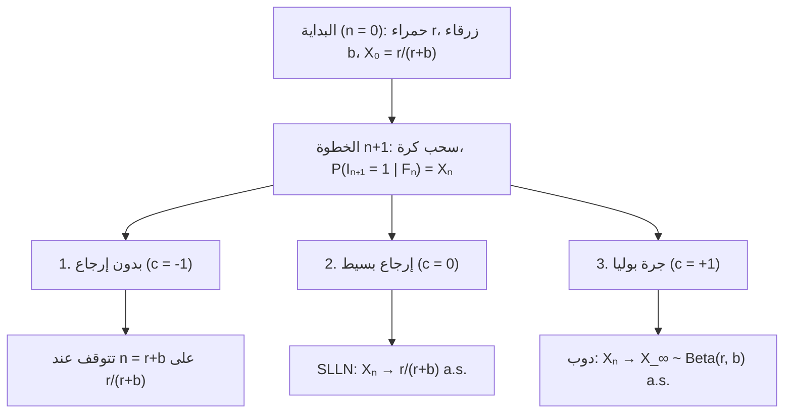
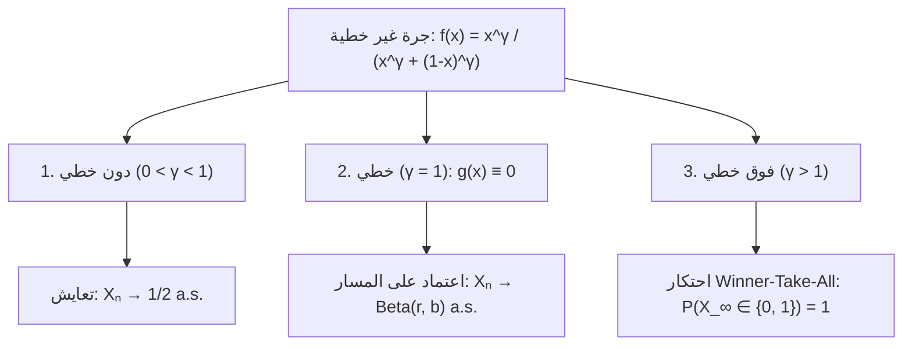

## مقدمة: لماذا تتحول بضع ضربات حظ في البداية إلى فجوات لا رجعة فيها؟

يتم إطلاق مقطعي فيديو أو معيارين تقنيين بجودة متطابقة تقريباً في اللحظة نفسها: وبفضل تقدم عشوائي طفيف في البداية، يتضخم أحدهما عبر التغذية الراجعة الإيجابية ليهيمن على السوق (<strong>تأثير متى</strong>)، بينما يطوي النسيان الآخر. غير أن <strong>قانون الأعداد الكبيرة القوي (SLLN)</strong> يعلّمنا العكس: في التجارب المستقلة (i.i.d.) مثل رمي العملة، تتلاشى التقلبات الأولية عندما $n \to \infty$ وتتقارب النسبة حتماً إلى الثابت $p$.

لماذا يتحدى العالم الواقعي قانون الأعداد الكبيرة؟ لأن العديد من العمليات التاريخية هي <strong>عمليات عشوائية معززة</strong> يؤدي فيها وقوع حدث إلى زيادة احتمال تكراره. في عام 1923، صاغ <strong>جورج بوليا</strong> و<strong>فلوريان إيغنبرغر</strong> <strong>نموذج جرة بوليا</strong>، كاشفين عن مفارقتين رياضيتين:
1. <strong>المفارقة الأولى (القابلية للتبادل)</strong>: رغم تغير محتوى الجرة بعد كل سحب، فإن $\mathbb{P}(I_n = 1) = \frac{r}{r+b}$ يظل ثابتاً لكل $n$، واحتمال أي متتالية يعتمد فقط على العدد الإجمالي للكرات الحمراء والزرقاء دون اعتبار لترتيبها (<strong>Exchangeability</strong>).
2. <strong>المفارقة الثانية (نهاية عشوائية)</strong>: عندما $n \to \infty$، تتقارب نسبة الكرات الحمراء $X_n$ نحو متغير عشوائي $X_\infty \sim \mathrm{Beta}(r, b)$. وعند البدء بـ $r=1, b=1$، تتبع النهاية <strong>التوزيع المنتظم $\mathrm{Uniform}(0, 1)$</strong> على $[0, 1]$!

---

## الفصل 1: ثلاثة أكوان للجرار — الاستنزاف، انعدام الذاكرة، وتعزيز بوليا

عند $n = 0$، تحتوي جرة على $R_0 = r$ كرات حمراء و $B_0 = b$ زرقاء ($N_0 = r + b$). في كل خطوة نسحب كرة ونعيدها مع $c$ كرات إضافية من اللون نفسه:
- <strong>1. بدون إرجاع ($c = -1$)</strong>: تغذية راجعة سلبية (التوزيع فوق الهندسي).
- <strong>2. إرجاع بسيط ($c = 0$)</strong>: عديم الذاكرة i.i.d. ($\mathrm{Binomial}(n, \frac{r}{r+b})$)، $X_n \xrightarrow{\text{a.s.}} \frac{r}{r+b}$.
- <strong>3. جرة بوليا ($c = +1$)</strong>: تغذية راجعة إيجابية (إرجاع الكرة <strong>مع كرة إضافية من اللون نفسه</strong>).

مع $I_n \in \{0, 1\}$ و $S_n = \sum_{k=1}^n I_k$، لدينا $R_n = r + S_n$ و $N_n = r + b + n$:

$$X_n := \frac{R_n}{N_n} = \frac{r + S_n}{r + b + n}, \qquad \mathbb{P}(I_{n+1} = 1 \mid \mathcal{F}_n) = X_n, \qquad |X_{n+1} - X_n| \le \frac{1}{r + b + n + 1}$$

| الخاصية | 1. بدون إرجاع ($c = -1$) | 2. إرجاع بسيط ($c = 0$) | 3. جرة بوليا ($c = +1$) |
| :--- | :--- | :--- | :--- |
| <strong>التغذية الراجعة</strong> | سلبية (استنزاف) | معدومة (عديم الذاكرة) | <strong>إيجابية (تعزيز ذاتي)</strong> |
| <strong>الاعتماد الإحصائي</strong> | ارتباط سلبي | <strong>مستقل (i.i.d.)</strong> | <strong>قابل للتبادل لا نهائياً</strong> |
| <strong>توزيع $S_n$</strong> | $\mathrm{Hypergeom}(N_0, r, n)$ | $\mathrm{Binomial}(n, \frac{r}{r+b})$ | <strong>$\mathrm{BetaBinom}(n, r, b)$</strong> |
| <strong>النهاية $X_\infty$</strong> | ثابت $\frac{r}{r+b}$ | ثابت $\frac{r}{r+b}$ a.s. | <strong>متغير $X_\infty \sim \mathrm{Beta}(r, b)$ a.s.</strong> |

---

## الفصل 2: القابلية للتبادل وتوزيع بيتا-ثنائي الحد

لأي متتالية $(i_1, \dots, i_n) \in \{0, 1\}^n$ تضم $k = \sum_{j=1}^n i_j$ حمراء، يكون حاصل ضرب المقامات $(r+b)^{(n)}$ وحاصل ضرب البسوط إبدالياً $r^{(k)} b^{(n-k)}$:

$$\mathbb{P}(I_1 = i_1, \dots, I_n = i_n) = \frac{r^{(k)} \, b^{(n-k)}}{(r+b)^{(n)}}, \qquad \mathbb{P}(S_n = k) = \binom{n}{k} \frac{\mathrm{B}(r+k, \, b+n-k)}{\mathrm{B}(r, \, b)}$$

وعندما <strong>$r = 1, b = 1$</strong> تختصر المضاريب لنحصل على التوزيع المنتظم المنفصل $\mathbb{P}(S_n = k) = \frac{1}{n + 1}$ ($k = 0, 1, \dots, n$).

---

## الفصل 3: مارتينجال دوب ونهاية $\mathrm{Beta}(r,b)$

بما أن $\mathbb{E}[R_{n+1} \mid \mathcal{F}_n] = R_n + X_n = (N_n + 1)X_n$، فإن النسبة $X_n$ تشكل <strong>مارتينجالاً</strong> محدوداً في $[0, 1]$:

$$\mathbb{E}[X_{n+1} \mid \mathcal{F}_n] = \frac{R_n + \mathbb{E}[I_{n+1} \mid \mathcal{F}_n]}{N_n + 1} = \frac{(N_n + 1) X_n}{N_n + 1} = X_n$$

بموجب <strong>مبرهنة تقارب المارتينجال لدوب</strong>، فإن $X_n \xrightarrow{\text{a.s.}} X_\infty$. وباستخدام $\frac{\Gamma(z+\alpha)}{\Gamma(z+\beta)} \sim z^{\alpha-\beta}$ عند $k = \lfloor np \rfloor$، نثبت أن $X_\infty$ يتبع <strong>توزيع بيتا $\mathrm{Beta}(r, b)$</strong>:

$$\boxed{f_{X_\infty}(p) = \frac{\Gamma(r+b)}{\Gamma(r)\Gamma(b)} \, p^{r-1} (1-p)^{b-1} \quad (0 < p < 1), \qquad \mathbb{E}[X_\infty] = \frac{r}{r+b}, \qquad \mathrm{Var}(X_\infty) = \frac{rb}{(r+b)^2(r+b+1)} > 0}$$

---

## الفصل 4: مبرهنة دي فينيتي، التحولات غير الخطية والتطبيقات

1. <strong>مبرهنة التمثيل لدي فينيتي (1931)</strong>: كل متتالية قابلة للتبادل لا نهائياً هي مزيج من تجارب برنولي المستقلة وفق التوزيع القبلي $\mathrm{Beta}(r,b)$:
   $$\mathbb{P}(I_1 = i_1, \dots, I_n = i_n) = \int_0^1 p^k (1-p)^{n-k} \, \frac{\Gamma(r+b)}{\Gamma(r)\Gamma(b)} p^{r-1}(1-p)^{b-1} \, dp$$
2. <strong>الجرار غير الخطية ($f(x) = \frac{x^\gamma}{x^\gamma + (1-x)^\gamma}$)</strong>: تعطي معادلة التقريب العشوائي $X_{n+1} - X_n = \frac{1}{N_n+1}[(f(X_n)-X_n) + \xi_{n+1}]$ ثلاثة أنظمة:

3. <strong>التطبيقات والحدود</strong>: يفسر <strong>W. Brian Arthur (1989)</strong> انغلاق المعايير ($\gamma > 1$، QWERTY، VHS)؛ ويولّد <strong>الارتباط التفضيلي (Yule–Simon / Barabási–Albert)</strong> قانون القوة $P(k) \sim k^{-(2 + \frac{1}{1-\alpha})}$؛ ويتقارب سحب ألوان بوزن $\theta > 0$ من $H_0$ إلى <strong>عملية ديريكليه $\mathrm{DP}(\theta, H_0)$ (CRP)</strong>؛ وتثبت <strong>تجربة MusicLab (Salganik et al. 2006)</strong> الاعتماد على المسار مع أربعة قيود: <strong>الجودة $\eta_i$</strong>، <strong>التشبع</strong>، <strong>الذاكرة</strong>، و<strong>الشبكة</strong>.
