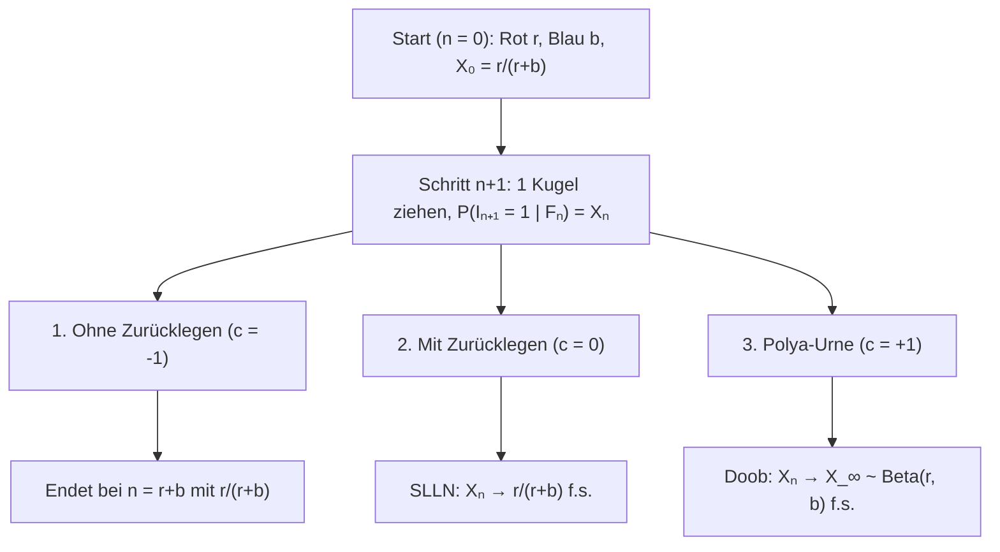
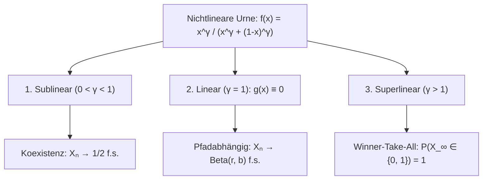

## Einleitung: Warum kristallisieren sich winzige Anfangszufälle zu unumkehrbaren Asymmetrien?

Zwei Videos oder Standards gleicher Qualität starten gleichzeitig: Durch einen winzigen Zufallsvorsprung gewinnt eines durch positives Feedback die Marktdominanz (<strong>Matthäus-Effekt</strong>), während das andere verschwindet. Das <strong>starke Gesetz der großen Zahlen (SLLN)</strong> lehrt für unabhängige (i.i.d.) Münzwürfe das Gegenteil: Anfangsschwankungen waschen sich für $n \to \infty$ aus und der Anteil konvergiert fast sicher gegen die Konstante $p$.

Reale Prozesse sind oft <strong>verstärkte stochastische Prozesse</strong>, bei denen das Eintreten eines Ereignisses die Wahrscheinlichkeit seiner Wiederholung erhöht. 1923 führten <strong>George Pólya</strong> und <strong>Florian Eggenberger</strong> das <strong>Pólya-Urnenmodell</strong> ein, das zwei Paradoxa zeigt:
1. <strong>Erstes Paradoxon (Austauschbarkeit)</strong>: Obwohl sich der Urneninhalt nach jedem Zug ändert, bleibt $\mathbb{P}(I_n = 1) = \frac{r}{r+b}$ für alle $n$ konstant, und die Wahrscheinlichkeit einer Folge hängt nur von der Anzahl roter und blauer Kugeln ab, nicht von ihrer Reihenfolge (<strong>Exchangeability</strong>).
2. <strong>Zweites Paradoxon (Zufälliger Grenzwert)</strong>: Für $n \to \infty$ konvergiert der rote Anteil $X_n$ fast sicher gegen eine Zufallsvariable $X_\infty \sim \mathrm{Beta}(r, b)$. Für $r=1, b=1$ ist $X_\infty \sim \mathrm{Uniform}(0, 1)$ gleichverteilt auf $[0, 1]$!

---

## Kapitel 1: Drei Urnen-Universen — Erschöpfung, Gedächtnislosigkeit und Pólya-Verstärkung

Bei $n = 0$ enthalte eine Urne $R_0 = r$ rote und $B_0 = b$ blaue Kugeln ($N_0 = r + b$). In jedem Schritt wird eine Kugel gezogen und mit $c$ Kugeln derselben Farbe zurückgelegt: <strong>1. Ohne Zurücklegen ($c = -1$)</strong> (negatives Feedback, hypergeometrisch), <strong>2. Mit Zurücklegen ($c = 0$)</strong> (i.i.d. $\mathrm{Binomial}(n, \frac{r}{r+b})$), <strong>3. Pólya-Urne ($c = +1$)</strong> (positives Feedback: gezogene Kugel <strong>plus $1$ Kugel gleicher Farbe</strong>).

Mit $I_n \in \{0, 1\}$ und $S_n = \sum_{k=1}^n I_k$ gilt $R_n = r + S_n$ und $N_n = r + b + n$:

$$X_n := \frac{R_n}{N_n} = \frac{r + S_n}{r + b + n}, \qquad \mathbb{P}(I_{n+1} = 1 \mid \mathcal{F}_n) = X_n, \qquad |X_{n+1} - X_n| \le \frac{1}{r + b + n + 1}$$

| Eigenschaft | 1. Ohne Zurücklegen ($c = -1$) | 2. Mit Zurücklegen ($c = 0$) | 3. Pólya-Urne ($c = +1$) |
| :--- | :--- | :--- | :--- |
| <strong>Rückkopplung</strong> | Negativ (Erschöpfung) | Keine (gedächtnislos) | <strong>Positiv (Selbstverstärkung)</strong> |
| <strong>Abhängigkeit</strong> | Negativ korreliert | <strong>Unabhängig (i.i.d.)</strong> | <strong>Unendlich austauschbar</strong> |
| <strong>Verteilung $S_n$</strong> | $\mathrm{Hypergeom}(N_0, r, n)$ | $\mathrm{Binomial}(n, \frac{r}{r+b})$ | <strong>$\mathrm{BetaBinom}(n, r, b)$</strong> |
| <strong>Grenzwert $X_\infty$</strong> | Konstante $\frac{r}{r+b}$ | Konstante $\frac{r}{r+b}$ f.s. | <strong>Zufallsvariable $\mathrm{Beta}(r, b)$ f.s.</strong> |

---

## Kapitel 2: Austauschbarkeit und Beta-Binomialverteilung

Für jede Folge $(i_1, \dots, i_n) \in \{0, 1\}^n$ mit $k = \sum_{j=1}^n i_j$ roten Zügen ist das Nennerprodukt stets $(r+b)^{(n)}$ und das Zählerprodukt kommutativ stets $r^{(k)} b^{(n-k)}$:

$$\mathbb{P}(I_1 = i_1, \dots, I_n = i_n) = \frac{r^{(k)} \, b^{(n-k)}}{(r+b)^{(n)}}, \qquad \mathbb{P}(S_n = k) = \binom{n}{k} \frac{\mathrm{B}(r+k, \, b+n-k)}{\mathrm{B}(r, \, b)}$$

Für <strong>$r = 1, b = 1$</strong> kürzen sich alle Fakultäten zur diskreten Gleichverteilung $\mathbb{P}(S_n = k) = \frac{1}{n + 1}$ ($k = 0, 1, \dots, n$).

---

## Kapitel 3: Doobscher Martingalkonvergenzsatz und $\mathrm{Beta}(r,b)$-Grenzwert

Wegen $\mathbb{E}[R_{n+1} \mid \mathcal{F}_n] = R_n + X_n = (N_n + 1)X_n$ ist $X_n$ ein beschränktes <strong>Martingal</strong> auf $[0, 1]$:

$$\mathbb{E}[X_{n+1} \mid \mathcal{F}_n] = \frac{R_n + \mathbb{E}[I_{n+1} \mid \mathcal{F}_n]}{N_n + 1} = \frac{(N_n + 1) X_n}{N_n + 1} = X_n$$

Nach dem <strong>Doobschen Martingalkonvergenzsatz</strong> gilt $X_n \xrightarrow{\text{f.s.}} X_\infty$. Mit $\frac{\Gamma(z+\alpha)}{\Gamma(z+\beta)} \sim z^{\alpha-\beta}$ für $k = \lfloor np \rfloor$ folgt die Dichte der <strong>Betaverteilung $\mathrm{Beta}(r, b)$</strong>:

$$\boxed{f_{X_\infty}(p) = \frac{\Gamma(r+b)}{\Gamma(r)\Gamma(b)} \, p^{r-1} (1-p)^{b-1} \quad (0 < p < 1), \qquad \mathbb{E}[X_\infty] = \frac{r}{r+b}, \qquad \mathrm{Var}(X_\infty) = \frac{rb}{(r+b)^2(r+b+1)} > 0}$$

---

## Kapitel 4: Satz von de Finetti, Phasenübergänge und Anwendungen

1. <strong>Darstellungssatz von de Finetti (1931)</strong>: Jede unendlich austauschbare Folge ist eine Mischung von i.i.d. Bernoulli-Versuchen bezüglich des Prior-Maßes $\mathrm{Beta}(r,b)$:
   $$\mathbb{P}(I_1 = i_1, \dots, I_n = i_n) = \int_0^1 p^k (1-p)^{n-k} \, \frac{\Gamma(r+b)}{\Gamma(r)\Gamma(b)} p^{r-1}(1-p)^{b-1} \, dp$$
2. <strong>Nichtlineare Urnen ($f(x) = \frac{x^\gamma}{x^\gamma + (1-x)^\gamma}$)</strong>: $X_{n+1} - X_n = \frac{1}{N_n+1}[(f(X_n)-X_n) + \xi_{n+1}]$ liefert drei Phasen:

3. <strong>Anwendungen & Grenzen</strong>: <strong>W. Brian Arthurs Lock-In (1989)</strong> erklärt Monopole bei $\gamma > 1$ (QWERTY, VHS); <strong>Preferential Attachment (Yule–Simon / Barabási–Albert)</strong> erzeugt $P(k) \sim k^{-(2 + \frac{1}{1-\alpha})}$; neue Farben mit Gewicht $\theta > 0$ aus $H_0$ führen zum <strong>Dirichlet-Prozess $\mathrm{DP}(\theta, H_0)$ (CRP)</strong>; <strong>MusicLab (Salganik et al. 2006)</strong> zeigt vier Grenzen: <strong>Fitness $\eta_i$</strong>, <strong>Sättigung</strong>, <strong>Gedächtnis</strong> und <strong>Netzwerk</strong>.
