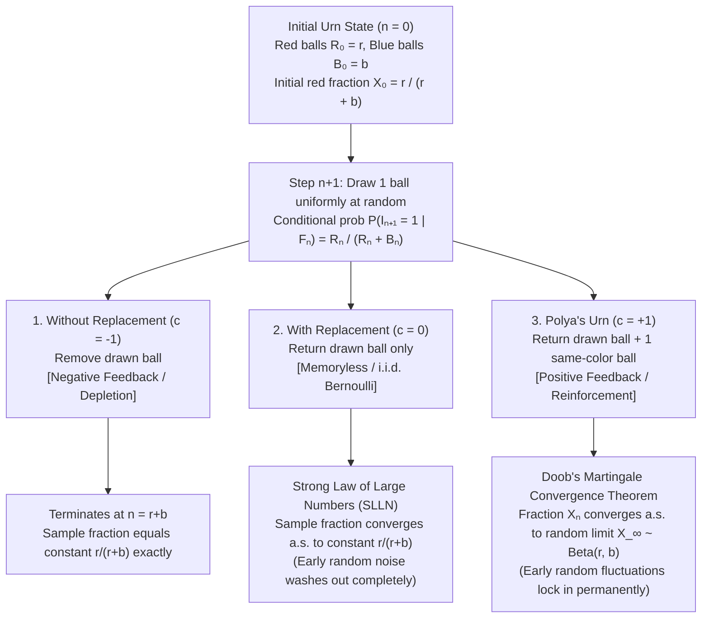
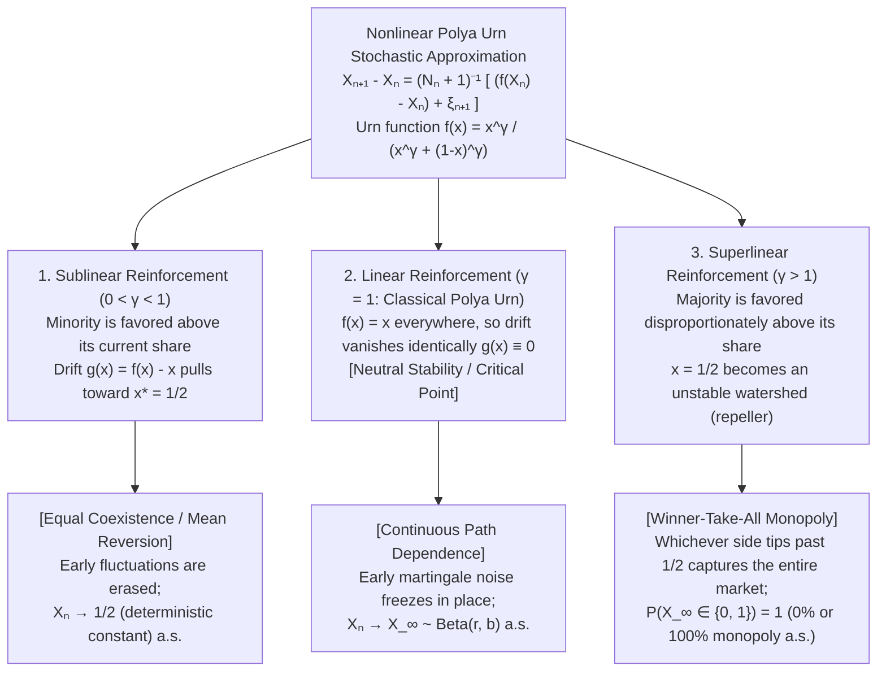

## Introduction: Why Do a Few Lucky Breaks at the Beginning Crystallize into Irreversible Inequality?

Two videos of virtually identical quality are uploaded at the exact same moment: one catches a tiny initial wave of clicks and snowballs into a multi-million-view viral hit, while the other languishes in obscurity. Two competing technological standards launch with comparable engineering merit, yet a slight early lead in adoption propels one to de facto monopoly while locking the other out of the market forever.

Across economics, sociology, and network science, we repeatedly witness a striking structural pattern: <strong>tiny, purely random fluctuations at the dawn of a process do not wash out over time—instead, they snowball through positive feedback and crystallize into permanent macroscopic asymmetries</strong>. In 1968, sociologist Robert K. Merton dubbed this dynamic of cumulative advantage the <strong>Matthew Effect</strong>.

Yet anyone trained in elementary probability theory should feel a sense of paradox when confronting this phenomenon. Classical probability's foundational pillar—the <strong>Strong Law of Large Numbers (SLLN)</strong>—teaches the exact opposite lesson. When we toss a fair coin, landing 8 heads and 2 tails in the first 10 tosses is a transient statistical fluctuation. As the number of trials $n$ grows to $10{,}000$ or $1{,}000{,}000$, that early streak is diluted by the growing denominator $n$ and washed away; the empirical fraction of heads converges almost surely to the deterministic constant $0.5$.

Why does the real world so often defy the Law of Large Numbers? Because many historical processes are not memoryless coin tosses, but <strong>Reinforced Stochastic Processes</strong>, in which <strong>the occurrence of an event actively alters the environment so as to increase the probability that the same event will occur again in the future</strong>.

In 1923, Hungarian mathematician <strong>George Pólya</strong> and his student <strong>Florian Eggenberger</strong> distilled self-reinforcement and path dependence into a deceptively simple model originally designed to describe contagious diseases: <strong>Pólya's Urn Model</strong>. Imagine an urn containing red and blue balls. At each step, we draw one ball uniformly at random, observe its color, and <strong>return the ball to the urn together with an additional ball of the exact same color</strong>. This single rule produces two profound mathematical paradoxes:

1. <strong>The First Paradox (Constant Marginal Probability and Exchangeability)</strong>: Even though the urn's composition changes after every draw, the unconditional probability of drawing a red ball at step $n$ remains constant at $\frac{r}{r+b}$ for all $n$, and the probability of any sequence of draws depends solely on the total counts of red and blue balls, remaining <strong>completely invariant to the order in which they appeared (Exchangeability)</strong>.
2. <strong>The Second Paradox (Almost Sure Convergence to a Random Limit)</strong>: As $n \to \infty$, the fraction of red balls $X_n$ does not converge to a deterministic constant, nor does it oscillate forever. Along each sample path, $X_n$ converges almost surely to a random limit $X_\infty$ governed by the <strong>Beta distribution $\mathrm{Beta}(r, b)$</strong>. When starting with 1 red and 1 blue ball ($r=1, b=1$), the limiting red share follows $\mathrm{Uniform}(0, 1)$: every final market share from $0\%$ to $100\%$ is equally likely!

---

## Chapter 1: Three Urn Universes — Depletion, Memorylessness, and Pólya Reinforcement

Suppose at time $n = 0$, an opaque urn contains <strong>$R_0 = r$ red balls</strong> and <strong>$B_0 = b$ blue balls</strong>, for a total of $N_0 = r + b$ balls ($r, b \ge 1$). At each step $n = 1, 2, \dots$, we draw one ball uniformly at random, observe its color, and return it along with $c$ net additional balls of the same color:

- <strong>1. Sampling Without Replacement ($c = -1$)</strong>: The drawn ball is removed. Drawing red reduces the remaining red inventory, creating <strong>negative feedback (depletion)</strong>. The red count in $n$ draws follows the <strong>Hypergeometric Distribution</strong>, and at $n = r+b$ the sample fraction equals $\frac{r}{r+b}$ deterministically.
- <strong>2. Sampling With Replacement ($c = 0$)</strong>: The drawn ball is returned alone. The urn stays at $r$ red and $b$ blue forever (<strong>memoryless i.i.d. Bernoulli trials</strong>). The red count follows $\mathrm{Binomial}(n, \frac{r}{r+b})$, and by the SLLN the sample fraction converges almost surely to the constant $\frac{r}{r+b}$.
- <strong>3. Pólya–Eggenberger Urn ($c = +1$)</strong>: The drawn ball is returned together with $1$ additional ball of the same color, creating <strong>positive feedback (self-reinforcement)</strong>.

### Formal Construction of the Standard Pólya Urn ($c=1$)

On a probability space $(\Omega, \mathcal{F}, \mathbb{P})$, let $I_n \in \{0, 1\}$ be the indicator that the $n$-th draw is red, and let $S_n = \sum_{k=1}^n I_k$ be the number of red draws in the first $n$ steps. After $n$ draws, the counts of red, blue, and total balls are:

$$R_n = r + S_n = r + \sum_{k=1}^n I_k, \qquad B_n = b + (n - S_n), \qquad N_n = R_n + B_n = r + b + n$$

Let $\mathcal{F}_n = \sigma(I_1, \dots, I_n)$ be the natural filtration and $X_n := \frac{R_n}{N_n} = \frac{r + S_n}{r + b + n}$ be the proportion of red balls after step $n$. Then the conditional probability of drawing red at step $n+1$ is:

$$\mathbb{P}(I_{n+1} = 1 \mid \mathcal{F}_n) = \frac{R_n}{R_n + B_n} = X_n$$

Notice the dramatic temporal asymmetry when $r = 1, b = 1$ ($X_0 = 1/2$): drawing red on step $1$ jumps the red share to $X_1 = \frac{2}{3} \approx 66.7\%$ ($+16.7\%$), whereas at step $n = 1000$ ($N_{1000} = 1002$), a single draw shifts the ratio by at most $\frac{1}{1003} < 0.1\%$:

$$|X_{n+1} - X_n| = \left| \frac{R_n + I_{n+1}}{N_n + 1} - \frac{R_n}{N_n} \right| = \frac{|N_n I_{n+1} - R_n|}{N_n (N_n + 1)} \le \frac{1}{r + b + n + 1}$$

Early draws occur when the denominator $r+b+n$ is small and therefore reshape the urn's future, while late draws encounter a massive denominator and can barely move $X_n$.

| Feature | 1. Without Replacement ($c = -1$) | 2. With Replacement ($c = 0$) | 3. Pólya's Urn Model ($c = +1$) |
| :--- | :--- | :--- | :--- |
| <strong>Post-Draw Rule</strong> | Remove drawn ball | Return drawn ball only | Return drawn ball <strong>+ 1 matching ball</strong> |
| <strong>Feedback Regime</strong> | Negative feedback (depletion) | Zero feedback (memoryless) | <strong>Positive feedback (self-reinforcing)</strong> |
| <strong>Dependence Structure</strong> | Negatively correlated | <strong>Independent (i.i.d.)</strong> | <strong>Positively correlated, infinitely exchangeable</strong> |
| <strong>Distribution of $S_n$</strong> | $\mathrm{Hypergeom}(N_0, r, n)$ | $\mathrm{Binomial}(n, \frac{r}{r+b})$ | <strong>$\mathrm{BetaBinom}(n, r, b)$</strong> |
| <strong>Asymptotic Limit $\lim_{n\to\infty} X_n$</strong> | Terminates at constant $\frac{r}{r+b}$ | Converges a.s. to constant $\frac{r}{r+b}$ (SLLN) | <strong>Converges a.s. to random $X_\infty \sim \mathrm{Beta}(r, b)$</strong> |

---

## Chapter 2: The First Paradox — Exchangeability and the Beta-Binomial Distribution

### Theorem 1: Proof of Infinite Exchangeability

Consider any binary sequence $(i_1, i_2, \dots, i_n) \in \{0, 1\}^n$ containing $k$ red draws ($\sum_{j=1}^n i_j = k$) and $n - k$ blue draws. If all $k$ reds occur first followed by all $n - k$ blues, the chain rule of conditional probability gives:

$$\mathbb{P}(I_1=1, \dots, I_k=1, I_{k+1}=0, \dots, I_n=0) = \frac{r(r+1)\cdots(r+k-1) \cdot b(b+1)\cdots(b+n-k-1)}{(r+b)(r+b+1)\cdots(r+b+n-1)}$$

What if the $k$ reds and $n-k$ blues appear in some other order $(i_1, \dots, i_n)$?
1. <strong>Denominator Invariance</strong>: Because the total ball count increases by $1$ on every draw regardless of color, the $j$-th denominator is always $r + b + j - 1$.
2. <strong>Numerator Commutativity</strong>: Whenever the $m$-th red ball is drawn (regardless of step index), there are $r+m-1$ red balls in the urn, contributing factor $(r+m-1)$ to the numerator; whenever the $\ell$-th blue ball is drawn, it contributes $(b+\ell-1)$.

Using the rising factorial $x^{(m)} := x(x+1)\cdots(x+m-1) = \frac{\Gamma(x+m)}{\Gamma(x)}$, the joint probability of <strong>any</strong> sequence $(i_1, \dots, i_n)$ with $k$ reds is:

$$\mathbb{P}(I_1 = i_1, I_2 = i_2, \dots, I_n = i_n) = \frac{r^{(k)} \, b^{(n-k)}}{(r+b)^{(n)}} \qquad \left( k = \sum_{j=1}^n i_j \right)$$

Because this depends only on $k$ and $n$ and not on the order of appearance, $(I_1, I_2, \dots)$ is <strong>infinitely exchangeable</strong>. Consequently, every draw has the exact same marginal distribution as the first draw:

$$\mathbb{P}(I_n = 1) = \mathbb{P}(I_1 = 1) = \frac{r}{r + b} \quad (\forall n \ge 1), \qquad \mathrm{Cov}(I_j, I_m) = \frac{rb}{(r+b)^2(r+b+1)} > 0 \quad (j \ne m)$$

### The Beta-Binomial Distribution and Uniformity at $r=1, b=1$

Multiplying the single-sequence probability by the $\binom{n}{k}$ ways to choose the positions of the $k$ red draws yields the <strong>Beta-Binomial Distribution</strong> $\mathrm{BetaBinom}(n, r, b)$:

$$\mathbb{P}(S_n = k) = \binom{n}{k} \frac{r^{(k)} \, b^{(n-k)}}{(r+b)^{(n)}} = \binom{n}{k} \frac{\mathrm{B}(r+k, \, b+n-k)}{\mathrm{B}(r, \, b)} \qquad (k = 0, 1, \dots, n)$$

When <strong>$r = 1, b = 1$</strong>, we have $1^{(k)} = k!$, $1^{(n-k)} = (n-k)!$, and $2^{(n)} = (n+1)!$, so all factorials cancel:

$$\mathbb{P}(S_n = k) = \frac{n!}{k! \, (n-k)!} \cdot \frac{k! \, (n-k)!}{(n+1)!} = \frac{1}{n + 1} \qquad (k = 0, 1, 2, \dots, n)$$

In an urn starting with 1 red and 1 blue ball, after $n = 100$ draws, <strong>getting $0$ reds, $50$ reds, or $100$ reds all have the exact same probability $\frac{1}{101}$</strong>!

---

## Chapter 3: The Second Paradox — Doob's Martingale Convergence Theorem and the $\mathrm{Beta}(r,b)$ Limit

### Step 1: $X_n$ Is a Bounded Martingale

Given $\mathcal{F}_n$, $R_n = N_n X_n$ is known and $\mathbb{E}[I_{n+1} \mid \mathcal{F}_n] = X_n$. Thus the conditional expectation of $X_{n+1} = \frac{R_n + I_{n+1}}{N_n + 1}$ is:

$$\mathbb{E}[X_{n+1} \mid \mathcal{F}_n] = \frac{R_n + \mathbb{E}[I_{n+1} \mid \mathcal{F}_n]}{N_n + 1} = \frac{N_n X_n + X_n}{N_n + 1} = \frac{(N_n + 1) X_n}{N_n + 1} = X_n$$

Hence $(X_n)_{n \ge 0}$ is a martingale bounded in $[0, 1]$. By <strong>Doob's Martingale Convergence Theorem</strong>, there exists a random variable $X_\infty \in [0, 1]$ such that $X_n$ converges to $X_\infty$ <strong>almost surely</strong> and in $L^p$ as $n \to \infty$:

$$X_n \xrightarrow{\text{a.s.}} X_\infty \quad (n \to \infty)$$

Along almost every sample path $\omega$, the red proportion stops wandering and locks into a permanent historical limit $X_\infty(\omega)$.

### Step 2: Deriving the $\mathrm{Beta}(r,b)$ Limiting Density

To identify the law of $X_\infty$, fix $p \in (0, 1)$ and set $k = \lfloor np \rfloor$. Expressing $\mathbb{P}(S_n = k)$ via Gamma functions gives:

$$\mathbb{P}(S_n = k) = \frac{\Gamma(r+b)}{\Gamma(r)\Gamma(b)} \cdot \frac{\Gamma(n+1)}{\Gamma(n+r+b)} \cdot \frac{\Gamma(k+r)}{\Gamma(k+1)} \cdot \frac{\Gamma(n-k+b)}{\Gamma(n-k+1)}$$

Applying Stirling's asymptotic ratio $\frac{\Gamma(z+\alpha)}{\Gamma(z+\beta)} \sim z^{\alpha-\beta}$ as $z \to \infty$ to the three Gamma ratios ($z = n$, $k \sim np$, and $n-k \sim n(1-p)$) yields:

$$\mathbb{P}(S_n = \lfloor np \rfloor) \sim \frac{\Gamma(r+b)}{\Gamma(r)\Gamma(b)} \, n^{1-(r+b)} \, (np)^{r-1} \, \big(n(1-p)\big)^{b-1} = \frac{1}{n} \cdot \frac{1}{\mathrm{B}(r, b)} p^{r-1}(1-p)^{b-1}$$

Multiplying by $n$ and taking $n \to \infty$ proves that $X_\infty$ has the <strong>Beta distribution $\mathrm{Beta}(r, b)$</strong> density:

$$\boxed{f_{X_\infty}(p) = \frac{\Gamma(r+b)}{\Gamma(r)\Gamma(b)} \, p^{r-1} (1-p)^{b-1} \quad (0 < p < 1), \qquad X_n \xrightarrow{\text{a.s.}} X_\infty \sim \mathrm{Beta}(r, b)}$$

with expectation and non-vanishing asymptotic variance:

$$\mathbb{E}[X_\infty] = \frac{r}{r + b}, \qquad \mathrm{Var}(X_\infty) = \frac{r b}{(r + b)^2 (r + b + 1)} > 0$$

For <strong>$r = 1, b = 1$</strong>, $f_{X_\infty}(p) = 1$, so $X_\infty \sim \mathrm{Uniform}(0, 1)$.

---

## Chapter 4: Contrast with the Strong Law of Large Numbers and de Finetti's Theorem

### 1. Ergodicity vs. Non-Ergodic Path Dependence
- <strong>SLLN ($c=0$, Ergodic)</strong>: Independent trials have zero covariance, so $\mathrm{Var}(\bar{I}_n) = \frac{p(1-p)}{n} \to 0$. Every sample path converges to the ensemble mean $p = \frac{r}{r+b}$.
- <strong>Pólya's Urn ($c=1$, Non-Ergodic)</strong>: Because any two draws share positive covariance $\frac{rb}{(r+b)^2(r+b+1)} > 0$ regardless of how far apart in time they occur, variance never vanishes. The ensemble average across parallel universes is $\mathbb{E}[X_\infty] = \frac{r}{r+b}$, but any single historical trajectory locks into a random realization $X_\infty(\omega) \sim \mathrm{Beta}(r, b)$. Moreover, the variance formula shows the <strong>stabilizing effect of initial scale $N_0 = r+b$</strong>: $\mathrm{Beta}(1,1)$ has standard deviation $28.9\%$, whereas $\mathrm{Beta}(1000,1000)$ has standard deviation $1.1\%$.

### 2. Bruno de Finetti's Representation Theorem (1931)
De Finetti's theorem states that an infinite binary sequence $(I_1, I_2, \dots)$ is infinitely exchangeable if and only if its joint law is a mixture of i.i.d. Bernoulli trials with respect to a unique prior measure $\mu$ on $[0, 1]$—which is precisely the law of $X_\infty$:

$$\mathbb{P}(I_1 = i_1, \dots, I_n = i_n) = \frac{\mathrm{B}(r+k, \, b+n-k)}{\mathrm{B}(r, \, b)} = \int_0^1 \underbrace{p^k (1-p)^{n-k}}_{\text{i.i.d. Bernoulli}(p)} \cdot \underbrace{\frac{\Gamma(r+b)}{\Gamma(r)\Gamma(b)} p^{r-1}(1-p)^{b-1}}_{\text{Beta}(r, b)\text{ mixing density } d\mu(p)} \, dp$$

This reveals an exact mathematical duality: <strong>a bottom-up Pólya urn where identical options undergo local self-reinforcement is observationally indistinguishable from a top-down Bayesian world where Nature draws a hidden talent $P \sim \mathrm{Beta}(r,b)$ at $n=0$ and runs i.i.d. coin tosses forever!</strong>

---

## Chapter 5: Nonlinear Pólya Urns and Winner-Take-All Phase Transitions

If the probability of adding a red ball given current share $X_n = x$ is governed by a nonlinear urn function $f(x) = \frac{x^\gamma}{x^\gamma + (1-x)^\gamma}$ ($\gamma > 0$), decomposing $X_{n+1} - X_n$ into deterministic drift $g(x) := f(x) - x$ and martingale noise $\xi_{n+1} := I_{n+1} - f(X_n)$ yields the Robbins–Monro <strong>stochastic approximation</strong> equation (Hill, Lane & Sudderth 1980; Pemantle 2007):

$$X_{n+1} - X_n = \frac{1}{N_n + 1} \Big( \big(f(X_n) - X_n\big) + \xi_{n+1} \Big)$$

- <strong>Sublinear ($\gamma < 1$, or Friedman's Urn with cross-addition)</strong>: In Bernard Friedman's (1949) linear urn with replacement matrix $M = \begin{pmatrix} a & b \\ b & a \end{pmatrix}$ ($b > 0$), even when the leading color is drawn, the minority color receives $b > 0$ balls. Similarly, for $0 < \gamma < 1$, the derivative at symmetry is $g'(1/2) = \gamma - 1 < 0$, making $x^* = 1/2$ a globally stable attractor. Early luck is erased and $X_n \xrightarrow{\text{a.s.}} 1/2$.
- <strong>Linear ($\gamma = 1$, Classical Pólya Urn)</strong>: Here $f(x) = x$ everywhere, so the deterministic drift vanishes identically ($g(x) \equiv 0$) across the entire interval $[0, 1]$! The classical Pólya urn sits at the exact critical boundary where zero restoring force and zero repelling force allow early martingale noise to freeze into $X_\infty \sim \mathrm{Beta}(r,b)$.
- <strong>Superlinear ($\gamma > 1$)</strong>: Here $x = 1/2$ becomes an unstable repeller ($g'(1/2) = \gamma - 1 > 0$; by Robin Pemantle's 1990 non-convergence theorem for unstable equilibria, $\mathbb{P}(X_\infty = 1/2) = 0$), while the boundary points $x^* \in \{0, 1\}$ become stable attractors ($g'(0) = g'(1) = -1 < 0$), forcing $\mathbb{P}(X_\infty \in \{0, 1\}) = 1$ (<strong>Winner-Take-All monopoly</strong>).

| Reinforcement Regime | Parameter / Rule | Drift $g(x) = f(x) - x$ | Stable Attractors | Limiting Distribution of $X_\infty$ |
| :--- | :--- | :--- | :--- | :--- |
| <strong>Sublinear / Friedman</strong> | $0 < \gamma < 1$ or $b > 0$ | Pulls toward $x = 1/2$ | Unique interior $x^* = 1/2$ | Point mass $\delta_{1/2}$ (Ergodic) |
| <strong>Linear (Classical Pólya)</strong> | $\gamma = 1$, diagonal $M$ | Identically zero $g(x) \equiv 0$ | Neutral across $[0, 1]$ | Continuous $\mathrm{Beta}(r, b)$ |
| <strong>Superlinear (Arthur)</strong> | $\gamma > 1$ | Repels from $1/2$ to $\{0, 1\}$ | Boundary points $\{0, 1\}$ | Bernoulli monopoly on $\{0, 1\}$ |

---

## Chapter 6: Economic Lock-In, Preferential Attachment, Dirichlet Processes, and Limitations

1. <strong>W. Brian Arthur's Path Dependence and Economic Lock-In (1989)</strong>: Using nonlinear Pólya urns, Arthur demonstrated that high-tech industries and platform markets characterized by <strong>increasing returns</strong> (network externalities, learning curves, and high switching costs, such as the QWERTY keyboard layout or VHS vs. Betamax) exhibit four hallmark properties: <strong>(i) unpredictability</strong> of market winner ex ante, <strong>(ii) inflexibility (lock-in)</strong> once a lead is established, <strong>(iii) non-ergodicity</strong> (small historical events are not averaged away), and <strong>(iv) potential path-dependent inefficiency</strong>, where an inferior standard can permanently lock out a superior rival due to early random adoption cascades.
2. <strong>Preferential Attachment Power Laws (Yule–Simon & Barabási–Albert)</strong>: When a generalized Pólya urn allows a small innovation probability $\alpha \in (0, 1)$ of introducing a brand-new color at each step while reinforcing existing colors proportional to their current counts with probability $1 - \alpha$, the limiting cluster-size distribution follows a heavy-tailed <strong>Power Law (Yule–Simon / Pareto distribution)</strong> $P(k) \sim k^{-(2 + \frac{1}{1-\alpha})}$, explaining the scale-free degree distribution $\gamma_{\text{BA}} = 3$ of citation networks and the World Wide Web (Barabási & Albert, 1999).
3. <strong>Dirichlet Process and Chinese Restaurant Process (Blackwell & MacQueen 1973; Ferguson 1973)</strong>: In Bayesian nonparametrics, if each step reinforces an existing atom $\theta_i$ with weight $1$ or draws a brand-new color from a continuous base measure $H_0$ with concentration weight $\theta > 0$ (so the $(n+1)$-st draw is new with probability $\frac{\theta}{\theta + n}$ and joins existing cluster $k$ of size $n_k$ with probability $\frac{n_k}{\theta + n}$), the empirical distribution converges almost surely to <strong>Thomas Ferguson's Dirichlet Process $\mathrm{DP}(\theta, H_0)$</strong>, and the induced exchangeable partition of customers across tables is the celebrated <strong>Chinese Restaurant Process (CRP)</strong>.
4. <strong>The MusicLab Experiment and Four Real-World Limitations</strong>: Salganik, Dodds, and Watts (2006) ran 8 parallel social-influence music markets from identical zero-download starting states, proving empirically that social reinforcement inflates both inequality (Gini coefficient) and unpredictability across parallel histories. However, applying pure Pólya urns to human society carries four critical limitations: <strong>(i) Intrinsic Fitness ($\eta_i$)</strong> (in the Bianconi–Barabási fitness model where selection scales as $\propto \eta_i R_{i,n}$, superior intrinsic quality can overcome early bad luck), <strong>(ii) Market Saturation and Novelty Fatigue</strong>, <strong>(iii) Memory Decay</strong> (exponentially aging urns forget ancient draws and allow regime shifts), and <strong>(iv) Network Topology</strong> (local clusters on Graphical Pólya Urns allow minority standards to survive in niches).

---

## References

1. <strong>Eggenberger, F., & Pólya, G. (1923).</strong> "Über die Statistik verketteter Vorgänge." *ZAMM*, 3(4), 279–289.
2. <strong>de Finetti, B. (1931).</strong> "Funzione caratteristica di un fenomeno aleatorio." *Atti della R. Accademia Nazionale dei Lincei*, 4, 251–299.
3. <strong>Blackwell, D., & MacQueen, J. B. (1973).</strong> "Ferguson distributions via Pólya urn schemes." *The Annals of Statistics*, 1(2), 353–355.
4. <strong>Hill, B. M., Lane, D., & Sudderth, W. (1980).</strong> "A strong law for some generalized urn processes." *The Annals of Probability*, 8(2), 214–226.
5. <strong>Arthur, W. B. (1989).</strong> "Competing technologies, increasing returns, and lock-in by historical events." *The Economic Journal*, 99(394), 116–131.
6. <strong>Pemantle, R. (2007).</strong> "A survey of random processes with reinforcement." *Probability Surveys*, 4, 1–79.
7. <strong>Salganik, M. J., Dodds, P. S., & Watts, D. J. (2006).</strong> "Experimental study of inequality and unpredictability in an artificial cultural market." *Science*, 311(5762), 854–856.
