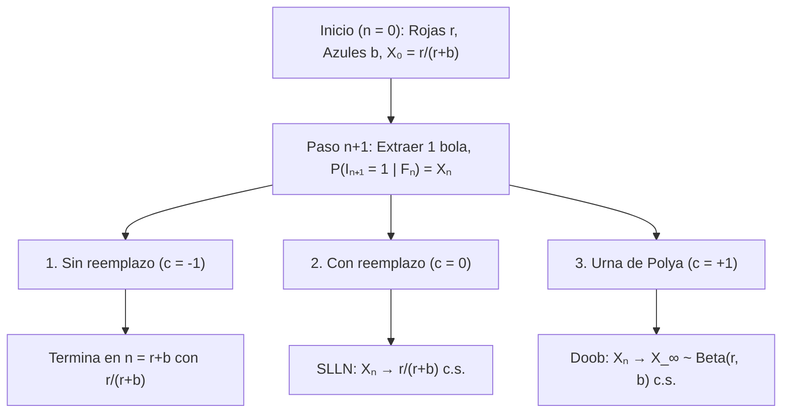
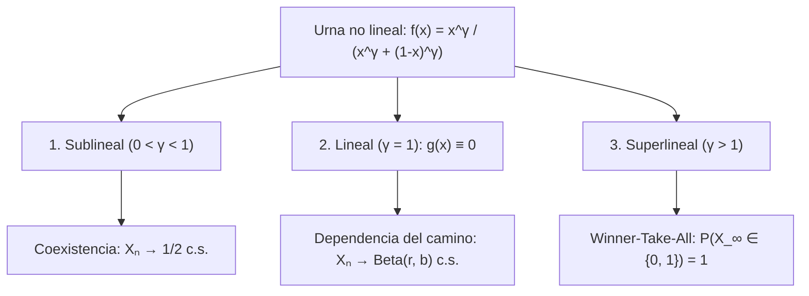

## Introducción: ¿Por qué unos pocos golpes de suerte al principio se convierten en brechas irreversibles?

Dos vídeos o estándares de calidad idéntica se lanzan al mismo tiempo: gracias a una pequeña ventaja aleatoria inicial, uno se amplifica mediante retroalimentación positiva hasta monopolizar el mercado (<strong>efecto Mateo</strong>), mientras el otro queda en el olvido. Sin embargo, la <strong>Ley Fuerte de los Grandes Números (SLLN)</strong> enseña lo contrario: en ensayos independientes (i.i.d.) como lanzar una moneda, las fluctuaciones iniciales se diluyen cuando $n \to \infty$ y la proporción converge casi seguramente a la constante $p$.

Muchos procesos reales son <strong>procesos estocásticos reforzados</strong> donde la ocurrencia de un evento aumenta la probabilidad de que se repita. En 1923, <strong>George Pólya</strong> y <strong>Florian Eggenberger</strong> formularon el <strong>modelo de la urna de Pólya</strong>, revelando dos paradojas:
1. <strong>Primera paradoja (Intercambiabilidad)</strong>: Aunque la urna cambia en cada paso, $\mathbb{P}(I_n = 1) = \frac{r}{r+b}$ es constante para todo $n$, y la probabilidad de cualquier secuencia depende solo del total de bolas rojas y azules, sin importar el orden (<strong>intercambiabilidad</strong>).
2. <strong>Segunda paradoja (Límite aleatorio)</strong>: Cuando $n \to \infty$, la proporción roja $X_n$ converge casi seguramente hacia una variable aleatoria $X_\infty \sim \mathrm{Beta}(r, b)$. ¡Para $r=1, b=1$, el límite sigue la <strong>distribución uniforme $\mathrm{Uniform}(0, 1)$</strong> en $[0, 1]$!

---

## Capítulo 1: Tres universos de urnas — Agotamiento, falta de memoria y refuerzo de Pólya

En $n = 0$, una urna contiene $R_0 = r$ bolas rojas y $B_0 = b$ azules ($N_0 = r + b$). En cada paso se extrae una bola y se devuelve con $c$ bolas del mismo color: <strong>1. Sin reemplazo ($c = -1$)</strong> (retroalimentación negativa, hipergeométrica), <strong>2. Con reemplazo ($c = 0$)</strong> (sin memoria i.i.d. $\mathrm{Binomial}(n, \frac{r}{r+b})$), <strong>3. Urna de Pólya ($c = +1$)</strong> (retroalimentación positiva: bola extraída <strong>más $1$ bola del mismo color</strong>).

Con $I_n \in \{0, 1\}$ y $S_n = \sum_{k=1}^n I_k$, tenemos $R_n = r + S_n$ y $N_n = r + b + n$:

$$X_n := \frac{R_n}{N_n} = \frac{r + S_n}{r + b + n}, \qquad \mathbb{P}(I_{n+1} = 1 \mid \mathcal{F}_n) = X_n, \qquad |X_{n+1} - X_n| \le \frac{1}{r + b + n + 1}$$

| Característica | 1. Sin reemplazo ($c = -1$) | 2. Con reemplazo ($c = 0$) | 3. Urna de Pólya ($c = +1$) |
| :--- | :--- | :--- | :--- |
| <strong>Retroalimentación</strong> | Negativa (agotamiento) | Nula (sin memoria) | <strong>Positiva (autorrefuerzo)</strong> |
| <strong>Dependencia</strong> | Correlación negativa | <strong>Independiente (i.i.d.)</strong> | <strong>Infinitamente intercambiable</strong> |
| <strong>Distribución $S_n$</strong> | $\mathrm{Hypergeom}(N_0, r, n)$ | $\mathrm{Binomial}(n, \frac{r}{r+b})$ | <strong>$\mathrm{BetaBinom}(n, r, b)$</strong> |
| <strong>Límite $X_\infty$</strong> | Constante $\frac{r}{r+b}$ | Constante $\frac{r}{r+b}$ c.s. | <strong>Variable $X_\infty \sim \mathrm{Beta}(r, b)$ c.s.</strong> |

---

## Capítulo 2: Intercambiabilidad y distribución Beta-Binomial

Para cualquier secuencia $(i_1, \dots, i_n) \in \{0, 1\}^n$ con $k = \sum_{j=1}^n i_j$ rojas, el producto de denominadores es $(r+b)^{(n)}$ y el de numeradores es conmutativamente $r^{(k)} b^{(n-k)}$:

$$\mathbb{P}(I_1 = i_1, \dots, I_n = i_n) = \frac{r^{(k)} \, b^{(n-k)}}{(r+b)^{(n)}}, \qquad \mathbb{P}(S_n = k) = \binom{n}{k} \frac{\mathrm{B}(r+k, \, b+n-k)}{\mathrm{B}(r, \, b)}$$

Para <strong>$r = 1, b = 1$</strong>, los factoriales se cancelan dando la distribución uniforme discreta $\mathbb{P}(S_n = k) = \frac{1}{n + 1}$ ($k = 0, 1, \dots, n$).

---

## Capítulo 3: Martingala de Doob y límite $\mathrm{Beta}(r,b)$

Como $\mathbb{E}[R_{n+1} \mid \mathcal{F}_n] = R_n + X_n = (N_n + 1)X_n$, la proporción $X_n$ es una <strong>martingala</strong> acotada en $[0, 1]$:

$$\mathbb{E}[X_{n+1} \mid \mathcal{F}_n] = \frac{R_n + \mathbb{E}[I_{n+1} \mid \mathcal{F}_n]}{N_n + 1} = \frac{(N_n + 1) X_n}{N_n + 1} = X_n$$

Por el <strong>teorema de convergencia de martingalas de Doob</strong>, $X_n \xrightarrow{\text{c.s.}} X_\infty$. La asintótica $\frac{\Gamma(z+\alpha)}{\Gamma(z+\beta)} \sim z^{\alpha-\beta}$ para $k = \lfloor np \rfloor$ demuestra que $X_\infty$ sigue la <strong>distribución Beta $\mathrm{Beta}(r, b)$</strong>:

$$\boxed{f_{X_\infty}(p) = \frac{\Gamma(r+b)}{\Gamma(r)\Gamma(b)} \, p^{r-1} (1-p)^{b-1} \quad (0 < p < 1), \qquad \mathbb{E}[X_\infty] = \frac{r}{r+b}, \qquad \mathrm{Var}(X_\infty) = \frac{rb}{(r+b)^2(r+b+1)} > 0}$$

---

## Capítulo 4: Teorema de de Finetti, transiciones no lineales y aplicaciones

1. <strong>Teorema de representación de de Finetti (1931)</strong>: Toda sucesión infinitamente intercambiable es una mezcla de ensayos de Bernoulli i.i.d. con distribución a priori $\mathrm{Beta}(r,b)$:
   $$\mathbb{P}(I_1 = i_1, \dots, I_n = i_n) = \int_0^1 p^k (1-p)^{n-k} \, \frac{\Gamma(r+b)}{\Gamma(r)\Gamma(b)} p^{r-1}(1-p)^{b-1} \, dp$$
2. <strong>Urnas no lineales ($f(x) = \frac{x^\gamma}{x^\gamma + (1-x)^\gamma}$)</strong>: $X_{n+1} - X_n = \frac{1}{N_n+1}[(f(X_n)-X_n) + \xi_{n+1}]$ produce tres regímenes:

3. <strong>Aplicaciones y límites</strong>: <strong>W. Brian Arthur (1989)</strong> explica el bloqueo ($\gamma > 1$, QWERTY, VHS); la <strong>conexión preferencial (Yule–Simon / Barabási–Albert)</strong> genera $P(k) \sim k^{-(2 + \frac{1}{1-\alpha})}$; muestrear nuevos colores ($\theta > 0$, $H_0$) converge al <strong>proceso de Dirichlet $\mathrm{DP}(\theta, H_0)$ (CRP)</strong>; <strong>MusicLab (Salganik et al. 2006)</strong> valida estos efectos bajo cuatro límites: <strong>aptitud $\eta_i$</strong>, <strong>saturación</strong>, <strong>olvido</strong> y <strong>red</strong>.
