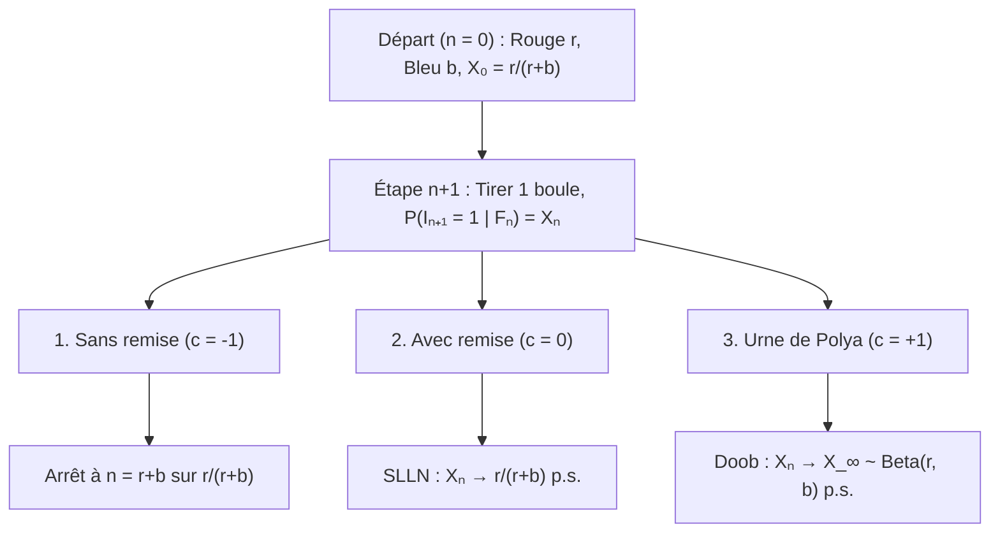
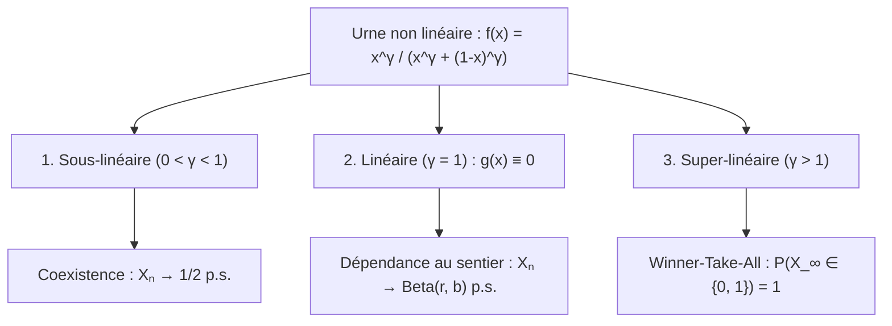

## Introduction : Pourquoi quelques coups de chance au départ figent-ils des écarts irréversibles ?

Deux vidéos ou standards de qualité comparable sont lancés au même instant : grâce à une infime avance initiale, l'un s'emballe par rétroaction positive jusqu'au monopole (<strong>effet Matthieu</strong>), tandis que l'autre tombe dans l'oubli. Pourtant, la <strong>loi forte des grands nombres (SLLN)</strong> enseigne l'inverse : pour des lancers de pièce indépendants (i.i.d.), l'aléa initial s'efface lorsque $n \to \infty$ et la fréquence converge presque sûrement vers la constante $p$.

Le monde réel suit souvent des <strong>processus aléatoires renforcés</strong> où chaque succès augmente la probabilité d'un succès futur. En 1923, <strong>George Pólya</strong> et <strong>Florian Eggenberger</strong> ont introduit le <strong>modèle de l'urne de Pólya</strong>, révélant deux paradoxes :
1. <strong>Premier paradoxe (Échangeabilité)</strong> : Bien que la composition de l'urne change à chaque tirage, $\mathbb{P}(I_n = 1) = \frac{r}{r+b}$ reste constante pour tout $n$, et la probabilité d'une séquence ne dépend que des effectifs totaux de rouges et de bleues, indépendamment de l'ordre (<strong>échangeabilité</strong>).
2. <strong>Second paradoxe (Limite aléatoire)</strong> : Lorsque $n \to \infty$, la proportion rouge $X_n$ converge presque sûrement vers une variable aléatoire $X_\infty \sim \mathrm{Beta}(r, b)$. Pour $r=1, b=1$, la limite suit la <strong>loi uniforme $\mathrm{Uniform}(0, 1)$</strong> sur $[0, 1]$ !

---

## Chapitre 1 : Trois univers d'urnes — Épuisement, absence de mémoire et renforcement de Pólya

À $n = 0$, une urne contient $R_0 = r$ boules rouges et $B_0 = b$ bleues ($N_0 = r + b$). À chaque étape, on tire une boule et on la remet avec $c$ boules de même couleur : <strong>1. Sans remise ($c = -1$)</strong> (rétroaction négative, hypergéométrique), <strong>2. Avec remise ($c = 0$)</strong> (sans mémoire i.i.d. $\mathrm{Binomial}(n, \frac{r}{r+b})$), <strong>3. Urne de Pólya ($c = +1$)</strong> (rétroaction positive : boule tirée <strong>plus $1$ boule de même couleur</strong>).

Avec $I_n \in \{0, 1\}$ et $S_n = \sum_{k=1}^n I_k$, on a $R_n = r + S_n$ et $N_n = r + b + n$ :

$$X_n := \frac{R_n}{N_n} = \frac{r + S_n}{r + b + n}, \qquad \mathbb{P}(I_{n+1} = 1 \mid \mathcal{F}_n) = X_n, \qquad |X_{n+1} - X_n| \le \frac{1}{r + b + n + 1}$$

| Caractéristique | 1. Sans remise ($c = -1$) | 2. Avec remise ($c = 0$) | 3. Urne de Pólya ($c = +1$) |
| :--- | :--- | :--- | :--- |
| <strong>Rétroaction</strong> | Négative (épuisement) | Nulle (sans mémoire) | <strong>Positive (auto-renforcement)</strong> |
| <strong>Dépendance</strong> | Corrélation négative | <strong>Indépendance (i.i.d.)</strong> | <strong>Infiniment échangeable</strong> |
| <strong>Loi de $S_n$</strong> | $\mathrm{Hypergeom}(N_0, r, n)$ | $\mathrm{Binomial}(n, \frac{r}{r+b})$ | <strong>$\mathrm{BetaBinom}(n, r, b)$</strong> |
| <strong>Limite $X_\infty$</strong> | Constante $\frac{r}{r+b}$ | Constante $\frac{r}{r+b}$ p.s. | <strong>Variable $X_\infty \sim \mathrm{Beta}(r, b)$ p.s.</strong> |

---

## Chapitre 2 : Échangeabilité et loi bêta-binomiale

Pour toute suite $(i_1, \dots, i_n) \in \{0, 1\}^n$ ayant $k = \sum_{j=1}^n i_j$ rouges, le produit des dénominateurs vaut $(r+b)^{(n)}$ et celui des numérateurs vaut commutativement $r^{(k)} b^{(n-k)}$ :

$$\mathbb{P}(I_1 = i_1, \dots, I_n = i_n) = \frac{r^{(k)} \, b^{(n-k)}}{(r+b)^{(n)}}, \qquad \mathbb{P}(S_n = k) = \binom{n}{k} \frac{\mathrm{B}(r+k, \, b+n-k)}{\mathrm{B}(r, \, b)}$$

Pour <strong>$r = 1, b = 1$</strong>, les factorielles se simplifient en la loi uniforme discrète $\mathbb{P}(S_n = k) = \frac{1}{n + 1}$ ($k = 0, 1, \dots, n$).

---

## Chapitre 3 : Théorème des martingales de Doob et limite $\mathrm{Beta}(r,b)$

Comme $\mathbb{E}[R_{n+1} \mid \mathcal{F}_n] = R_n + X_n = (N_n + 1)X_n$, la proportion $X_n$ est une <strong>martingale</strong> bornée dans $[0, 1]$ :

$$\mathbb{E}[X_{n+1} \mid \mathcal{F}_n] = \frac{R_n + \mathbb{E}[I_{n+1} \mid \mathcal{F}_n]}{N_n + 1} = \frac{(N_n + 1) X_n}{N_n + 1} = X_n$$

Par le <strong>théorème de convergence des martingales de Doob</strong>, $X_n \xrightarrow{\text{p.s.}} X_\infty$. L'asymptotique $\frac{\Gamma(z+\alpha)}{\Gamma(z+\beta)} \sim z^{\alpha-\beta}$ pour $k = \lfloor np \rfloor$ donne la densité <strong>Bêta $\mathrm{Beta}(r, b)$</strong> :

$$\boxed{f_{X_\infty}(p) = \frac{\Gamma(r+b)}{\Gamma(r)\Gamma(b)} \, p^{r-1} (1-p)^{b-1} \quad (0 < p < 1), \qquad \mathbb{E}[X_\infty] = \frac{r}{r+b}, \qquad \mathrm{Var}(X_\infty) = \frac{rb}{(r+b)^2(r+b+1)} > 0}$$

---

## Chapitre 4 : Théorème de de Finetti, transitions non linéaires et applications

1. <strong>Théorème de représentation de de Finetti (1931)</strong> : Toute suite infiniment échangeable est un mélange d'essais de Bernoulli i.i.d. selon la loi a priori $\mathrm{Beta}(r,b)$ :
   $$\mathbb{P}(I_1 = i_1, \dots, I_n = i_n) = \int_0^1 p^k (1-p)^{n-k} \, \frac{\Gamma(r+b)}{\Gamma(r)\Gamma(b)} p^{r-1}(1-p)^{b-1} \, dp$$
2. <strong>Urnes non linéaires ($f(x) = \frac{x^\gamma}{x^\gamma + (1-x)^\gamma}$)</strong> : $X_{n+1} - X_n = \frac{1}{N_n+1}[(f(X_n)-X_n) + \xi_{n+1}]$ donne trois régimes :

3. <strong>Applications & limites</strong> : <strong>W. Brian Arthur (1989)</strong> explique le lock-in ($\gamma > 1$, QWERTY, VHS) ; <strong>l'attachement préférentiel (Yule–Simon / Barabási–Albert)</strong> donne $P(k) \sim k^{-(2 + \frac{1}{1-\alpha})}$ ; tirer de nouvelles couleurs ($\theta > 0$, $H_0$) converge vers le <strong>processus de Dirichlet $\mathrm{DP}(\theta, H_0)$ (CRP)</strong> ; <strong>MusicLab (Salganik et al. 2006)</strong> valide ces effets sous quatre limites : <strong>qualité $\eta_i$</strong>, <strong>saturation</strong>, <strong>oubli</strong> et <strong>réseau</strong>.
