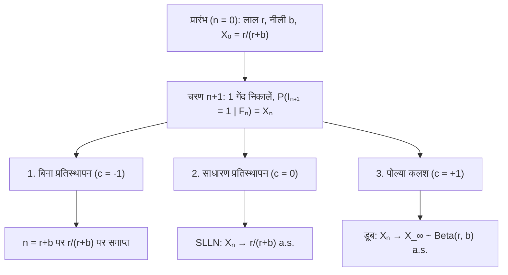
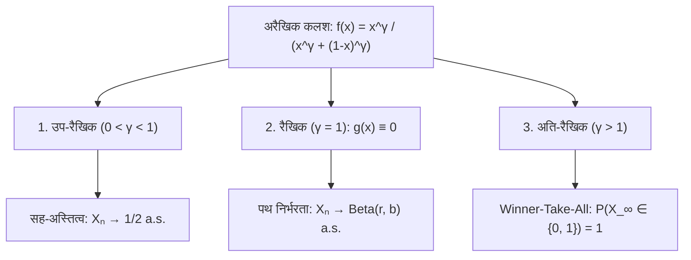

## प्रस्तावना: शुरुआत के कुछ छोटे संयोग अपरिवर्तनीय अंतर में क्यों बदल जाते हैं?

समान गुणवत्ता वाले दो वीडियो या मानक एक साथ शुरू होते हैं: प्रारंभिक सूक्ष्म बढ़त के कारण एक सकारात्मक फीडबैक के ज़रिए बाज़ार पर एकाधिकार कर लेता है (<strong>मैथ्यू प्रभाव</strong>), जबकि दूसरा खो जाता है। किंतु <strong>बड़ी संख्याओं का सशक्त नियम (SLLN)</strong> सिखाता है कि स्वतंत्र (i.i.d.) सिक्का उछालने में $n \to \infty$ पर प्रारंभिक उतार-चढ़ाव मिट जाते हैं और अनुपात स्थिरांक $p$ पर अभिसरित होता है।

कई वास्तविक प्रक्रियाएं <strong>प्रबलित स्टोकेस्टिक प्रक्रियाएं</strong> हैं जिनमें किसी घटना का घटित होना उसके पुनः घटित होने की प्रायिकता को बढ़ा देता है। 1923 में <strong>जॉर्ज पोल्या</strong> और <strong>फ्लोरियन एगेनबर्गर</strong> ने <strong>पोल्या का कलश मॉडल</strong> प्रस्तुत किया, जो दो विरोधाभास दिखाता है:
1. <strong>पहला विरोधाभास (विनिमेयता)</strong>: हर चरण में कलश बदलने पर भी सभी $n$ के लिए $\mathbb{P}(I_n = 1) = \frac{r}{r+b}$ स्थिर रहता है, और किसी भी अनुक्रम की प्रायिकता केवल लाल और नीली गेंदों की कुल संख्या पर निर्भर करती है, क्रम पर नहीं (<strong>Exchangeability</strong>)।
2. <strong>दूसरा विरोधाभास (यादृच्छिक सीमा)</strong>: जब $n \to \infty$, लाल अनुपात $X_n$ एक यादृच्छिक चर $X_\infty \sim \mathrm{Beta}(r, b)$ की ओर लगभग निश्चित रूप से अभिसरित होता है। $r=1, b=1$ के लिए सीमा $[0, 1]$ पर <strong>समान वितरण $\mathrm{Uniform}(0, 1)$</strong> का अनुसरण करती है!

---

## अध्याय 1: तीन कलश ब्रह्मांड — रिक्तीकरण, स्मृतिहीनता और पोल्या प्रबलन

समय $n = 0$ पर कलश में $R_0 = r$ लाल और $B_0 = b$ नीली गेंदें हैं ($N_0 = r + b$)। प्रत्येक चरण में एक गेंद निकाली जाती है और उसी रंग की $c$ गेंदों के साथ लौटाई जाती है: <strong>1. बिना प्रतिस्थापन ($c = -1$)</strong> (नकारात्मक फीडबैक, हाइपरजियोमेट्रिक), <strong>2. साधारण प्रतिस्थापन ($c = 0$)</strong> (स्मृतिहीन i.i.d. $\mathrm{Binomial}(n, \frac{r}{r+b})$), <strong>3. पोल्या कलश ($c = +1$)</strong> (सकारात्मक फीडबैक: गेंद <strong>प्लस $1$ समान रंग की गेंद</strong>)।

$I_n \in \{0, 1\}$ और $S_n = \sum_{k=1}^n I_k$ के साथ, $R_n = r + S_n$ और $N_n = r + b + n$:

$$X_n := \frac{R_n}{N_n} = \frac{r + S_n}{r + b + n}, \qquad \mathbb{P}(I_{n+1} = 1 \mid \mathcal{F}_n) = X_n, \qquad |X_{n+1} - X_n| \le \frac{1}{r + b + n + 1}$$

| विशेषता | 1. बिना प्रतिस्थापन ($c = -1$) | 2. साधारण प्रतिस्थापन ($c = 0$) | 3. पोल्या कलश ($c = +1$) |
| :--- | :--- | :--- | :--- |
| <strong>फीडबैक</strong> | नकारात्मक (रिक्तीकरण) | शून्य (स्मृतिहीन) | <strong>सकारात्मक (स्व-प्रबलन)</strong> |
| <strong>निर्भरता</strong> | नकारात्मक सहसंबंध | <strong>स्वतंत्र (i.i.d.)</strong> | <strong>अनंत विनिमेय</strong> |
| <strong>$S_n$ का वितरण</strong> | $\mathrm{Hypergeom}(N_0, r, n)$ | $\mathrm{Binomial}(n, \frac{r}{r+b})$ | <strong>$\mathrm{BetaBinom}(n, r, b)$</strong> |
| <strong>सीमा $X_\infty$</strong> | स्थिरांक $\frac{r}{r+b}$ | स्थिरांक $\frac{r}{r+b}$ a.s. | <strong>चर $X_\infty \sim \mathrm{Beta}(r, b)$ a.s.</strong> |

---

## अध्याय 2: विनिमेयता और बीटा-द्विपद वितरण

किसी भी अनुक्रम $(i_1, \dots, i_n) \in \{0, 1\}^n$ के लिए जिसमें $k = \sum_{j=1}^n i_j$ लाल गेंदें हैं, हरों का गुणनफल $(r+b)^{(n)}$ और अंशों का गुणनफल क्रम से स्वतंत्र होकर $r^{(k)} b^{(n-k)}$ होता है:

$$\mathbb{P}(I_1 = i_1, \dots, I_n = i_n) = \frac{r^{(k)} \, b^{(n-k)}}{(r+b)^{(n)}}, \qquad \mathbb{P}(S_n = k) = \binom{n}{k} \frac{\mathrm{B}(r+k, \, b+n-k)}{\mathrm{B}(r, \, b)}$$

जब <strong>$r = 1, b = 1$</strong>, सभी क्रमगुणित कटकर असतत समान वितरण $\mathbb{P}(S_n = k) = \frac{1}{n + 1}$ ($k = 0, 1, \dots, n$) देते हैं।

---

## अध्याय 3: डूब का मार्टिंगेल प्रमेय और $\mathrm{Beta}(r,b)$ सीमा

चूंकि $\mathbb{E}[R_{n+1} \mid \mathcal{F}_n] = R_n + X_n = (N_n + 1)X_n$, अनुपात $X_n$ अंतराल $[0, 1]$ पर एक परिबद्ध <strong>मार्टिंगेल</strong> है:

$$\mathbb{E}[X_{n+1} \mid \mathcal{F}_n] = \frac{R_n + \mathbb{E}[I_{n+1} \mid \mathcal{F}_n]}{N_n + 1} = \frac{(N_n + 1) X_n}{N_n + 1} = X_n$$

<strong>डूब के मार्टिंगेल अभिसरण प्रमेय</strong> द्वारा, $X_n \xrightarrow{\text{a.s.}} X_\infty$। $k = \lfloor np \rfloor$ के लिए $\frac{\Gamma(z+\alpha)}{\Gamma(z+\beta)} \sim z^{\alpha-\beta}$ से सिद्ध होता है कि $X_\infty$ का घनत्व <strong>बीटा वितरण $\mathrm{Beta}(r, b)$</strong> है:

$$\boxed{f_{X_\infty}(p) = \frac{\Gamma(r+b)}{\Gamma(r)\Gamma(b)} \, p^{r-1} (1-p)^{b-1} \quad (0 < p < 1), \qquad \mathbb{E}[X_\infty] = \frac{r}{r+b}, \qquad \mathrm{Var}(X_\infty) = \frac{rb}{(r+b)^2(r+b+1)} > 0}$$

---

## अध्याय 4: डी फिनेट्टी प्रमेय, अरैखिक प्रावस्था संक्रमण और अनुप्रयोग

1. <strong>डी फिनेट्टी का निरूपण प्रमेय (1931)</strong>: प्रत्येक अनंत विनिमेय अनुक्रम पूर्व माप $\mathrm{Beta}(r,b)$ के सापेक्ष i.i.d. बरनौली परीक्षणों का मिश्रण होता है:
   $$\mathbb{P}(I_1 = i_1, \dots, I_n = i_n) = \int_0^1 p^k (1-p)^{n-k} \, \frac{\Gamma(r+b)}{\Gamma(r)\Gamma(b)} p^{r-1}(1-p)^{b-1} \, dp$$
2. <strong>अरैखिक कलश ($f(x) = \frac{x^\gamma}{x^\gamma + (1-x)^\gamma}$)</strong>: $X_{n+1} - X_n = \frac{1}{N_n+1}[(f(X_n)-X_n) + \xi_{n+1}]$ तीन व्यवस्थाएं देता है:

3. <strong>अनुप्रयोग और सीमाएं</strong>: <strong>W. Brian Arthur (1989)</strong> लॉक-इन ($\gamma > 1$, QWERTY, VHS) समझाता है; <strong>वरीय जुड़ाव (Yule–Simon / Barabási–Albert)</strong> $P(k) \sim k^{-(2 + \frac{1}{1-\alpha})}$ देता है; $H_0$ से ($\theta > 0$) नए रंग चुनना <strong>डिरिचलेट प्रक्रिया $\mathrm{DP}(\theta, H_0)$ (CRP)</strong> देता है; <strong>MusicLab (Salganik et al. 2006)</strong> चार सीमाएं (<strong>गुणवत्ता $\eta_i$</strong>, <strong>संतृप्ति</strong>, <strong>स्मृति</strong>, <strong>नेटवर्क</strong>) दिखाता है।
