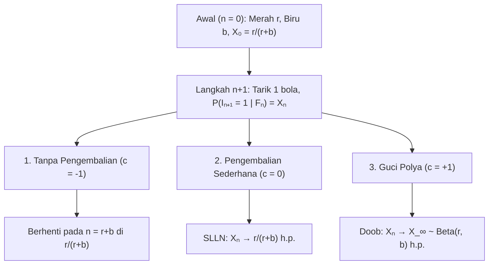
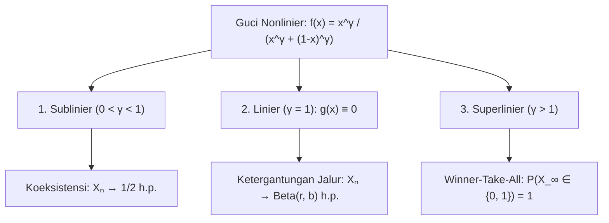

## Pendahuluan: Mengapa Keberuntungan Kecil di Awal Mengkristal Menjadi Ketimpangan Permanen?

Dua video atau standar dengan kualitas identik diluncurkan bersamaan: berkat keunggulan acak kecil di awal, salah satunya membesar melalui umpan balik positif hingga memonopoli pasar (<strong>Efek Matius</strong>), sementara yang lain tenggelam. Namun, <strong>Hukum Kuat Bilangan Besar (SLLN)</strong> mengajarkan sebaliknya: dalam percobaan independen (i.i.d.) seperti lempar koin, fluktuasi awal terhapus saat $n \to \infty$ dan proporsi sampel konvergen hampir pasti ke konstanta $p$.

Banyak proses nyata adalah <strong>Proses Stokastik Diperkuat</strong> di mana terjadinya suatu peristiwa meningkatkan probabilitas peristiwa itu terulang. Pada 1923, <strong>George Pólya</strong> dan <strong>Florian Eggenberger</strong> merumuskan <strong>Model Guci Pólya</strong>, mengungkap dua paradoks:
1. <strong>Paradoks Pertama (Exchangeability)</strong>: Meskipun isi guci berubah setiap langkah, $\mathbb{P}(I_n = 1) = \frac{r}{r+b}$ konstan untuk semua $n$, dan probabilitas barisan hanya bergantung pada total bola merah dan biru tanpa peduli urutannya (<strong>Exchangeability</strong>).
2. <strong>Paradoks Kedua (Limit Acak)</strong>: Saat $n \to \infty$, proporsi merah $X_n$ konvergen hampir pasti menuju variabel acak $X_\infty \sim \mathrm{Beta}(r, b)$. Untuk $r=1, b=1$, limitnya mengikuti <strong>distribusi seragam $\mathrm{Uniform}(0, 1)$</strong> pada $[0, 1]$!

---

## Bab 1: Tiga Semesta Guci — Pengurasan, Tanpa Memori, dan Penguatan Pólya

Pada $n = 0$, guci berisi $R_0 = r$ bola merah dan $B_0 = b$ biru ($N_0 = r + b$). Setiap langkah, satu bola ditarik dan dikembalikan bersama $c$ bola sewarna: <strong>1. Tanpa Pengembalian ($c = -1$)</strong> (umpan balik negatif, hipergeometrik), <strong>2. Pengembalian Sederhana ($c = 0$)</strong> (tanpa memori i.i.d. $\mathrm{Binomial}(n, \frac{r}{r+b})$), <strong>3. Guci Pólya ($c = +1$)</strong> (umpan balik positif: bola dikembalikan <strong>plus $1$ bola sewarna</strong>).

Dengan $I_n \in \{0, 1\}$ dan $S_n = \sum_{k=1}^n I_k$, berlaku $R_n = r + S_n$ dan $N_n = r + b + n$:

$$X_n := \frac{R_n}{N_n} = \frac{r + S_n}{r + b + n}, \qquad \mathbb{P}(I_{n+1} = 1 \mid \mathcal{F}_n) = X_n, \qquad |X_{n+1} - X_n| \le \frac{1}{r + b + n + 1}$$

| Karakteristik | 1. Tanpa Pengembalian ($c = -1$) | 2. Pengembalian Sederhana ($c = 0$) | 3. Guci Pólya ($c = +1$) |
| :--- | :--- | :--- | :--- |
| <strong>Umpan Balik</strong> | Negatif (pengurasan) | Nol (tanpa memori) | <strong>Positif (penguatan diri)</strong> |
| <strong>Ketergantungan</strong> | Korelasi negatif | <strong>Independen (i.i.d.)</strong> | <strong>Exchangeable tak hingga</strong> |
| <strong>Distribusi $S_n$</strong> | $\mathrm{Hypergeom}(N_0, r, n)$ | $\mathrm{Binomial}(n, \frac{r}{r+b})$ | <strong>$\mathrm{BetaBinom}(n, r, b)$</strong> |
| <strong>Limit $X_\infty$</strong> | Konstanta $\frac{r}{r+b}$ | Konstanta $\frac{r}{r+b}$ h.p. | <strong>Variabel $X_\infty \sim \mathrm{Beta}(r, b)$ h.p.</strong> |

---

## Bab 2: Exchangeability dan Distribusi Beta-Binomial

Untuk setiap barisan $(i_1, \dots, i_n) \in \{0, 1\}^n$ dengan $k = \sum_{j=1}^n i_j$ merah, hasil kali penyebut adalah $(r+b)^{(n)}$ dan pembilang secara komutatif adalah $r^{(k)} b^{(n-k)}$:

$$\mathbb{P}(I_1 = i_1, \dots, I_n = i_n) = \frac{r^{(k)} \, b^{(n-k)}}{(r+b)^{(n)}}, \qquad \mathbb{P}(S_n = k) = \binom{n}{k} \frac{\mathrm{B}(r+k, \, b+n-k)}{\mathrm{B}(r, \, b)}$$

Untuk <strong>$r = 1, b = 1$</strong>, semua faktorial saling menghilangkan menjadi distribusi seragam diskrit $\mathbb{P}(S_n = k) = \frac{1}{n + 1}$ ($k = 0, 1, \dots, n$).

---

## Bab 3: Martingale Doob dan Limit $\mathrm{Beta}(r,b)$

Karena $\mathbb{E}[R_{n+1} \mid \mathcal{F}_n] = R_n + X_n = (N_n + 1)X_n$, proporsi $X_n$ adalah <strong>martingale</strong> terbatas pada $[0, 1]$:

$$\mathbb{E}[X_{n+1} \mid \mathcal{F}_n] = \frac{R_n + \mathbb{E}[I_{n+1} \mid \mathcal{F}_n]}{N_n + 1} = \frac{(N_n + 1) X_n}{N_n + 1} = X_n$$

Berdasarkan <strong>Teorema Konvergensi Martingale Doob</strong>, $X_n \xrightarrow{\text{h.p.}} X_\infty$. Asimtotik $\frac{\Gamma(z+\alpha)}{\Gamma(z+\beta)} \sim z^{\alpha-\beta}$ untuk $k = \lfloor np \rfloor$ membuktikan bahwa $X_\infty$ mengikuti <strong>distribusi Beta $\mathrm{Beta}(r, b)$</strong>:

$$\boxed{f_{X_\infty}(p) = \frac{\Gamma(r+b)}{\Gamma(r)\Gamma(b)} \, p^{r-1} (1-p)^{b-1} \quad (0 < p < 1), \qquad \mathbb{E}[X_\infty] = \frac{r}{r+b}, \qquad \mathrm{Var}(X_\infty) = \frac{rb}{(r+b)^2(r+b+1)} > 0}$$

---

## Bab 4: Teorema de Finetti, Transisi Nonlinier, dan Aplikasi

1. <strong>Teorema Representasi de Finetti (1931)</strong>: Setiap barisan infinitely exchangeable adalah campuran percobaan Bernoulli i.i.d. terhadap prior $\mathrm{Beta}(r,b)$:
   $$\mathbb{P}(I_1 = i_1, \dots, I_n = i_n) = \int_0^1 p^k (1-p)^{n-k} \, \frac{\Gamma(r+b)}{\Gamma(r)\Gamma(b)} p^{r-1}(1-p)^{b-1} \, dp$$
2. <strong>Guci Nonlinier ($f(x) = \frac{x^\gamma}{x^\gamma + (1-x)^\gamma}$)</strong>: $X_{n+1} - X_n = \frac{1}{N_n+1}[(f(X_n)-X_n) + \xi_{n+1}]$ menghasilkan tiga rezim:

3. <strong>Aplikasi dan Batasan</strong>: <strong>W. Brian Arthur (1989)</strong> menjelaskan Lock-In ($\gamma > 1$, QWERTY, VHS); <strong>Preferential Attachment (Yule–Simon / Barabási–Albert)</strong> menghasilkan $P(k) \sim k^{-(2 + \frac{1}{1-\alpha})}$; warna baru ($\theta > 0$, $H_0$) konvergen ke <strong>Proses Dirichlet $\mathrm{DP}(\theta, H_0)$ (CRP)</strong>; <strong>MusicLab (Salganik et al. 2006)</strong> membuktikan empat batasan: <strong>kualitas $\eta_i$</strong>, <strong>kejenuhan</strong>, <strong>memori</strong>, dan <strong>jaringan</strong>.
