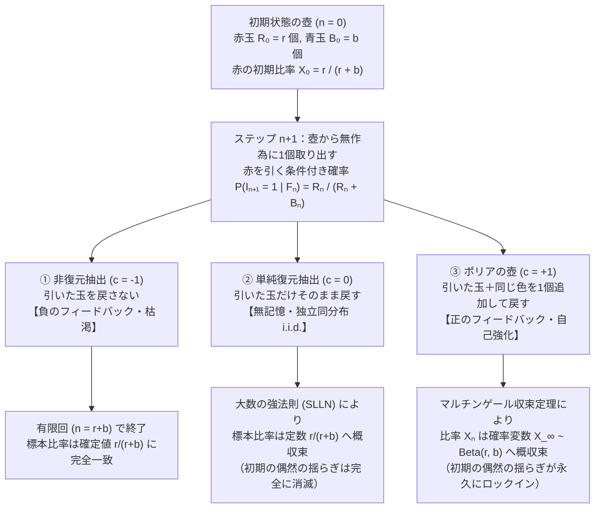
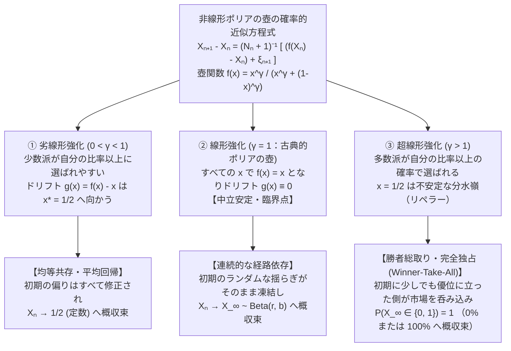

## はじめに：なぜ「最初のほんの数回の運」が、決して覆らない格差へと結晶化するのか

ほぼ同じ品質の2つの動画が同時に投稿されたにもかかわらず、一方は数百万回再生されるバイラル・ヒットとなり、もう一方は誰の目にも触れずに埋もれていく。ほぼ同じ技術水準にあった2つの規格やプラットフォームのうち、たまたま初期にわずかなシェアの優位を得た側が市場を席巻し、事実上の標準（デファクト・スタンダード）として固定化される。あるいは、同じ潜在能力を持つ2人の若手研究者のうち、最初の論文が偶然注目を集めた側だけに研究費と共同研究の機会が集中し、10年後には圧倒的な業績差がついている——。

私たちの周囲には、<strong>「初期のほんの小さな偶然の差が、時間の経過とともに消えるどころか雪だるま式に増幅され、巨大な偏りとして定着する」</strong>という現象が満ちあふれている。社会学者ロバート・マートンは、新約聖書のマタイによる福音書の一節（「富める者はますます富み、貧しき者は持っているものまでも取り上げられる」）になぞらえて、この累積的優位のメカニズムを<strong>マタイ効果（Matthew Effect）</strong>と呼んだ。

しかし、初等的な確率論や統計学を学んだ人ほど、この現象に対して強い違和感を覚えるはずである。なぜなら、私たちが最初に学ぶ確率の基本法則——<strong>大数の強法則（Strong Law of Large Numbers: SLLN）</strong>——は、まったく逆の結論を教えているからだ。

歪みのないコインを投げるとき、最初の10回でたまたま表が8回、裏が2回出たとしても、それは単なる初期の統計的揺らぎ（ノイズ）にすぎない。試行回数 $n$ を100回、1万回、100万回へと増やしていけば、初期の偏りは巨大な分母 $n$ の中に希釈されて跡形もなく洗い流され、表が出る割合は必ず真の確率 $0.5$（$50\%$）へと一点収束する。もし現実世界がコイン投げのような「独立同分布（i.i.d.）」の試行の積み重ねであるならば、一時的な運不運はいずれ平均化され、本来の実力通りの比率に落ち着くはずではないか？

答えは明快である。現実世界の多くのプロセスは、過去の結果が未来の確率になんの干渉もしない「記憶のないコイン投げ」ではなく、<strong>「過去に起きた結果が、次に同じ結果が起きる確率そのものを押し上げる」という自己強化型確率過程（Reinforced Stochastic Process）</strong>だからである。

この自己強化と経路依存性（Path Dependence）の本質を、驚くほどシンプルなルールでありながら完璧な数学的厳密さをもって切り出した思考実験が存在する。1923年、ハンガリー出身の数学者<strong>ジョージ・ポリア（George Pólya）</strong>と彼の教え子であるスイスの数学者<strong>フロリアン・エッゲンベルガー（Florian Eggenberger）</strong>が、伝染病（感染症）の拡大を記述するために考案した<strong>「ポリアの壺（Pólya's Urn Model）」</strong>である。

壺の中に赤玉と青玉を入れておき、1個無作為に取り出して色を確認したら、<strong>その玉と一緒に「同じ色の玉をもう1個追加して」壺に戻す</strong>。たったこれだけのルール変更によって、確率の世界は劇的な変貌を遂げる。ポリアの壺は、一見すると直感に真っ向から反する2つの数学的パラドックスを秘めている。

1. <strong>第一のパラドックス（周辺確率の不変性と交換可能性）</strong>：1回ごとに壺の中身が書き換わり、条件付き確率が激しく変動するにもかかわらず、事前に予測する「$n$ 回目に赤玉が出る無条件の確率」は $n$ によらず常に一定であり、さらに「どの順番で赤と青が出たか」は系列の確率に一切影響しない（<strong>交換可能性 / Exchangeability</strong>）。
2. <strong>第二のパラドックス（ランダムな極限への概収束）</strong>：試行回数を無限大（$n \to \infty$）にしたとき、壺の中の赤玉の割合 $X_n$ は定数には収束しない。しかし永遠にフラフラと揺れ動き続けるのでもなく、各々の壺（歴史のサンプルパス）ごとに<strong>ある特定の極限値へとピタリと収束（ロックイン）し、その極限値 $X_\infty$ 自体が「ベータ分布（Beta Distribution）」に従う確率変数になる</strong>。特に赤1個・青1個から始めた場合、極限の比率は $0\%$ から $100\%$ までのあらゆる値を<strong>完全に等確率（連続一様分布）</strong>でとる！

本稿では、このポリアの壺モデルの基礎方程式から出発し、ベータ二項分布と交換可能性の証明、ドゥーブのマルチンゲール収束定理を用いた極限分布 $\mathrm{Beta}(r,b)$ の厳密な導出、通常の大数の法則やブルーノ・ド・フィネッティの表現定理（ベイズ推論）との深い双対性を解き明かす。さらに後半では、強化のルールを非線形に拡張したときに現れる「勝者総取り（完全独占）への相転移」を解析し、経済学・ネットワーク科学・社会実験（MusicLab）への応用と、このモデルを現実社会に当てはめる際に決して見落としてはならない「4つの限界」までを体系的に論じる。

---

## 第1章：3つの壺モデル——非復元抽出・復元抽出・ポリアの自己強化抽出

確率論における「壺（Urn）から玉を引くモデル」は、ヤコブ・ベルヌーイの『推測術（Ars Conjectandi）』（1713年）以来、ランダム現象の構造を抽象化する最も基本的な装置として使われてきた。

いま、時刻 $n = 0$ の初期状態において、不透明な壺の中に<strong>赤玉が $R_0 = r$ 個</strong>、<strong>青玉が $B_0 = b$ 個</strong>（合計 $N_0 = r + b$ 個、$r, b \ge 1$）入っているとする。ここからステップ $n = 1, 2, 3, \dots$ ごとに、壺の中をよくかき混ぜて玉を1個だけ一様無作為（uniformly at random）に取り出し、その色を確認する。

このとき、<strong>「取り出した玉をどう扱うか（壺に玉を何個戻すか）」</strong>というたった1つのパラメータ $c$（同じ色の追加個数）の違いによって、確率過程は3つの全く異なる宇宙へと分岐する。

### 1. 非復元抽出（Sampling Without Replacement：$c = -1$）
取り出した玉を壺に戻さず、そのまま外に取り除いてしまうルールである（戻す個数が $0$ 個なので、元の状態からの純増分は $c = -1$ とみなせる）。
- 赤玉を1個引くと、壺の中の赤玉が減るため、次のステップで再び赤玉を引く確率は<strong>低下する</strong>。これは<strong>負のフィードバック（枯渇・抑制過程）</strong>である。
- $n$ 回の抽出で得られる赤玉の個数は<strong>超幾何分布（Hypergeometric Distribution）</strong>に従う。
- 総ステップ数 $N_0 = r + b$ 回で壺は空になり、最終的に引き出された赤玉の割合は、途中の順番がどうであれ必ず初期比率 $\frac{r}{r+b}$ に $100\%$ の確率で一致する（分散ゼロの確定値）。

### 2. 単純復元抽出（Sampling With Replacement：$c = 0$）
取り出した玉の色を記録したあと、その玉だけをそのまま壺に戻すルールである（純増分 $c = 0$）。
- 何回試行を繰り返しても、壺の中身は永遠に「赤 $r$ 個、青 $b$ 個」のまま変化しない。過去の結果は壺の状態に一切痕跡を残さない（<strong>記憶なし / 無フィードバック</strong>）。
- 各ステップで赤玉を引く事象は、常に一定の確率 $p = \frac{r}{r+b}$ を持つ<strong>独立同分布（i.i.d.）なベルヌーイ試行</strong>（コイン投げと同じ）であり、$n$ 回中の赤玉の個数は<strong>二項分布 $\mathrm{Binomial}(n, \frac{r}{r+b})$</strong> に従う。

### 3. ポリアの壺モデル（Pólya-Eggenberger Urn：$c \ge 1$）
取り出した玉の色を確認したあと、<strong>その玉を壺に戻すとともに、同じ色の新しい玉をさらに $c$ 個追加して壺に入れる</strong>ルールである。エッゲンベルガーとポリア（1923）はこれを「伝染（contagion）」のモデルとして定式化した。感染症の患者（赤玉）が1人見つかると、その周囲に接触感染が広がることで、集団全体のなかで次に感染者が見つかる確率そのものが増加するからである。
- 最も本質的かつ標準的なケースである <strong>$c = 1$（引いた玉と同じ色を1個ずつ増やすモデル）</strong> を考えよう。
- 赤玉を1個引くと、壺の中の赤玉が $1$ 個増えるため、次のステップで赤玉を引く確率は<strong>上昇する</strong>。逆に青玉を引けば、青玉が増えて赤玉を引く確率は低下する。これは<strong>正のフィードバック（自己強化過程 / Self-Reinforcing Process）</strong>である。

### 標準ポリア壺（$c=1$）の厳密な定式化と「初期1回の衝撃」

$c=1$ のポリアの壺を確率過程として定式化しておこう。確率空間 $(\Omega, \mathcal{F}, \mathbb{P})$ 上で、第 $n$ ステップ（$n \ge 1$）に取り出された玉が赤であれば $I_n = 1$、青であれば $I_n = 0$ と値をとる指示確率変数（ベルヌーイ変数）を定義する。

$n$ 回目の試行が終わった時点での赤玉の総数を $R_n$、青玉の総数を $B_n$、壺の中の玉の総数を $N_n = R_n + B_n$ と書く。最初の $n$ 回のうち赤玉が出た回数を $S_n = \sum_{k=1}^n I_k$ とすれば、毎回必ず1個ずつ玉が追加されるため、次が成り立つ。

$$R_n = r + S_n = r + \sum_{k=1}^n I_k, \qquad B_n = b + (n - S_n), \qquad N_n = R_n + B_n = r + b + n$$

ここで重要なのは、赤玉の数 $R_n$ と青玉の数 $B_n$ はランダムに変動する確率変数であるのに対し、<strong>分母である総玉数 $N_n = r + b + n$ は偶然に左右されない決定論的な数列である</strong>という点だ。

時刻 $n$ までの履歴（情報）を表す $\sigma$-加法族（フィルトレーション）を $\mathcal{F}_n = \sigma(I_1, I_2, \dots, I_n)$ とし、時刻 $n$ における壺の中の赤玉の割合を $X_n$ とおこう。

$$X_n := \frac{R_n}{N_n} = \frac{r + S_n}{r + b + n}$$

すると、ステップ $n+1$ で赤玉を引く<strong>条件付き確率</strong>は、まさに時刻 $n$ における赤玉の占有率 $X_n$ そのものに等しい。

$$\mathbb{P}(I_{n+1} = 1 \mid \mathcal{F}_n) = \frac{R_n}{R_n + B_n} = X_n$$

この式が持つ「時期による重みの非対称性」を実感するために、最も単純な初期状態 $r = 1, b = 1$（赤1個・青1個、$N_0 = 2$）で具体的に数字を追ってみよう。
- <strong>時刻 $n=0$</strong>：赤1個、青1個。赤の割合は $X_0 = \frac{1}{2} = 0.500$（$50.0\%$）である。
- <strong>第1ステップ（$n=1$）</strong>：コイントスと全く同じ確率 $1/2$ で、たまたま赤玉を引いたとしよう（$I_1 = 1$）。赤玉を1個追加して戻すため、壺の中は「赤2個、青1個（計3個）」になる。この瞬間、次に赤を引く確率は $X_1 = \frac{2}{3} \approx 0.667$（$66.7\%$）へと<strong>たった1回の試行で $+16.7\%$ も跳ね上がる</strong>！
- <strong>第2ステップ（$n=2$）</strong>：すでに赤が有利になった状態（確率 $2/3$）で、もう一度赤を引いたとしよう（$I_2 = 1$）。壺の中は「赤3個、青1個（計4個）」となり、赤の割合は $X_2 = \frac{3}{4} = 0.750$（$75.0\%$）に達する。
- では逆に、<strong>第1000ステップ（$n=1000$）</strong>の時点で、もし仮に壺の中に赤玉が501個、青玉が501個（計1002個、$X_{1000} = 0.5000$）入っていたとしたらどうなるか？ここで次の1回（1001回目）に赤玉を引いたとしても、赤玉の割合は $\frac{502}{1003} \approx 0.500498$ となり、わずか <strong>$+0.05\%$ しか変化しない</strong>。

1ステップあたりの比率の変化量 $|X_{n+1} - X_n|$ を計算すると、その上限は常に分母 $N_{n+1} = r + b + n + 1$ に反比例することがわかる。

$$|X_{n+1} - X_n| = \left| \frac{R_n + I_{n+1}}{N_n + 1} - \frac{R_n}{N_n} \right| = \frac{|N_n I_{n+1} - R_n|}{N_n (N_n + 1)} \le \frac{1}{r + b + n + 1}$$

つまり、<strong>分母 $r + b + n$ が極めて小さい初期段階（$n=1, 2, 3\dots$）における1回の偶然は、壺の組成を劇的に書き換える巨大な衝撃力を持つのに対し、試行が進んで分母が巨大化した後期段階における1回の試行は、もはや全体の比率をほとんど動かすことができない</strong>。これが、初期の偶然が凍結・固定化される物理的メカニズムの第一歩である。

| 比較項目 | ① 非復元抽出 ($c = -1$) | ② 単純復元抽出 ($c = 0$) | ③ ポリアの壺モデル ($c = +1$) |
| :--- | :--- | :--- | :--- |
| <strong>抽出後の操作</strong> | 引いた玉を戻さない（除去） | 引いた玉だけをそのまま戻す | 引いた玉＋<strong>同色を1個追加</strong>して戻す |
| <strong>フィードバックの性質</strong> | 負のフィードバック（枯渇・抑制） | フィードバックなし（無記憶） | <strong>正のフィードバック（自己強化・伝染）</strong> |
| <strong>試行間の統計的関係</strong> | 負の相関・交換可能（有限列） | <strong>独立同分布（i.i.d.）</strong>・交換可能 | <strong>強い正の相関・無限に交換可能</strong> |
| <strong>$n$ 回中の赤の個数 $S_n$ の分布</strong> | 超幾何分布 $\mathrm{Hypergeom}(N_0, r, n)$ | 二項分布 $\mathrm{Binomial}(n, \frac{r}{r+b})$ | <strong>ベータ二項分布 $\mathrm{BetaBinom}(n, r, b)$</strong> |
| <strong>極限比率 $\lim_{n\to\infty} X_n$ の挙動</strong> | $n=N_0$ で終了し定数 $\frac{r}{r+b}$ に一致 | 定数 $\frac{r}{r+b}$ へ概収束（大数の強法則） | <strong>確率変数 $X_\infty \sim \mathrm{Beta}(r, b)$ へ概収束</strong> |
| <strong>初期の偶然の運命</strong> | 完全に打ち消される | $O(1/n)$ で希釈され完全に消滅する | <strong>永久に記憶され極限値を決定づける</strong> |

---

## 第2章：第一のパラドックス——なぜ条件付き確率は激しく動くのに、周辺確率は一定で「順序に依存しない（交換可能）」のか

ポリアの壺のルールを聞くと、多くの人は次のように考える。「1回目に赤が出れば2回目に赤が出る確率が上がるし、青が出れば下がる。このように前の結果が次の確率を引っ張るのだから、『1回目に赤が出て2回目に青が出る確率』と『1回目に青が出て2回目に赤が出る確率』は違うのではないか？また、ステップ $n$ が進むにつれて無条件の確率 $\mathbb{P}(I_n = 1)$ も変わっていくのではないか？」

ところが、実際に計算してみると驚くべき事実が判明する。<strong>どのステップ $n$ においても、事前に予測する赤玉の無条件確率（周辺確率）は常に $\frac{r}{r+b}$ で不変であり、さらに任意の長さ $n$ の抽出結果が生じる確率は、赤が出た総回数 $k$ と青が出た総回数 $n-k$ だけに依存し、それらがどの順序で現れたかには一切依存しない</strong>のである。

### 定理1：交換可能性（Exchangeability）の厳密な証明

長さ $n$ の任意の抽出結果の列 $(i_1, i_2, \dots, i_n) \in \{0, 1\}^n$ を考えよう。この列の中に赤（$1$）がちょうど $k$ 個、青（$0$）がちょうど $n - k$ 個含まれているとする（すなわち $\sum_{j=1}^n i_j = k$）。

まず、最もわかりやすい特定の順序として、<strong>「最初の $k$ 回がすべて赤（$1$）であり、続く後半の $n-k$ 回がすべて青（$0$）である」</strong>という事象の確率を、条件付き確率の連鎖律（乗法定理）に従って書き下してみよう。

- 1回目に赤を引く確率：$\frac{r}{r+b}$ （この後、壺は赤 $r+1$ 個、計 $r+b+1$ 個になる）
- 2回目に赤を引く条件付き確率：$\frac{r+1}{r+b+1}$ （この後、壺は赤 $r+2$ 個、計 $r+b+2$ 個になる）
- $\cdots$
- $k$ 回目に赤を引く条件付き確率：$\frac{r+k-1}{r+b+k-1}$ （この時点で壺は赤 $r+k$ 個、青 $b$ 個、計 $r+b+k$ 個になる）
- $k+1$ 回目に初めて青を引く条件付き確率：$\frac{b}{r+b+k}$ （この後、青が $b+1$ 個になる）
- $k+2$ 回目に青を引く条件付き確率：$\frac{b+1}{r+b+k+1}$
- $\cdots$
- $n$ 回目に（$n-k$ 個目の）青を引く条件付き確率：$\frac{b + (n - k - 1)}{r + b + n - 1}$

これら $n$ 個の分数をすべて掛け合わせると、次のようになる。

$$\mathbb{P}(I_1=1, \dots, I_k=1, I_{k+1}=0, \dots, I_n=0) = \frac{r(r+1)\cdots(r+k-1) \cdot b(b+1)\cdots(b+n-k-1)}{(r+b)(r+b+1)\cdots(r+b+n-1)}$$

では、赤と青が出る順序を任意に入れ替えた一般の列 $(i_1, i_2, \dots, i_n)$（赤が $k$ 回、青が $n-k$ 回）ではどうなるだろうか？

1. <strong>分母の不変性</strong>：各ステップで赤が出ようが青が出ようが、壺の中の玉の総数は毎回必ず $1$ 個ずつ増えていく。したがって、$j$ 回目の抽出における分母は常に $r + b + j - 1$ であり、$n$ 回分の分母の積は結果の順序に一切関係なく常に $(r+b)(r+b+1)\cdots(r+b+n-1)$ となる。
2. <strong>分子の可換性</strong>：列の中で「1回目の赤」が第何ステップで出ようとも、その時点で壺の中にある赤玉の数は必ず初期値 $r$ 個であるから、そのステップの分子には必ず因数 $r$ が現れる。「2回目の赤」が出るときには、それが何ステップ目であれ赤玉は $r+1$ 個になっているから、分子には必ず因数 $r+1$ が現れる。一般に、$m$ 回目の赤が出るときには分子に $r+m-1$ が現れ、$\ell$ 回目の青が出るときには分子に $b+\ell-1$ が現れる。
3. 実数の掛け算は順序を入れ替えても値が変わらない（乗法の交換法則）ため、赤が $k$ 回、青が $n-k$ 回出るならば、$n$ 個の分子を掛け合わせた積は、順序によらず<strong>常に同一の積</strong>になる！

ここで組合せ論における<strong>上昇階乗（Rising Factorial / ポッホハマー記号）</strong>

$$x^{(m)} := x(x+1)(x+2)\cdots(x+m-1) = \frac{\Gamma(x+m)}{\Gamma(x)} \qquad (\text{ただし } x^{(0)} := 1)$$

を用いると、赤が $k$ 回、青が $n-k$ 回含まれる<strong>任意の</strong>特定順序の系列 $(i_1, \dots, i_n)$ の確率は、次の美しい閉じた式で表される。

$$\mathbb{P}(I_1 = i_1, I_2 = i_2, \dots, I_n = i_n) = \frac{r^{(k)} \, b^{(n-k)}}{(r+b)^{(n)}} \qquad \left( k = \sum_{j=1}^n i_j \right)$$

この式の右辺には、個々のインデックス $i_1, \dots, i_n$ の順序に関する情報が完全に消えており、和 $k$ と長さ $n$ だけしか含まれていない。このように、任意の有限部分列の結合確率が変数の順列（並べ替え）に対して不変である性質を、確率論において<strong>交換可能性（Exchangeability）</strong>と呼ぶ。

独立同分布（i.i.d.）な確率変数列は明らかに交換可能である（その場合の結合確率は $p^k (1-p)^{n-k}$ となる）。しかしポリアの壺が示したのは、<strong>「試行間に強い従属関係（自己強化）があっても、交換可能性は完璧に成り立つ」</strong>という驚くべき事実であった。

たとえば $r=1, b=1$ で $n=2$ のとき、「1回目赤・2回目青」の確率と「1回目青・2回目赤」の確率を比べてみよう。
- $\mathbb{P}(I_1=1, I_2=0) = \frac{1}{2} \times \frac{1}{3} = \frac{1}{6}$
- $\mathbb{P}(I_1=0, I_2=1) = \frac{1}{2} \times \frac{1}{3} = \frac{1}{6}$
また、$\mathbb{P}(I_1=1, I_2=1) = \frac{1}{2} \times \frac{2}{3} = \frac{2}{6} = \frac{1}{3}$ となる。
ここから2回目に赤が出る無条件の周辺確率 $\mathbb{P}(I_2 = 1)$ を計算すると、全確率の公式より
$$\mathbb{P}(I_2 = 1) = \mathbb{P}(I_1=1, I_2=1) + \mathbb{P}(I_1=0, I_2=1) = \frac{1}{3} + \frac{1}{6} = \frac{1}{2}$$
となり、1回目の確率 $\mathbb{P}(I_1 = 1) = \frac{1}{2}$ と完全に一致する！一般に交換可能性から直ちに、すべての $n \ge 1$ に対して $\mathbb{P}(I_n = 1) = \mathbb{P}(I_1 = 1) = \frac{r}{r+b}$ が従うのである。

### ベータ二項分布（Beta-Binomial Distribution）と $r=1, b=1$ の衝撃

1つの特定の順序 $(i_1, \dots, i_n)$ が生じる確率がすべて等しく $\frac{r^{(k)} b^{(n-k)}}{(r+b)^{(n)}}$ であるならば、$n$ 回の抽出で赤玉が出る総回数 $S_n = \sum_{j=1}^n I_j$ がちょうど $k$ 回（$0 \le k \le n$）となる確率は、$n$ 箇所から赤が出る $k$ 箇所を選ぶ組合せの数 $\binom{n}{k}$ を掛けるだけで直ちに求まる。

$$\mathbb{P}(S_n = k) = \binom{n}{k} \frac{r^{(k)} \, b^{(n-k)}}{(r+b)^{(n)}}$$

ガンマ関数 $\Gamma(x)$ とオイラーのベータ関数 $\mathrm{B}(\alpha, \beta) = \frac{\Gamma(\alpha)\Gamma(\beta)}{\Gamma(\alpha+\beta)}$ を使って書き直すと、次の表現を得る。

$$\mathbb{P}(S_n = k) = \binom{n}{k} \frac{\Gamma(r+k)}{\Gamma(r)} \frac{\Gamma(b+n-k)}{\Gamma(b)} \frac{\Gamma(r+b)}{\Gamma(r+b+n)} = \binom{n}{k} \frac{\mathrm{B}(r+k, \, b+n-k)}{\mathrm{B}(r, \, b)}$$

この離散確率分布は、統計学において<strong>ポリア＝エッゲンベルガー分布（Pólya-Eggenberger Distribution）</strong>あるいは<strong>ベータ二項分布（Beta-Binomial Distribution）</strong>と呼ばれている。

ここで、最も象徴的な初期条件である <strong>$r = 1, b = 1$（最初に赤玉1個、青玉1個だけが入っている状態）</strong> を代入してみよう。自然数に対して上昇階乗は通常の階乗になるため、$1^{(k)} = 1 \cdot 2 \cdots k = k!$、$1^{(n-k)} = (n-k)!$、そして分母は $(1+1)^{(n)} = 2^{(n)} = 2 \cdot 3 \cdots (n+1) = (n+1)!$ である。これを上の式に代入すると、信じがたいほど劇的な約分が起きる。

$$\mathbb{P}(S_n = k) = \frac{n!}{k! \, (n-k)!} \cdot \frac{k! \, (n-k)!}{(n+1)!} = \frac{n!}{(n+1)!} = \frac{1}{n+1} \qquad (k = 0, 1, 2, \dots, n)$$

右辺から $k$ が完全に消え去ってしまった！これが意味する事実は驚異的である。
最初に赤1個・青1個の壺から始めて $n = 100$ 回玉を引き続けたとしよう。もしこれが単純復元抽出（コイン投げ）であれば、赤が50回出る確率 $\binom{100}{50} (1/2)^{100} \approx 0.0796$ が最大となり、赤が0回（100回連続で青）や赤が100回（100回連続で赤）となる確率は $(1/2)^{100} \approx 7.89 \times 10^{-31}$ という天文学的なゼロに等しい値になる。

ところが $r=1, b=1$ のポリアの壺では、<strong>100回引いて赤が0回である確率も、赤が25回である確率も、赤が50回である確率も、100回すべて赤が出る確率も、すべて完全に等しく $\frac{1}{101}$（約 $0.99\%$）になる</strong>のである。$S_n$ の分布は $\{0, 1, 2, \dots, n\}$ 上の<strong>離散一様分布</strong>になるのだ。なぜこんなことが起きるのか？それは、最初の数回でたまたま赤が連続すると、壺の中がほぼ赤玉だらけになり、残りの90数回もそのまま赤が出続ける確率が劇的に高まるからである。

---

## 第3章：第二のパラドックス——マルチンゲール収束定理と「確率変数への収束」

$n$ 回後の赤玉の個数 $S_n$ がこれほど広い範囲にばらつくとしたら、試行回数 $n$ を無限大（$n \to \infty$）へと飛ばしたとき、壺の中の赤玉の比率

$$X_n = \frac{R_n}{R_n + B_n} = \frac{r + S_n}{r + b + n}$$

はいったいどうなるのだろうか？ここで2つの疑問が生じる。
1. <strong>そもそも比率 $X_n$ は収束するのか？</strong> それとも、あるときは $0.8$ になり、その後青が連続して $0.2$ に落ち、また赤が連続して $0.9$ に戻るというように、永遠に $0$ と $1$ の間を往復して振動し続けるのだろうか？
2. <strong>もし収束するとしたら、何に収束するのか？</strong>

この2つの問いに完璧な解答を与えるのが、現代確率論の金字塔である<strong>マルチンゲール理論（Martingale Theory）</strong>である。

### ステップ1：比率 $X_n$ が「マルチンゲール」であることの証明

確率過程 $(X_n)_{n \ge 0}$ がフィルトレーション $(\mathcal{F}_n)_{n \ge 0}$ に関して<strong>マルチンゲール（Martingale）</strong>であるとは、各 $n$ で $\mathbb{E}[|X_n|] < \infty$ かつ、過去のすべての履歴 $\mathcal{F}_n$ が与えられたもとでの次のステップの条件付き期待値が、現在の値 $X_n$ にピタリと一致すること、すなわち

$$\mathbb{E}[X_{n+1} \mid \mathcal{F}_n] = X_n \quad (\text{a.s.})$$

が成り立つことをいう。直感的に言えば、「現在までの情報をすべて知ったうえで予測する明日の期待値は、今日の現在値と変わらない（上昇傾向も下降傾向もない公平な賭けである）」という性質である。

ポリアの壺における赤玉の比率 $X_n = \frac{R_n}{N_n}$（ただし $N_n = r + b + n$）について、これを直接計算してみよう。時刻 $n$ の履歴 $\mathcal{F}_n$ が与えられたとき、現在の赤玉の数 $R_n$（したがって $X_n = R_n / N_n$）はすでに確定した既知の値である。次の第 $n+1$ ステップでは、
- 条件付き確率 $X_n$ で赤玉が引かれ（$I_{n+1} = 1$）、赤玉の数は $R_{n+1} = R_n + 1$ になる。
- 条件付き確率 $1 - X_n$ で青玉が引かれ（$I_{n+1} = 0$）、赤玉の数は $R_{n+1} = R_n$ のまま据え置かれる。

したがって、$R_{n+1} = R_n + I_{n+1}$ の条件付き期待値は、$\mathbb{E}[I_{n+1} \mid \mathcal{F}_n] = X_n$ より直ちに次のように求まる。

$$\mathbb{E}[R_{n+1} \mid \mathcal{F}_n] = R_n + \mathbb{E}[I_{n+1} \mid \mathcal{F}_n] = R_n + X_n$$

ここで、ステップ $n+1$ の総玉数 $N_{n+1} = N_n + 1 = r + b + n + 1$ は定数であるから、両辺を $N_n + 1$ で割り、関係式 $R_n = N_n X_n$ を代入すると、鮮やかな恒等式が現れる。

$$\mathbb{E}[X_{n+1} \mid \mathcal{F}_n] = \frac{\mathbb{E}[R_{n+1} \mid \mathcal{F}_n]}{N_n + 1} = \frac{R_n + X_n}{N_n + 1} = \frac{N_n X_n + X_n}{N_n + 1} = \frac{(N_n + 1) X_n}{N_n + 1} = X_n$$

これで、<strong>ポリアの壺の赤玉比率 $(X_n)_{n \ge 0}$ は厳密なマルチンゲールである</strong>ことが証明された。
（なお、繰り返し期待値の法則 $\mathbb{E}[X_n] = \mathbb{E}[\mathbb{E}[X_n \mid \mathcal{F}_{n-1}]] = \mathbb{E}[X_{n-1}] = \dots = \mathbb{E}[X_0] = \frac{r}{r+b}$ を用いれば、第2章で示した「無条件の周辺確率がすべての $n$ で $\frac{r}{r+b}$ に保たれる」という事実も、たった1行で別証明できる！）

### ステップ2：ドゥーブのマルチンゲール収束定理による「概収束（ロックイン）」

マルチンゲール $(X_n)_{n \ge 0}$ は、比率であるから常に閉区間 $[0, 1]$ の中に収まっている（$0 \le X_n \le 1$）。すなわち、一様に有界（したがって $\sup_{n \ge 0} \mathbb{E}[|X_n|] \le 1 < \infty$）である。

ここで確率論における最も強力な基本定理の1つ、ジョセフ・ドゥーブによる<strong>ドゥーブのマルチンゲール収束定理（Doob's Martingale Convergence Theorem）</strong>を適用しよう。

> <strong>定理（ドゥーブのマルチンゲール収束定理）</strong>：
> $(X_n)_{n \ge 0}$ が $\sup_{n \ge 0} \mathbb{E}[|X_n|] < \infty$ を満たすマルチンゲールであるとき、ある可積分な確率変数 $X_\infty$ が存在して、$n \to \infty$ のとき $X_n$ は $X_\infty$ へと<strong>概収束（Almost Sure Convergence：確率 $1$ で収束）</strong>する。さらに $(X_n)$ が有界（$0 \le X_n \le 1$）であれば、一様可積分性により $L^1$ 収束（および任意の $L^p$ 収束）も同時に成り立つ：
> $$X_n \xrightarrow{\text{a.s.}} X_\infty \quad (n \to \infty)$$

この定理が先ほどの第1の疑問に決定的な終止符を打つ。
ポリアの壺で玉を無限に引き続けると、<strong>赤玉の割合 $X_n(\omega)$ は永遠に振動し続けることは決してなく、確率 $1$ で、それぞれの試行の歴史（サンプルパス $\omega \in \Omega$）に応じたある1つの極限値 $X_\infty(\omega) \in [0, 1]$ にピタリと収束（ロックイン）する</strong>のである。一度分母が大きくなってある比率の近傍に落ち着けば、そこから再び大きく別の比率へとジャンプする確率はゼロに収束する。

### ステップ3：極限確率変数 $X_\infty$ の分布——ベータ分布 $\mathrm{Beta}(r, b)$ の導出

では、収束先である極限 $X_\infty$ はどのような分布に従うのだろうか？
第2章で導出したベータ二項分布の式から、直接 $n \to \infty$ の極限密度関数を計算してみよう。

$X_n = \frac{r + S_n}{r + b + n}$ において、$r, b$ は定数であるから、$n \to \infty$ での $X_n$ の極限分布は、標本比率 $\frac{S_n}{n}$ の極限分布と完全に一致する。任意の連続点 $p \in (0, 1)$ を固定し、$k = \lfloor n p \rfloor$（$n \to \infty$ で $k/n \to p$、$(n-k)/n \to 1-p$）とおいたときの確率質量 $\mathbb{P}(S_n = k)$ の漸近挙動を調べる。

第2章の式をガンマ関数で整理すると、$\Gamma(m+1) = m!$ より次のようになる。

$$\mathbb{P}(S_n = k) = \frac{n!}{k! \, (n-k)!} \frac{\Gamma(r+k)}{\Gamma(r)} \frac{\Gamma(b+n-k)}{\Gamma(b)} \frac{\Gamma(r+b)}{\Gamma(r+b+n)} = \frac{\Gamma(r+b)}{\Gamma(r)\Gamma(b)} \cdot \frac{\Gamma(n+1)}{\Gamma(n+r+b)} \cdot \frac{\Gamma(k+r)}{\Gamma(k+1)} \cdot \frac{\Gamma(n-k+b)}{\Gamma(n-k+1)}$$

ここで、スターリングの公式から導かれるガンマ関数の有名な漸近公式

$$\lim_{z \to \infty} \frac{\Gamma(z + \alpha)}{\Gamma(z + \beta)} \, z^{\beta - \alpha} = 1 \qquad \left( \text{すなわち } z \to \infty \text{ で } \frac{\Gamma(z+\alpha)}{\Gamma(z+\beta)} \sim z^{\alpha - \beta} \right)$$

を、右辺の3つのガンマ関数の比（$z = n$、$z = k \approx np$、$z = n-k \approx n(1-p)$）にそれぞれ適用する。
1. 第1の比：$\dfrac{\Gamma(n+1)}{\Gamma(n+r+b)} \sim n^{1 - (r+b)}$
2. 第2の比：$\dfrac{\Gamma(k+r)}{\Gamma(k+1)} \sim k^{r-1} \sim (np)^{r-1} = n^{r-1} p^{r-1}$
3. 第3の比：$\dfrac{\Gamma(n-k+b)}{\Gamma(n-k+1)} \sim (n-k)^{b-1} \sim (n(1-p))^{b-1} = n^{b-1} (1-p)^{b-1}$

これら3つを掛け合わせると、驚くべきことに $n$ のべき乗の指数が

$$n^{\,1 - (r+b) \,+\, (r-1) \,+\, (b-1)} = n^{-1} = \frac{1}{n}$$

となって綺麗に相殺し、ちょうど離散確率を連続密度へ変換するための微小幅 $\Delta p = \frac{1}{n}$ だけが残る！したがって、両辺に $n$ を掛けて $n \to \infty$ の極限をとると、極限確率変数 $X_\infty$ の確率密度関数 $f_{X_\infty}(p)$ が一意に定まる。

$$f_{X_\infty}(p) = \lim_{n \to \infty} n \, \mathbb{P}(S_n = \lfloor np \rfloor) = \frac{\Gamma(r+b)}{\Gamma(r)\Gamma(b)} \, p^{r-1} (1-p)^{b-1} = \frac{1}{\mathrm{B}(r, b)} \, p^{r-1} (1-p)^{b-1} \qquad (0 < p < 1)$$

これこそが、パラメータ $(r, b)$ を持つ<strong>ベータ分布 $\mathrm{Beta}(r, b)$</strong> の確率密度関数に他ならない！

$$\boxed{X_n = \frac{R_n}{R_n + B_n} \xrightarrow{\text{a.s.}} X_\infty \sim \mathrm{Beta}(r, b) \quad (n \to \infty)}$$

この極限分布 $X_\infty \sim \mathrm{Beta}(r, b)$ の期待値と分散を計算しておこう。
- <strong>極限の期待値</strong>：
  $$\mathbb{E}[X_\infty] = \frac{r}{r + b}$$
  これは初期比率 $X_0 = \frac{r}{r+b}$ に正確に一致する。
- <strong>極限の分散</strong>：
  $$\mathrm{Var}(X_\infty) = \frac{r b}{(r + b)^2 (r + b + 1)} > 0$$

この分散の式をじっくりと味わってほしい。コイン投げ（単純復元抽出）であれば、$n$ 回後の標本比率の分散は $\frac{p(1-p)}{n}$ であり、$n \to \infty$ とすれば分母の $n$ によって分散は完全に $0$ に潰れる。だからすべてのコイン投げの歴史は同じ定数 $p$ に収束する。
しかしポリアの壺では、<strong>試行回数 $n$ を無限大にしても、極限の分散 $\mathrm{Var}(X_\infty)$ は決して $0$ にならない</strong>。初期状態 $(r, b)$ だけで決まる正の分散 $\frac{rb}{(r+b)^2(r+b+1)}$ が、無限の時間が経過した後も永遠に消えずに残るのである。

そして先ほどの <strong>$r = 1, b = 1$</strong> のケースをこの密度関数に代入すると、$p^{1-1}(1-p)^{1-1} = 1$ より、

$$f_{X_\infty}(p) = 1 \qquad (0 < p < 1) \quad \Longleftrightarrow \quad X_\infty \sim \mathrm{Uniform}(0, 1)$$

となる。つまり、「赤1個・青1個」という完全に平等な初期状態からスタートした壺を無限回回し続けると、ある壺では赤が $92.3\%$ で固定化され、別の壺では赤が $14.7\%$ で固定化され、また別の壺では $51.2\%$ で固定化される——しかも、<strong>最終的に赤玉が何パーセントのシェアを握るかという極限値は、$0\%$ から $100\%$ までのすべての実数値をまったく同じ確率（一様分布）でとる</strong>のである。初期の数ステップの全くの偶然が、無限遠の未来における世界の構造を完全に決定づけてしまうのだ。

---

## 第4章：通常の大数の法則との決定的な違いと「ド・フィネッティの表現定理」

前章で導いた結果を、改めて「通常の大数の強法則（SLLN）」と比較し、さらに現代ベイズ統計学の根幹をなす「ド・フィネッティの表現定理」の視点から照明を当ててみよう。

### 1. エルゴード性（初期条件の忘却）vs 非エルゴード性（経路依存）

単純復元抽出（$c=0$）とポリアの壺（$c=1$）の決定的な違いは、力学系や統計物理学の言葉を使えば<strong>「エルゴード性（Ergodicity）の有無」</strong>として表現できる。

- <strong>単純復元抽出（エルゴード的プロセス）</strong>：
  1つの壺で無限回試行を繰り返したときの「時間平均（1つのサンプルパスの極限 $\lim_{n\to\infty} X_n$）」と、多数の独立な壺を並べたときの「アンサンブル平均（空間平均 $\mathbb{E}[X_n]$）」が完全に一致し、どちらも定数 $\frac{r}{r+b}$ になる。初期にどんな極端な偶然（10回連続の赤など）が起きても、システムの内部状態（壺の組成）が書き換わらないため、時間が経てば初期の記憶は完全に忘却される。
- <strong>ポリアの壺（非エルゴード的・経路依存プロセス）</strong>：
  多数の壺を宇宙に並べて平均をとった「アンサンブル平均 $\mathbb{E}[X_\infty]$」は確かに初期比率 $\frac{r}{r+b}$ に一致する。しかし、<strong>私たちが現実に生きる「たった1つの歴史（1つのサンプルパス $\omega$）」における時間極限 $X_\infty(\omega)$ は、アンサンブル平均とは全く異なるランダムな値 $\mathrm{Beta}(r, b)$ へと収束する</strong>。1つの壺をどれだけ長く観察し続けても、初期の標準的な比率 $\frac{r}{r+b}$ を復元することは原理的に不可能である。なぜなら、初期の偶然の揺らぎそのものが壺の内部状態（分母が小さい時期の分子）を不可逆的に書き換え、その経路（Path）に依存した固有の極限へとロックインしてしまうからである。

また、極限分布 $\mathrm{Beta}(r, b)$ の分散 $\mathrm{Var}(X_\infty) = \frac{rb}{(r+b)^2(r+b+1)}$ の式からは、<strong>「初期のシステム規模 $N_0 = r + b$ が持つ安定化効果」</strong>も読み取れる。
同じ初期比率 $50\%$（$r = b$）であっても、
- $r = 1, b = 1$（初期総数 $2$ 個）なら、$X_\infty \sim \mathrm{Beta}(1, 1)$ で一様分布となり、標準偏差は $\sqrt{1/12} \approx 0.289$（$\pm 28.9\%$）と極めて大きく暴れる。
- $r = 10, b = 10$（初期総数 $20$ 個）なら、$X_\infty \sim \mathrm{Beta}(10, 10)$ となり、標準偏差は $\sqrt{100 / (400 \times 21)} \approx 0.109$（$\pm 10.9\%$）へと縮小し、$0.5$ を中心とする釣鐘型の分布になる。
- $r = 1000, b = 1000$（初期総数 $2000$ 個）から始めれば、最初から分母が巨大であるため、初期の数回の偶然は全体の比率をほとんど動かせず、標準偏差は $\approx 0.011$（$\pm 1.1\%$）となってほぼ $0.5$ のごく近くに収束する。

すなわち、<strong>「市場やコミュニティがまだ生まれたばかりで規模（分母 $r+b$）が極端に小さい黎明期においてのみ、わずかな偶然が最終的な運命を左右する決定的なレバレッジを持つ」</strong>という法則が、ベータ分布のパラメータから数学的に導かれるのである。

### 2. ブルーノ・ド・フィネッティの表現定理（1931）とベイズ推論の双対性

ここで、第2章で証明した「交換可能性」と、第3章で証明した「極限分布 $\mathrm{Beta}(r,b)$」を結びつける、20世紀確率論の最も美しい定理を紹介しよう。イタリアの数学者<strong>ブルーノ・ド・フィネッティ（Bruno de Finetti）</strong>が1931年に証明した<strong>ド・フィネッティの表現定理（Representation Theorem）</strong>である。

> <strong>定理（ド・フィネッティの表現定理）</strong>：
> $\{0, 1\}$ に値をとる無限確率変数列 $(I_1, I_2, I_3, \dots)$ が<strong>無限に交換可能（infinitely exchangeable）</strong>であるための必要十分条件は、区間 $[0, 1]$ 上のある一意な確率分布（確率測度）$\mu$ が存在して、任意の $n$ と任意の列 $(i_1, \dots, i_n) \in \{0, 1\}^n$（ただし $k = \sum_{j=1}^n i_j$）に対して、結合確率が次のように積分表現されることである：
> $$\mathbb{P}(I_1 = i_1, \dots, I_n = i_n) = \int_0^1 p^k (1-p)^{n-k} \, d\mu(p)$$
> さらにこのとき、混合分布（事前分布）$\mu$ は、標本平均の概収束極限 $X_\infty = \lim_{n\to\infty} \frac{1}{n}\sum_{j=1}^n I_j$ の法則（分布）に他ならない。すなわち、<strong>$X_\infty = p$ が与えられた条件のもとで、列 $(I_1, I_2, \dots)$ は成功確率 $p$ の条件付き独立同分布（conditionally i.i.d.）なベルヌーイ試行となる！</strong>

この定理をポリアの壺に当てはめてみよう。第2章で求めた結合確率の式に、ベータ関数 $\mathrm{B}(a,b) = \int_0^1 p^{a-1}(1-p)^{b-1}\,dp$ の積分定義を代入すると、次の恒等式が成り立つことが直ちに確認できる。

$$\mathbb{P}(I_1 = i_1, \dots, I_n = i_n) = \frac{\mathrm{B}(r+k, \, b+n-k)}{\mathrm{B}(r, \, b)} = \int_0^1 \underbrace{p^k (1-p)^{n-k}}_{\text{成功確率 } p \text{ の i.i.d. ベルヌーイ尤度}} \cdot \underbrace{\frac{\Gamma(r+b)}{\Gamma(r)\Gamma(b)} p^{r-1}(1-p)^{b-1}}_{\text{ベータ事前分布 } f_{X_\infty}(p)} \, dp$$

この等式が物語っている「2つの世界観の等価性（双対性）」には、背筋が震えるほどの深みがある。

1. <strong>時間発展・自己強化の視点（ボトムアップの生成過程）</strong>：
   壺の中には最初から「真の確率 $p$」などどこにも存在しない。ただ赤 $r$ 個・青 $b$ 個からスタートし、1ステップごとに引いた玉と同じ色を1個ずつ足していくという局所的な<strong>自己強化（正のフィードバック）</strong>を繰り返しただけである。その結果、無限の時間の果てに、極限比率 $X_\infty \sim \mathrm{Beta}(r, b)$ が歴史の結果として<strong>創発</strong>した。
2. <strong>ベイズ推論・潜在変数の視点（トップダウンの学習過程）</strong>：
   時刻 $n=0$ において、神（自然）がまずベータ分布 $\mathrm{Beta}(r, b)$ に従う乱数 $P \in (0, 1)$ を1つだけ秘密裏に引き、表が出る確率が $P = p$ である「歪んだコイン」を作ったとする。その後、神は壺など使わず、ただその同じコインを<strong>独立同分布（i.i.d.）</strong>に投げ続けているだけである！
   観測者である私たちは真の値 $p$ を知らないため、事前分布を $\mathrm{Beta}(r, b)$ とおく。$n$ 回中 $k$ 回の表を観測した後の $p$ のベイズ事後分布は、共役性により $\mathrm{Beta}(r+k, b+n-k)$ となり、その事後平均（次の1回で表が出る予測確率）は $\frac{r+k}{r+b+n}$ となる——これはポリアの壺の条件付き確率と1ミリも違わず完全に一致する！

つまり数学的には、<strong>「最初から隠れた真の実力 $p \sim \mathrm{Beta}(r,b)$ が決まっていて、独立な試行を通じてその真の実力が徐々に明らかになっていく世界」と、「最初は誰も全く同じで真の実力差など存在しないのに、一歩ごとの偶然が自己強化されていくことで、あたかも最初から実力差 $X_\infty$ があったかのように固定化される世界」は、観測されるデータ列 $(I_1, I_2, \dots)$ の確率法則として完全に区別不可能（同型）</strong>なのである！

私たちが現実社会で大きな成功を収めた人物や大ヒット商品を見るとき、「あの人には最初から特別な才能（潜在変数 $p$）があったのだ」と解釈したくなる理由はここにある。自己強化プロセスが作り出した事後的な極限 $X_\infty$ は、観測者からは「最初から存在していた固有のパラメータ $p$」と数学的に全く同じ姿をして現れるからである。

---

## 第5章：一般化・非線形ポリアの壺と「勝者総取り（独占）」への相転移

ここまでの古典的ポリアの壺（$c=1$）では、極限分布は連続なベータ分布 $\mathrm{Beta}(r, b)$ であり、たとえば最終的に「赤が $65\%$、青が $35\%$ で永遠に共存する」といった市場分割が普通に起こる。しかし現実のプラットフォーム競争や技術規格争い（VHS対ベータマックスなど）では、最終的に片方が $100\%$（シェア $1$）を握り、もう片方が $0\%$ に駆逐される<strong>「勝者総取り（Winner-Take-All / 完全独占）」</strong>がしばしば観察される。この違いはどこから生まれるのだろうか？

この問いに答えるため、ポリアの壺を2つの方向——<strong>① 置換行列による線形一般化</strong>と、<strong>② 確率的近似法による非線形ポリアの壺</strong>——へと拡張しよう。

### 1. 置換行列（Replacement Matrix）とフリードマンの壺

古典的ポリアの壺では「赤を引いたら赤だけを増やし、青を引いたら青だけを増やす」と仮定した。これを一般化し、赤を引いたときには「赤を $a$ 個、青を $b$ 個」追加し、青を引いたときには「赤を $c$ 個、青を $d$ 個」追加するという<strong>置換行列（Replacement Matrix）</strong>

$$M = \begin{pmatrix} a & b \\ c & d \end{pmatrix}$$

を考える（行和 $a+b = c+d = s \ge 1$ は一定とする）。
- 古典的ポリアの壺は対角行列 $M = \begin{pmatrix} c & 0 \\ 0 & c \end{pmatrix}$ である。この行列の固有値は重複した $\lambda_1 = \lambda_2 = c$ であり、固有空間が2次元全体になるため、任意の比率が中立安定となってベータ分布が生じる。
- これに対し、非対角成分が正（$b > 0, c > 0$）、特にバーナード・フリードマン（Bernard Friedman, 1949）が研究した対称な<strong>フリードマンの壺</strong>（赤を引いたら赤を $a$ 個・青を $b$ 個（$b>0$）足す）では何が起きるか？
  たとえ赤が多数派になって赤ばかりが引かれるようになっても、赤が引かれるたびに<strong>必ず敗者である青玉も $b$ 個ずつ壺に補給される</strong>ため、極端な偏りを引き戻す復元力が働く。その結果、ペロン＝フロベニウスの定理により、赤玉の比率 $X_n$ は初期の偶然を完全に忘れて行列 $M$ の最大固有値に対応する<strong>唯一の確定的な固有ベクトル比率（対称なら $1/2$）へと概収束する</strong>！さらに、$a - b$ と $a + b$ の比（第2固有値と最大固有値の比 $\rho = \frac{a-b}{a+b}$）が $\rho < 1/2$ であれば漸近正規性（中心極限定理）までが完全に復活する。

### 2. 非線形ポリアの壺（Hill, Lane & Sudderth 1980 / Pemantle 2007）

逆に、多数派がさらに強く優遇される「非線形な自己強化」を導入するとどうなるか？
いま時刻 $n$ における赤玉の比率が $X_n \in [0, 1]$ であるとき、次のステップで赤玉が1個追加される確率が $X_n$ そのものではなく、ある<strong>壺関数（Urn Function）</strong> $f : [0, 1] \to [0, 1]$ によって

$$\mathbb{P}(I_{n+1} = 1 \mid \mathcal{F}_n) = f(X_n)$$

で与えられるとしよう。代表的なモデルとして、経済学やネットワーク科学で広く使われる<strong>べき乗型（ロジット型）の非線形強化関数</strong>

$$f(x) = \frac{x^\gamma}{x^\gamma + (1-x)^\gamma} \qquad (\gamma > 0)$$

を考える。ここで指数 $\gamma > 0$ は「フィードバックの非線形性（多数派への忖度の強さ）」を表すパラメータである。

このとき、比率 $X_n = \frac{R_n}{N_n}$ の1ステップの増分 $X_{n+1} - X_n$ を計算し、条件付き期待値（決定論的ドリフト）と平均ゼロのマルチンゲール差分ノイズ $\xi_{n+1} := I_{n+1} - f(X_n)$（$\mathbb{E}[\xi_{n+1} \mid \mathcal{F}_n] = 0$）に分解してみよう。

$$X_{n+1} - X_n = \frac{R_n + I_{n+1}}{N_n + 1} - X_n = \frac{1}{N_n + 1} \Big( I_{n+1} - X_n \Big) = \frac{1}{N_n + 1} \Big( \underbrace{f(X_n) - X_n}_{\text{決定論的ドリフト } g(X_n)} + \underbrace{\xi_{n+1}}_{\text{マルチンゲール雑音}} \Big)$$

この方程式は、ロビンスとモンロー（Robbins & Monro, 1951）に端を発する<strong>確率的近似法（Stochastic Approximation）</strong>の基本方程式そのものである！ステップ幅 $\frac{1}{N_n + 1} \sim \frac{1}{n}$ は $\sum \frac{1}{n} = \infty$ かつ $\sum \frac{1}{n^2} < \infty$ を満たすため、マルチンゲール雑音の累積は確率 $1$ で収束し、$n \to \infty$ における $X_n$ の漸近軌道は、常微分方程式（ODE）

$$\frac{dx}{dt} = g(x) := f(x) - x$$

の<strong>安定固定点（アトラクター：$g(x^*) = 0$ かつ $g'(x^*) < 0$ となる点）</strong>によって完全に支配される（Hill, Lane & Sudderth 1980; Pemantle 2007）。指数 $\gamma$ の値によって、世界は3つの全く異なるレジーム（相）へと劇的に分裂する。

#### ① 劣線形強化（Sublinear Reinforcement：$0 < \gamma < 1$）——平均回帰と均等共存
$0 < \gamma < 1$ のとき、たとえば $x = 0.2$（少数派）に対して $\gamma = 0.5$ なら $f(0.2) = \frac{\sqrt{0.2}}{\sqrt{0.2}+\sqrt{0.8}} = \frac{1}{1+2} \approx 0.333 > 0.2$ となり、少数派は現在のシェア以上の確率で選ばれる。
このときドリフト関数 $g(x) = f(x) - x$ は、$x \in (0, 1/2)$ で $g(x) > 0$（押し上げ）、$x \in (1/2, 1)$ で $g(x) < 0$（押し下げ）となり、中央の $x^* = 1/2$ で微分係数 $g'(1/2) = \gamma - 1 < 0$ となる<strong>大域的安定固定点</strong>を持つ（両端の $x=0, 1$ は不安定固定点）。したがって、初期にどんな偶然の偏りが生じてもドリフトによって中央へ引き戻され、$X_n \xrightarrow{\text{a.s.}} \frac{1}{2}$（定数）へと収束する。

#### ② 線形強化（Linear Reinforcement：$\gamma = 1$）——古典的ポリアの壺（臨界点）
$\gamma = 1$ のとき、すべての $x \in [0, 1]$ において $f(x) = x$ となり、<strong>決定論的ドリフトが区間全体で恒等的に消滅する（$g(x) \equiv 0$）</strong>！
これこそが、なぜ古典的ポリアの壺で連続なベータ分布 $\mathrm{Beta}(r, b)$ が現れたのかに対する力学系的な理由である。$\gamma = 1$ は、平均へ引き戻す復元力（$\gamma < 1$）も、端へと吹き飛ばす発散力（$\gamma > 1$）も働かない<strong>絶妙な臨界点（無差別平衡）</strong>であり、このときだけマルチンゲール雑音 $\xi_{n+1}$ が初期に作ったランダムな位置がどこであってもそのまま安定点として凍結するのである。

#### ③ 超線形強化（Superlinear Reinforcement：$\gamma > 1$）——勝者総取り（Winner-Take-All）
$\gamma > 1$（たとえば $\gamma = 2$）のとき、一度でも赤玉のシェアが $50\%$ をわずかに超えると（たとえば $x = 0.6$）、次に赤が選ばれる確率は $f(0.6) = \frac{0.6^2}{0.6^2 + 0.4^2} = \frac{0.36}{0.52} \approx 0.692 > 0.6$ となり、<strong>現在のシェアをさらに上回る確率で多数派が選ばれる</strong>。
このとき、中央の $x = 1/2$ では $g'(1/2) = \gamma - 1 > 0$ となって<strong>不安定固定点（分水嶺 / リペラー）</strong>と化し、逆に両端の $x^* = 0$ と $x^* = 1$ が $g'(0) = g'(1) = -1 < 0$ の<strong>安定固定点（アトラクター）</strong>となる（なおロビン・ペマントル Pemantle 1990 の定理により、内部の不安定固定点 $x = 1/2$ に確率過程が収束する確率は厳密に $0$ であることが証明されている）。
結果として、極限分布は $\{0, 1\}$ の2点のみに集中するベルヌーイ分布となる：

$$\mathbb{P}\big( X_\infty \in \{0, 1\} \big) = 1 \qquad (\gamma > 1)$$

すなわち、<strong>超線形強化（$\gamma > 1$）が働く世界では、2つの選択肢が適度なシェアで共存することは数学的に不可能であり、初期の偶然で少しでも分水嶺（$1/2$）の片側に傾いた側が、雪だるま式に相手を駆逐して必ず $100\%$ の完全独占（モノポリー）へと至る</strong>のである！

---

## 第6章：社会現象・複雑系への広大な応用と、モデルが抱える「限界」

ポリアの壺とその拡張モデルは、純粋数学の枠を超え、経済学・ネットワーク科学・機械学習・社会学において「歴史と偶然がいかに構造を作るか」を説明する標準理論となった。その代表的な3つの応用と、現実社会に適用する際の重要な限界を見ていこう。

### 応用1：W. ブライアン・アーサーの「収穫逓増（Increasing Returns）」と技術ロックイン
1980年代まで、主流派（新古典派）経済学は「収穫逓減（Diminishing Returns）」を前提としていた。鉄鋼や農業のように、同じ商品を大量に作れば資源が逼迫したり市場が飽和したりして利益率が下がるため、市場は初期の歴史によらず必ず「最も効率的な唯一の均衡価格・シェア」に収束すると考えられていたのである（フリードマンの壺や $\gamma < 1$ の世界）。

これに対し、経済学者<strong>W. ブライアン・アーサー（W. Brian Arthur, 1989, 1994）</strong>と経済史家ポール・デイヴィッド（Paul David, 1985）は、ハイテク産業やプラットフォーム経済では逆に<strong>収穫逓増（Increasing Returns：採用が増えるほどさらに採用される価値が高まる正のフィードバック）</strong>が支配的であることを指摘し、その数学的基盤としてまさに<strong>非線形ポリアの壺モデル</strong>を導入した。
- キーボードの<strong>QWERTY配列</strong>、ビデオ規格の<strong>VHS対ベータマックス</strong>、パソコンOSやスマホアプリ生態系などでは、ユーザーが増えるほど対応ソフトや周辺機器が増え（<strong>ネットワーク外部性</strong>）、生産コストが下がり（<strong>学習効果</strong>）、スイッチング・コストが高まる。
- アーサーは非線形ポリアの壺（$\gamma > 1$）を用いて、こうした市場では①<strong>予測不可能性</strong>（事前にどちらが勝つか分からない）、②<strong>非柔軟性・ロックイン（Lock-In）</strong>（一度片方が支配的になると補助金や努力では覆せない）、③<strong>潜在的非効率性</strong>（初期の偶然の採用順によって、長期的には本来より優れた性能を持つはずだった技術が淘汰されうる）が生じることを数学的に証明し、複雑系経済学（サンタフェ研究所）の礎を築いた。

### 応用2：優先的選択（べき乗則）とディリクレ過程（ベイズノンパラメトリクス）
ポリアの壺は「赤と青の2色」に限定されない。もし壺から玉を引く際、確率 $1 - \alpha$ では既存の玉と同じ色を1個増やし、<strong>一定の小さな確率 $\alpha \in (0, 1)$ で「まだ壺の中に存在しないまったく新しい色の玉（新種の生物、新しいWebサイト、新しい単語）」を1個投入する</strong>というルールに拡張したらどうなるか？
- これこそが、ジョージ・ユール（Yule, 1925）が生物進化の属と種の分布を説明するために考案し、ノーベル経済学賞受賞者<strong>ハーバート・サイモン（Herbert Simon, 1955）</strong>が都市人口や所得分布、単語の出現頻度（ジップの法則）へと一般化した<strong>ユール＝サイモン過程（Yule-Simon Process）</strong>である。
- さらに1999年、アルバート＝ラズロ・バラバシとレカ・アルバート（Barabási & Albert）は、インターネットのリンク構造や論文の引用ネットワークにおいて、新しいノードが既存のノードの次数（リンク数）に比例した確率で接続する現象を<strong>優先的選択（Preferential Attachment）</strong>と名付けた。これは数学的には「新しい色が増え続けるポリアの壺」と等価であり、その極限では正規分布やベータ分布ではなく、ごく少数の巨大ハブが圧倒的多数を占める<strong>べき乗則（Power-Law / パレート分布：$P(k) \sim k^{-(2 + \frac{1}{1-\alpha})}$）</strong>が必然的に創発する。
- また統計学・機械学習においては、既存の玉には重み $1$ で同じ色を足し、重み $\theta > 0$（集中度パラメータ）に比例する確率で連続な基底分布 $H_0$ から<strong>まったく新しい色（クラスタ）を生成する「ポリアの壺スキーム（Blackwell & MacQueen, 1973）」</strong>を考えると、その極限分布はトーマス・ファーガソン（Ferguson, 1973）の<strong>ディリクレ過程（Dirichlet Process）</strong>となり、その交換可能な分割構造は<strong>中華料理店過程（Chinese Restaurant Process: CRP）</strong>として、クラスタ数を事前に決めないベイズノンパラメトリック機械学習の心臓部として活躍している。

### 応用3：サルガニク＆ワッツの「MusicLab（人工音楽市場）」実験
では、現実の人間社会において、本当にポリアの壺のような「初期の偶然による人気の分岐」は起きているのだろうか？実世界のデータでは「結果としてヒットした曲」しか観測できず、「もし歴史をやり直したら別の曲がヒットしたか」という反実仮想（Counterfactual）を検証することができない。

この難問を鮮やかな実験デザインで突破したのが、2006年にコロンビア大学の社会学者<strong>マシュー・サルガニク、ピーター・ドッズ、ダンカン・ワッツ（Salganik, Dodds & Watts, 2006, *Science*）</strong>が行った歴史的なWeb実験<strong>「MusicLab」</strong>である。
彼らは14,341人の参加者を募集し、まだ無名だった48組のインディーズバンドの楽曲を聴かせて気に入った曲を無料ダウンロードできる仮想音楽市場を作った。このとき参加者は無作為に次の2つの条件に振り分けられた。
1. <strong>独立条件（Independent World：単純復元抽出に近い世界）</strong>：他の人がどの曲を何回ダウンロードしたかが一切表示されない。参加者は純粋に自分の耳で聴いた楽曲の良さ（内在的品質）だけで判断する。
2. <strong>社会影響条件（Social Influence Worlds：ポリアの壺の世界）</strong>：画面上に「これまでの累積ダウンロード数ランキング」がリアルタイムで表示される。しかも研究チームは、<strong>まったく同じ48曲・同じ初期状態（すべてダウンロード数0）からスタートする「8つの完全に独立した平行世界（World 1〜World 8）」</strong>を同時に走らせたのである！これはまさに、「赤玉と青玉の初期条件が全く同じ8つのポリアの壺を並べて、それぞれ独立に回す」ことに相当する。

実験の結果は、ポリアの壺の理論が見事に人間社会の集団心理を捉えていることを実証した。
- <strong>格差（不平等）の拡大</strong>：他人のダウンロード数が見える社会影響条件（8つの世界）では、人気曲にダウンロードが集中し、独立条件に比べてヒット曲と不人気曲のジニ係数（格差）が劇的に拡大した。
- <strong>予測不可能性（経路依存）の増大</strong>：独立条件での人気順位をその曲の「本来の魅力（品質）」とみなすと、8つの平行世界の間で、<strong>まったく同じ曲であるにもかかわらず、ある世界では1位の大ヒットになった曲が、別の平行世界では40位近くに沈む</strong>というように、最終的な順位が大きくばらついた。初期にたまたま数人が特定の曲を聴いてダウンロードしたという微小な偶然が、ランキング表示を通じて次の参加者の視聴確率を引き上げ（自己強化）、それぞれの平行世界で異なるヒットチャートをロックインさせたのである。

---

### ポリアの壺モデルを社会現象に当てはめる際の「4つの重大な限界」

ここまでの議論を読むと、「世の中の成功や格差は、実力ではなくすべて初期の運とポリアの壺の自己強化だけで決まっているのだ」と結論づけたくなりがちである。しかし、数学モデルが強力であればあるほど、<strong>そのモデルが置いている仮定と現実世界の乖離（限界）</strong>を冷徹に把握しておかなければならない。ポリアの壺を社会現象に適用する際には、次の4つの本質的な限界が存在する。

#### 限界1：内在的品質（Intrinsic Fitness）の違いが捨象されている
古典的ポリアの壺（および対称な非線形壺）の最大の仮定は、<strong>「すべての玉の色（選択肢）が、選ばれやすさにおいて完全に同等（対称）である」</strong>という点にある。しかし現実の商品・楽曲・科学論文には、明らかに固有の品質や有用性の差（<strong>適応度 / Fitness $\eta$</strong>）が存在する。
実際、先ほどのサルガニク＆ワッツの MusicLab 実験でも、「すべてが運だけで決まった」わけでは決してなかった。独立条件で上位だった「本当に質の高い曲」は、8つの平行世界のどれにおいても概ね上位圏に入り、逆に最低品質の曲が1位になることはなかった（最も激しく順位が乱高下したのは「中くらいの品質の曲」であった）。
ネットワーク科学においてジネストラ・ビアンコニとバラバシ（Bianconi & Barabási, 2001）が導入した<strong>フィットネス・モデル（Fitness Model）</strong>のように、各選択肢 $i$ が固有の魅力度 $\eta_i$ を持ち、選ばれる確率が $\propto \eta_i R_{i,n}$ のように「現在のシェア $\times$ 固有の品質」で決まる場合、たとえ後発であったり初期の運が悪かったりしても、圧倒的に高い品質 $\eta_i$ を持つ選択肢は指数関数的にシェアを伸ばし、初期のロックインを覆して逆転（Winner-Take-Most / ボース＝アインシュタイン凝縮に類似した相転移）を起こすことができる。

#### 限界2：市場の飽和・上限（Carrying Capacity）と「飽き（負のフィードバック）」
ポリアの壺では、ステップ $n \to \infty$ に向かって壺の中の玉の数が無限に増え続け、かつ同じ色を引き続けても追加個数 $c$ が永遠に減らないと仮定している。しかし現実の市場には<strong>有限の人口上限（環境収容力）</strong>があり、一度その商品を買った人や感染症に罹患して免疫を獲得した人は、再び同じ色の玉を増やすプールから抜けていく（SIR感染症モデルにおける回復・免疫獲得）。さらにファッションやコンテンツ消費においては、ある選択肢が世の中に溢れすぎると「希少性の喪失」や「飽き（Fatigue）」が生じ、途中から負のフィードバック（$\gamma < 1$ やフリードマンの壺のような反転効果）が働き始める。

#### 限界3：無限の記憶 vs 記憶の減衰（Memory Decay / 忘却）
標準的なポリアの壺では、<strong>ステップ $n=1$ で追加された1個の玉も、ステップ $n=10000$ で追加された1個の玉も、壺の中で永久に劣化せず全く同じ重み $1$ を持ち続ける（無限記憶 / Infinite Memory）</strong>。だからこそ初期の揺らぎが永久にロックインされる。
しかし現実のSNSのトレンドアルゴリズムや消費者の記憶、企業のブランド力においては、過去の出来事の影響力は時間とともに指数関数的またはべき乗的に減衰（忘却）していく。古い玉が一定の割合で壺から消滅していく「減衰付きポリアの壺（Aging / Decaying Urn）」では、初期のロックインは永続せず、新しいトレンドによる世代交代（レジーム・シフト）が可能になる。

#### 限界4：完全混合（Well-Mixed）の仮定とネットワーク構造の無視
1つの壺から玉を引くモデルは、物理学的には<strong>平均場近似（Mean-Field Approximation / 完全混合系）</strong>に対応している。すなわち、市場に参加するすべての人間が「社会全体のグローバルなシェア $X_n$」を全く同じように参照して意思決定を行うと仮定している。
しかし現実の社会や経済は、地理的な距離や専門分野、趣味のコミュニティによってクラスター化された<strong>グラフ（ネットワーク）構造</strong>を持っている。グラフィカル・ポリアの壺（Graphical Pólya Urns）の研究が示す通り、局所的なネットワーク上では、あるコミュニティで赤がロックインしても、別のコミュニティでは青がロックインするという<strong>「棲み分け（空間的共存）」</strong>が可能であり、そこで培われた少数派の技術が後に性能を磨いて市場全体へ逆進出する揺りかご（ニッチ）として機能するのである。

---

## おわりに：偶然と必然のあわいを見つめる確率論のレンズ

1923年にエッゲンベルガーとポリアがわずか数ページの論文で提示した「玉を取り出して同じ色を足して戻す」という素朴な壺のモデルは、100年の時を経て、確率論・統計学・経済学・社会科学を貫く巨大な知的体系へと成長した。

私たちがポリアの壺から受け取るべき最大の教訓は、結果の偏りに対する「謙虚さと洞察力」である。
現実の世界で圧倒的な勝者と敗者の格差を目にしたとき、人間の認知はしばしば2つの極端な誤謬のどちらかに振れてしまう。1つは、事後的に確定した極限比率 $X_\infty$ を見て、「勝者には最初からそれに見合うだけの絶対的な実力差（必然）があったのだ」とすべてを能力に帰属させる<strong>後知恵バイアス（生存者バイアス）</strong>である。もう1つは、逆に「世の中はすべて運ゲー（ガチャ）であり、努力や品質には何の意味もない」と切り捨てる<strong>極端な偶然決定論</strong>である。

本稿で解き明かした強化確率過程の数理は、そのどちらの極論も退ける。
- 初期のシステムの分母 $r + b$ が小さい黎明期において、正のフィードバックが働くならば、最初のわずかな偶然がマルチンゲール収束定理によって増幅・固定化され、大きな格差（ベータ分布 $\mathrm{Beta}(r,b)$）を生み出すことは数学的な必然である。
- さらに、ランキング表示やネットワーク外部性によって多数派への選好が超線形（$\gamma > 1$）になれば、どれほど実力が拮抗していてもシステムは分水嶺を越えて勝者総取り（$\{0, 1\}$）へと相転移する。
- しかし同時に、置換行列の非対角成分（多様性への補給）や劣線形フィードバック（$\gamma < 1$）、記憶の減衰、そして何より各選択肢が持つ固有の品質（フィットネス $\eta$）が存在する領域では、初期の偶然によるロックインは打破され、長期的には真の価値が浮かび上がる。

「いま自分が見ている格差は、分母が小さい時期のマルチンゲール雑音が凍結したものなのか、それとも超線形な制度設計（$\gamma > 1$）が人為的に作り出した独占なのか、あるいは固有の品質差（ドリフト）による収束なのか？」——ポリアの壺というレンズを手にしたとき、私たちは初めて、歴史の中に織り込まれた「偶然」と「必然」の糸を、確かな数理の言葉で解きほぐすことができるのである。

---

## 参考文献・さらなる学習のために

1. <strong>Eggenberger, F., & Pólya, G. (1923).</strong> "Über die Statistik verketteter Vorgänge." *Zeitschrift für Angewandte Mathematik und Mechanik (ZAMM)*, 3(4), 279–289. （ポリアの壺モデルを初めて導入した歴史的原論文）
2. <strong>de Finetti, B. (1931).</strong> "Funzione caratteristica di un fenomeno aleatorio." *Atti della R. Accademia Nazionale dei Lincei*, Ser. 6, Memorie, Classe di Scienze Fisiche, Matematiche e Naturali, 4, 251–299. （交換可能な確率変数列の表現定理を確立した古典）
3. <strong>Hill, B. M., Lane, D., & Sudderth, W. (1980).</strong> "A strong law for some generalized urn processes." *The Annals of Probability*, 8(2), 214–226. （非線形ポリアの壺における概収束先と安定固定点の関係を証明した重要論文）
4. <strong>Arthur, W. B. (1989).</strong> "Competing technologies, increasing returns, and lock-in by historical events." *The Economic Journal*, 99(394), 116–131. （収穫逓増と技術ロックインを非線形ポリア壺で定式化した経済学の金字塔）
5. <strong>Pemantle, R. (2007).</strong> "A survey of random processes with reinforcement." *Probability Surveys*, 4, 1–79. （ポリアの壺から確率的近似法、強化ランダムウォークまでを網羅した現代確率論の決定版サーベイ）
6. <strong>Mahmoud, H. M. (2008).</strong> *Pólya Urn Models*. Chapman and Hall/CRC. （組合せ論・マルチンゲール・置換行列による多色ポリア壺を体系的にまとめた専門書）
7. <strong>Salganik, M. J., Dodds, P. S., & Watts, D. J. (2006).</strong> "Experimental study of inequality and unpredictability in an artificial cultural market." *Science*, 311(5762), 854–856. （8つの平行世界を用いて社会的強化が格差と予測不可能性を生むことを実証した MusicLab 実験）
