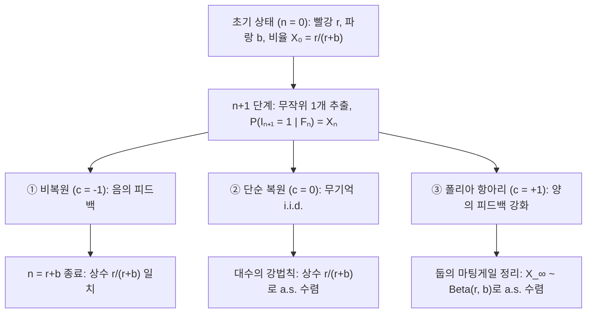
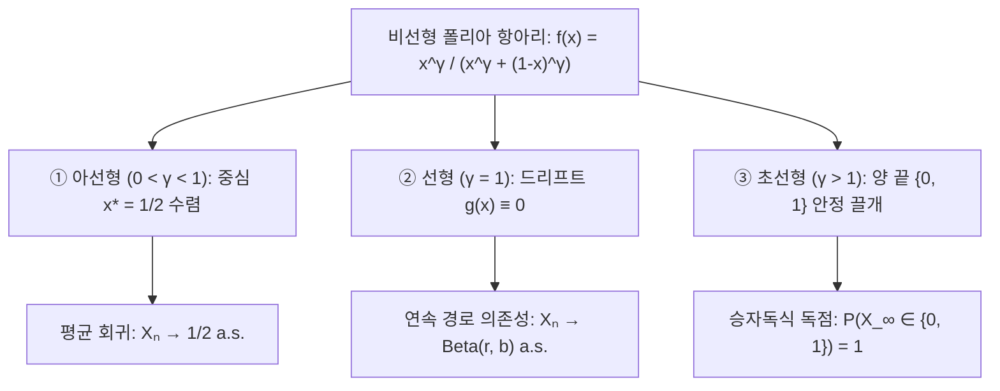

## 들어가며: 왜 처음 몇 번의 사소한 운이 돌이킬 수 없는 격차로 결정화되는가?

품질이 비슷한 두 영상이나 기술 표준이 동시에 출발해도, 초기에 우연히 얻은 미세한 우위가 양의 피드백을 통해 거대한 독점으로 이어지는 현상(<strong>마태 효과</strong>)이 자주 관찰됩니다. 반면 고전 확률론의 <strong>대수의 강법칙(SLLN)</strong>은 독립 항등 분포(i.i.d.) 동전 던지기에서 초기의 요동은 $n \to \infty$에 따라 소멸하고 표본 비율이 상수 $p$로 수렴한다고 가르칩니다.

현실이 대수의 법칙을 따르지 않는 이유는 과거의 결과가 미래에 같은 결과가 일어날 확률을 높이는 <strong>강화 확률 과정(Reinforced Stochastic Process)</strong>이기 때문입니다. 1923년 <strong>조지 폴리아(George Pólya)</strong>와 <strong>플로리안 에겐베르거</strong>가 고안한 <strong>폴리아의 항아리 모델</strong>은 두 가지 수학적 역설을 보여줍니다.
1. <strong>제1 역설(주변 확률 불변성과 교환 가능성)</strong>: 매 시행마다 항아리 구성이 바뀌어도 $n$번째에 빨간 구슬을 뽑을 무조건부 확률은 모든 $n$에서 $\frac{r}{r+b}$로 일정하며, 수열의 확률은 뽑힌 순서와 무관하게 총 개수에만 의존합니다(<strong>교환 가능성 / Exchangeability</strong>).
2. <strong>제2 역설(확률 변수로의 수렴)</strong>: $n \to \infty$일 때 빨간 구슬 비율 $X_n$은 상수가 아니라 각 경로마다 <strong>베타 분포 $\mathrm{Beta}(r, b)$를 따르는 확률 변수 $X_\infty$</strong>로 거의 확실하게 수렴합니다. 특히 $r=1, b=1$로 시작하면 극한 점유율은 $[0, 1]$ 위에서 <strong>연속 균등 분포 $\mathrm{Uniform}(0, 1)$</strong>를 따릅니다!

---

## 제1장: 세 가지 항아리 우주 — 비복원, 복원, 폴리아 강화 추출

초기 시점 $n = 0$에 빨간 구슬 $R_0 = r$개, 파란 구슬 $B_0 = b$개($N_0 = r + b$)가 있을 때, 매 단계 구슬 1개를 뽑아 색을 확인한 뒤 원래 구슬과 함께 같은 색 구슬을 $c$개 추가하여 되돌려 넣습니다.
- <strong>① 비복원 추출($c = -1$)</strong>: 뽑은 구슬을 제거합니다(음의 피드백, 초기하 분포).
- <strong>② 단순 복원 추출($c = 0$)</strong>: 뽑은 구슬만 돌려보내며($\mathrm{Binomial}(n, \frac{r}{r+b})$), 대수의 강법칙에 의해 상수 $\frac{r}{r+b}$로 수렴합니다.
- <strong>③ 폴리아의 항아리($c = +1$)</strong>: 뽑은 구슬과 함께 <strong>같은 색 구슬을 1개 더 추가</strong>해 넣습니다(양의 피드백).

$n$번째 추출이 빨강이면 $I_n = 1$, $S_n = \sum_{k=1}^n I_k$라 두면 총 구슬 수는 $N_n = r + b + n$이 되며 빨간 구슬 비율은 다음과 같습니다.

$$X_n := \frac{R_n}{N_n} = \frac{r + S_n}{r + b + n}, \qquad \mathbb{P}(I_{n+1} = 1 \mid \mathcal{F}_n) = X_n, \qquad |X_{n+1} - X_n| \le \frac{1}{r + b + n + 1}$$

| 비교 항목 | ① 비복원 추출 ($c = -1$) | ② 단순 복원 추출 ($c = 0$) | ③ 폴리아의 항아리 ($c = +1$) |
| :--- | :--- | :--- | :--- |
| <strong>피드백 성질</strong> | 음의 피드백 (고갈) | 피드백 없음 (무기억) | <strong>양의 피드백 (자기 강화)</strong> |
| <strong>통계적 관계</strong> | 음의 상관 | <strong>독립 항등 분포 (i.i.d.)</strong> | <strong>양의 상관, 무한 교환 가능</strong> |
| <strong>$S_n$의 분포</strong> | $\mathrm{Hypergeom}(N_0, r, n)$ | $\mathrm{Binomial}(n, \frac{r}{r+b})$ | <strong>$\mathrm{BetaBinom}(n, r, b)$</strong> |
| <strong>극한 $\lim_{n\to\infty} X_n$</strong> | 상수 $\frac{r}{r+b}$ 종료 | 상수 $\frac{r}{r+b}$로 a.s. 수렴 | <strong>$X_\infty \sim \mathrm{Beta}(r, b)$로 a.s. 수렴</strong> |

---

## 제2장: 제1 역설 — 교환 가능성(Exchangeability)과 베타-이항 분포

길이 $n$인 수열 $(i_1, \dots, i_n) \in \{0, 1\}^n$에서 빨강이 $k$번($\sum_{j=1}^n i_j = k$), 파랑이 $n-k$번 나올 때, 순서와 무관하게 분모의 곱은 항상 $(r+b)^{(n)}$이고 분자의 곱은 곱셈의 교환법칙에 의해 항상 $r^{(k)} b^{(n-k)}$입니다. 상승 계승 $x^{(m)} = \frac{\Gamma(x+m)}{\Gamma(x)}$을 쓰면 결합 확률과 $S_n$의 <strong>베타-이항 분포</strong>는 다음과 같습니다.

$$\mathbb{P}(I_1 = i_1, \dots, I_n = i_n) = \frac{r^{(k)} \, b^{(n-k)}}{(r+b)^{(n)}}, \qquad \mathbb{P}(S_n = k) = \binom{n}{k} \frac{\mathrm{B}(r+k, \, b+n-k)}{\mathrm{B}(r, \, b)}$$

따라서 $(I_1, I_2, \dots)$는 <strong>무한 교환 가능</strong>하며 모든 $n$에서 $\mathbb{P}(I_n = 1) = \frac{r}{r+b}$입니다. 특히 <strong>$r = 1, b = 1$</strong>일 때는 $\mathbb{P}(S_n = k) = \frac{1}{n + 1}$ ($k = 0, 1, \dots, n$)인 이산 균등 분포가 됩니다!

---

## 제3장: 제2 역설 — 둡의 마팅게일 수렴 정리와 $\mathrm{Beta}(r,b)$ 극한

$\mathbb{E}[R_{n+1} \mid \mathcal{F}_n] = R_n + X_n = (N_n + 1)X_n$이므로 비율 $X_n$은 $[0, 1]$ 위의 유계 <strong>마팅게일(Martingale)</strong>입니다.

$$\mathbb{E}[X_{n+1} \mid \mathcal{F}_n] = \frac{R_n + \mathbb{E}[I_{n+1} \mid \mathcal{F}_n]}{N_n + 1} = \frac{(N_n + 1) X_n}{N_n + 1} = X_n$$

<strong>둡의 마팅게일 수렴 정리</strong>에 의해 $X_n \xrightarrow{\text{a.s.}} X_\infty$가 성립하며, 감마 함수 점근식 $\frac{\Gamma(z+\alpha)}{\Gamma(z+\beta)} \sim z^{\alpha-\beta}$를 적용하면 $X_\infty$는 <strong>베타 분포 $\mathrm{Beta}(r, b)$</strong>를 따릅니다.

$$\boxed{f_{X_\infty}(p) = \frac{\Gamma(r+b)}{\Gamma(r)\Gamma(b)} \, p^{r-1} (1-p)^{b-1} \quad (0 < p < 1), \qquad \mathbb{E}[X_\infty] = \frac{r}{r+b}, \qquad \mathrm{Var}(X_\infty) = \frac{rb}{(r+b)^2(r+b+1)} > 0}$$

$r = 1, b = 1$이면 $f_{X_\infty}(p) = 1$이므로 $X_\infty \sim \mathrm{Uniform}(0, 1)$입니다.

---

## 제4장: 드 피네티 정리, 비선형 승자독식 상전이와 응용

1. <strong>드 피네티(de Finetti) 표현 정리(1931)</strong>: 무한 교환 가능 수열은 사전 분포 $\mathrm{Beta}(r,b)$에 대한 조건부 독립 베르누이 시행의 혼합으로 표현됩니다.
   $$\mathbb{P}(I_1 = i_1, \dots, I_n = i_n) = \int_0^1 p^k (1-p)^{n-k} \, \frac{\Gamma(r+b)}{\Gamma(r)\Gamma(b)} p^{r-1}(1-p)^{b-1} \, dp$$
2. <strong>비선형 폴리아 항아리와 승자독식 상전이</strong>: 비선형 함수 $f(x) = \frac{x^\gamma}{x^\gamma + (1-x)^\gamma}$에 대한 확률적 근사 방정식 $X_{n+1} - X_n = \frac{1}{N_n+1}[(f(X_n)-X_n) + \xi_{n+1}]$은 세 가지 상을 가집니다.

3. <strong>경제적 록인, 선호적 연결 멱법칙, 디리클레 과정</strong>:
   - <strong>W. 브라이언 아서(1989)의 기술 록인</strong>: 초선형 강화($\gamma > 1$)는 수확 체증 시장(QWERTY, VHS)의 독점 고착화를 설명합니다.
   - <strong>선호적 연결과 멱법칙(Yule-Simon / Barabási-Albert)</strong>: 확률 $\alpha$로 새 색상을 도입하면 <strong>멱법칙 분포</strong> $P(k) \sim k^{-(2 + \frac{1}{1-\alpha})}$가 도출됩니다.
   - <strong>디리클레 과정과 중국집 과정(Blackwell & MacQueen 1973)</strong>: 집중도 $\theta > 0$와 기저 분포 $H_0$에서 새 색상을 뽑는 극한은 <strong>디리클레 과정 $\mathrm{DP}(\theta, H_0)$</strong> 및 <strong>중국집 과정(CRP)</strong>이 됩니다.
   - <strong>MusicLab 실험과 4가지 한계</strong>: Salganik 등(2006)은 8개 평행 음악 시장 실험으로 사회적 강화의 불평등 증폭을 입증했으며, 현실 적용 시에는 <strong>내재적 품질 $\eta_i$</strong>, <strong>시장 포화</strong>, <strong>기억 감쇠</strong>, <strong>네트워크 구조</strong>의 한계를 고려해야 합니다.
