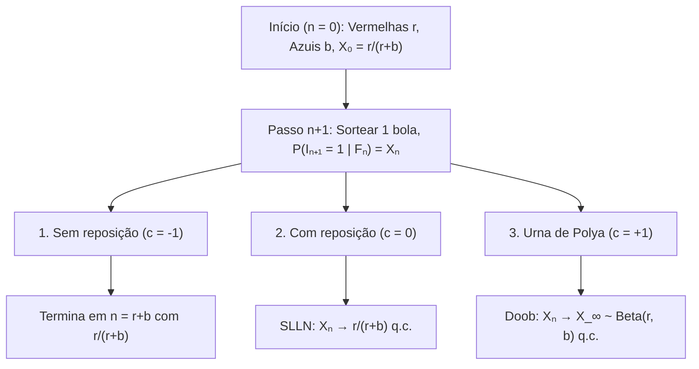
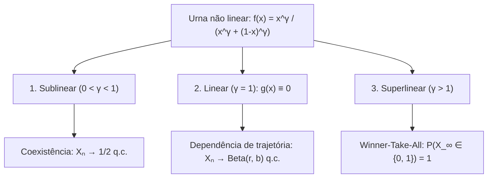

## Introdução: Por que alguns golpes de sorte no início se cristalizam em desigualdades irreversíveis?

Dois vídeos ou padrões de qualidade idêntica são lançados no mesmo instante: graças a uma pequena vantagem aleatória inicial, um deles se amplifica por retroalimentação positiva até dominar o mercado (<strong>efeito Mateus</strong>), enquanto o outro cai no esquecimento. Contudo, a <strong>Lei Forte dos Grandes Números (SLLN)</strong> ensina o oposto: em ensaios independentes (i.i.d.) como lançar uma moeda, as flutuações iniciais são diluídas quando $n \to \infty$ e a proporção converge quase certamente para a constante $p$.

Muitos processos reais são <strong>processos estocásticos reforçados</strong> nos quais a ocorrência de um evento aumenta a probabilidade de ele se repetir. Em 1923, <strong>George Pólya</strong> e <strong>Florian Eggenberger</strong> formularam o <strong>modelo da urna de Pólya</strong>, revelando dois paradoxos:
1. <strong>Primeiro paradoxo (Permutabilidade)</strong>: Embora a urna mude a cada passo, $\mathbb{P}(I_n = 1) = \frac{r}{r+b}$ permanece constante para todo $n$, e a probabilidade de qualquer sequência depende apenas do total de bolas vermelhas e azuis, independentemente da ordem (<strong>permutabilidade</strong>).
2. <strong>Segundo paradoxo (Limite aleatório)</strong>: Quando $n \to \infty$, a proporção vermelha $X_n$ converge quase certamente para uma variável aleatória $X_\infty \sim \mathrm{Beta}(r, b)$. Para $r=1, b=1$, o limite segue a <strong>distribuição uniforme $\mathrm{Uniform}(0, 1)$</strong> em $[0, 1]$!

---

## Capítulo 1: Três universos de urnas — Esgotamento, ausência de memória e reforço de Pólya

Em $n = 0$, uma urna contém $R_0 = r$ bolas vermelhas e $B_0 = b$ azuis ($N_0 = r + b$). Em cada passo sorteamos uma bola e a devolvemos com $c$ bolas da mesma cor: <strong>1. Sem reposição ($c = -1$)</strong> (retroalimentação negativa, hipergeométrica), <strong>2. Com reposição ($c = 0$)</strong> (sem memória i.i.d. $\mathrm{Binomial}(n, \frac{r}{r+b})$), <strong>3. Urna de Pólya ($c = +1$)</strong> (retroalimentação positiva: bola sorteada <strong>mais $1$ bola da mesma cor</strong>).

Com $I_n \in \{0, 1\}$ e $S_n = \sum_{k=1}^n I_k$, temos $R_n = r + S_n$ e $N_n = r + b + n$:

$$X_n := \frac{R_n}{N_n} = \frac{r + S_n}{r + b + n}, \qquad \mathbb{P}(I_{n+1} = 1 \mid \mathcal{F}_n) = X_n, \qquad |X_{n+1} - X_n| \le \frac{1}{r + b + n + 1}$$

| Característica | 1. Sem reposição ($c = -1$) | 2. Com reposição ($c = 0$) | 3. Urna de Pólya ($c = +1$) |
| :--- | :--- | :--- | :--- |
| <strong>Retroalimentação</strong> | Negativa (esgotamento) | Nula (sem memória) | <strong>Positiva (autorreforço)</strong> |
| <strong>Dependência</strong> | Correlação negativa | <strong>Independente (i.i.d.)</strong> | <strong>Infinitamente permutável</strong> |
| <strong>Distribuição $S_n$</strong> | $\mathrm{Hypergeom}(N_0, r, n)$ | $\mathrm{Binomial}(n, \frac{r}{r+b})$ | <strong>$\mathrm{BetaBinom}(n, r, b)$</strong> |
| <strong>Limite $X_\infty$</strong> | Constante $\frac{r}{r+b}$ | Constante $\frac{r}{r+b}$ q.c. | <strong>Variável $X_\infty \sim \mathrm{Beta}(r, b)$ q.c.</strong> |

---

## Capítulo 2: Permutabilidade e distribuição Beta-Binomial

Para qualquer sequência $(i_1, \dots, i_n) \in \{0, 1\}^n$ com $k = \sum_{j=1}^n i_j$ vermelhas, o produto dos denominadores é $(r+b)^{(n)}$ e o dos numeradores é comutativamente $r^{(k)} b^{(n-k)}$:

$$\mathbb{P}(I_1 = i_1, \dots, I_n = i_n) = \frac{r^{(k)} \, b^{(n-k)}}{(r+b)^{(n)}}, \qquad \mathbb{P}(S_n = k) = \binom{n}{k} \frac{\mathrm{B}(r+k, \, b+n-k)}{\mathrm{B}(r, \, b)}$$

Para <strong>$r = 1, b = 1$</strong>, os fatoriais se cancelam gerando a distribuição uniforme discreta $\mathbb{P}(S_n = k) = \frac{1}{n + 1}$ ($k = 0, 1, \dots, n$).

---

## Capítulo 3: Martingale de Doob e limite $\mathrm{Beta}(r,b)$

Como $\mathbb{E}[R_{n+1} \mid \mathcal{F}_n] = R_n + X_n = (N_n + 1)X_n$, a proporção $X_n$ é um <strong>martingale</strong> limitado em $[0, 1]$:

$$\mathbb{E}[X_{n+1} \mid \mathcal{F}_n] = \frac{R_n + \mathbb{E}[I_{n+1} \mid \mathcal{F}_n]}{N_n + 1} = \frac{(N_n + 1) X_n}{N_n + 1} = X_n$$

Pelo <strong>teorema de convergência de martingales de Doob</strong>, $X_n \xrightarrow{\text{q.c.}} X_\infty$. A assintótica $\frac{\Gamma(z+\alpha)}{\Gamma(z+\beta)} \sim z^{\alpha-\beta}$ para $k = \lfloor np \rfloor$ prova que $X_\infty$ segue a <strong>distribuição Beta $\mathrm{Beta}(r, b)$</strong>:

$$\boxed{f_{X_\infty}(p) = \frac{\Gamma(r+b)}{\Gamma(r)\Gamma(b)} \, p^{r-1} (1-p)^{b-1} \quad (0 < p < 1), \qquad \mathbb{E}[X_\infty] = \frac{r}{r+b}, \qquad \mathrm{Var}(X_\infty) = \frac{rb}{(r+b)^2(r+b+1)} > 0}$$

---

## Capítulo 4: Teorema de de Finetti, transições não lineares e aplicações

1. <strong>Teorema de representação de de Finetti (1931)</strong>: Toda sequência infinitamente permutável é uma mistura de ensaios de Bernoulli i.i.d. com distribuição a priori $\mathrm{Beta}(r,b)$:
   $$\mathbb{P}(I_1 = i_1, \dots, I_n = i_n) = \int_0^1 p^k (1-p)^{n-k} \, \frac{\Gamma(r+b)}{\Gamma(r)\Gamma(b)} p^{r-1}(1-p)^{b-1} \, dp$$
2. <strong>Urnas não lineares ($f(x) = \frac{x^\gamma}{x^\gamma + (1-x)^\gamma}$)</strong>: $X_{n+1} - X_n = \frac{1}{N_n+1}[(f(X_n)-X_n) + \xi_{n+1}]$ produz três regimes:

3. <strong>Aplicações e limites</strong>: <strong>W. Brian Arthur (1989)</strong> explica o lock-in ($\gamma > 1$, QWERTY, VHS); a <strong>ligação preferencial (Yule–Simon / Barabási–Albert)</strong> gera $P(k) \sim k^{-(2 + \frac{1}{1-\alpha})}$; amostrar novas cores ($\theta > 0$, $H_0$) converge para o <strong>processo de Dirichlet $\mathrm{DP}(\theta, H_0)$ (CRP)</strong>; <strong>MusicLab (Salganik et al. 2006)</strong> valida esses efeitos sob quatro limites: <strong>aptidão $\eta_i$</strong>, <strong>saturação</strong>, <strong>memória</strong> e <strong>rede</strong>.
