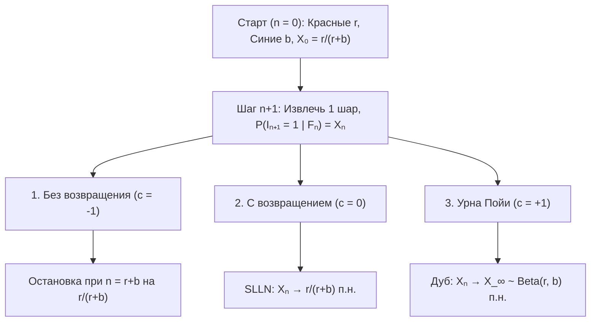
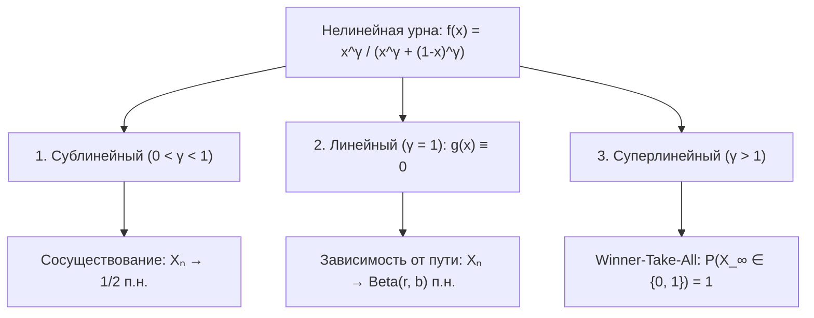

## Введение: почему несколько случайных удач на старте превращаются в необратимый разрыв?

Два видеоролика или стандарта одинакового качества запускаются одновременно: благодаря крошечному перевесу на старте один из них за счет положительной обратной связи захватывает рынок (<strong>эффект Матфея</strong>), а другой остается в тени. Однако <strong>усиленный закон больших чисел (SLLN)</strong> утверждает обратное: в независимых (i.i.d.) испытаниях Бернулли начальные флуктуации размываются при $n \to \infty$, и доля почти наверное сходится к константе $p$.

Многие реальные процессы являются <strong>случайными процессами с подкреплением</strong>, где наступление события повышает вероятность его повторения. В 1923 году <strong>Джордж Пойа</strong> и <strong>Флориан Эггенбергер</strong> предложили <strong>модель урны Пойи</strong>, открыв два парадокса:
1. <strong>Первый парадокс (Перестановочность)</strong>: Хотя состав урны меняется на каждом шаге, $\mathbb{P}(I_n = 1) = \frac{r}{r+b}$ постоянна для всех $n$, а вероятность любой последовательности зависит только от числа красных и синих шаров, но не от их порядка (<strong>перестановочность</strong>).
2. <strong>Второй парадокс (Случайный предел)</strong>: При $n \to \infty$ доля красных шаров $X_n$ почти наверное сходится к случайной величине $X_\infty \sim \mathrm{Beta}(r, b)$. При $r=1, b=1$ предел имеет <strong>равномерное распределение $\mathrm{Uniform}(0, 1)$</strong> на $[0, 1]$!

---

## Глава 1: Три вселенные урн — исчерпание, отсутствие памяти и подкрепление Пойи

При $n = 0$ в урне $R_0 = r$ красных и $B_0 = b$ синих шаров ($N_0 = r + b$). На каждом шаге извлекается один шар и возвращается вместе с $c$ шарами того же цвета: <strong>1. Без возвращения ($c = -1$)</strong> (отрицательная связь, гипергеометрическое), <strong>2. С возвращением ($c = 0$)</strong> (без памяти i.i.d. $\mathrm{Binomial}(n, \frac{r}{r+b})$), <strong>3. Урна Пойи ($c = +1$)</strong> (положительная связь: шар <strong>плюс $1$ шар того же цвета</strong>).

Пусть $I_n \in \{0, 1\}$ и $S_n = \sum_{k=1}^n I_k$, тогда $R_n = r + S_n$ и $N_n = r + b + n$:

$$X_n := \frac{R_n}{N_n} = \frac{r + S_n}{r + b + n}, \qquad \mathbb{P}(I_{n+1} = 1 \mid \mathcal{F}_n) = X_n, \qquad |X_{n+1} - X_n| \le \frac{1}{r + b + n + 1}$$

| Характеристика | 1. Без возвращения ($c = -1$) | 2. С возвращением ($c = 0$) | 3. Урна Пойи ($c = +1$) |
| :--- | :--- | :--- | :--- |
| <strong>Обратная связь</strong> | Отрицательная (исчерпание) | Отсутствует (без памяти) | <strong>Положительная (самоподкрепление)</strong> |
| <strong>Зависимость</strong> | Отрицательная корреляция | <strong>Независимость (i.i.d.)</strong> | <strong>Бесконечно перестановочна</strong> |
| <strong>Распределение $S_n$</strong> | $\mathrm{Hypergeom}(N_0, r, n)$ | $\mathrm{Binomial}(n, \frac{r}{r+b})$ | <strong>$\mathrm{BetaBinom}(n, r, b)$</strong> |
| <strong>Предел $X_\infty$</strong> | Константа $\frac{r}{r+b}$ | Константа $\frac{r}{r+b}$ п.н. | <strong>Величина $X_\infty \sim \mathrm{Beta}(r, b)$ п.н.</strong> |

---

## Глава 2: Перестановочность и бета-биномиальное распределение

Для любой последовательности $(i_1, \dots, i_n) \in \{0, 1\}^n$ с $k = \sum_{j=1}^n i_j$ красными шарами произведение знаменателей равно $(r+b)^{(n)}$, а числителей коммутативно равно $r^{(k)} b^{(n-k)}$:

$$\mathbb{P}(I_1 = i_1, \dots, I_n = i_n) = \frac{r^{(k)} \, b^{(n-k)}}{(r+b)^{(n)}}, \qquad \mathbb{P}(S_n = k) = \binom{n}{k} \frac{\mathrm{B}(r+k, \, b+n-k)}{\mathrm{B}(r, \, b)}$$

При <strong>$r = 1, b = 1$</strong> факториалы сокращаются в дискретное равномерное распределение $\mathbb{P}(S_n = k) = \frac{1}{n + 1}$ ($k = 0, 1, \dots, n$).

---

## Глава 3: Мартингал Дуба и предел $\mathrm{Beta}(r,b)$

Так как $\mathbb{E}[R_{n+1} \mid \mathcal{F}_n] = R_n + X_n = (N_n + 1)X_n$, доля $X_n$ образует ограниченный <strong>мартингал</strong> на $[0, 1]$:

$$\mathbb{E}[X_{n+1} \mid \mathcal{F}_n] = \frac{R_n + \mathbb{E}[I_{n+1} \mid \mathcal{F}_n]}{N_n + 1} = \frac{(N_n + 1) X_n}{N_n + 1} = X_n$$

По <strong>теореме Дуба о сходимости мартингалов</strong>, $X_n \xrightarrow{\text{п.н.}} X_\infty$. Асимптотика $\frac{\Gamma(z+\alpha)}{\Gamma(z+\beta)} \sim z^{\alpha-\beta}$ при $k = \lfloor np \rfloor$ доказывает, что $X_\infty$ имеет <strong>бета-распределение $\mathrm{Beta}(r, b)$</strong>:

$$\boxed{f_{X_\infty}(p) = \frac{\Gamma(r+b)}{\Gamma(r)\Gamma(b)} \, p^{r-1} (1-p)^{b-1} \quad (0 < p < 1), \qquad \mathbb{E}[X_\infty] = \frac{r}{r+b}, \qquad \mathrm{Var}(X_\infty) = \frac{rb}{(r+b)^2(r+b+1)} > 0}$$

---

## Глава 4: Теорема де Финетти, нелинейные переходы и приложения

1. <strong>Теорема представления де Финетти (1931)</strong>: Любая бесконечно перестановочная последовательность есть смесь независимых испытаний Бернулли с априорной мерой $\mathrm{Beta}(r,b)$:
   $$\mathbb{P}(I_1 = i_1, \dots, I_n = i_n) = \int_0^1 p^k (1-p)^{n-k} \, \frac{\Gamma(r+b)}{\Gamma(r)\Gamma(b)} p^{r-1}(1-p)^{b-1} \, dp$$
2. <strong>Нелинейные урны ($f(x) = \frac{x^\gamma}{x^\gamma + (1-x)^\gamma}$)</strong>: $X_{n+1} - X_n = \frac{1}{N_n+1}[(f(X_n)-X_n) + \xi_{n+1}]$ порождает три режима:

3. <strong>Приложения и ограничения</strong>: <strong>W. Brian Arthur (1989)</strong> объясняет Lock-In ($\gamma > 1$, QWERTY, VHS); <strong>предпочтительное присоединение (Юл–Саймон / Барабаши–Альберт)</strong> порождает $P(k) \sim k^{-(2 + \frac{1}{1-\alpha})}$; цвета с весом $\theta > 0$ из $H_0$ сходятся к <strong>процессу Дирихле $\mathrm{DP}(\theta, H_0)$ (CRP)</strong>; <strong>MusicLab (Salganik et al. 2006)</strong> выделяет четыре границы: <strong>качество $\eta_i$</strong>, <strong>насыщение</strong>, <strong>память</strong> и <strong>сеть</strong>.
