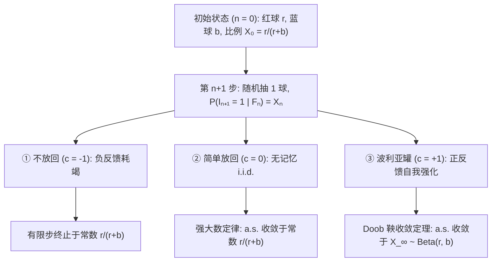
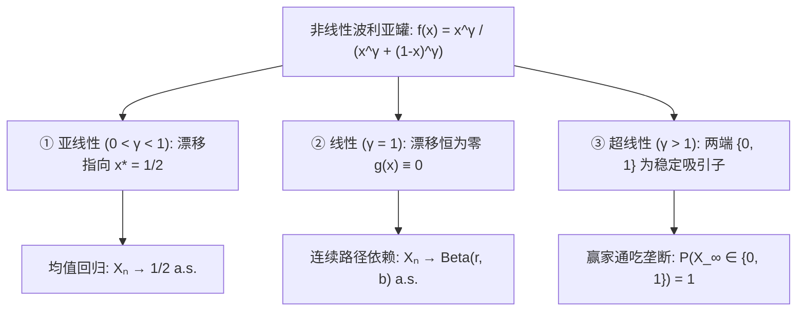

## 引言：为什么最初几次微小的运气会固化为不可逆转的差距？

在现实世界中，两个质量几乎相同的视频或技术标准同时起步，最初几次偶然的点击或采用往往会像滚雪球一样通过正反馈不断放大，最终形成巨大的市场垄断（<strong>马太效应 / Matthew Effect</strong>）。然而，初等概率论中的<strong>强大数定律（Strong Law of Large Numbers, SLLN）</strong>却告诉我们：在独立同分布（i.i.d.）的抛硬币试验中，初期的随机波动随着试验次数 $n \to \infty$ 必然被分母稀释，样本比例几乎必然收敛于常数 $p$。

为什么现实世界往往违背大数定律？因为许多社会与自然过程并非“无记忆的独立试验”，而是<strong>强化随机过程（Reinforced Stochastic Process）</strong>——过去发生的结果会主动改变系统状态，提高同一结果在未来再次发生的概率。1923年，数学家<strong>乔治·波利亚（George Pólya）</strong>与学生<strong>弗洛里安·埃根伯格（Florian Eggenberger）</strong>为了模拟传染病扩散，提出了著名的<strong>波利亚罐模型（Pólya's Urn Model）</strong>，揭示了两个惊人的数学悖论：
1. <strong>第一悖论（边缘概率不变性与可交换性）</strong>：尽管每次抽球后罐内成分都在改变，第 $n$ 次抽出红球的无条件边缘概率对所有 $n$ 恒为 $\frac{r}{r+b}$，且任意抽取序列的概率仅取决于红蓝球的总次数，与出现的先后顺序完全无关（<strong>可交换性 / Exchangeability</strong>）。
2. <strong>第二悖论（向随机极限的几乎必然收敛）</strong>：当 $n \to \infty$ 时，红球比例 $X_n$ 不会像大数定律那样收敛到常数，而是沿每条样本路径几乎必然收敛（锁定）到一个<strong>服从 $\mathrm{Beta}(r, b)$ 分布的随机变量 $X_\infty$</strong>。特别地，当初始为1红1蓝（$r=1, b=1$）时，极限比例服从 $[0, 1]$ 上的<strong>连续均匀分布 $\mathrm{Uniform}(0, 1)$</strong>！

---

## 第一章：三种抽样宇宙——不放回、放回与波利亚正反馈强化

设时刻 $n = 0$ 时罐中有 $R_0 = r$ 个红球和 $B_0 = b$ 个蓝球（总数 $N_0 = r + b$）。每次随机抽取一球观察颜色后，连同原球额外放入 $c$ 个同色球：
- <strong>① 不放回抽样（$c = -1$，负反馈耗竭）</strong>：抽出的球不放回，服从超几何分布，在 $n = r+b$ 时样本比例确定性地等于 $\frac{r}{r+b}$。
- <strong>② 简单放回抽样（$c = 0$，无记忆 i.i.d.）</strong>：只将原球放回，红球数服从二项分布 $\mathrm{Binomial}(n, \frac{r}{r+b})$，由强大数定律几乎必然收敛于常数 $\frac{r}{r+b}$。
- <strong>③ 波利亚罐模型（$c = +1$，正反馈自我强化）</strong>：将原球放回并<strong>额外加入 $1$ 个同色球</strong>。

记第 $n$ 次抽出红球的指示变量为 $I_n \in \{0, 1\}$，前 $n$ 次红球总数为 $S_n = \sum_{k=1}^n I_k$。第 $n$ 步后红球数 $R_n = r + S_n$，总球数确定性地增长为 $N_n = r + b + n$。红球比例与单步变化上界为：

$$X_n := \frac{R_n}{N_n} = \frac{r + S_n}{r + b + n}, \qquad \mathbb{P}(I_{n+1} = 1 \mid \mathcal{F}_n) = X_n, \qquad |X_{n+1} - X_n| \le \frac{1}{r + b + n + 1}$$

当初期分母极小时（如 $r=b=1$），第1次抽到红球会使比例从 $50\%$ 跃升至 $66.7\%$；而当后期分母极大时，单次抽样几乎无法改变宏观比例。

| 比较维度 | ① 不放回抽样 ($c = -1$) | ② 简单放回抽样 ($c = 0$) | ③ 波利亚罐模型 ($c = +1$) |
| :--- | :--- | :--- | :--- |
| <strong>反馈机制</strong> | 负反馈（耗竭抑制） | 无反馈（无记忆 i.i.d.） | <strong>正反馈（自我强化与传染）</strong> |
| <strong>序列统计性质</strong> | 负相关、有限可交换 | 独立同分布（i.i.d.） | <strong>强正相关、无限可交换</strong> |
| <strong>$S_n$ 的分布</strong> | $\mathrm{Hypergeom}(N_0, r, n)$ | $\mathrm{Binomial}(n, \frac{r}{r+b})$ | <strong>$\mathrm{BetaBinom}(n, r, b)$</strong> |
| <strong>极限 $\lim_{n\to\infty} X_n$</strong> | 终止于常数 $\frac{r}{r+b}$ | a.s. 收敛于常数 $\frac{r}{r+b}$ | <strong>a.s. 收敛于 $X_\infty \sim \mathrm{Beta}(r, b)$</strong> |

---

## 第二章：第一悖论——无限可交换性与 Beta-二项分布

任意长为 $n$、包含 $k$ 个红球（$\sum_{j=1}^n i_j = k$）和 $n-k$ 个蓝球的序列 $(i_1, \dots, i_n) \in \{0, 1\}^n$，无论顺序如何，第 $j$ 步的分母恒为 $r+b+j-1$，而第 $m$ 次红球的分子恒为 $r+m-1$，第 $\ell$ 次蓝球的分子恒为 $b+\ell-1$。利用上升阶乘 $x^{(m)} = \frac{\Gamma(x+m)}{\Gamma(x)}$，联合概率与乘以 $\binom{n}{k}$ 后的 <strong>Beta-二项分布</strong>为：

$$\mathbb{P}(I_1 = i_1, \dots, I_n = i_n) = \frac{r^{(k)} \, b^{(n-k)}}{(r+b)^{(n)}}, \qquad \mathbb{P}(S_n = k) = \binom{n}{k} \frac{\mathrm{B}(r+k, \, b+n-k)}{\mathrm{B}(r, \, b)}$$

因此序列满足<strong>无限可交换性</strong>，且对所有 $n$ 有 $\mathbb{P}(I_n = 1) = \frac{r}{r+b}$。当 <strong>$r = 1, b = 1$</strong> 时，$1^{(k)} = k!$，$2^{(n)} = (n+1)!$，约分后得到离散均匀分布 $\mathbb{P}(S_n = k) = \frac{1}{n + 1}$（$k = 0, 1, \dots, n$）：抽取100次时，抽到0个、50个或100个红球的概率完全相等，均为 $\frac{1}{101}$！

---

## 第三章：第二悖论——Doob 鞅收敛定理与 $\mathrm{Beta}(r,b)$ 极限

给定 $\mathcal{F}_n$，由 $\mathbb{E}[R_{n+1} \mid \mathcal{F}_n] = R_n + X_n = (N_n + 1)X_n$ 可得有界<strong>鞅（Martingale）</strong>性质：

$$\mathbb{E}[X_{n+1} \mid \mathcal{F}_n] = \frac{R_n + \mathbb{E}[I_{n+1} \mid \mathcal{F}_n]}{N_n + 1} = \frac{(N_n + 1) X_n}{N_n + 1} = X_n$$

由<strong>Doob 鞅收敛定理</strong>，存在随机变量 $X_\infty \in [0, 1]$ 使得 $X_n \xrightarrow{\text{a.s.}} X_\infty$。利用伽马函数渐近式 $\frac{\Gamma(z+\alpha)}{\Gamma(z+\beta)} \sim z^{\alpha-\beta}$ 对 $k = \lfloor np \rfloor$ 取极限，可得 $X_\infty$ 服从 <strong>$\mathrm{Beta}(r, b)$ 分布</strong>：

$$\boxed{f_{X_\infty}(p) = \frac{\Gamma(r+b)}{\Gamma(r)\Gamma(b)} \, p^{r-1} (1-p)^{b-1} \quad (0 < p < 1), \qquad \mathbb{E}[X_\infty] = \frac{r}{r+b}, \qquad \mathrm{Var}(X_\infty) = \frac{rb}{(r+b)^2(r+b+1)} > 0}$$

当 $r = 1, b = 1$ 时，$f_{X_\infty}(p) = 1$，即 $X_\infty \sim \mathrm{Uniform}(0, 1)$。

---

## 第四章：de Finetti 定理、非线性赢家通吃相变与社会应用

1. <strong>非遍历性与 de Finetti 表示定理（1931）</strong>：波利亚罐具有非零渐近方差。由<strong>de Finetti 表示定理</strong>，无限可交换序列等价于以 $\mathrm{Beta}(r,b)$ 为先验分布的条件独立伯努利试验混合：
   $$\mathbb{P}(I_1 = i_1, \dots, I_n = i_n) = \int_0^1 p^k (1-p)^{n-k} \, \frac{\Gamma(r+b)}{\Gamma(r)\Gamma(b)} p^{r-1}(1-p)^{b-1} \, dp$$
   这意味着“无先验差异但正反馈强化的自下而上过程”与“先天决定潜在能力 $P \sim \mathrm{Beta}(r,b)$ 的自上而下贝叶斯过程”在观测上完全同构！
2. <strong>非线性波利亚罐与赢家通吃相变（Hill, Lane & Sudderth 1980; Arthur 1989）</strong>：对非线性强化函数 $f(x) = \frac{x^\gamma}{x^\gamma + (1-x)^\gamma}$，随机近似方程 $X_{n+1} - X_n = \frac{1}{N_n+1}[(f(X_n)-X_n) + \xi_{n+1}]$ 产生三种相态：

3. <strong>经济锁定、优先连接幂律与狄利克雷过程</strong>：
   - <strong>W. Brian Arthur（1989）的技术锁定</strong>：超线性强化（$\gamma > 1$）解释了 QWERTY 键盘与 VHS 标准中的收益递增与历史锁定（Lock-In）。
   - <strong>优先连接与幂律（Yule-Simon / Barabási-Albert）</strong>：以概率 $\alpha$ 引入新颜色球并按比例强化现有颜色，导出无标度网络的<strong>幂律分布</strong> $P(k) \sim k^{-(2 + \frac{1}{1-\alpha})}$。
   - <strong>狄利克雷过程与中餐馆过程（Blackwell & MacQueen 1973）</strong>：以权重 $\theta > 0$ 从连续基分布 $H_0$ 抽新颜色的极限即为<strong>狄利克雷过程 $\mathrm{DP}(\theta, H_0)$</strong> 与<strong>中餐馆过程（CRP）</strong>。
   - <strong>MusicLab 实验与四大局限</strong>：Salganik 等（2006）通过8个平行音乐市场证实了社会强化会放大不平等与不可预测性；现实应用需注意<strong>内在适应度差异（Fitness $\eta_i$）</strong>、<strong>市场饱和</strong>、<strong>记忆衰减</strong>与<strong>网络拓扑</strong>四大局限。
