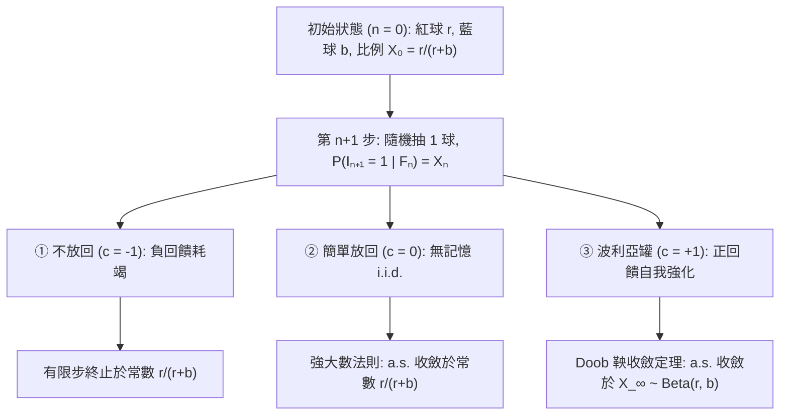
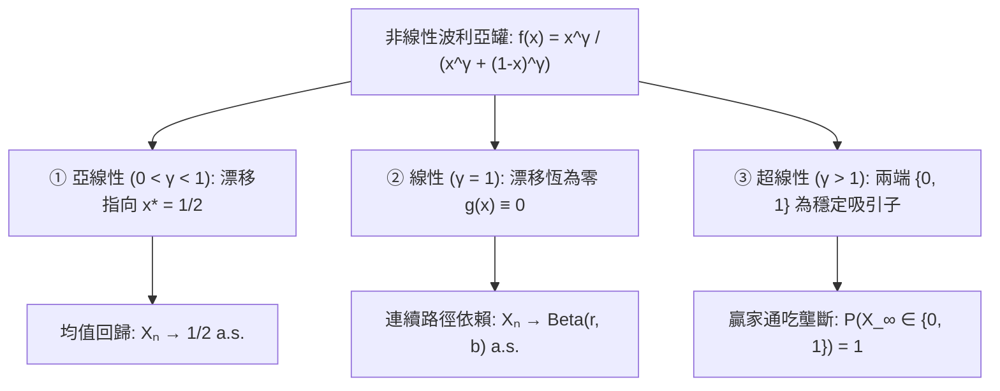

## 引言：為什麼最初幾次微小的運氣會固化為不可逆轉的差距？

在現實世界中，兩個品質幾乎相同的影片或技術標準同時起步，最初幾次偶然的點擊或採用往往會像滾雪球一樣透過正回饋不斷放大，最終形成巨大的市場壟斷（<strong>馬太效應 / Matthew Effect</strong>）。然而，初等機率論中的<strong>強大數法則（Strong Law of Large Numbers, SLLN）</strong>卻告訴我們：在獨立同分佈（i.i.d.）的擲硬幣試驗中，初期的隨機波動隨著試驗次數 $n \to \infty$ 必然被分母稀釋，樣本比例幾乎必然收斂於常數 $p$。

為什麼現實世界往往違背大數法則？因為許多社會與自然過程並非「無記憶的獨立試驗」，而是<strong>強化隨機過程（Reinforced Stochastic Process）</strong>——過去發生的結果會主動改變系統狀態，提高同一結果在未來再次發生的機率。1923年，數學家<strong>喬治·波利亞（George Pólya）</strong>與學生<strong>弗洛里安·埃根伯格（Florian Eggenberger）</strong>為了模擬傳染病擴散，提出了著名的<strong>波利亞罐模型（Pólya's Urn Model）</strong>，揭示了兩個驚人的數學悖論：
1. <strong>第一悖論（邊際機率不變性與可交換性）</strong>：儘管每次抽球後罐內成分都在改變，第 $n$ 次抽出紅球的無條件邊際機率對所有 $n$ 恆為 $\frac{r}{r+b}$，且任意抽取序列的機率僅取決於紅藍球的總次數，與出現的先後順序完全無關（<strong>可交換性 / Exchangeability</strong>）。
2. <strong>第二悖論（向隨機極限的幾乎必然收斂）</strong>：當 $n \to \infty$ 時，紅球比例 $X_n$ 不會像大數法則那樣收斂到常數，而是沿每條樣本路徑幾乎必然收斂（鎖定）到一個<strong>服從 $\mathrm{Beta}(r, b)$ 分佈的隨機變數 $X_\infty$</strong>。特別地，當初始為1紅1藍（$r=1, b=1$）時，極限比例服從 $[0, 1]$ 上的<strong>連續均勻分佈 $\mathrm{Uniform}(0, 1)$</strong>！

---

## 第一章：三種抽樣宇宙——不放回、放回與波利亞正回饋強化

設時刻 $n = 0$ 時罐中有 $R_0 = r$ 個紅球和 $B_0 = b$ 個藍球（總數 $N_0 = r + b$）。每次隨機抽取一球觀察顏色後，連同原球額外放入 $c$ 個同色球：
- <strong>① 不放回抽樣（$c = -1$，負回饋耗竭）</strong>：抽出的球不放回，服從超幾何分佈，在 $n = r+b$ 時樣本比例確定性地等於 $\frac{r}{r+b}$。
- <strong>② 簡單放回抽樣（$c = 0$，無記憶 i.i.d.）</strong>：只將原球放回，紅球數服從二項分佈 $\mathrm{Binomial}(n, \frac{r}{r+b})$，由強大數法則幾乎必然收斂於常數 $\frac{r}{r+b}$。
- <strong>③ 波利亞罐模型（$c = +1$，正回饋自我強化）</strong>：將原球放回並<strong>額外加入 $1$ 個同色球</strong>。

記第 $n$ 次抽出紅球的指示變數為 $I_n \in \{0, 1\}$，前 $n$ 次紅球總數為 $S_n = \sum_{k=1}^n I_k$。第 $n$ 步後紅球數 $R_n = r + S_n$，總球數確定性地增長為 $N_n = r + b + n$。紅球比例與單步變化上界為：

$$X_n := \frac{R_n}{N_n} = \frac{r + S_n}{r + b + n}, \qquad \mathbb{P}(I_{n+1} = 1 \mid \mathcal{F}_n) = X_n, \qquad |X_{n+1} - X_n| \le \frac{1}{r + b + n + 1}$$

當初期分母極小時（如 $r=b=1$），第1次抽到紅球會使比例從 $50\%$ 躍升至 $66.7\%$；而當後期分母極大時，單次抽樣幾乎無法改變宏觀比例。

| 比較維度 | ① 不放回抽樣 ($c = -1$) | ② 簡單放回抽樣 ($c = 0$) | ③ 波利亞罐模型 ($c = +1$) |
| :--- | :--- | :--- | :--- |
| <strong>回饋機制</strong> | 負回饋（耗竭抑制） | 無回饋（無記憶 i.i.d.） | <strong>正回饋（自我強化與傳染）</strong> |
| <strong>序列統計性質</strong> | 負相關、有限可交換 | 獨立同分佈（i.i.d.） | <strong>強正相關、無限可交換</strong> |
| <strong>$S_n$ 的分佈</strong> | $\mathrm{Hypergeom}(N_0, r, n)$ | $\mathrm{Binomial}(n, \frac{r}{r+b})$ | <strong>$\mathrm{BetaBinom}(n, r, b)$</strong> |
| <strong>極限 $\lim_{n\to\infty} X_n$</strong> | 終止於常數 $\frac{r}{r+b}$ | a.s. 收斂於常數 $\frac{r}{r+b}$ | <strong>a.s. 收斂於 $X_\infty \sim \mathrm{Beta}(r, b)$</strong> |

---

## 第二章：第一悖論——無限可交換性與 Beta-二項分佈

任意長為 $n$、包含 $k$ 個紅球（$\sum_{j=1}^n i_j = k$）和 $n-k$ 個藍球的序列 $(i_1, \dots, i_n) \in \{0, 1\}^n$，無論順序如何，第 $j$ 步的分母恆為 $r+b+j-1$，而第 $m$ 次紅球的分子恆為 $r+m-1$，第 $\ell$ 次藍球的分子恆為 $b+\ell-1$。利用上升階乘 $x^{(m)} = \frac{\Gamma(x+m)}{\Gamma(x)}$，聯合機率與乘以 $\binom{n}{k}$ 後的 <strong>Beta-二項分佈</strong>為：

$$\mathbb{P}(I_1 = i_1, \dots, I_n = i_n) = \frac{r^{(k)} \, b^{(n-k)}}{(r+b)^{(n)}}, \qquad \mathbb{P}(S_n = k) = \binom{n}{k} \frac{\mathrm{B}(r+k, \, b+n-k)}{\mathrm{B}(r, \, b)}$$

因此序列滿足<strong>無限可交換性</strong>，且對所有 $n$ 有 $\mathbb{P}(I_n = 1) = \frac{r}{r+b}$。當 <strong>$r = 1, b = 1$</strong> 時，$1^{(k)} = k!$，$2^{(n)} = (n+1)!$，約分後得到離散均勻分佈 $\mathbb{P}(S_n = k) = \frac{1}{n + 1}$（$k = 0, 1, \dots, n$）：抽取100次時，抽到0個、50個或100個紅球的機率完全相等，均為 $\frac{1}{101}$！

---

## 第三章：第二悖論——Doob 鞅收斂定理與 $\mathrm{Beta}(r,b)$ 極限

給定 $\mathcal{F}_n$，由 $\mathbb{E}[R_{n+1} \mid \mathcal{F}_n] = R_n + X_n = (N_n + 1)X_n$ 可得有界<strong>鞅（Martingale）</strong>性質：

$$\mathbb{E}[X_{n+1} \mid \mathcal{F}_n] = \frac{R_n + \mathbb{E}[I_{n+1} \mid \mathcal{F}_n]}{N_n + 1} = \frac{(N_n + 1) X_n}{N_n + 1} = X_n$$

由<strong>Doob 鞅收斂定理</strong>，存在隨機變數 $X_\infty \in [0, 1]$ 使得 $X_n \xrightarrow{\text{a.s.}} X_\infty$。利用伽馬函數漸近式 $\frac{\Gamma(z+\alpha)}{\Gamma(z+\beta)} \sim z^{\alpha-\beta}$ 對 $k = \lfloor np \rfloor$ 取極限，可得 $X_\infty$ 服從 <strong>$\mathrm{Beta}(r, b)$ 分佈</strong>：

$$\boxed{f_{X_\infty}(p) = \frac{\Gamma(r+b)}{\Gamma(r)\Gamma(b)} \, p^{r-1} (1-p)^{b-1} \quad (0 < p < 1), \qquad \mathbb{E}[X_\infty] = \frac{r}{r+b}, \qquad \mathrm{Var}(X_\infty) = \frac{rb}{(r+b)^2(r+b+1)} > 0}$$

當 $r = 1, b = 1$ 時，$f_{X_\infty}(p) = 1$，即 $X_\infty \sim \mathrm{Uniform}(0, 1)$。

---

## 第四章：de Finetti 定理、非線性贏家通吃相變與社會應用

1. <strong>非遍歷性與 de Finetti 表示定理（1931）</strong>：波利亞罐具有非零漸近變異數。由<strong>de Finetti 表示定理</strong>，無限可交換序列等價於以 $\mathrm{Beta}(r,b)$ 為先驗分佈的條件獨立伯努利試驗混合：
   $$\mathbb{P}(I_1 = i_1, \dots, I_n = i_n) = \int_0^1 p^k (1-p)^{n-k} \, \frac{\Gamma(r+b)}{\Gamma(r)\Gamma(b)} p^{r-1}(1-p)^{b-1} \, dp$$
   這意味著「無先驗差異但正回饋強化的自下而上過程」與「先天決定潛在能力 $P \sim \mathrm{Beta}(r,b)$ 的自上而下貝氏過程」在觀測上完全同構！
2. <strong>非線性波利亞罐與贏家通吃相變（Hill, Lane & Sudderth 1980; Arthur 1989）</strong>：對非線性強化函數 $f(x) = \frac{x^\gamma}{x^\gamma + (1-x)^\gamma}$，隨機近似方程 $X_{n+1} - X_n = \frac{1}{N_n+1}[(f(X_n)-X_n) + \xi_{n+1}]$ 產生三種相態：

3. <strong>經濟鎖定、優先連接冪律與狄利克雷過程</strong>：
   - <strong>W. Brian Arthur（1989）的技術鎖定</strong>：超線性強化（$\gamma > 1$）解釋了 QWERTY 鍵盤與 VHS 標準中的報酬遞增與歷史鎖定（Lock-In）。
   - <strong>優先連接與冪律（Yule-Simon / Barabási-Albert）</strong>：以機率 $\alpha$ 引入新顏色球並按比例強化現有顏色，導出無尺度網路的<strong>冪律分佈</strong> $P(k) \sim k^{-(2 + \frac{1}{1-\alpha})}$。
   - <strong>狄利克雷過程與中餐館過程（Blackwell & MacQueen 1973）</strong>：以權重 $\theta > 0$ 從連續基分佈 $H_0$ 抽新顏色的極限即為<strong>狄利克雷過程 $\mathrm{DP}(\theta, H_0)$</strong> 與<strong>中餐館過程（CRP）</strong>。
   - <strong>MusicLab 實驗與四大局限</strong>：Salganik 等（2006）透過8個平行音樂市場證實了社會強化會放大不平等與不可預測性；現實應用需注意<strong>內在適應度差異（Fitness $\eta_i$）</strong>、<strong>市場飽和</strong>、<strong>記憶衰減</strong>與<strong>網路拓撲</strong>四大局限。
