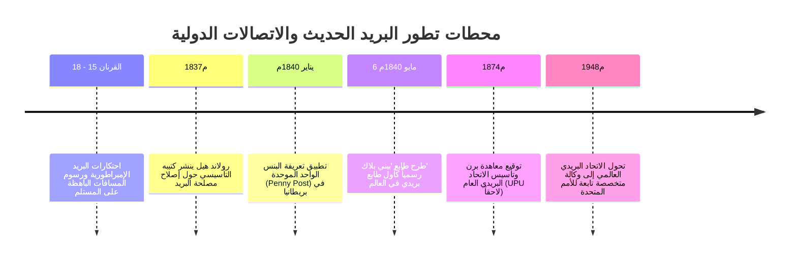

حين نرسل اليوم بريداً إلكترونياً أو رسالة فورية، لا يُفرض علينا أي رسم إضافي بناءً على بُعد المسافة التي تفصلنا عن المتلقي. وكذلك عند إرسال طرد بريدي تقليدي، يعتبر قيام المرسل بدفع الأجرة مسبقاً عبر الطوابع من البديهيات الإنسانية المطلقة.

غير أنه قبل عام 1840م، كانت هذه المفاهيم مقلوبة رأساً على عقب: إذ كانت رسوم البريد تُحسب بناءً على **المسافة المقطوعة** و**عدد صفحات الورق**، وكانت تُدفع **نقداً بواسطة المتلقي عند وصول الرسالة إلى عتبة بيته**. وبالنسبة للطبقات العاملة الكادحة، كان وصول رسالة مفاجئة يعني تبديد دخل يوم عمل كامل لسداد نفقاتها.

تغير هذا الواقع بفضل المصلح البريطاني **سير رولاند هيل (Rowland Hill)** الذي أطلق ثورة التعريفة الموحدة وأصدر أول طابع بريد لاصق في التاريخ: **بيني بلاك (Penny Black)** عام 1840م. وفي عام 1874م، توج هذا المسار بتأسيس **الاتحاد البريدي العالمي (UPU)** في برن، واضعاً أول بروتوكول اتصال عالمي مفتوح وموحد بين شعوب الأرض.

---

## 1. شلل المنظومة البريدية القديمة والتحايل على الدفع عند الاستلام

قبل عام 1840م، كانت مصلحة البريد الملكية في بريطانيا أداة جباية ضريبية لتمويل الحروب:
- **حساب الأوراق ومنع الأظرف**: وضع الرسالة داخل ظرف كان يضاعف الرسوم لاعتباره ورقة ثانية، ما دفع الناس للكتابة المتصالبة (*Cross-writing*) بتسويد الصفحة أفقياً وعمودياً لتوفير الورق.
- **خديعة الدفع عند الاستلام**: كان ساعي البريد يقف طويلاً أمام المنازل لتحصيل النقود. فابتكر الناس حيلاً ذكية: يضع المرسل علامات حبر سرية على الغلاف الخارجي تشير إلى فحوى الخبر؛ فيلقي المتلقي نظرة سريعة على الغلاف عند الباب، ويفهم الرسالة، ثم يعيدها للساعي مدعياً عجزه عن السداد. وكانت مصلحة البريد تتكبد مشقة النقل لمئات الأميال دون الحصول على فلس واحد.

---

## 2. اكتشاف رولاند هيل وطابع 'بيني بلاك'

في عام 1837م، فحص رولاند هيل دفاتر عربات البريد بين لندن وإدنبرة (640 كم) واكتشف حقيقة مذهلة:
- التكلفة الحقيقية لنقل رسالة واحدة لمسافة 640 كم لا تتعدى **1/36 من البنس**!
- بينما تبتلع الإجراءات البيروقراطية (فحص الورق على ضوء الشموع، وحساب الأميال، والتحصيل المنزلي) أكثر من 99 % من نفقات البريد.

طرح هيل ثلاثة مبادئ ثورية:
1. **التعريفة الموحدة (Uniform Rate)** ببنس واحد للبلاد كلها.
2. **الوزن بدلاً من عدد الأوراق** (بنس لكل نصف أونصة).
3. **الدفع المسبق الإلزامي بواسطة طوابع لاصقة**.

وفي **6 مايو 1840م**، أبصر طابع **بيني بلاك** النور حاملاً صورة الملكة فيكتوريا بتقنية الحفر الصلب المتقن. ولأن بريطانيا كانت الدولة الوحيدة في العالم التي تصدر طوابع آنذاك، لم يُطبع اسم الدولة على الطابع، وهو امتياز دولي فريد تحتفظ به بريطانيا في لوائح UPU حتى يومنا هذا.

---

## 3. البريد السككي وتأسيس الاتحاد البريدي العالمي (1874م)

أحدثت السكك الحديدية ثورة عبر مكاتب البريد المتنقلة (**Travelling Post Office**) عام 1838م، التي فرزت الرسائل بسرعة القطار وتبادلت الأكياس دون توقف. فقفز عدد الرسائل في بريطانيا من 76 مليوناً عام 1839م إلى 350 مليوناً عام 1850م.

وعلى الصعيد الدولي، وبمبادرة من هاينريش فون شتيفان، وقعت 22 دولة عام 1874م **معاهدة برن** لتأسيس الاتحاد البريدي العالمي وفق ثلاثة أسس:
1. **الإقليم البريدي الموحد**: اعتبار العالم منطقة بريدية واحدة بلا حدود جمركية على الخطابات.
2. **حرية العبور**: التزام الدول بعدم اعتراض البريد العابر لأراضيها.
3. **الاحتفاظ بالرسوم**: تحتفظ دولة الإرسال بكامل قيمة الطابع، وتقوم دولة الاستقبال بالتوزيع الداخلي مجاناً.

---

## 4. تطابق المنظومة البريدية مع شبكة الإنترنت

يمثل النظام البريدي في القرن التاسع عشر النموذج الأصلي المباشر لبروتوكول الإنترنت (TCP/IP):
- **الظرف = حزمة البيانات (IP Packet)**.
- **العنوان والرمز البريدي = عنوان IP**.
- **الطابع = رمز التحقق والمصادقة (Token)**.
- **ختم الإلغاء = الطابع الزمني ومؤشر العمر (TTL)**.
- **مركز الفرز = جهاز التوجيه (Router)**.

إن مبدأ "من طرف إلى طرف" (End-to-End) الذي تقوم عليه الشبكة العنكبوتية اليوم هو الترجمة الرقمية المباشرة لعبقرية رولاند هيل والاتحاد البريدي العالمي.
