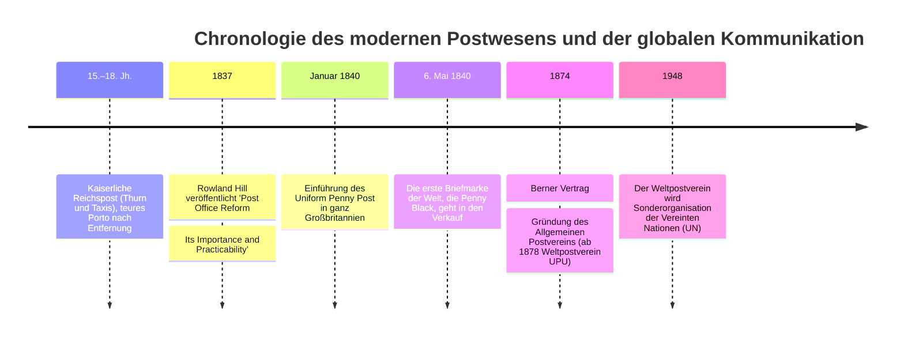
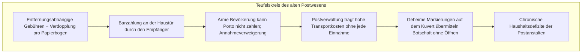
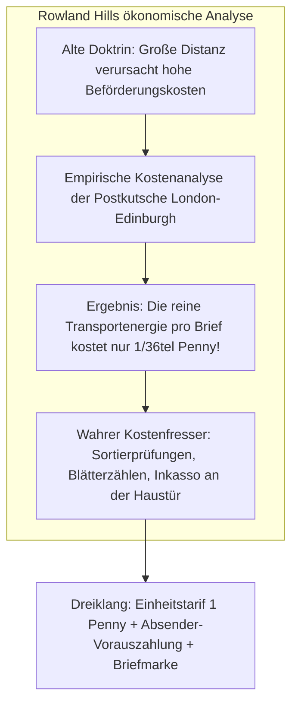

Wenn wir heute auf einem Smartphone eine E-Mail oder Textnachricht absenden, fällt kein Zuschlag an, ganz gleich, ob der Empfänger im Nachbarraum oder auf der anderen Erdhalbkugel weilt. Ebenso gilt es als unumstößliche Selbstverständlichkeit, dass der Absender vor dem Einwurf eines Briefes das Beförderungsentgelt entrichtet.

Vor dem Jahr 1840 jedoch war diese Logik vollständig verkehrt: Das Briefporto wurde nach der **Entfernung** und der **Anzahl der Papierbögen** berechnet und stieg ins Unbezahlbare. Überdies zahlte der **Empfänger an der Haustür in bar**. Für eine einfache Arbeiterfamilie bedeutete der Erhalt eines Briefes oft den Verlust eines vollen Tageslohnes.

Dieser bürokratische Missstand wurde durch den britischen Reformer **Sir Rowland Hill** und die erste selbstklebende Briefmarke der Welt, die **Penny Black** (1840), revolutioniert. Mit der Gründung des **Weltpostvereins (UPU)** im Jahr 1874 in Bern entstand schließlich das erste wahrhaft globale, staatenübergreifende Kommunikationsnetzwerk der Menschheitsgeschichte.

---

## 1. Das vorindustrielle Post-Dilemma: Absurde Tarife und Scheitern des Empfängerportos

Bis 1840 diente die Post der europäischen Fürstenhäuser und Monarchen primär als staatliche Steuerdomäne zur Sanierung von Kriegskassen.

- **Das Zählen der Blätter (Sheet-counting)**: Ein Brief von London nach Edinburgh kostete 13,5 Pence – ein voller Tageslohn. Ein Umschlag galt als zweites Blatt und verdoppelte das Porto. Um Papier zu sparen, erfand man das unleserliche „Kreuzschreiben“ (*Cross-writing*).
- **Die Portofalle des Empfängers**: Da erst bei Auslieferung bezahlt wurde, warteten Briefträger oft vergeblich auf Geld. Absender brachten daher geheime Tintenkleckse auf dem Brief an; der Empfänger warf an der Tür einen Blick auf das Zeichen („Ich bin wohlauf“), verweigerte die Annahme wegen Geldmangels, und die Post blieb auf den Kosten sitzen.

---

## 2. Rowland Hills mathematische Entdeckung und die Penny Black

Der Schulreformer **Sir Rowland Hill (1795–1879)** analysierte die Bücher der Postkutsche London–Edinburgh:

- **Reine Transportkosten: 1/36 Penny**: Hill wies nach, dass die physische Beförderung eines Briefes über 600 km lediglich den Bruchteil eines Pennys kostete. Die eigentlichen Unkosten entstanden durch administrative Transaktionskosten (Briefe gegen die Kerze halten, Zählen der Bögen, Feilschen an der Haustür).
- **Die Reform 1840**: Hill forderte den **Einheitstarif (Uniform Rate)** von einem Penny für Briefe bis zu einer halben Unze, die **Vorauszahlung durch den Absender** und die **Penny Black** als Quittungsmarke.

Am **6. Mai 1840** erschien die Penny Black mit dem Porträt der jungen Königin Victoria im Stahltiefdruck von Perkins, Bacon & Co. Da Großbritannien das einzige Land mit Briefmarken war, verzichtete man auf den Landesnamen – ein Privileg, das britische Marken im Weltpostverein bis heute genießen.

---

## 3. Bahnpost (TPO) und die Explosion der Kommunikation

Mit dem Ausbau des Dampfeisenbahnnetzes entstand 1838 das fahrende Bahnpostamt (**Travelling Post Office / TPO**):
- Postbeamte sortierten Briefe während der Fahrt.
- Mit automatischen Fangnetzen wurden Postsäcke bei voller Fahrt an Bahnhöfen aufgenommen und abgeworfen.
- Das Briefaufkommen in Großbritannien explodierte von 76 Millionen (1839) auf 350 Millionen (1850).
- Es entstanden die ersten Weihnachtsgrüße (1843), Fernunterricht per Post und der moderne Versandhandel.

---

## 4. Der Weltpostverein (UPU) von 1874

Auf Initiative von Heinrich von Stephan (Generalpostdirektor des Deutschen Reiches) unterzeichneten 22 Staaten am 9. Oktober 1874 den **Berner Vertrag** und gründeten die UPU:
1. **Einheitliches Postgebiet (*Single Postal Territory*)**: Alle Mitgliedstaaten bilden ein einziges grenzenloses Hoheitsgebiet für Briefsendungen.
2. **Freiheit der Durchfuhr (*Freedom of Transit*)**: Kein Staat darf den Transit ausländischer Postsäcke blockieren.
3. **Kostenteilungsprinzip**: Der Absenderstaat behält das eingenommene Porto; der Empfängerstaat stellt Auslandspost im Inland unentgeltlich zu.

---

## 5. Postsystem und Internet-Architektur

Die Architektur der viktorianischen Post gleicht verblüffend den Konzepten moderner Datennetze (TCP/IP):
- **Umschlag = IP-Paket** (Datenkapselung)
- **Postleitzahl / Adresse = IP-Adresse** (Hierarchisches Routing)
- **Briefmarke = Authentifizierungs-Token** (Vorausbezahlter Netzzugang)
- **Stempel = Zeitstempel / TTL** (Vermeidung doppelter Abfertigung)
- **Verteilzentrum = Router** (Paketvermittlung)

Das fundamentale „Ende-zu-Ende-Prinzip“ des Internets ist die direkte digitale Fortführung der Postreform von 1840.
