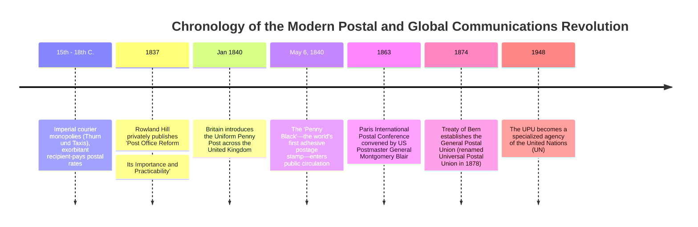
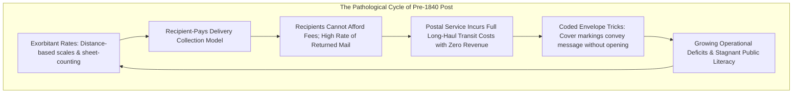
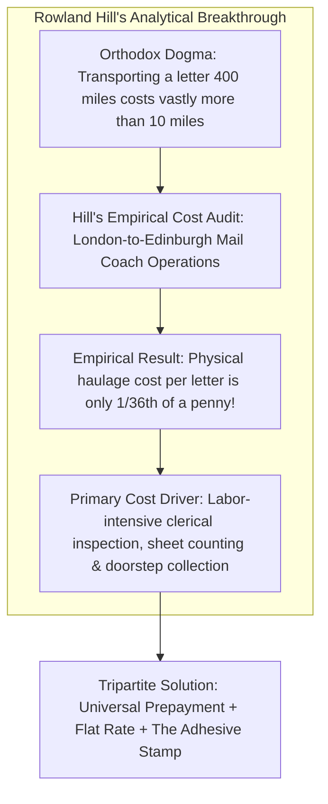
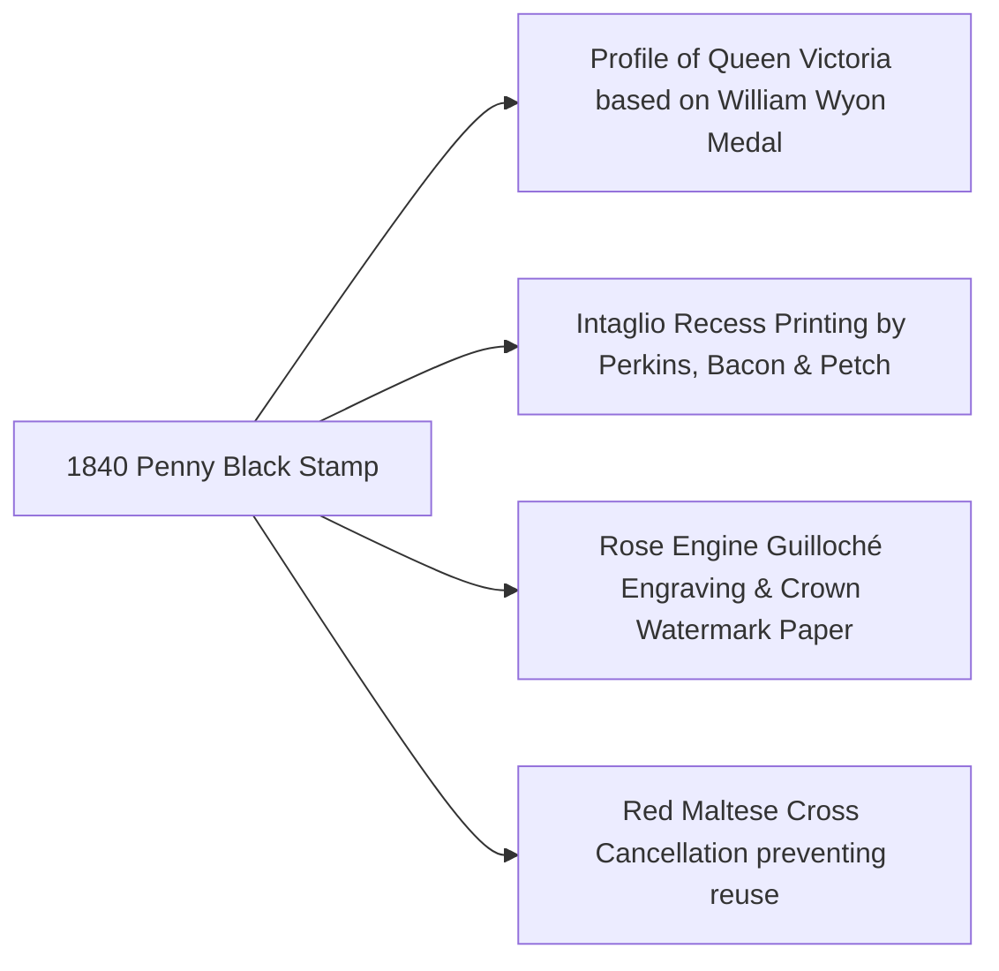
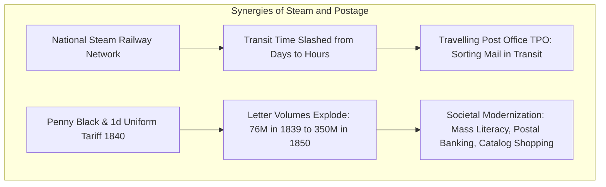
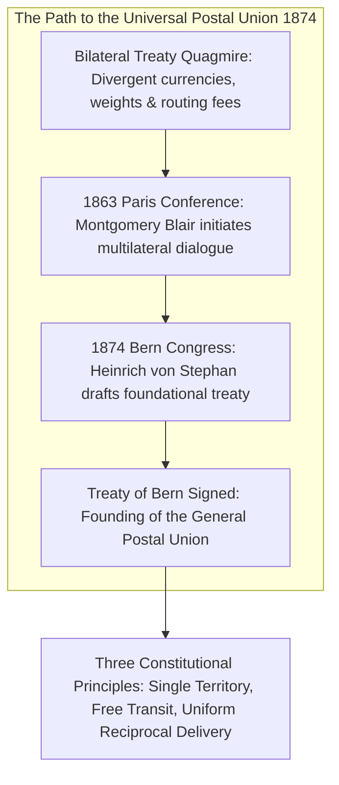
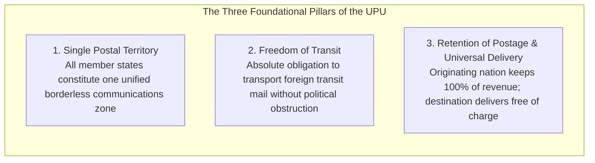
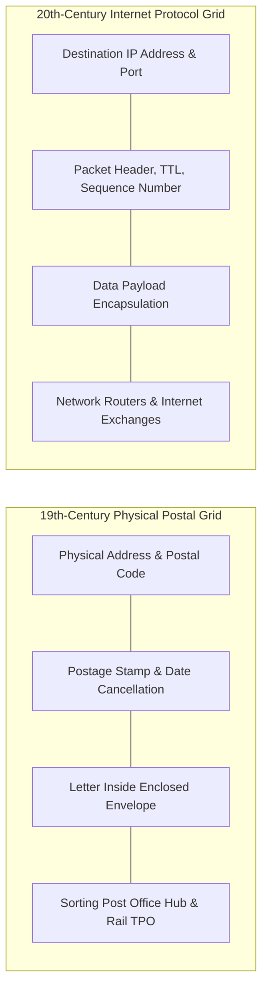

When modern citizens transmit an email or instant message, no premium is levied based on whether the recipient sits in the adjacent room or on the opposite hemisphere of the globe. Furthermore, when dispatching a physical parcel or letter, society takes it as an axiomatic rule that the sender prepays the transit fee via a stamp or digital barcode prior to deposit.

Yet prior to 1840, this operational paradigm was completely inverted. Throughout the pre-industrial world, postal freight was **assessed based on distance traveled and the number of sheets enclosed**, and critically, **was paid by the recipient upon final delivery**. For common working families, receiving an unexpected letter from a distant relative was not a joy, but an existential financial emergency capable of wiping out a day's wages.

This corrupt, inefficient, and regressive structure was shattered by the visionary British educational reformer **Sir Rowland Hill** through his revolutionary 1837 proposal and the subsequent issuance on May 6, 1840, of the world's first adhesive postage stamp: **the Penny Black**. Thirty-four years later, in 1874, nations gathered in Switzerland to sign the Treaty of Bern, creating the **Universal Postal Union (UPU)**—the first truly global, open, multilateral interoperability protocol in human history.

This treatise explores the mathematical insights behind Hill's uniform penny post, the physical transformation of mail via steam locomotives, the institutional diplomacy of the UPU, and the profound architectural continuity connecting nineteenth-century postal routing with twenty-first-century internet packet switching.

---

## 1. The Pre-Modern Postal Impasse: Perverse Incentives and Systemic Failure

Prior to 1840, European postal administrations operated not as public utilities designed to facilitate universal civic communication, but as **regressive fiscal monopolies engineered to extract crown revenue** and finance state warfare.

### 1.1 From Imperial Couriers to Crown Tax Monopolies
In early modern Europe, organized cross-border communication was pioneered by the **House of Thurn und Taxis**, an aristocratic dynasty appointed by the Holy Roman Emperors to run an extensive relay system of couriers, stables, and mail coaches across the continent. By the eighteenth century, however, rising sovereign nation-states annexed these private postal operations into state monopolies. 

In Great Britain, the Royal Mail was treated as a convenient cash cow. Successive Chancellors of the Exchequer raised postal tariffs repeatedly to service astronomical debts incurred during the Seven Years' War and the Napoleonic Wars.

### 1.2 The Absurd Calculus of Distance and Sheet Counting
In the 1830s, dispatching a single letter within Britain was an ordeal of labyrinthine bureaucracy:
1. **Distance-Based Sliding Scales**: Posting a letter from London to Edinburgh cost 13.5 pence (more than an entire day's wage for an agricultural laborer or factory worker). 
2. **The Sheet-Counting Rule**: Tariffs were computed not by deadweight, but by the physical number of paper leaves. A single sheet carried the base rate; two sheets doubled the fee; three sheets tripled it. To minimize charges, correspondents developed the nearly unreadable practice of **"cross-writing"**—penning lines horizontally across the page, rotating the paper 90 degrees, and writing a second layer of text vertically over the first.
3. **The Ban on Envelopes**: Placing a letter inside an envelope counted as a second sheet of paper, immediately doubling the transit tariff. Consequently, letters were folded origami-style with the address inscribed on the exterior and sealed with wax. Postal clerks spent hours holding folded letters up to burning candles to inspect whether a covert second slip of paper was concealed inside.

### 1.3 The Fatal Flaw of the Recipient-Pays Model
The most economically destructive feature of the pre-1840 system was that **postage was collected from the recipient at the doorstep**.
- **Labor Bottlenecks**: Mail carriers were forced to wait at every individual front door while servants searched for change or householders disputed the distance calculation. A postman could spend ten minutes executing a single transaction.
- **Coded Delivery Evasion**: Because payment could only be demanded upon physical acceptance of the letter, the public devised elaborate signaling tricks. Family members arranged secret codes on the exterior wrapper (e.g., an ink blot in the upper-right corner signified "arrived safely," a circle meant "illness"). The recipient inspected the folded letter at the door, extracted the necessary information, and politely returned the item to the exhausted postman, declaring they could not afford the fee. The Post Office incurred the entire capital expense of sorting and long-distance transport, yet recovered zero revenue.

### 1.4 Elite Corruption: The Franking Privilege Abuse
While ordinary citizens were starved of affordable communication, members of Parliament, peers of the realm, and government ministers enjoyed the **franking privilege**—the legal right to send and receive letters free of all postal charges merely by writing their signature (*the frank*) on the cover. 

Parliamentarians routinely abused this immunity, franking commercial mail for corporate business partners, banking syndicates, and political cronies. By 1838, over **five million letters per year (more than 12% of total national volume)** traveled entirely free under parliamentary franks, shifting the financial deficit onto the backs of the laboring classes.

---

## 2. Rowland Hill's Revolution: The Mathematics of the Penny Post

The man who dismantled this antiquarian apparatus was **Sir Rowland Hill (1795–1879)**, a schoolmaster, inventor, and social reformer possessing an exceptional gift for cost-accounting analysis.

### 2.1 The Mathematical Insight: 1/36th of a Penny per Letter
In early 1837, Hill privately printed his historic pamphlet, *Post Office Reform: Its Importance and Practicability*. Applying rigorous empirical methods, Hill audited the precise ledger of the mail coach running from London to Edinburgh (approximately 400 miles / 640 km):
- Accounting for horse feed, coachman wages, tolls, and maintenance, Hill calculated that the physical fuel and mechanical cost of transporting an average letter of normal weight over 400 miles was **precisely $\frac{1}{36}\text{ of a penny}$ (approximately 0.028 pence)**.
- Conversely, the clerical cost of inspecting the letter, counting its sheets before a candle, entering the item into municipal tax ledgers, and having a letter carrier negotiate payment at the destination door amounted to several pence per letter.

Hill established a profound economic theorem: **in transport networks, terminal handling and transaction costs dwarf pure line-haul transit costs**. Therefore, charging variable fees based on mileage was an economically irrational policy that generated astronomical overhead while suppressing consumer demand.

### 2.2 The Uniform Penny Post Doctrine
Hill proposed an audacious restructuring built upon three interdependent institutional pillars:
1. **Uniform Rate**: A single flat fee across the entire territorial expanse of the United Kingdom, completely uncoupled from geographical distance.
2. **Weight-Based Classification**: Abolition of sheet counting in favor of a simple weight ceiling: one penny for any letter weighing up to half an ounce (approximately 14 grams), enabling the widespread adoption of modern envelopes.
3. **Compulsory Prepayment**: Requiring the sender to pay for transit at the point of origin, entirely eliminating doorstep cash collections and failed-delivery returns.

### 2.3 May 6, 1840: The Genesis of the Penny Black
Parliament succumbed to public pressure and commercial lobbying, passing the Postage Act of 1839. On **May 6, 1840**, the world's first adhesive postage stamp—the **Penny Black**—was officially placed on sale.

- **Security Engineering**: Produced by the specialized security printing firm **Perkins, Bacon & Petch**, the stamp utilized high-precision **intaglio recess steel plate engraving**. A rose-engine lathe cut intricate, non-reproducible geometric *guilloché* backgrounds, while the specialized paper was embedded with individual crown watermarks.
- **The Queen's Portrait**: Victoria's youthful side-profile, based on William Wyon's commemorative 1837 City Medal, was chosen because human facial recognition possesses acute cognitive sensitivity to microscopic discrepancies, making fraudulent hand-drawn forgery nearly impossible.
- **The Anonymity of Empire**: The stamp was inscribed simply with "POSTAGE" at the top and "ONE PENNY" at the bottom. Because Great Britain was the sole issuer of postage stamps on planet Earth in 1840, no national country name was required. Under subsequent international treaties of the UPU, British postage stamps retain this unique legal exemption to this day.

---

## 3. Steam Logistics: Railways, TPOs, and the Information Explosion

The introduction of the Penny Post coincided with the rapid expansion of steam locomotion during the British "Railway Mania" of the 1840s, triggering an unprecedented synergistic leap in physical throughput.

### 3.1 The Travelling Post Office (TPO)
In 1838, the Grand Junction Railway inaugurated the first **Travelling Post Office (TPO)**—specially designed rail carriages fitted with sorting pigeonholes, wax heaters, and bag racks.
- Sorters organized letters while the locomotive roared through the night at fifty miles per hour.
- Ground-breaking **automatic pouch-exchange apparatus** allowed mail trains to drop off and scoop up leather mailbags from trackside gantries at full speed without decelerating.
- By eliminating static sorting delays at terminal hubs, the Royal Mail established the world's first guaranteed overnight delivery grid, linking London, Birmingham, Manchester, Liverpool, and Edinburgh.

### 3.2 Explosive Volume Growth and Cultural Transformation
The empirical results of Hill's price-elasticity thesis were vindicated with spectacular clarity:
- **1839 (Pre-reform base)**: 75.9 million letters
- **1840 (First reform year)**: 168.8 million letters (**+122% increase**)
- **1850**: 347.1 million letters (**a 4.5-fold expansion**)
- **1875**: Surpassed 1.0 billion letters per annum.

The cheap penny post catalyzed profound democratic and economic transformations:
- **Mass Literacy**: The working class gained a powerful, personal motivation to acquire literacy, corresponding with separated family members working in urban factories or overseas colonies.
- **The Christmas Card (1843)**: Invented by Sir Henry Cole and illustrated by John Callcott Horsley, the commercial greeting card industry was made viable solely by the one-penny postal rate.
- **Distance Education and Mail-Order Commerce**: In 1840, Sir Isaac Pitman launched the world's first correspondence course, grading shorthand exercises submitted by students via post. Commercial catalogs flourished, enabling regional manufacturers to sell directly to consumers nationwide.

---

## 4. International Architecture: The Universal Postal Union (UPU)

As national postal reforms spread across France, Belgium, Germany, and the United States, cross-border international communication devolved into operational chaos.

### 4.1 The Bilateral Treaty Quagmire
By the 1860s, dispatching an international letter required consulting complex, conflicting tables of bilateral treaties:
- If an American citizen wished to post a letter to Vienna, the tariff varied wildly depending on whether the mail traveled via a British packet steamer, a French steamer through Le Havre, or a direct German Lloyd ship to Hamburg.
- Transit tariffs accumulated at every national boundary, measured in non-standard units (ounces, grams, Zoll-weights) and settled in fluctuating currencies (thalers, francs, shillings, florins).

### 4.2 Heinrich von Stephan and the 1874 Treaty of Bern
The visionary architect of international postal harmonization was **Heinrich von Stephan (1831–1897)**, Postmaster General of the North German Confederation and later State Secretary of the Imperial Post Office of the German Empire.

In October 1874, delegates from twenty-two sovereign nations convened at the Federal Palace in Bern, Switzerland. On **October 9, 1874**, they executed the historic **Treaty of Bern**, establishing the **General Postal Union** (renamed the **Universal Postal Union [UPU]** in 1878):

1. **The Single Postal Territory (*Territoire Postal Unique*)**: For postal purposes, all member states formed a single, borderless communications zone. A letter posted in Washington, D.C., addressed to Tokyo or Berlin, was treated with the exact same dispatch priority and legal sanctity as domestic correspondence.
2. **Freedom of Transit (*Liberté de Transit*)**: Every member country committed to providing unhindered transit across its domestic railways, roads, and waterways for mail pouches originating in any other member state, even during times of political tension.
3. **Retention of Postage (*Absence de Décompte*)**: Under the foundational UPU doctrine, the dispatching nation retained 100% of the postage collected from the sender. The destination country agreed to deliver the mail across its domestic territory free of charge, operating on the assumption that incoming and outgoing mail volumes between reciprocal nations roughly balanced over time.

---

## 5. Architectural Isomorphism: The Postal Roots of the Internet

The institutional and operational architecture engineered by Rowland Hill and the UPU in the nineteenth century served as the conceptual blueprint for the packet-switched computer networks developed in the late twentieth century.

| Postal System Component | Internet Architecture Equivalent (TCP/IP) | Structural and Functional Equivalence |
| :--- | :--- | :--- |
| **Envelope** | **IP Packet Frame** | Encapsulates heterogeneous contents inside a standardized container, hiding internal data while presenting uniform routing metadata. |
| **Physical Address / Postal Code** | **IP Address / Port Number** | Hierarchical addressing schema enabling deterministic global path selection across decentralized nodes. |
| **Postage Stamp** | **Cryptographic Authentication Token** | Verifies prior payment and grants authorization to consume shared network routing bandwidth. |
| **Postmark / Cancellation Stamp** | **Packet Timestamp / Time-to-Live (TTL)** | Records the exact injection time and location, preventing replay attacks and double-spending of services. |
| **Regional Sorting Office / Hub** | **Core Layer-3 Router / IXP** | Inspects header metadata and forwards containers along the optimal outbound physical link. |
| **UPU Single Postal Territory** | **Autonomous System Interconnection (BGP)** | Abstract protocol uniting hundreds of sovereign networks into an interoperable, global communications commons. |

When computer scientists Paul Baran, Donald Davies, and Vint Cerf designed packet-switching protocols, they consciously borrowed from the postal model: the **End-to-End Principle**, asynchronous store-and-forward routing, and best-effort delivery are direct digital translations of the postal mechanisms perfected under Victorian steam logistics.

---

## 6. Contemporary Relevance and the Logistics Frontier

In the twenty-first century, digital telecommunications have decimated physical letter volumes. Yet far from rendering the postal system obsolete, the global rise of **e-commerce platforms (Amazon, AliExpress, eBay)** has transformed national postal services into the indispensable physical backbone of global trade.

### The Modern Frontier: Terminal Dues and Trade Disputes
The founding UPU principle that destination nations deliver incoming foreign mail without charging handling fees was modified in 1969 through the establishment of **Terminal Dues (*Frais de Terminal*)**—compensatory payments made by origin posts to destination posts for imbalances in delivery volume.

However, the classification of rapid-growth emerging export economies as developing nations entitled to discounted terminal dues triggered fierce geopolitical disputes. In 2018–2019, the United States threatened withdrawal from the UPU over subsidized packet rates from East Asia, leading to an extraordinary congress in Geneva that granted postal authorities the right to self-declare package delivery rates. Even in the digital era, the century-and-a-half-old treaties of the UPU remain the vital geopolitical battleground governing global physical supply chains.

### Conclusion
The Penny Black was far more than an adhesive square of gummed paper. It was an intellectual monument to the democratization of human communication. By shifting the financial friction from the destination to the origin, standardizing tariffs, and building an open global protocol through the UPU, the architects of the postal revolution established the foundational infrastructure of human interconnectedness that continues to power our globalized world.
