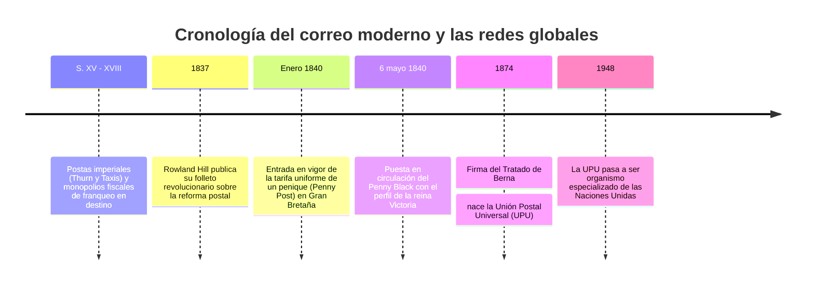

En la actualidad, enviar un correo electrónico o un mensaje instantáneo no acarrea coste adicional alguno en función de la distancia. Del mismo modo, depositar una carta en un buzón presupone que el remitente ha abonado el franqueo de antemano.

Sin embargo, antes de 1840 este principio operaba a la inversa: las tarifas postales se tasaban en función de la **distancia** y del **número de pliegos**, cobrándose **en efectivo al destinatario en el momento de la entrega**. Para un obrero humilde, recibir correspondencia ajena podía costar el sueldo de una jornada completa.

La transformación llegó de la mano de **Sir Rowland Hill**, quien revolucionó el sistema con la creación del primer sello adhesivo del mundo: el **Penny Black** (1840). Décadas después, en 1874, la fundación de la **Unión Postal Universal (UPU)** en Berna consagró el primer protocolo unificado de comunicaciones a escala global.

---

## 1. El régimen postal tradicional y el fraude del pago en destino

Hasta el siglo XIX, el correo funcionaba como un lucrativo monopolio estatal recaudatorio:
- **Tasa por pliego y distancia**: Una carta de Londres a Edimburgo costaba 13,5 peniques. Si se usaba sobre, se cobraba como un segundo pliego, lo que dio lugar a la «escritura cruzada» (*cross-writing*) para rellenar la misma hoja en dos direcciones perpendiculares.
- **La quiebra del cobro en destino**: El cartero perdía horas esperando cobrar en cada puerta. Surgió la trampa de los mensajes en clave: remitentes que convenían marcas de tinta exteriores para transmitir mensajes básicos; el receptor miraba el sobre en la puerta, se daba por informado y devolvía la carta alegando falta de dinero. El correo transportaba millones de cartas sin cobrar un céntimo.

---

## 2. El descubrimiento de Rowland Hill y el Penny Black

En 1837, Rowland Hill auditó minuciosamente la diligencia postal Londres-Edimburgo y descubrió algo asombroso:
- El coste físico de transportar una carta a lo largo de 640 km era de tan solo **1/36 de penique**.
- El 99 % de los costes de la institución radicaba en la burocracia de pesar, contar pliegos al trasluz y cobrar a domicilio.

Hill formuló tres pilares:
1. **Tarifa plana uniforme (Uniform Penny Post)** de un penique nacional.
2. **Tarificación por peso**, despenalizando los sobres.
3. **Pago anticipado obligatorio mediante sellos adhesivos**.

El **6 de mayo de 1840** nació el **Penny Black**, grabado por Perkins, Bacon & Co. con el retrato de la joven reina Victoria. Al ser el primer sello del mundo, no incorporó nombre de país, una excepción histórica que los sellos británicos conservan legalmente en la UPU hasta hoy.

---

## 3. Del tren correo a la Unión Postal Universal (1874)

Con el auge del ferrocarril, en 1838 se estrenaron las oficinas postales ambulantes en vagones de tren (**Travelling Post Office**), capaces de clasificar y enganchar sacas de correo a gran velocidad sin detenerse. El volumen de cartas en Gran Bretaña se disparó de 76 millones en 1839 a 350 millones en 1850.

En 1874, gracias al impulso de Heinrich von Stephan, 22 naciones firmaron el **Tratado de Berna** fundando la UPU sobre tres normas fundamentales:
1. **Territorio postal único**: El planeta constituye un espacio común unificado.
2. **Libertad de tránsito**: Obligación recíproca de encaminar la valija extranjera.
3. **Retención de ingresos**: La administración remitente cobra el franqueo y el país de destino reparte gratuitamente en su territorio.

---

## 4. El correo como antepasado de Internet

La arquitectura postal diseñada en el siglo XIX guarda una correspondencia exacta con el protocolo TCP/IP de Internet:
- **Sobre = Paquete IP** (encapsulación y privacidad).
- **Código postal y dirección = Dirección IP** (enrutamiento por niveles).
- **Sello = Token de autenticación** (recurso prepagado).
- **Matasellos = Marca temporal y TTL** (evita duplicidad).
- **Centro de clasificación = Enrutador (Router)**.

Rowland Hill y los arquitectos de la UPU crearon, en plena era del vapor, el diseño institucional que gobierna hoy nuestras autopistas de la información.
