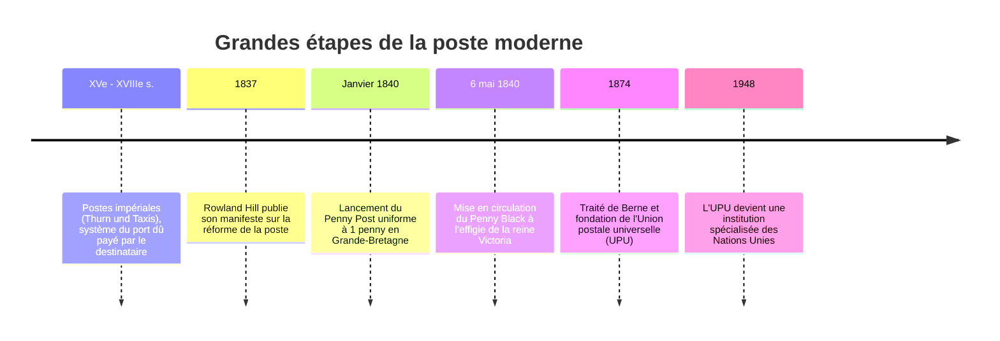

Dans notre quotidien numérique, l'envoi d'un courriel ne coûte pas plus cher selon que le destinataire se trouve dans la pièce d'à côté ou aux antipodes. De même, expédier une lettre suppose que l'expéditeur affranchisse préalablement son pli.

Pourtant, avant 1840, la réalité était inverse : les tarifs postaux étaient proportionnels à la **distance parcourue** et au **nombre de feuilles de papier**, et payables **en espèces par le destinataire à la réception**. Pour les classes laborieuses, recevoir une lettre constituait un fardeau financier insoutenable.

Cette impasse fut surmontée grâce aux travaux de l'Anglais **Sir Rowland Hill**, père du premier timbre-poste adhésif de l'histoire : **le Penny Black (1840)**. En 1874, la signature du traité de Berne créait **l'Union postale universelle (UPU)**, instaurant le premier réseau de télécommunication planétaire unifié.

---

## 1. La crise du port dû et l'absurdité de l'ancien régime postal

Avant 1840, la poste royale britannique servait d'instrument fiscal répressif pour renflouer les caisses de l'État :
- **Tarification à la feuille** : Mettre une lettre sous enveloppe doublait le prix, car l'enveloppe comptait comme une seconde feuille. On pratiquait donc l'écriture croisée (*cross-writing*) pour noircir le même feuillet dans les deux sens.
- **La ruine du port dû** : Le facteur devait négocier le paiement sur le pas de la porte. Des stratagèmes d'initiés apparurent : des signes ou taches d'encre codés sur l'extérieur indiquaient le message sans ouvrir le pli ; le destinataire regardait la lettre, refusait de payer et la rendait au facteur. La poste transportait des millions de lettres à perte.

---

## 2. Le coup de génie de Rowland Hill et le Penny Black

En 1837, Rowland Hill publia une étude statistique démontrant que :
- Le coût physique réel du transport d'une lettre de Londres à Édimbourg (640 km) n'était que de **1/36e de penny**.
- La quasi-totalité des dépenses postales provenait des frais de transaction (peser, compter les feuillets à la bougie, réclamer l'argent à domicile).

Hill proposa une révolution en trois points :
1. **Tarif uniforme (Uniform Penny Post)** : 1 penny partout dans le pays.
2. **Paiement au poids** : suppression du décompte des feuilles.
3. **Prépaiement obligatoire par timbre adhésif**.

Le **6 mai 1840**, le **Penny Black** entra dans l'histoire, orné du profil de la reine Victoria gravé par Perkins, Bacon & Co. Le Royaume-Uni étant le premier émetteur, il ne mentionna aucun nom de pays, privilège mondial conservé à ce jour au sein de l'UPU.

---

## 3. Vapeur, tri ferroviaire et l'UPU de 1874

L'apparition des wagons-poste ambulants (**Travelling Post Office**) en 1838 permit de trier le courrier à toute vapeur et d'échanger des sacs postaux en pleine voie sans ralentir le train. Le trafic britannique bondit de 76 millions de lettres en 1839 à 350 millions en 1850.

Sur le plan international, sous l'impulsion de Heinrich von Stephan, 22 nations signèrent en 1874 le **traité de Berne** instituant l'UPU sur trois principes :
1. **Territoire postal unique** : Les frontières nationales s'effacent pour le courrier.
2. **Liberté de transit** : Garantie d'acheminement des dépêches à travers les pays tiers.
3. **Absence de décompte** : L'administration expéditrice conserve les recettes d'affranchissement, le pays de destination distribuant gratuitement le courrier entrant.

---

## 4. Des timbres aux paquets IP d'Internet

Le réseau postal moderne a fourni la matrice conceptuelle d'Internet :
- **L'enveloppe = le paquet IP** (encapsulation des données).
- **L'adresse / code postal = l'adresse IP** (routage hiérarchique).
- **Le timbre = le jeton d'authentification** (ressource prépayée).
- **Le bureau de tri = le routeur**.

Rowland Hill et les architectes de l'UPU ont ainsi posé, dès le XIXe siècle, les fondations logistiques de notre société de l'information.
