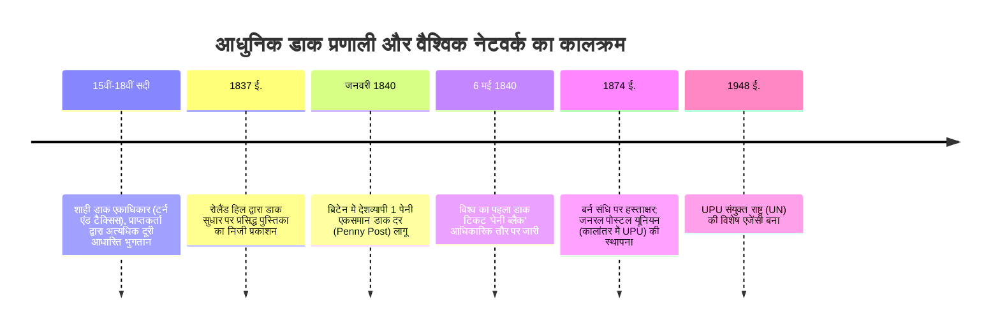

आज जब हम स्मार्टफोन से ईमेल या संदेश भेजते हैं, तो इस बात का कोई अतिरिक्त शुल्क नहीं लगता कि प्राप्तकर्ता पास के कमरे में है या दुनिया के दूसरे छोर पर। इसी तरह, कोई भौतिक पत्र या पार्सल भेजते समय प्रेषक द्वारा टिकट लगाकर पहले से भुगतान करना मानव समाज का सामान्य नियम बन चुका है।

परंतु 1840 से पूर्व विश्व की डाक व्यवस्था इसके सर्वथा विपरीत थी: डाक शुल्क **तय की गई दूरी** और **कागज़ के पन्नों की संख्या** के आधार पर अत्यधिक महंगा होता था, और सबसे बढ़कर, **पत्र प्राप्त होने पर प्राप्तकर्ता द्वारा नकद भुगतान (To-Pay System)** किया जाता था। निर्धन कामकाजी परिवारों के लिए दूर के परिजन का पत्र मिलना किसी आर्थिक विपत्ति से कम नहीं था।

इस पुरातन विसंगति को ब्रिटिश समाज सुधारक **सर रोलैंड हिल (Sir Rowland Hill)** ने 1840 में एकसमान डाक शुल्क और विश्व के पहले चिपकाने वाले डाक टिकट **'पेनी ब्लैक' (Penny Black)** के आविष्कार से समाप्त किया। इसके बाद 1874 में स्विट्जरलैंड के बर्न में **यूनिवर्सल पोस्टल यूनियन (UPU)** की स्थापना हुई, जिसने सीमाओं से परे विश्व का पहला खुला संचार नेटवर्क तैयार किया।

---

## 1. पूर्व-आधुनिक डाक का संकट और 'प्रापक भुगतान' का पतन

1840 से पहले ब्रिटिश रॉयल मेल का उपयोग युद्धों का कर्ज चुकाने के लिए जनता से कर वसूलने के साधन के रूप में किया जाता था:
- **पन्नों की गिनती की मार**: लंदन से एडिनबर्ग (640 किमी) पत्र भेजने का शुल्क 13.5 पेंस था, जो एक मजदूर के पूरे दिन के वेतन के बराबर था। यदि लिफाफे का उपयोग किया जाता तो उसे दूसरा पन्ना मानकर शुल्क दोगुना कर दिया जाता था। पन्ने बचाने के लिए लोग एक ही कागज़ पर आड़े-तिरछे अक्षरों में लिखते थे जिसे 'क्रॉस-राइटिंग' कहा जाता था।
- **प्रापक भुगतान व्यवस्था की विफलता**: डाकिया घर-घर जाकर पैसे वसूलने में घंटों बर्बाद करता था। लोगों ने बचने के लिए सांकेतिक कोड ईजाद किए: लिफाफे पर स्याही का विशेष धब्बा कुशलक्षेम का संकेत देता था; प्राप्तकर्ता दरवाजे पर लिफाफा देखकर खबर समझ लेता और पैसे की कमी का बहाना बनाकर पत्र लौटा देता। डाक विभाग भारी नुकसान झेलता था।

---

## 2. रोलैंड हिल की गणितीय खोज और 'पेनी ब्लैक'

1837 में रोलैंड हिल ने लंदन-एडिनबर्ग मेल कोच के बहीखातों का विश्लेषण कर एक चौंकाने वाला निष्कर्ष निकाला:
- एक पत्र को 640 किमी दूर ले जाने की वास्तविक भौतिक परिवहन लागत केवल **1/36 पेनी** थी!
- डाक विभाग का 99% खर्च मोमबत्ती की रोशनी में पन्नों की जांच करने, दूरी नापने और घर-घर जाकर पैसे वसूलने की प्रशासनिक प्रक्रिया में नष्ट हो रहा था।

हिल ने तीन क्रांतिकारी सिद्धांत दिए:
1. **एकसमान दर (Uniform Rate)**: पूरे देश में केवल 1 पेनी शुल्क।
2. **वजन आधारित वर्गीकरण** (आधा औंस तक 1 पेनी), जिससे लिफाफों का प्रयोग संभव हुआ।
3. **चिपकने वाले डाक टिकट द्वारा प्रेषक द्वारा अनिवार्य अग्रिम भुगतान**।

**6 मई 1840** को 15 वर्षीय महारानी विक्टोरिया के चित्र वाला **'पेनी ब्लैक'** जारी हुआ। चूंकि ब्रिटेन दुनिया का पहला टिकट जारीकर्ता था, इसलिए टिकट पर देश का नाम नहीं छापा गया—यह ऐतिहासिक विशेषाधिकार UPU में आज भी केवल ब्रिटिश डाक टिकटों को प्राप्त है।

---

## 3. रेलवे डाक वैन (TPO) और बर्न संधि 1874 (UPU)

1838 में चलती ट्रेन में डाक छांटने वाली **ट्रैवलिंग पोस्ट ऑफिस (TPO)** शुरू हुई, जिसने बिना ट्रेन रोके स्वचालित जालों से डाक थैलों का आदान-प्रदान किया। ब्रिटेन में पत्रों की संख्या 1839 में 7.6 करोड़ से बढ़कर 1850 में 35 करोड़ हो गई।

1874 में हेनरिक वॉन स्टीफन की पहल पर 22 देशों ने बर्न में **UPU** की स्थापना की:
1. **एकल डाक क्षेत्र**: सभी सदस्य देश बिना किसी सीमा के एक डाक क्षेत्र माने जाएंगे।
2. **पारगमन की स्वतंत्रता**: किसी भी देश के डाक थैलों को बिना रुकावट रास्ता देने की गारंटी।
3. **राजस्व प्रतिधारण**: भेजने वाला देश पूरा डाक टिकट राजस्व रखेगा और गंतव्य देश अपने यहां निःशुल्क वितरण करेगा।

---

## 4. आधुनिक इंटरनेट का पूर्वज: डाक नेटवर्क

19वीं सदी की डाक व्यवस्था सीधे तौर पर इंटरनेट TCP/IP पैकेट स्विचिंग की जनक है:
- **लिफाफा = IP पैकेट** (डेटा छिपाना व मानकीकरण)।
- **पता और पिनकोड = IP एड्रेस** (पदानुक्रमित रूटिंग)।
- **डाक टिकट = प्रमाणीकरण टोकन** (प्रीपेड अनुमति)।
- **मुहर = टाइमस्टैम्प और TTL** (पुनः उपयोग रोकथाम)।
- **सॉर्टिंग सेंटर = नेटवर्क राउटर**।

रोलैंड हिल का 'एंड-टू-एंड' सिद्धांत और गैर-अवरुद्ध वितरण मॉडल आज डिजिटल सूचना महामार्गों की रीढ़ बना हुआ है।
