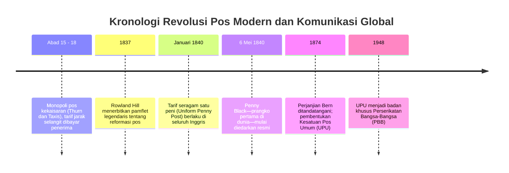

Ketika kita mengirim surel atau pesan singkat hari ini, tidak ada biaya ekstra berdasarkan jarak tempuh penerima. Begitu pula saat mengirim surat fisik, adalah hal yang lumrah bahwa pengirim membayar ongkos kirim terlebih dahulu sebelum memasukkannya ke kotak pos.

Namun sebelum tahun 1840, logika ini berlaku sebaliknya: tarif pos dihitung berdasarkan **jarak tempuh** dan **jumlah lembar kertas**, serta ditagih **secara tunai kepada penerima saat surat tiba di depan pintu**. Bagi kaum pekerja miskin, menerima surat tak terduga adalah bencana keuangan yang dapat menguras upah kerja seharian.

Kebuntuan sistem kuno ini dirombak total oleh reformator Inggris, **Sir Rowland Hill**, melalui inovasi tarif seragam dan penerbitan prangko berperekat pertama di dunia: **Penny Black** pada 6 Mei 1840. Pada tahun 1874 di Swiss, berdirilah **Universal Postal Union (UPU)** yang menciptakan protokol komunikasi global pertama tanpa sekat perbatasan.

---

## 1. Kebuntuan Pos Tradisional: Tarif Rumit dan Jebakan Bayar di Tempat

Sebelum tahun 1840, pos kerajaan Inggris dikelola sebagai sarana pemerasan pajak oleh kas negara:
- **Tarif Berdasarkan Lembar Kertas**: Mengirim surat dari London ke Edinburgh berbiaya 13,5 peni. Memasukkan surat ke amplop dihitung sebagai dua lembar kertas sehingga tarifnya langsung berlipat ganda. Hal ini memaksa masyarakat menulis silang tumpang tindih (*cross-writing*) demi menghemat kertas.
- **Kegagalan Sistem Bayar di Tempat**: Pengantar pos membuang waktu menagih uang di depan pintu rumah. Muncul trik manipulasi tanda luar: pengirim menaruh noda tinta rahasia di sampul luar yang menandakan kabar selamat. Penerima melihat tanda itu, memahami pesannya, lalu menolak membayar dan mengembalikan surat ke petugas pos. Lembaga pos menanggung ongkos angkut tanpa pemasukan.

---

## 2. Terobosan Matematika Rowland Hill dan Prangko Penny Black

Pada tahun 1837, Rowland Hill mengaudit pembukuan kereta pos rute London–Edinburgh (640 km) dan menemukan fakta mencengangkan:
- Biaya bahan bakar dan tenaga murni untuk mengangkut satu surat sejauh 640 km hanyalah **1/36 peni**!
- Pemborosan biaya pos sesungguhnya terjadi pada birokrasi penimbangan, penerawangan lilin, dan penagihan tunai pintu ke pintu.

Hill mencetuskan tiga pilar:
1. **Tarif Seragam (Uniform Rate)** satu peni ke seluruh negeri.
2. **Penetapan tarif berdasarkan berat**, bukan jumlah lembar.
3. **Pembayaran di muka oleh pengirim menggunakan prangko berperekat**.

Pada **6 Mei 1840**, terbitlah **Penny Black** berukir profil Ratu Victoria. Karena Inggris adalah satu-satunya negara penerbit prangko kala itu, nama negara sengaja tidak dicantumkan—sebuah hak istimewa bersejarah yang diakui konvensi UPU hingga hari ini.

---

## 3. Kereta Pos Berjalan dan Perjanjian Bern 1874 (UPU)

Revolusi pos berpadu dengan rel kereta api melalui gerbong pos berjalan (**Travelling Post Office / TPO**) pada tahun 1838 yang menyortir surat di tengah perjalanan dan menukar kantong pos tanpa menghentikan laju kereta. Jumlah surat di Inggris melompat dari 76 juta (1839) menjadi 350 juta (1850).

Pada tahun 1874, di bawah prakarsa Heinrich von Stephan dari Jerman, 22 negara mendirikan UPU di Bern dengan tiga pilar:
1. **Wilayah Pos Tunggal**: Seluruh negara anggota disatukan sebagai satu teritori tanpa batas pos.
2. **Kebebasan Transit**: Jaminan angkut surat antarnegara tanpa halangan politik.
3. **Retensi Tarif**: Negara pengirim menyimpan seluruh penerimaan prangko dan negara tujuan mengantar gratis di wilayahnya.

---

## 4. Dari Prangko Menuju Protokol Internet (TCP/IP)

Arsitektur pos abad ke-19 merupakan cetak biru langsung dari arsitektur internet:
- **Amplop = Paket IP** (enkapsulasi muatan data).
- **Alamat & Kode Pos = Alamat IP** (perutean bertingkat).
- **Prangko = Token Otentikasi** (izin akses prabayar).
- **Cap Pos = Cap Waktu & TTL** (mencegah penggunaan ulang).
- **Kantor Sortir = Router Jaringan**.

Prinsip *End-to-End* dan transmisi *Best-Effort* yang menopang internet modern pada hakikatnya adalah penerjemahan digital atas reformasi pos Rowland Hill tahun 1840.
