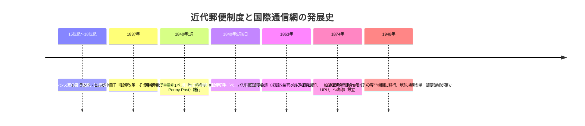
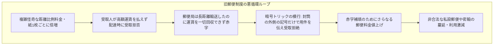
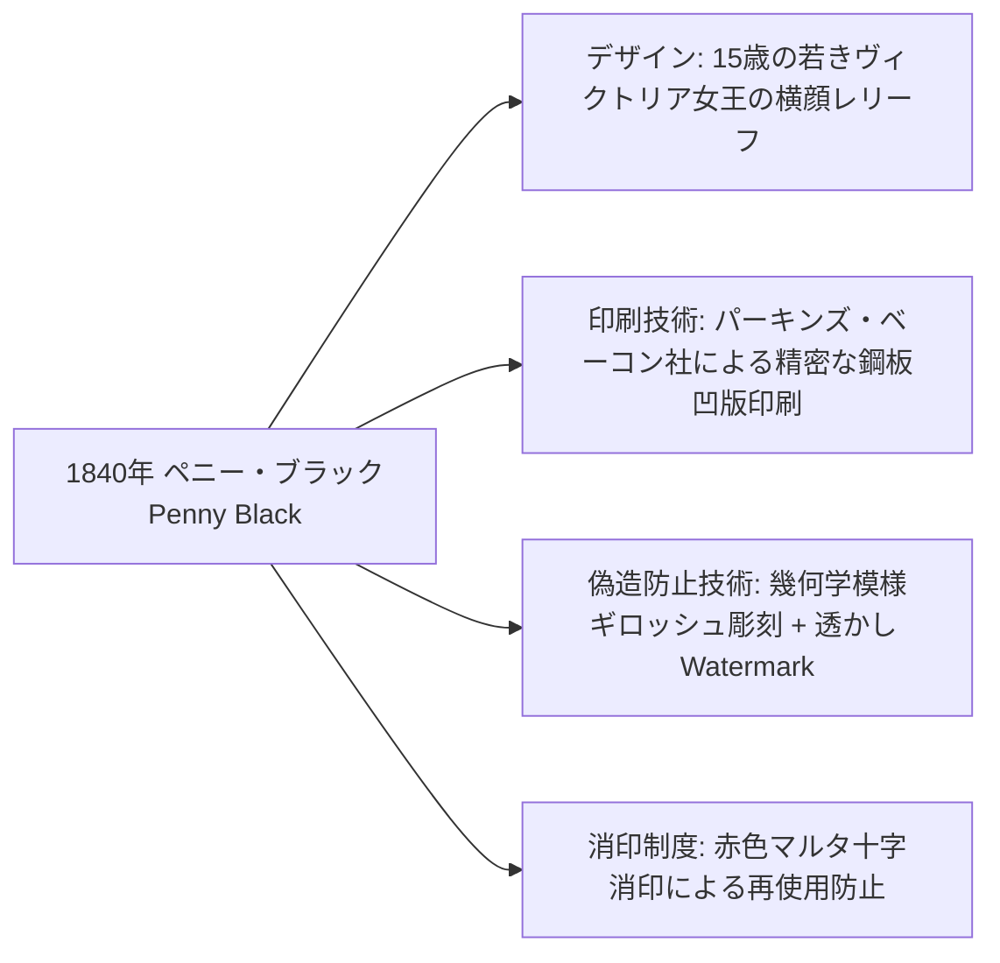
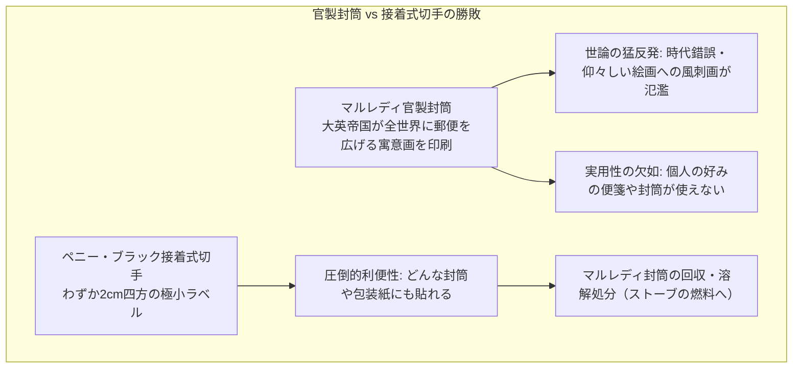
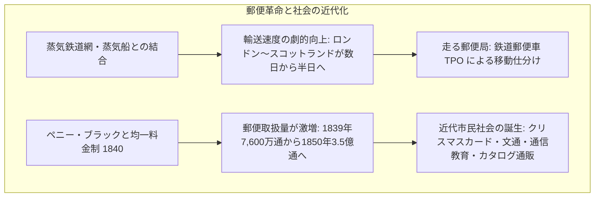
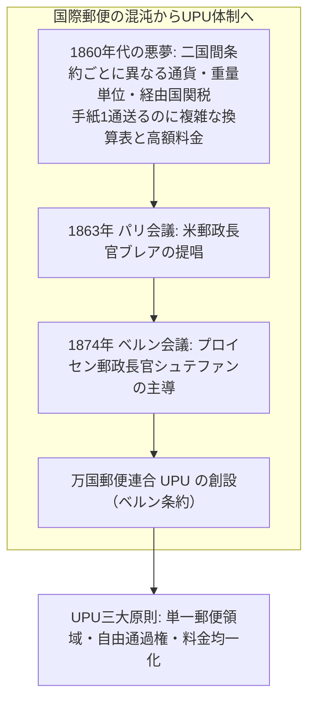
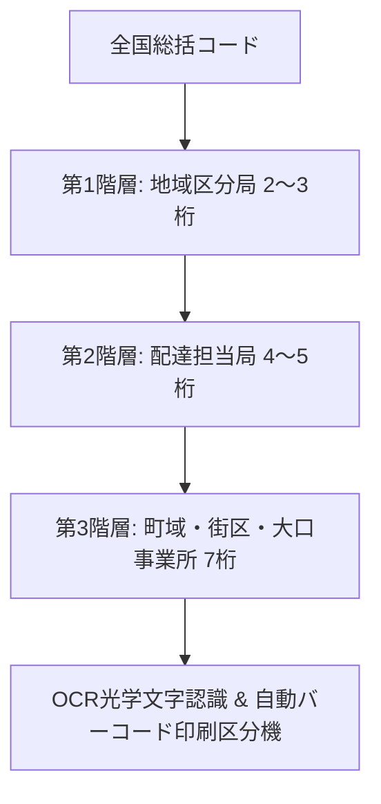

現代の私たちがスマートフォンで電子メールやメッセージを送信するとき、送信先が隣の部屋の友人であっても、地球の裏側の同僚であっても、距離に応じた別料金を請求されることはありません。また、手紙や荷物を送る際には、差出人があらかじめ切手を購入するかオンライン決済を済ませてポストに投函するのが当然の常識となっています。

しかし、19世紀前半までの世界では、この常識は完全に逆転していました。手紙の郵送料金は**「配達距離」**と**「便箋の枚数」**に応じて天文学的に跳ね上がり、しかも**「受取人が配達時に現金を支払う（受取人払い制）」**が原則でした。貧しい庶民にとって、親族からの手紙を受け取ることは1日分の食費が吹き飛ぶほどの金銭的危機を意味していたのです。

この非効率と不条理を打破したのが、1840年にイギリスで断行された**ローランド・ヒルの郵便改革**と、世界最初の接着式切手**「ペニー・ブラック（Penny Black）」**でした。さらに1874年には、国境を越えた通信網を統合する**万国郵便連合（UPU）**が設立され、人類史上初となる「地球規模の開かれた通信プロトコル」が完成しました。

本稿では、前近代の郵便制度が抱えていた経済的矛盾、ローランド・ヒルが発見したコスト構造の数理的真実、鉄道網と結合した物理物流の爆発的進化、UPUの国際法秩序、そして現代のインターネット・パケット通信との驚くべき構造的相似性を、包括的かつ多角的に解剖します。



---

## 1. 前近代の郵便：不条理な料金体系と受取人払い制の崩壊

19世紀初頭までのヨーロッパおよび世界各国の郵便システムは、国家権力や大貴族の特権的通信手段から発達したものであり、一般大衆の自由な利用を想定したインフラではありませんでした。



### 1.1 トゥルン・ウント・タクシス家から国家専売郵便へ
中世末期、神聖ローマ帝国の郵便ネットワークを独占したのはイタリア貴族出身の**トゥルン・ウント・タクシス家（Thurn und Taxis）**でした。彼らは規則的な駅伝馬車便（Relay post）網を全欧に張り巡らせ、皇帝の勅令や貴族・大商人の信書を驚くべき速度で輸送しました。

しかし17世紀から18世紀にかけて、主権国家が成立すると、各国政府は郵便事業を**国家財政の重要な税収源（事実上の信書専売税）**と位置づけました。イギリスのロイヤルメール（王立郵便）をはじめとする政府は、手紙の輸送に極めて高額な料金を課し、ナポレオン戦争などの巨額の戦費調達手段として郵便料金を引き上げ続けました。

### 1.2 距離制と枚数制が生み出した怪奇な料金構造
1830年代のイギリスにおける郵便料金は、現代からは信じがたいほど複雑でした：
1. **距離による従量制**: ロンドンからエディンバラ（約600km）まで手紙を送る場合、基本料金だけで1シリング1ペンス半（13.5ペンス）もかかりました。これは当時の貧しい労働者の日当の半分から丸1日分に匹敵しました。
2. **便箋の枚数による倍増（枚数制）**: 料金は重量ではなく「紙の枚数」で計算されました。便箋1枚なら通常料金ですが、2枚になると料金は即座に**2倍**、領収書や別紙を同封して3枚になれば**3倍**になりました。そのため当時の人々は、郵便料金を節約するために「クロスライティング（Cross-writing）」と呼ばれる、紙を縦横格子状に重ね書きする解読困難な書き方を強いられていました。
3. **エンベロープ（封筒）の禁止**: 便箋を「封筒」に入れると、封筒自体が「2枚目の紙」とみなされて料金が2倍になったため、手紙は紙自体を複雑に折り畳み、裏面に直接宛先を書いてシーリングワックス（封蝋）で閉じる必要がありました。郵便局員は、蝋燭の火に手紙を透かして「中に2枚目の紙が隠されていないか」を1通ずつ検査していました。

### 1.3 受取人払い制の致命的欠陥と「無料伝達トリック」
最大の問題は、料金の支払いが**「手紙が届いた時に受取人が支払う（受取人払い制）」**だったことです。
- **配達員の過酷な集金業務**: 配達員は一軒ごとに受取人を呼び出し、料金の支払いを要求しなければなりませんでした。受取人が不在だったり、小銭を持っていなかったり、支払いを渋ったりすると、配達員は何十分も待たされ、郵便業務の効率は壊滅的に低下しました。
- **暗号による受取拒否トリック**: 有名な逸話として、詩人サミュエル・テイラー・コールリッジが見た光景があります。ある宿屋の給仕の貧しい娘にロンドンから手紙が届きましたが、娘は料金が払えないと手紙を配達員に返却しました。見かねたコールリッジが代わりに料金を支払おうとすると、娘は「払わないでください」と言いました。実は手紙の表に書かれた宛名のインクの染みや記号の位置によって、「兄が無事にロンドンに到着し、健康である」という暗号がすでに伝達されており、中身を読む必要はなかったのです。
このように、郵便局は遠路はるばる手紙を運んだにもかかわらず、受取拒絶によって運賃を1ペンスも回収できないケースが日常茶飯事となっていました。

### 1.4 特権階級の「フランキング（無料郵送特権）」の濫用
一方で、国会議員（下院・上院議員）や高官には、封筒の表に自分の署名を書くだけで郵便を無料で送受信できる**「フランキング特権（Franking privilege）」**が認められていました。
議員たちは自分の手紙だけでなく、親族、友人、取引先の商業手紙にまで署名を乱発して無料で郵送させ、時には白紙の署名済み便箋を贈賄や謝礼として配留していました。1830年代後半には、英国内を流通する全郵便の**約10〜15%が無料の特権郵便**で占められ、その財政的赤字のツケが一般庶民への高額料金となって転嫁されていたのです。

---


### 1.5 ポストホルンの響きと郵便馬車（メールコーチ）の超厳格運行
1784年、ジョン・パーマーの提唱によって創設された英国の**郵便馬車（Mail Coach）**は、前近代における最も洗練された高速物流システムでした。
- **時速10〜12マイルの定時運行**: 4頭立てのサラブレッド系競走馬を用い、約10マイル（約16km）ごとに宿駅（Stage）で疲労した馬をわずか数分で新鮮な馬へと交代（チェンジ）させながら、昼夜を問わず疾走しました。
- **ポストホルン（郵便ラッパ）の信号プロトコル**: 郵便馬車の後部に搭乗する護衛兵（ロイヤルメール・ガード）は、有料道路の料金所（ターンパイク・ゲート）の手前で長い真鍮製のラッパを吹き鳴らしました。郵便馬車は国王陛下の信書を運ぶため、関門を停止することなく通過する法的特権を有しており、料金所番人はラッパの音が聞こえると夜中でも跳び起きて直ちに遮断棒を開放しなければ重罪に処されました。
- **クロスライティング（格子状重ね書き）の苦闘**: 庶民にとって手紙は貴重品でした。紙1枚の料金枠内に収めるため、便箋にまず横方向に文字を書き連ね、紙の端まで達すると紙を90度回転させて、すでに書いた文字の上に直角に交差するように縦書きで文字を重ね書きしました。受取人は、縦横の異なるインクの濃淡や文脈を頼りに虫眼鏡を使って解読していました。


---

## 2. ローランド・ヒルの郵便改革：数理的発見と「ペニー・ブラック」

この腐敗しきった郵便制度に、徹底的なデータ分析と経済工学の手法で風穴を開けたのが、教育者・発明家であった**ローランド・ヒル（Sir Rowland Hill, 1795–1879）**でした。

```mermaid
flowchart TD
    subgraph ローランド・ヒルの数理的ブレイクスルー
        OldView[旧来の常識: 遠くへ運ぶほど輸送コストが高いはず] --> HillAnalysis[実証的データ分析: ロンドン〜エディンバラ間の郵便輸送費を厳密に計算]
        HillAnalysis --> Discovery[驚くべき発見: 手紙1通あたりの純粋な輸送原価はわずか 1/36 ペニー！]
        Discovery --> RealCost[真のコスト要因: 窓口での計量・枚数検査・配達時の集金という人件費！]
    end
    RealCost --> Solution[解決策: 差出人前払い・重量別均一1ペニー料金・接着式切手]
```

### 2.1 輸送原価の数理的発見：1通あたり「1/36ペニー」
1837年、ヒルは『郵便改革：その重要性と実用性（Post Office Reform: Its Importance and Practicability）』と題する私家版パンフレットを出版し、当時の政府と社会に巨大な衝撃を与えました。

ヒルは、ロンドンからエディンバラ（約400マイル＝約640km）まで運行される郵便馬車（Mail Coach）の運行費用、積載重量、手紙1通の平均重量などの実測データを克明に分析し、次のような驚天動地の計算結果を導き出しました：
- 郵便馬車1便を満載にして運行する総費用のうち、乗員給与や馬の維持費を含めた**「手紙1通をロンドンからエディンバラまで640km運ぶための純粋な輸送費用」は、わずか【36分の1ペニー（約0.028ペンス）】に過ぎない**。
- それに対し、郵便局が手紙1通を受け付け、紙の枚数を蝋燭に透かして検査し、距離を計算して帳簿に記載し、配達先で受取人から集金して帳尻を合わせるための**「事務・人件費コスト」は、輸送費用の数百倍にも達していた**。

すなわち、従来の「距離が遠いから高い料金を取る」という料金制度は、物流の物理的実態を全く反映していないナンセンスであり、**「真のボトルネックは輸送そのものではなく、料金計算と集金にかかる取引コスト（Transaction Cost）である」**という経済学的真理をヒルは突き止めたのです。

### 2.2 ヒルの改革案：近代郵便の三大原則
ヒルが提唱した解決策は、驚くほどシンプルかつ革命的でした：
1. **均一料金制（Uniform Rate）**: 距離の遠近にかかわらず、全国内一律の料金とする。
2. **重量制（Weight-based System）**: 紙の枚数ではなく、重量（半オンス＝約14g以下）で課金する。これにより封筒の使用が解禁される。
3. **差出人前払い制（Prepayment）**: 配達員が集金するのではなく、手紙を出す側が事前に料金を支払う。
4. **低廉化（The Penny Post）**: 料金を一挙に**「全国均一1ペニー（1/2オンスまで）」**という破格の安さに引き下げる。

料金を1ペニーに下げれば、一時的に郵便収入は減少するかもしれないが、手紙の総量が爆発的に増加するため規模の経済が働き、国民全体の知的水準と商工業活動が飛躍して最終的には国家財政にも大きく寄与するとヒルは論証しました。

### 2.3 1840年5月6日：世界最初の切手「ペニー・ブラック」の誕生
激しい議会論争の末、1840年1月10日に均一1ペニー郵便法が施行され、同年5月6日、料金前払いを証明するための世界最初の接着式郵便切手**「ペニー・ブラック（Penny Black）」**が正式に発行されました。



- **印刷と偽造防止のハイテク**: 印刷を担当したパーキンズ・ベーコン社（Perkins, Bacon & Petch）は、紙幣印刷に用いられていた**精密彫刻（ギロッシュ彫刻機）**と**凹版印刷（Intaglio）**を駆使し、手作業では絶対に模倣できない微細な幾何学模様を背景に刻みました。さらに紙には王冠の形をした「透かし（Watermark）」が漉き込まれました。
- **女王の肖像**: 肖像には、ウィリアム・ワイオンがデザインした15歳のヴィクトリア女王のメダル彫刻が採用されました。人間の目は人間の顔の微細な歪みに極めて敏感であるため、肖像画の偽造は幾何学模様よりも遥かに難しいという防犯上の配慮がありました。
- **国名のない切手**: 切手の上部には「POSTAGE」、下部には「ONE PENNY」とだけ刻まれ、国名はどこにも印刷されていませんでした。当時、切手を発行している国は世界でイギリスただ1国しか存在しなかったため、国名を記載する必要がなかったのです。この歴史的特権により、現在でも万国郵便連合（UPU）の国際規約において、イギリスの切手だけは国名の表記を免除されています。

---


### 2.4 マルレディ封筒の挫折と「ペニー・ブラック」の勝利
1840年5月6日、ローランド・ヒルの改革に伴って発行されたのはペニー・ブラック切手だけではありませんでした。政府は同時に、高名な画家ウィリアム・マルレディ（William Mulready）がデザインした前払い用の**「マルレディ官製封筒（Mulready Stationery）」**を大々的に発売しました。



- **壮大な寓意画への大衆の嘲笑**: マルレディ封筒には、中央に大英帝国の擬人像ブリタニアが鎮座し、左右にアジア人、アフリカ人、北米先住民がひざまずき、天使たちが世界中へ手紙を届けるという極めて壮大かつ仰々しい絵画が印刷されていました。しかし当時の市民からは「大げさで気取っている」「手紙の宛先を書くスペースがほとんどない」と大不評を買い、新聞や雑誌にはマルレディ封筒をパロディ化した毒々しい風刺封筒が何十種類も出回りました。
- **接着式切手の圧倒的機能美**: 結局、マルレディ封筒は大量の売れ残りを出し、郵便局の巨大なストーブで焼却処分されるという惨憺たる結末を迎えました。その一方で、わずか2cm四方でどんな紙にも糊で貼れる**ペニー・ブラック切手**の洗練された機能美と利便性が爆発的な支持を獲得し、世界標準の座を射止めたのです。

### 2.5 消印の化学戦：ペニー・ブラックからペニー・レッドへ
ペニー・ブラックの導入直後、ロイヤルメールは深刻な不正問題に直面しました。
当時の郵便局員は、切手の再使用を防ぐために**赤い油性インクの「マルタ十字消印（Maltese Cross cancellation）」**を切手表面に手作業で捺印していました。
しかし、ペニー・ブラックの黒いインクは強固な油性炭素系顔料（カーボンブラック）であったのに対し、赤い消印インクはテレピン油や石鹸水、酸性の化学薬品で簡単に洗い流すことができました。ロンドンの化学者や悪質な市民たちは、消印を洗浄して切手を何度も再利用する「切手ロンダリング」を始めたのです。

ローランド・ヒルはこの不正を根絶するため、化学者マイケル・ファラデーらに相談し、消印インクと切手の関係を根本的に見直しました：
1. **消印を黒色油性インクに変更**: 消印を絶対に落ちない黒いカーボンインクに変更する。
2. **切手を赤色（ペニー・レッド）に変更**: 黒い消印が見えるよう、1841年に切手の地色を黒から赤褐色（レッド・ブラウン）へと変更した**「ペニー・レッド（Penny Red）」**を発行。
この「黒い消印を落とそうとして薬品につけると、切手の赤い顔料ごと溶けて白紙になってしまう」という化学的防犯設計によって、切手の不正再利用は完全に封じ込められました。


---

## 3. 鉄道・蒸気船の爆発と近代社会の変容

ペニー・ブラックの導入と均一料金制は、時を同じくして進行していた**蒸気鉄道網の敷設（鉄道狂時代 / Railway Mania）**と完璧に共鳴し、情報通信の次元を一変させました。



### 3.1 鉄道郵便車（TPO: Travelling Post Office）の誕生
1838年、イギリスのグランド・ジャンクション鉄道で最初の**鉄道郵便車（Travelling Post Office / TPO）**が導入されました。
- 列車が走行している間に、車内の仕分け棚で郵便局員たちが宛先別に郵便物を仕分けました。
- さらに驚くべき発明は、**「無停車郵便受渡装置（Mail exchange apparatus）」**でした。駅を高速で通過する郵便列車の側面からネットを突き出し、線路脇の支柱に吊るされた郵便袋を走行中に引っ掛けて回収すると同時に、車内の郵便袋を地上側のネットへ放り出すというからくり仕掛けでした。
これにより、ロンドンから地方都市への郵便配達時間は数日からわずか数時間へと短縮され、翌朝には全国どこでも朝刊新聞や手紙が届く「日次全国ネットワーク」が完成したのです。

### 3.2 郵便取扱量の爆発的拡大
郵便の低廉化と利便性向上により、イギリスの信書取扱量は天文学的に増大しました：
- **1839年（旧制度最後）**: 約7,600万通
- **1840年（改革初年）**: 約1億6,800万通（**前年比2.2倍**）
- **1850年**: 約3億4,700万通（**改革前の4.5倍以上**）
- **1875年**: 年間10億通を突破。

### 3.3 大衆文化とビジネスの近代化
均一1ペニー郵便は、社会のあらゆる階層に巨大な文化革命をもたらしました：
- **識字率の急上昇**: 貧しい労働者階級や女性が、遠く離れた家族と安価に手紙をやり取りできるようになり、文字を読み書きする強烈なインセンティブが生まれました。
- **クリスマスカードの誕生（1843年）**: ヘンリー・コール卿が友人の画家ジョン・スコット・ホースリーに依頼して作成した最初の商業用クリスマスカードは、1ペニー郵便制度があったからこそ全国へ広まり、年中行事として定着しました。
- **近代通信教育とカタログ販売**: 1840年、アイザック・ピットマンは郵便を利用した速記術の通信添削講座を開講。さらに遠隔地への通信販売カタログや雑誌の定期購読が普及し、現代のEコマースの原型がこの時代に形成されました。

---


### 3.4 日本の近代郵便への移植：前島密の奇跡（1871年）
イギリスで完成したローランド・ヒルの郵便システムは、明治維新直後の日本にも電光石火の速さで移植されました。その立役者が**「日本近代郵便の父」前島密（まえじま ひそか, 1835–1919）**です。

- **飛脚制度の限界と新政府の危機**: 江戸時代の日本には民間の「飛脚（ひきゃく）」が発達していましたが、運賃は距離や緊急度に応じて非常に高額であり、各地の藩が割拠していたため全国統一的な通信網は存在しませんでした。
- **英国留学での直接視察**: 1870年（明治3年）、前島は鉄道・郵便事業の視察のためイギリスへ渡航。ロンドンで均一料金制、接着式切手、郵便ポスト、鉄道郵便車が織りなす圧倒的な通信ネットワークを目の当たりにし、「国家の近代化には、鉄道よりもまず郵便インフラが先決である」と確信しました。
- **1871年（明治4年）の創業**: 帰国した前島は、わずか数ヶ月の準備期間で東京・京都・大阪間に官営の近代郵便制度を発足させました。「郵便」「切手」「葉書」という見事な日本語訳を考案したのも前島です。1873年には全国均一料金制を確立し、1877年にはアジアで最初のUPU加盟国となりました。ヨーロッパの最新インフラをわずか数年で完全消化したこのスピード感は、日本の産業革命を後押しする最大の情報動脈となったのです。


---

## 4. 国境を越える通信インフラ：万国郵便連合（UPU）の成立

国内の郵便ネットワークが確立されると、次なる課題は**「国境を越えた国際郵便」**の泥沼のような混乱でした。



### 4.1 二国間条約の悪夢と国際郵便の混乱
19世紀半ば、国際郵便を送るには相手国との個別の「二国間郵便条約」に従わなければなりませんでした。
- 通過する国ごとに別々の関税や中継料が加算され、重量の単位も国によってオンス、グラム、ツォル（Zoll）とバラバラでした。
- たとえば、アメリカからドイツへ手紙を送る場合、イギリス経由か、フランス経由か、ハンブルクの直行船便かによって料金が何倍も異なり、差出人はどのルートを通るかを指定して複雑な計算をしなければなりませんでした。

### 4.2 ハインリヒ・フォン・シュテファンの遠見
この混乱を収拾すべく立ち上がったのが、北ドイツ連邦（のちのドイツ帝国）の郵政長官**ハインリヒ・フォン・シュテファン（Heinrich von Stephan, 1831–1897）**でした。シュテファンは、世界中のすべての国家が単一のルールで結ばれる多国間条約の締結を提唱しました。

1874年9月、スイスのベルンに欧米22カ国の代表が集結し、同年10月9日、歴史的な**ベルン条約（Treaty of Bern）**が調印されました。これにより**一般郵便連合（General Postal Union）**が創設され、1878年に**万国郵便連合（Universal Postal Union: UPU）**へと改称されました（調印日の10月9日は、現在も「世界郵便の日」として記念されています）。

### 4.3 UPUの革命的3大原則
UPUが定めた基本原則は、国際法およびグローバル・ガバナンスにおける金字塔でした：

#### (1) 単一の郵便領域（Single Postal Territory）
世界中のすべての加盟国は、郵便の取扱いにおいては国境を持たない**「単一の領土」**とみなされます。加盟国のポストに投函された手紙は、地球上のあらゆる加盟国の宛先へ、自国内の手紙と全く同じ優先度と安全基準で配達されなければなりません。

#### (2) 自由通過権（Freedom of Transit）
いかなる加盟国も、自国の領土や領海を通過する他国の郵便物の通過（中継）を妨害・拒否してはならないという原則です。戦争や外交対立が生じている場合であっても、郵便の自由通過は人道的な通信インフラとして保障されました。

#### (3) 到着国無料配達の原則（The Principle of Universal Delivery）
「差出国の郵便事業者が徴収した国際郵便料金は、すべて差出国が保持し、配達先の到着国は配達手数料を請求しない」という原則です。
当時は「A国からB国へ送られる手紙の量と、B国からA国へ送られる手紙の量は長期的にほぼ同数になる」という前提に基づき、国境をまたぐ複雑な手数料精算を全廃して運用コストを極小化しました（※のちに発展途上国と先進国の不均衡を是正するため「到着料制度 / Terminal Dues」が導入されます）。

---


### 4.4 普仏戦争の奇跡：パリ包囲戦の気球郵便とマイクロフィルム伝書鳩
UPU創設（1874年）の直前、近代通信技術の極限を示す劇的な事件が起きました。1870年の普仏戦争における**「パリ包囲戦（Siege of Paris）」**です。

プロイセン軍によって完全に陸路を遮断され孤立無援となったパリ市民は、外部との通信を維持するために驚異的な航空郵便システムを即興で構築しました：
- **有人ガス気球による空中脱出郵便（Ballon monté）**: パリ市内の鉄道駅で巨大なガス気球を製造し、風任せでプロイセン軍の頭上を飛び越えて地方都市へ手紙を投下・輸送しました。包囲期間中、66機以上の気球が放たれ、約250万通の手紙と政治家（レオン・ガンベタなど）を脱出させました。
- **伝書鳩とマイクロフィルム技術（Pigeon post）**: 一方、外部からパリ市内へ返信を送るため、プロイセン軍の前哨線を突破できる「伝書鳩」が利用されました。写真家ルネ・ダグロン（René Dagron）は、数万通の公電や私信を極薄のコロジオン膜マイクロフィルム（約3cm×5cm）に極小縮小撮影し、鳩の尾羽の筒に結びつけました。パリに帰還した鳩のマイクロフィルムを幻灯機（プロジェクター）で壁に拡大投影し、書記官が手書きで書き写して市民に配達したのです。

この「国境や軍事封鎖を越えて民間の手紙を届けることの至高の価値」は、ヨーロッパ社会に深い感銘を与え、ハインリヒ・フォン・シュテファンが唱えた「戦時であっても通信の自由通過を保障する」という万国郵便連合（UPU）の崇高な理念へと結実していきました。


---

## 5. 郵便制度と現代インターネットの構造的同一性

驚くべきことに、ローランド・ヒルとUPUが19世紀に構築した近代郵便制度のアーキテクチャは、20世紀末に発明された**インターネットおよびTCP/IPパケット通信の基本設計思想と完全に一致**しています。

```mermaid
flowchart LR
    subgraph 19世紀の近代郵便ネットワーク
        P_Addr[宛先住所・郵便番号] --- P_Header[切手・消印・消印日付]
        P_Header --- P_Body[封筒の中身の手紙]
        P_Body --- P_Hub[集配郵便局・鉄道郵便車]
    end
    subgraph 21世紀のインターネット・パケット通信
        I_Addr[IPアドレス・ポート番号] --- I_Header[パケットヘッダ・TTL・シーケンス番号]
        I_Header --- I_Body[ペイロード データの中身]
        I_Body --- I_Hub[ルータ・パケット交換機]
    end
```

| 郵便システムの構成要素 | インターネット（TCP/IP）の対応技術 | 機能的・設計思想的一致点 |
| :--- | :--- | :--- |
| **封筒（Envelope）** | **パケット（Packet）** | データを物理的・論理的な外被で包み、内容物を秘匿・標準化する |
| **宛名（To: / From:）** | **IPヘッダ（送信元/送信先IP）** | ネットワーク全体で一意にルーティングを可能にするアドレス体系 |
| **切手（Stamp）** | **認証トークン・課金ヘッダ** | 前払いでサービス利用権が付与されていることを証明するメタデータ |
| **消印（Postmark）** | **タイムスタンプ・ホップ記録** | メッセージがシステムを通過した時刻と場所を刻印し、二重使用を防ぐ |
| **集配局・ハブ局** | **ルータ（Router）・IX（Internet Exchange）** | 宛先の階層構造を読み取り、最適な経路へとメッセージを転送する |
| **郵便ポスト** | **クライアント送信ソケット** | エンドユーザーが非同期にメッセージをネットワークへインジェクションする接点 |
| **UPU単一領域原則** | **インターネット相互接続（BGP・AS間接続）** | 異機種・異国のネットワークを抽象化し、地球規模の単一接続空間を実現する |

インターネットの設計者たち（ヴィント・サーフら）は、郵便システムの持つ「エンド・ツー・エンド原理（ネットワークの中継器はパケットの中身を検閲・改変せず、単に宛先へ届けることだけに専念する）」と「ベストエフォート型の非同期配送」をデジタル空間に移植したに過ぎません。人類が今日享受しているデジタル情報社会の青写真は、すでに1840年のロンドンと1874年のベルンにおいて完成していたのです。

---


### 5.4 郵便番号（ZIPコード）と自動区分機：階層ツリー構造のアルゴリズム
手紙の取扱量が数十億通に達した20世紀後半、人手による仕分け作業は物理的限界に達しました。ここで登場したのが、現代のDNS（ドメインネームシステム）やIPルーティングテーブルと全く同じ**「郵便番号（Postal Code / 米国ZIP Code）」**の階層構造です。



郵便番号は、地理空間を木構造（Tree Structure）で再帰的に分割した識別子です。日本の7桁郵便番号や米国の5桁+4桁ZIPコードは、郵便局のOCR（光学文字認識）スキャナが一瞬で住所を読み取り、不可視の蛍光バーコードを印字して、毎時数万通の速度で配達順にソートする完全自動化物流システムを支えています。この階層型アドレス解決アルゴリズムこそ、現代のインターネットルーティング（CIDR表記法）の直接の先祖なのです。


---

## 6. 現代への遺産と新たな挑戦

21世紀を迎えた今日、手紙（書状）の取扱量は電子メールやSNSの普及によって急減しています。しかし、郵便ネットワークそのものが消滅したわけではありません。むしろ、**AmazonなどのグローバルEコマースの爆発的普及**に伴い、小包（パーセル）や宅配便の物流インフラとして、郵便網はかつてない重要性を帯びています。

### 現代の課題：越境ECとUPU到着料摩擦
近年、UPUの歴史的枠組みは新たな地政学的摩擦に直面しています。特に、中国などの新興国から先進国へ発送される軽量小包の到着料（Terminal Dues）が、開発途上国優遇措置によって極めて低廉に据え置かれていたため、「中国の工場から米国の消費者に届く送料が、米国内の国内配送料よりも安い」という逆転現象が生じ、米中通商摩擦の争点となりました。
これに対し、2019年のUPU臨時総会において到着料の自主設定枠が拡大されるなど、150年前に作られた国際通信プロトコルは、デジタル時代の新たなパワーバランスに対応すべく柔軟な改定を続けています。

### 結論
黒く輝く1枚のペニー・ブラック切手は、単なる紙切れではありませんでした。それは、**「通信の権利を万人に開放し、距離の壁を打ち破り、世界を一つのネットワークとして結ぶ」**という、近代情報革命の第一声だったのです。
