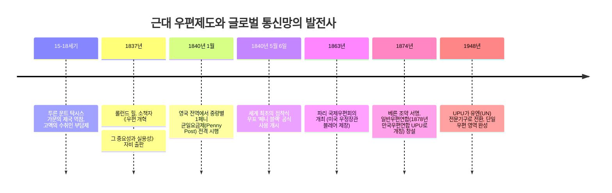
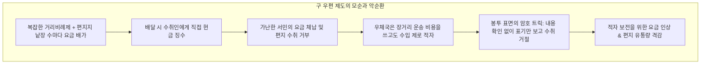
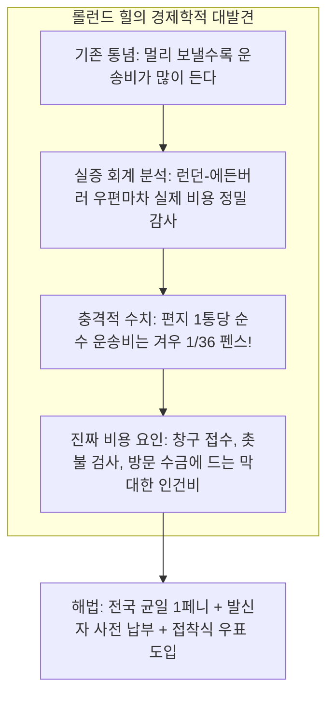

오늘날 우리가 스마트폰으로 이메일이나 메시지를 보낼 때, 수신자가 옆방에 있든 지구 반대편에 있든 거리별 추가 요금을 내지 않습니다. 또한 편지나 소포를 보낼 때 발신인이 우표를 사거나 결제를 마친 뒤 우체통에 넣는 것은 상식입니다.

그러나 1840년 이전의 세계에서는 이 모든 상식이 정반대였습니다. 우편 요금은 **'이동 거리'**와 **'편지지 장수'**에 따라 천문학적으로 치솟았으며, 무엇보다 **'수취인이 배달받을 때 현금으로 지불(수취인 지불제)'**하는 것이 원칙이었습니다. 가난한 서민에게 먼 친척의 편지가 도착한다는 것은 하루치 식비가 날아가는 경제적 재난이었습니다.

이 불합리를 타파한 인물이 영국의 사회개혁가 **롤런드 힐(Sir Rowland Hill)**이었으며, 그 결실이 1840년 발행된 세계 최초의 접착식 우표 **'페니 블랙(Penny Black)'**이었습니다. 나아가 1874년 스위스 베른에서는 국가 간 국경을 허무는 **만국우편연합(UPU)**이 결성되어, 인류 최초의 '글로벌 오픈 통신 프로토콜'이 완성되었습니다.

---

## 1. 전근대 우편의 파행: 수취인 부담제와 거리비례제의 파탄

19세기 초까지 유럽의 우편 제도는 대중을 위한 공공 인프라가 아니라, **국가 권력의 전비 조달용 독점 세금 징수 수단**이었습니다.

- **장수 계산법의 횡포**: 런던에서 에든버러(약 640km)까지 편지 한 통을 보내는 기본요금은 13.5펜스로 노동자의 하루 품삯에 달했습니다. 게다가 무게가 아니라 '종이 장수'로 요금을 매겨, 편지지가 2장이면 2배, 3장이면 3배로 뛰었습니다. 봉투를 쓰면 그 자체가 '두 번째 종이'로 간주되어 요금이 두 배가 되었기에 봉투 사용은 엄격히 기피되었고, 편지지를 가로세로로 겹쳐 쓰는 **'크로스 라이팅(Cross-writing)'**이 성행했습니다.
- **수취인 지불제의 파탄**: 배달부가 집집마다 문을 두드려 돈을 받아내야 했으므로 배달 시간이 한없이 지연되었습니다. 더욱이 편지 겉봉에 잉크 얼룩이나 기호로 안부를 전하는 암호를 미리 정해두고, 겉면만 확인한 뒤 "돈이 없어 못 받겠다"며 편지를 반송하는 **'암호 사기 수법'**이 만연했습니다. 우체국은 운송비만 날리고 운임을 한 푼도 건지지 못하는 만성 적자에 허덕였습니다.

---

## 2. 롤런드 힐의 수학적 발견과 '페니 블랙'의 탄생

이 구조적 모순을 통계 데이터와 경제공학으로 격파한 인물이 **롤런드 힐(Rowland Hill)**이었습니다.

### 2.1 1통당 1/36펜스: 운송비의 진실
1837년 힐은 소책자 《우편 개혁》에서 런던-에든버러 우편마차 장부를 정밀 분석하여 경악스러운 사실을 밝혔습니다:
- 편지 1통을 640km 운송하는 데 드는 **순수 물리적 연료·마차 운송비는 단 1/36펜스(약 0.028펜스)**에 불과했습니다.
- 우체국 지출의 99% 이상은 운송 자체가 아니라, 편지지 장수를 촛불에 비춰보고 거리를 계산하며 집집마다 돈을 받으러 다니는 **'거래비용(Transaction Cost)'**에 낭비되고 있었습니다.

힐은 거리제를 폐지하고 **'전국 균일 요금제(Uniform Rate)'**, 장수제가 아닌 **'중량제(0.5온스 이하 1페니)'**, 그리고 **'발신인 사전 납부제'**를 시행해야 한다고 역설했습니다.

### 2.2 1840년 5월 6일: 페니 블랙의 탄생
1840년 5월 6일, 요금 사전 완납을 증명하기 위해 발행된 세계 최초의 우표가 **'페니 블랙(Penny Black)'**입니다:
- 빅토리아 여왕의 옆모습 메달 조각을 기초로 정밀 요판 인쇄(Intaglio) 기술을 적용.
- 위조 방지를 위해 기하학적 로즈 엔진 문양과 왕관 워터마크(투각) 종이를 사용.
- 당시 전 세계에서 우표를 발행한 나라가 영국뿐이었기에 국명을 인쇄하지 않았으며, 이 역사적 특권으로 지금도 영국 우표에는 UPU 규정상 국명 표기가 면제됩니다.

---

## 3. 철도망 결합과 근대 통신의 만개

페니 블랙의 등장은 증기 철도망의 급팽창과 맞물려 폭발적 시너지를 일으켰습니다:
- **달리는 우체국 (TPO: Travelling Post Office)**: 1838년 도입된 철도 우편차는 시속 80km로 질주하는 열차 안에서 우편물을 분류하고, 자동 그물망 장치로 역을 통과하며 멈추지 않고 우편 자루를 교환했습니다.
- **취급량의 대폭발**: 영국의 우편 유통량은 1839년 7,600만 통에서 1840년 1억 6,800만 통, 1850년 3억 5,000만 통으로 수직 상승했습니다.
- 크리스마스 카드의 탄생(1843년), 통신교육, 우편주문 카탈로그 상업 등 근대 시민사회와 대중문화가 완전히 새롭게 재편되었습니다.

---

## 4. 국경 없는 통신망: 만국우편연합(UPU)의 3대 원칙

국내 통신이 정비되자 각국 간의 복잡한 양자조약이 국제우편의 걸림돌로 떠올랐습니다. 1874년 독일 제국 우정청장 하인리히 폰 슈테판(Heinrich von Stephan)의 주도로 스위스 베른에서 22개국이 모여 **만국우편연합(UPU)**을 창설했습니다:
1. **단일 우편 영역 (Single Postal Territory)**: 전 회원국은 우편에 있어 국경 없는 '하나의 영토'로 간주되며, 외국 우편물도 국내 우편물과 동일한 안전과 신속성으로 배달해야 합니다.
2. **자유 통과권 (Freedom of Transit)**: 어떤 국가도 자국 영토나 영해를 통과하는 타국의 우편물 중계를 방해할 수 없습니다.
3. **요금 완납 및 도착국 무료 배달**: 발송국이 우편 요금을 전액 보유하고, 도착국은 무료로 최종 배달을 수행합니다.

---

## 5. 우편 프로토콜과 인터넷 패킷 통신의 구조적 동일성

19세기 롤런드 힐과 UPU가 설계한 우편 체계는 20세기 말 발명된 **인터넷 TCP/IP 패킷 교환(Packet Switching)**의 철학과 완벽하게 일치합니다:

| 우편 시스템 | 인터넷 TCP/IP 패킷 | 시스템 설계상의 공통점 |
| :--- | :--- | :--- |
| **봉투 (Envelope)** | **IP 패킷 (Packet)** | 데이터 은닉 및 표준화된 프로토콜 캡슐화 |
| **주소 / 우편번호** | **IP 주소 / 포트 번호** | 전 지구적 계층적 라우팅 식별자 |
| **우표 (Stamp)** | **인증 토큰 / 헤더** | 발신자 측 사전 자원 지불 증명 |
| **소인 (Postmark)** | **타임스탬프 / TTL** | 시간·경로 기록 및 중복 재사용 방지 |
| **집하·분류 우체국** | **라우터 (Router)** | 주소를 판독하여 최적 경로로 비동기 전송 |
| **UPU 단일 영역 원칙** | **BGP 기반 AS 상호접속** | 이기종 네트워크를 하나로 묶는 글로벌 상호운용성 |

인터넷의 핵심 사상인 '엔드 투 엔드 원칙(End-to-End Principle)'과 '비동기 최선 노력 배달(Best-Effort Delivery)'은 빅토리아 시대 우편망의 메커니즘을 디지털로 변환한 것에 불과합니다.

### 결론
검은색 1페니 우표 한 장은 단순한 종이 조각이 아니었습니다. 그것은 **"통신의 권리를 만인에게 평등하게 개방하고, 거리의 장벽을 허물어 지구를 하나의 네트워크로 연결한다"**는 근대 정보 혁명의 위대한 출발점이었습니다.
