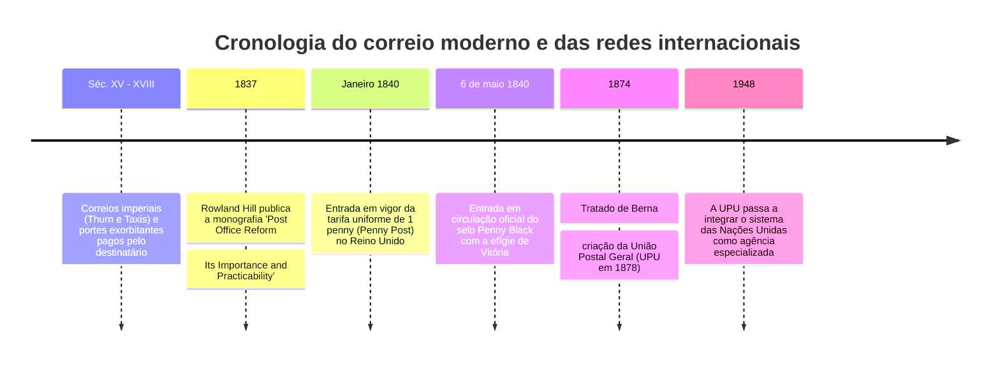

No mundo digital contemporâneo, enviar uma mensagem eletrónica não envolve qualquer sobretaxa pela distância. Da mesma forma, o ato de colocar uma carta num marco do correio baseia-se na certeza de que o remetente liquidou a tarifa previamente.

Contudo, antes de 1840, este modelo funcionava de forma diametralmente oposta: os portes eram proporcionais à **distância percorrida** e ao **número de folhas**, sendo cobrados **em dinheiro ao destinatário no momento da entrega**. Para as classes trabalhadoras, a chegada de uma carta representava amiúde uma catástrofe orçamental.

A rutura com este paradigma arcaico deveu-se a **Sir Rowland Hill**, arquiteto do primeiro selo postal adesivo do mundo: o **Penny Black** (1840). Trinta e quatro anos mais tarde, em 1874, a assinatura do Tratado de Berna dava origem à **União Postal Universal (UPU)**, constituindo a primeira rede global aberta de comunicações da humanidade.

---

## 1. A falência do porte no destino e o sistema arcaico

Antes de 1840, os correios reais britânicos operavam como feudo tributário da Coroa:
- **Tributação por folha**: Colocar uma carta dentro de um envelope duplicava a taxa. O público recorria à «escrita cruzada» (*cross-writing*), redigindo texto na horizontal e na vertical na mesma folha.
- **A fraude do pagamento no destino**: O carteiro aguardava longos minutos à porta de cada casa. Criou-se o estratagema das marcas exteriores cifradas: o destinatário examinava a carta à porta, interpretava a mensagem codificada e recusava o recebimento por alegada falta de dinheiro, deixando o serviço postal em prejuízo crónico.

---

## 2. A descoberta matemática de Rowland Hill e o Penny Black

Em 1837, Rowland Hill auditou o percurso postal Londres–Edimburgo (640 km) e apurou uma verdade económica demolidora:
- O custo do combustível e tração animal para transportar uma carta era de meros **1/36 de penny**.
- A quase totalidade da despesa postal residia nos custos de transação: examinar as folhas contra a luz de velas, calcular tabelas de distâncias e cobrar os montantes à porta.

Hill instituiu três postulados:
1. **Tarifa uniforme (Uniform Penny Post)** de um penny em todo o país.
2. **Franqueamento por peso**, legitimando os envelopes.
3. **Pré-pagamento obrigatório pelo remetente mediante selos adesivos**.

A **6 de maio de 1840** nascia o **Penny Black**, gravado em talhe-doce com o perfil da jovem rainha Vitória. Sendo o único emissor mundial na época, o selo dispensou o nome do país de origem — um privilégio preservado pelo correio britânico na UPU até aos nossos dias.

---

## 3. O vapor ferroviário e a fundação da UPU (1874)

Com a era do vapor, surgiram em 1838 as estações de correio ambulantes em carruagens ferroviárias (**Travelling Post Office**), triando a correspondência a 80 km/h e apanhando sacas em andamento através de redes automáticas. O volume de correspondência britânico disparou de 76 milhões em 1839 para 350 milhões em 1850.

No plano externo, impulsionadas por Heinrich von Stephan, 22 nações assinaram em 1874 o **Tratado de Berna**, estabelecendo a UPU sob três princípios:
1. **Território postal único**: Os países membros formam um espaço geográfico contínuo para o correio.
2. **Liberdade de trânsito**: Garantia de encaminhamento das malas diplomáticas e postais de terceiros.
3. **Retenção da taxa**: O país de envio arrecada os portes e o de destino entrega gratuitamente.

---

## 4. O paralelismo com os pacotes de dados da Internet

A infraestrutura postal antecipou de modo integral os fundamentos do protocolo TCP/IP da Internet:
- **Envelope = Pacote IP** (encapsulamento de dados).
- **Código Postal = Endereço IP** (encaminhamento hierárquico).
- **Selo = Token de autenticação** (autorização de tráfego pré-paga).
- **Carimbo = Marca temporal e TTL** (rastreio e prevenção de reutilização).
- **Estação de Triagem = Roteador (Router)**.

Rowland Hill e os fundadores da UPU materializaram, em plena era vitoriana, a matriz operacional que rege o tráfego de dados do século XXI.
