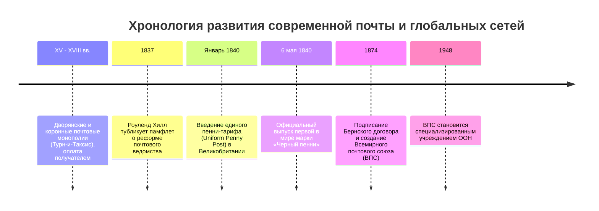

Сегодня, отправляя электронное письмо или сообщение в мессенджере, никто не платит надбавку в зависимости от того, находится ли адресат в соседней комнате или на другом континенте. Точно так же отправка посылки или письма подразумевает, что отправитель заранее оплачивает доставку покупкой марки или онлайн-платежом.

Однако до 1840 года этот порядок был вывернут наизнанку: почтовые тарифы зависели от **расстояния доставки** и **количества листов бумаги**, возрастая до астрономических сумм, причем **оплачивал доставку получатель наличными при вручении**. Для бедных слоев населения получение письма от родственника превращалось в финансовое бедствие, лишавшее семью дневного заработка.

Эту порочную и неэффективную систему разрушил британский реформатор **сэр Роуленд Хилл (Rowland Hill)**, предложивший концепцию единого дешевого тарифа и создавший первую в мире самоклеящуюся почтовую марку — **«Черный пенни» (Penny Black)** в 1840 году. А в 1874 году в Берне был основан **Всемирный почтовый союз (ВПС / UPU)**, заложивший основы первого открытого глобального протокола коммуникаций в истории цивилизации.

---

## 1. Тупик традиционной почты: Абсурд тарифов и крах оплаты получателем

До 1840 года королевская почта Великобритании служила фискальным инструментом выкачивания денег из населения:
- **Полистовая оплата и запрет конвертов**: Письмо из Лондона в Эдинбург стоило 13,5 пенса (целый дневной заработок рабочего). Конверт считался «вторым листом» и удваивал тариф. Чтобы сэкономить, люди писали поперек уже написанных строк («перекрестное письмо» *cross-writing*).
- **Крах оплаты получателем**: Почтальоны простаивали у дверей, выбивая деньги. Появились изощренные хитрости: отправители рисовали на конверте условные знаки (кляксы, черточки), сообщавшие суть новости. Получатель разглядывал письмо на пороге, узнавал, что родственник жив-здоров, и возвращал письмо почтальону, заявляя о неплатежеспособности. Почта возила миллионы писем в чистый убыток.

---

## 2. Математическое открытие Хилла и «Черный пенни»

В 1837 году Роуленд Хилл проанализировал баланс почтовой кареты Лондон–Эдинбург (640 км) и выяснил поразительный факт:
- Физическая себестоимость транспортировки одного письма на расстояние 640 км составляла всего **1/36 пенса**!
- Основные затраты почты уходили не на дорогу, а на трансакционные издержки: взвешивание, просмотр писем на свечу, оформление громоздких реестров и выбивание денег у дверей получателей.

Хилл сформулировал три принципа:
1. **Единый тариф (Uniform Rate)** в 1 пенни по всей стране.
2. **Тарификация по весу** (до полуунции), разрешившая использование конвертов.
3. **Обязательная предоплата отправителем с помощью наклеиваемой марки**.

**6 мая 1840 года** родилась марка **«Черный пенни»** с портретом 15-летней королевы Виктории, отпечатанная глубокой печатью. Поскольку Великобритания была первой, на марке не указывалось название страны — эта уникальная привилегия сохраняется за британскими марками в правилах ВПС и по сей день.

---

## 3. Железнодорожная почта и основание ВПС (1874)

Появление передвижных вагонов-сортировок (**Travelling Post Office**) в 1838 году позволило сортировать корреспонденцию прямо на ходу поезда и обмениваться мешками на станциях без остановки состава. Объем писем в Англии вырос с 76 млн в 1839 г. до 350 млн в 1850 г.

В 1874 году по инициативе Генриха фон Стефана 22 государства подписали **Бернский договор**, создав ВПС на трех китах:
1. **Единая почтовая территория**: Мир превращается в единое пространство без барьеров для корреспонденции.
2. **Свобода транзита**: Обязанность беспрепятственно пропускать почту третьих стран.
3. **Принцип удержания сборов**: Страна-отправитель оставляет себе плату за марку, а страна назначения доставляет почту бесплатно.

---

## 4. Почта как прародитель архитектуры Интернета

Архитектура почтовой реформы XIX века легла в основу стека сетевых протоколов TCP/IP:
- **Конверт = IP-пакет** (инкапсуляция полезной нагрузки).
- **Почтовый индекс и адрес = IP-адрес** (иерархическая маршрутизация).
- **Марка = Криптографический токен** (предоплаченный ресурс).
- **Штемпель гашения = Временная метка и TTL** (защита от повторного использования).
- **Сортировочный узел = Маршрутизатор (Router)**.

Принцип «End-to-End» и негарантированная доставка дейтаграмм (Best-Effort) — прямое цифровое отражение почтовой модели Хилла и ВПС.
