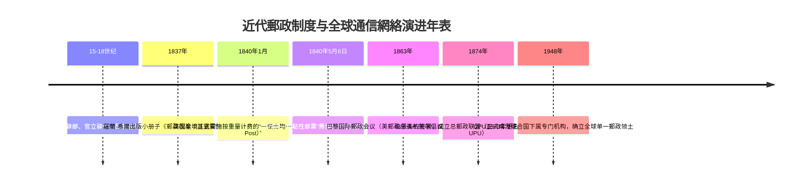
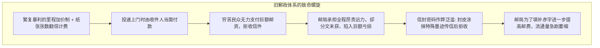
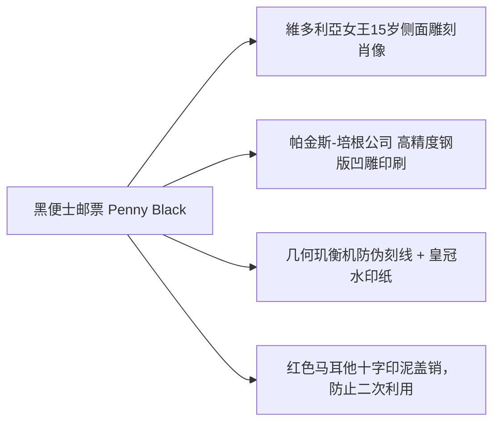

在当今数字化时代，当我们发送一封电子邮件或網絡即时消息时，无论对方身处隔壁房间还是大洋彼岸的地球另一端，我们都不会被加收任何距离溢价。同样，邮寄实体信件或包裹时，由寄件人预先贴上邮票或支付运费，已成为人类社会的普遍常识。

然而在1840年以前，整个世界的郵政逻辑完全是颠倒的：邮资根据**“投递距离的远近”**与**“信纸的张数”**以天文数字暴涨，并且全部由**“收件人在门口当面付现（到付制）”**。对于普通的劳动阶层而言，收到一封远方亲人的来信，往往意味着一天甚至数天的口粮被洗劫一空。

打破这一歷史痼疾的，是英国教育家与社会改革家**羅蘭·希爾（Sir Rowland Hill）**在1840年发起的郵政革命，以及世界上第一枚自带背胶的邮票——**“黑便士（Penny Black）”**。34年后的1874年，瑞士伯恩见证了**万国郵政联盟（UPU）**的诞生，人类歷史上首个真正意义上的“全球开放式互联通信协议”就此成型。



---

## 1. 前近代郵政的制度性瘫痪：到付制与纸张计费的恶性循环

在工业革命初期，欧洲的郵政体系并非服务大众的公共基础设施，而是**王权榨取财政税收的垄断工具**。英国皇家郵政多次调高邮资，以此偿还拿破仑战争留下的巨额国债。



### 1.1 荒诞的计费法则
1830年代的英国郵政运行着极其荒谬的计价公式：
1. **距离阶梯累进**：从伦敦寄信至爱丁堡（约640公里），单张信纸基础資費高达13.5便士，超过底层工人整整一天的工资。
2. **纸张张数翻倍（Sheet-counting）**：邮资不是按重量而是按信纸数量收取。一张纸是单倍价，两张纸立即翻倍，夹带收据便算三张纸。为了省钱，人们被迫发明出**“交叉书写（Cross-writing）”**：写满横行后，将纸旋转90度在字迹上再写满竖行，阅读犹如破译密码。
3. **严禁使用信封**：把信塞进信封，信封本身就会被算作“第二张纸”导致邮资加倍。邮差甚至用烛光透光检查信纸内是否藏匿小纸条。

### 1.2 到付制的崩塌与“暗号拒收”
更致命的是**收件人到付制**。邮差每天挨家挨户敲门收钱，若收件人不在家或掏不出零钱，邮差只能长时间空等，派送效率极低。
民众更是巧妙利用这一漏洞：寄件人在信封表面故意留下墨水点或特定符号（例如右上角红点代表“已安全抵达”，下部折角代表“身体安康”）。收件人在门槛前瞥见暗号，心领神会后立即以“无钱支付”为由将信退回邮差。邮局辛辛苦苦运送几百公里，最终落得零收入。

---

## 2. 羅蘭·希爾的数理洞察与“黑便士”的工程奇迹

彻底摧毁这套腐朽机制的，是英国学者**羅蘭·希爾（Rowland Hill）**。

```mermaid
flowchart TD
    subgraph 羅蘭·希爾的經濟学洞见
        Dogma[传统偏见: 运输里程越远，成本必然越高] --> Audit[实证核算: 审计伦敦至爱丁堡郵政马车的实际账目]
        Audit --> Discovery[震撼数据: 一封信运送640公里的纯物理运费仅为 1/36 便士！]
        Discovery --> RealCost[真正成本核心: 窗口检验、烛光查纸、登门收款的繁杂人力成本]
    end
    RealCost --> Solution[三大改革: 全国均一便士資費 + 寄件人预付 + 粘贴式邮票]
```

### 2.1 惊人发现：纯运输成本仅占1/36便士
希尔在1837年的划时代名作《郵政改革：其重要性与可行性》中，通过对伦敦至爱丁堡邮马车的运力、饲料、养护及载重量数据进行严密测算，得出颠覆性结论：
- 将一封标准信件跨越640公里运至苏格兰，其**纯物理交通能耗成本仅仅只有1/36便士（约0.028便士）**。
- 郵政系统绝大部分的开销，全被浪费在“窗口逐张透光验纸、繁琐计程查表、登门交涉收钱”的巨额**交易成本（Transaction Cost）**之中！

希尔提出：彻底取消里程计价，实行**全国均一資費（Uniform Penny Post）**；取消数纸制，实行**重量阶梯制（半盎司以内均一便士）**；并且强制推行**寄件人预付制**！

### 2.2 1840年5月6日：黑便士诞生
1840年5月6日，世界上第一枚自粘邮票**“黑便士（Penny Black）”**公开发售：



- **高科技凹版防伪**：运用钞票级玑衡机刻出的精密微观几何底纹，配以皇冠水印。
- **无国名特权**：当时全球仅英国一家发行邮票，因而票面只印“POSTAGE ONE PENNY”，无需国名。根据万国郵政联盟条约，英国邮票至今享有免印国名的全球唯一特权。

---

## 3. 铁路邮车与工业社会的全面重塑

均一便士郵政与同期爆发的英国铁路狂潮（Railway Mania）产生了惊天动地的化学反应。

- **行进中的邮局（TPO: Travelling Post Office）**：1838年，铁路郵政车厢投入运营。列车在以每小时50英里疾驰过程中，分拣员在车内飞速按目的地分信，并使用**轨道旁全自动网兜收发装置**，在列车不减速的情况下瞬间完成路口邮袋抛接，建成了全英次日达的极速郵政網絡。
- **信件流通量爆炸**：英国全国信件投递量从1839年的7600万封飙升至1840年的1.68亿封，到1850年突破3.5亿封。
- **近代大众文化诞生**：1843年亨利·科尔发明了商业圣诞卡，随之一便士郵政传遍千家万户；速记远程函授教育、邮购目录商品贸易、期刊杂志订阅等现代商业模式如雨后春笋般涌现。

---

## 4. 全球互联基石：万国郵政联盟（UPU）

国内網絡的完善迅速遭遇了国际信件流转的乱象。在19世纪中叶前，跨国信件受制于各国割裂的双边条约，货币、重量单位（盎司/克/关税单位）各不相同，转运费用层层盘剥。

1874年，在德意志帝国郵政总局长**海因里希·冯·斯特凡（Heinrich von Stephan）**的主导下，22国代表在瑞士签署《伯恩条约》，创立**万国郵政联盟（UPU）**，确立了统治至今的三大基石原则：
1. **单一郵政领土（Single Postal Territory）**：全体成员国在郵政业务中被视为同一个无国界领土，外国信件享受与本国信件同等优先级与投递标准。
2. **过境自由权（Freedom of Transit）**：任何国家不得阻挠或扣押过境的他国邮袋。
3. **資費保留与免费终端递送**：寄出方邮局全额保留所收邮资，收件国免费为外国邮件提供境内最终投递（后续演化出终端费协议）。

---

## 5. 郵政协议与现代網際網路的底层同构性

令人惊叹的是，羅蘭·希爾与万国郵政联盟所构建的物理通信網絡，其架构逻辑与20世纪末诞生的**網際網路TCP/IP分組交換协议（Packet Switching）**存在着不可思议的同构映射：

| 郵政網絡架构 | 網際網路 TCP/IP 协议映射 | 系统工程与设计哲学一致性 |
| :--- | :--- | :--- |
| **信封（Envelope）** | **IP封包（Packet）** | 协议封装：隐藏具体载荷内容，对外展示标准化元数据 |
| **地址与邮编** | **IP地址与端口号** | 分级可路由编址，支持全网无歧义路由寻址 |
| **邮票（Stamp）** | **服务认证令牌** | 寄件端预付资源使用权的加密凭单 |
| **邮戳（Postmark）** | **时间戳与TTL计数器** | 记录入网时空坐标，杜绝重放攻击与循环使用 |
| **邮件分拣中心** | **三层路由器（Router）** | 解读包头地址并向下一跳最佳链路异步转递 |
| **单一领土原则** | **自治系统互联（BGP协议）** | 异构網絡完全解耦对齐，形成全球统一可达空间 |

網際網路先驱们所践行的“端到端原则（End-to-End Principle）”与“尽力而为传输（Best-Effort Delivery）”，本质上就是把維多利亞时代的郵政机制数字化。

### 结语
黑便士邮票不仅是一枚小小的纸片，更是人类通信民主化的无上丰碑。正是它将信息沟通从统治阶级的特权，变成了普罗大众不可剥夺的基本权利。
