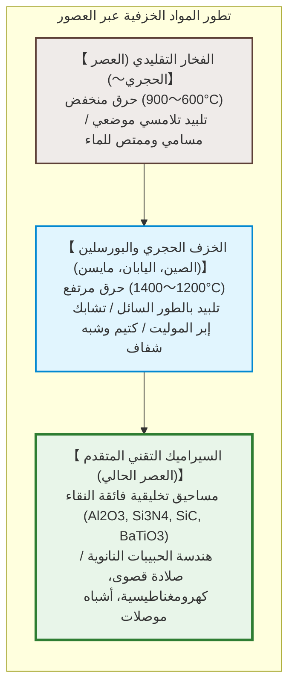
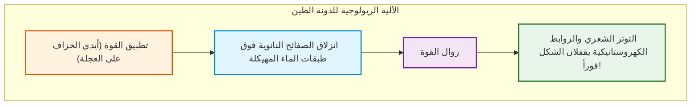
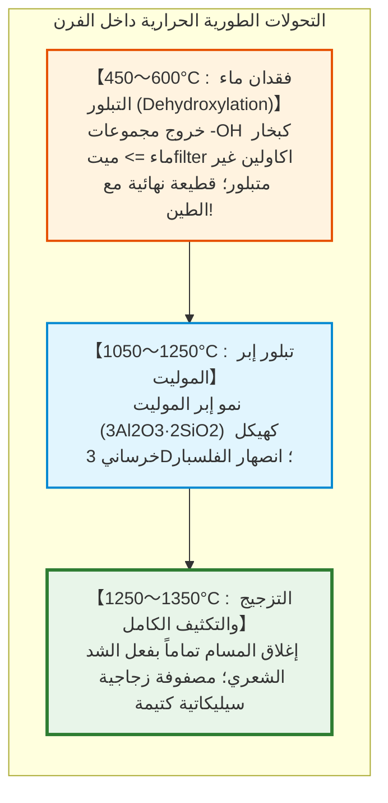
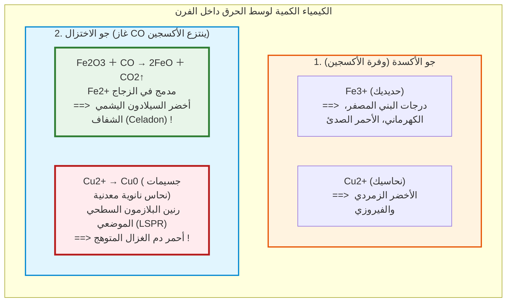

## مقدمة: الطين الرخو الذي يتصلب صخراً خالداً بفعل النار

منذ عشرات الآلاف من السنين، اكتشف الإنسان في العصر الحجري القديم معجزة في قلب النار: طين ناعم لدن يمكن تشكيله بسهولة بالأصابع، يتحول بشكل لا رجعة فيه عند تعرضه لحرارة نارية عالية إلى إناء صلب، كتيم وصامد للماء: **السيراميك (الخزف)**.

اشتقت الكلمة من الإغريقية **«keramos» (κέραμος)** وتعني الطين المحروق. واليوم تجاوز السيراميك أواني الطعام بمراحل:
- أكثر من 1000 **مكثف سيراميكي متعدد الطبقات (MLCC)** في كل هاتف ذكي؛
- بلاطات السيليكا النقية تتحمل بلازما $1500^\circ\text{C}$ أثناء دخول المركبات الفضائية للغلاف الجوي؛
- سيراميك الهيدروكسي أباتيت الحيوي يندمج خلوياً مع عظام الإنسان؛
- **كربيد السيليكون ($\text{SiC}$)** يقود محولات الطاقة في السيارات الكهربائية الحديثة.

---

## الفصل الأول: بنية الكاولينيت النانوية وفيزياء اللدونة

### 1.1 شبكة الكاولينيت الطبقية 1:1

المعدن الأساسي في صناعة البورسلين هو **الكاولينيت** ($\text{Al}_2\text{Si}_2\text{O}_5(\text{OH})_4$):
1. صفيحة السيليكا رباعية الأوجه ($\text{Si-O}$)؛
2. صفيحة الألومينا ثمانية الأوجه ($\text{Al-O/OH}$).

تحت المجهر الإلكتروني، يظهر الكاولينيت كصفائح نانوية سداسية مسطحة يبلغ سمكها بضعة نانومترات.

### 1.2 آلية اللدونة (Plasticity)

- **مساحة سطحية نوعية هائلة**: $10 \text{ إلى } 30\,\text{m}^2/\text{g}$؛
- **أسطح سالبة وأطراف موجبة الشحنة** تكون شبكة تشبه «بيت البطاقات»؛
- **أغشية مائية مهيكلة نانوياً**: تسمح بالانزلاق السلس تحت ضغط التشكيل (**سهولة التشكل**)، في حين يثبت الشد السطحي الشعري الأشكال فور زوال القوة (**الاحتفاظ بالشكل**).

---

## الفصل الثاني: التحولات الحرارية والتلبيد في الفرن

1. **فقدان ماء التبلور ($450 \sim 600^\circ\text{C}$)**: تنطلق مجموعات $-\text{OH}$ ويتحول الطين إلى **ميتاكاولين** عديم التبلور، ليعبر نقطة اللاعودة حيث يستحيل عليه التحلل مجدداً في الماء.
2. **تبلور الموليت ($> 1100^\circ\text{C}$)**: تتشابك بلورات **الموليت** الإبرية ($3\text{Al}_2\text{O}_3 \cdot 2\text{SiO}_2$) تماماً كشبكات التسليح الفولاذية.
3. **التلبيد بالطور السائل**: ينصهر الفلسبار في سائل لزج يملأ كافة المسام بواسطة قوى السحب الشعرية.

---

## الفصل الثالث: الفخار، الخزف الحجري، والبورسلين

| الفئة | حرارة الحرق | البنية المجهرية | امتصاص الماء | الشفافية | الرنين الصوتي |
|---|---|---|---|---|---|
| **الفخار (Earthenware)** | **$800 \sim 1150^\circ\text{C}$** | تلبيد حبيبي مسامي | **$> 10\%$** | معتم | صوت خافت مكتوم |
| **الخزف الحجري (Stoneware)** | **$1200 \sim 1280^\circ\text{C}$** | متزجج، كتيم للماء | **$< 1\%$** | معتم | صوت صخري صلب |
| **البورسلين (Porcelain)** | **$1300 \sim 1400^\circ\text{C}$** | خليط زجاجي وموليت عديم المسام | **$0 \sim 0{,}2\%$** | **نصف شفاف (ينفذ الضوء)** | **رنين معدني نقي وواضح** |

---

## الفصل الرابع: كيمياء الطلاء الزجاجي وأجواء الحرق

- **السيلادون**: كمية ضئيلة من الحديد ($1 \sim 2\%$) تُختزل إلى $\text{Fe}^{2+}$، لتمتص اللون الأحمر وتبث لون اليشم الأخضر الساحر.
- **التصدع الجمالي (الكراكليه)**: يحدث عندما يتمدد الطلاء الزجاجي حرارياً أكثر من الجسم الخزفي ($\alpha_\text{الطلاء} > \alpha_\text{الجسم}$)، مما يسبب شقوقاً شعرية فنية متقاطعة عند التبريد.

---

## الفصل الخامس: الذهب الأبيض – مايسن وأريتا

في القرن السابع عشر، اجتاحت أوروبا حمى الخزف الياباني (إيماري). سجن أغسطس القوي الخيميائي **يوهان فريدريش بوتغر** حتى فك لغز البورسلين في 1709 عبر صهر الكاولين والفلسبار فوق $1300^\circ\text{C}$، لتولد بعدها دار **مايسن** للخزف في 1710.

---

## الفصل السادس: السيراميك التقني المتقدم

- **تيتانات الباريوم ($\text{BaTiO}_3$) ومكثفات MLCC**: ثابت عزل يفوق 5000 إلى 10000، مما يتيح تجميع آلاف الطبقات تحت الميكرونية في رقائق دقيقة.
- **الزركونيا المثبتة جزئياً (PSZ)**: المتانة بالتحول الطوري. يولد الإجهاد تمدداً حجمياً بنسبة 4% يطبق على الشروخ ويمنع كسر السيراميك كلياً.

---

## خاتمة: العهد الأبدي بين الطين والنار

من أول إناء فخاري في فجر التاريخ إلى رقائق كربيد السيليكون في عصر الذكاء الاصطناعي، يظل المبدأ ثابتاً: إعادة ترتيب الروابط الذرية غير العضوية بقوة الحرارة. السيراميك هو الأساس المادي الأرسخ للحضارة الإنسانية.
