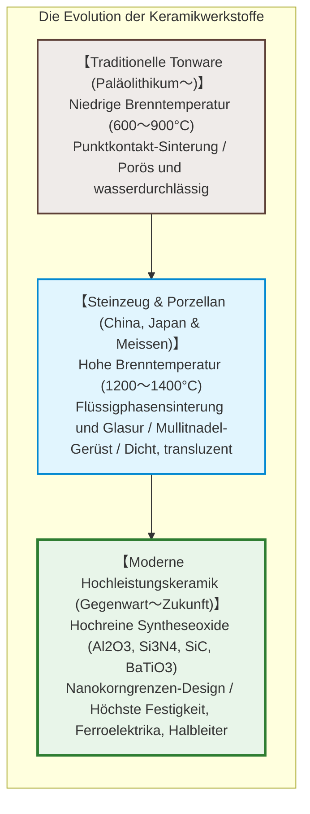
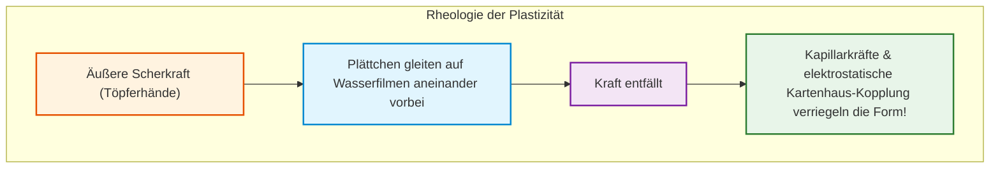
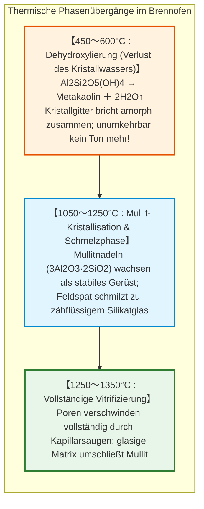
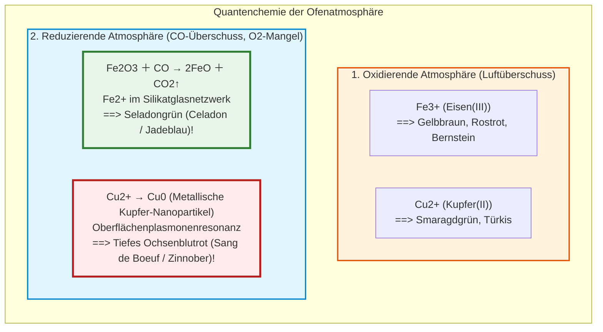

## Einleitung: Warum Schlamm im Feuer zu unvergänglichem Stein wird

Vor zehntausenden Jahren entdeckten Menschen im Jungpaläolithikum ein physikalisches Wunder: Weicher Ton, der mit Wasser beliebig verformbar war, wandelte sich im lodernden Feuer ab einer kritischen Temperatur unumkehrbar in ein hartes, dichtes und wasserfestes Gefäß um: **die Keramik**.

Das Wort leitet sich vom griechischen **„keramos“ (κέραμος)** ab – gebrannter Ton. Heute reicht das Spektrum der Keramik weit über Geschirr hinaus:
- Über 1.000 **Vielschicht-Keramikkondensatoren (MLCCs)** stabilisieren die Stromkreise eines jeden modernen Smartphones;
- Hitzeschutzkacheln widerstehen dem $1500^\circ\text{C}$ heißen Eintrittsplasma von Raumfähren;
- **Biokeramik (Hydroxylapatit)** verwächst direkt mit Knochen in Implantaten;
- **Siliziumkarbid ($\text{SiC}$)** treibt Hochleistungs-Wechselrichter moderner Elektroautos an.

---

## Kapitel 1: Kaolinit-Nanostruktur und die Physik der Plastizität

### 1.1 Das Schichtgitter des Kaolinits

Die Basis hochwertiger Tone ist **Kaolinit** ($\text{Al}_2\text{Si}_2\text{O}_5(\text{OH})_4$). Seine Kristallstruktur besteht aus asymmetrischen 1:1-Schichten:
1. Einer **$\text{Si-O}$-Tetraederschicht** (sechseckiges Silikatnetz);
2. Einer **$\text{Al-O/OH}$-Oktaederschicht** (Gibbsit-Schicht).

Unter dem Elektronenmikroskop bilden die Kristalle sechseckige, hauchdünne Nanoplättchen von wenigen Mikrometern Durchmesser.

### 1.2 Mechanismus der Plastizität

Warum lässt sich Ton auf der Töpferscheibe hauchdünn hochziehen, behält aber sofort seine Form?
- **Riesige spezifische Oberfläche**: $10 \text{ bis } 30\,\text{m}^2/\text{g}$.
- **Ladungsasymmetrie**: Die Basalflächen sind permanent **negativ**, gebrochene Kanten **positiv** geladen.
- **Hydrathüllen-Schmierung**: Unter Schub gleiten die Plättchen auf nanometerdünnen Wasserfilmen aneinander vorbei (**Verformbarkeit**). Fällt die Kraft weg, ziehen Kapillarkräfte und elektrostatische Anziehung („Kartenhaus-Struktur“) die Teilchen fest (**Formbeständigkeit**).

---

## Kapitel 2: Phasenübergänge und Sinterung im Brennofen

1. **Dehydroxylierung ($450 \sim 600^\circ\text{C}$)**: Chemisch gebundene Hydroxylgruppen spalten sich als Wasser ab; es entsteht amorpher **Metakaolin**.
2. **Mullitbildung ($> 1100^\circ\text{C}$)**: Nadelige **Mullitkristalle** ($3\text{Al}_2\text{O}_3 \cdot 2\text{SiO}_2$) wachsen dreidimensional wie Stahlarmierungen.
3. **Flüssigphasensinterung**: Feldspat schmilzt zu einer zähen Glasschmelze, deren Kapillardruck alle Hohlräume zusammenzieht und Poren eliminiert.

---

## Kapitel 3: Werkstoffkunde: Tonware, Steinzeug und Porzellan

| Kategorie | Brenntemperatur | Gefüge | Wasseraufnahme | Transluzenz | Klang |
|---|---|---|---|---|---|
| **Tonware (Earthenware)** | **$800 \sim 1150^\circ\text{C}$** | Poröses Punktkontakt-Gefüge | **$> 10\%$** | Undurchsichtig | Dumpf |
| **Steinzeug (Stoneware)** | **$1200 \sim 1280^\circ\text{C}$** | Dicht gesintert, unglasiert dicht | **$< 1\%$** | Undurchsichtig | Steinig-hart |
| **Porzellan (Porcelain)** | **$1300 \sim 1400^\circ\text{C}$** | Vollständig vitrifiziertes Mullit-Glas | **$0 \sim 0{,}2\%$** | **Lichtdurchlässig** | **Heller metallischer Klang** |

Porzellan klingt metallisch, da das porenfreie, hoch-elastische Mullit-Glas-Gefüge Schallwellen ohne Dämpfung weiterleitet, und es ist transluzent, weil keine Poren das Licht streuen.

---

## Kapitel 4: Glasurchemie und Ofenatmosphäre

- **Seladonglasur**: Im reduzierenden Brand entzieht Kohlenmonoxid ($\text{CO}$) dem Eisenoxid Sauerstoff, wodurch zweiwertiges Eisen ($\text{Fe}^{2+}$) entsteht, das rotes Licht absorbiert und den berühmten jadegrünen Ton erzeugt.
- **Krakelee (Haarrisse)**: Wenn der thermische Ausdehnungskoeffizient der Glasur größer ist als der des Scherbens ($\alpha_\text{Glasur} > \alpha_\text{Scherben}$), reißt die Glasurschicht beim Abkühlen dekorativ ein.

---

## Kapitel 5: Das Weiße Gold – Meissen und Arita

Im 17. Jahrhundert exportierte Japan über die VOC Millionen Stücke **Arita-/Imari-Porzellan** nach Europa. August der Starke von Sachsen ließ den Alchemisten **Johann Friedrich Böttger** einkerkern, bis dieser 1709 zusammen mit Tschirnhaus das Geheimnis lüftete: Kaolin und Feldspat bei über $1300^\circ\text{C}$ zu brennen. 1710 entstand **Meissen**, die erste Porzellanmanufaktur Europas.

---

## Kapitel 6: Hochleistungskeramik in Elektronik und Raumfahrt

- **Bariumtitanat ($\text{BaTiO}_3$) & MLCC**: Durch die Perowskit-Kristallstruktur besitzt es eine Dielektrizitätskonstante von über 5.000 bis 10.000. Über 1.000 Nanoschichten werden zu mikroskopischen Kondensatoren gestapelt.
- **Umwandlungsverstärktes Zirkonoxid (PSZ)**: Bei Rissbildung expandiert die tetragonale Phase durch Martensit-Umwandlung um 4 % in die monokline Phase, presst den Riss zusammen und verhindert den Bruch („metallähnliche Keramik“).

---

## Fazit: Die Meisterung der anorganischen Bindung

Vom ersten gebrannten Tonkrug der Steinzeit bis zu den Siliziumkarbid-Halbleitern der Moderne: Das Prinzip bleibt identisch – die thermodynamische Neuordnung kovalenter und ionischer Bindungen unter der Einwirkung von Hitze. Keramik ist das beständigste Material der Menschheitsgeschichte.
