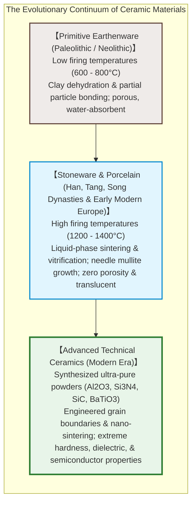
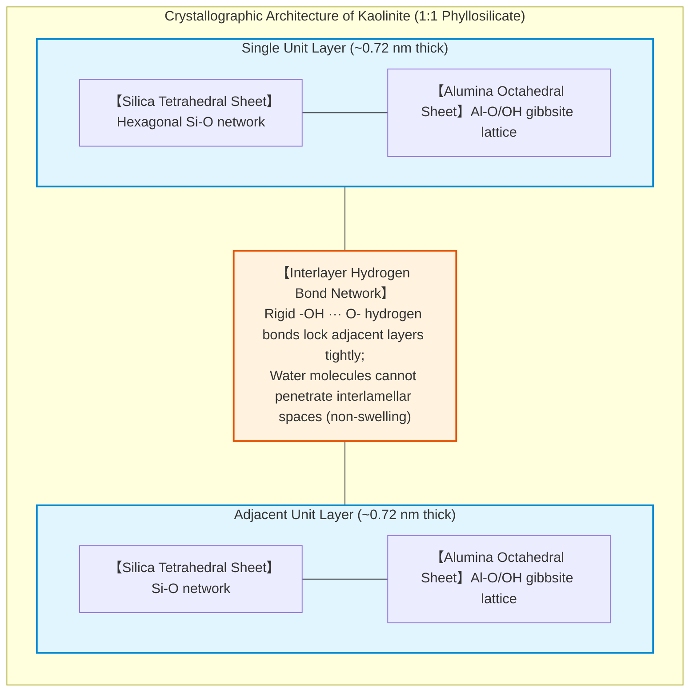
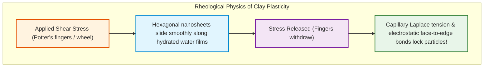
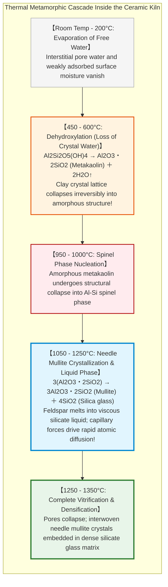
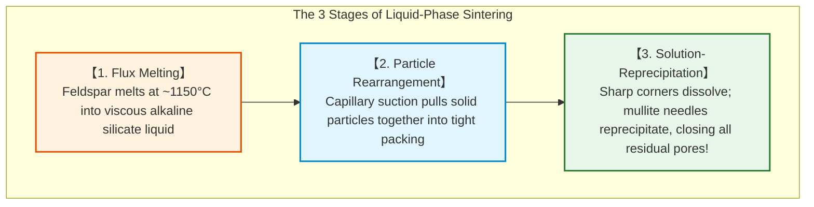
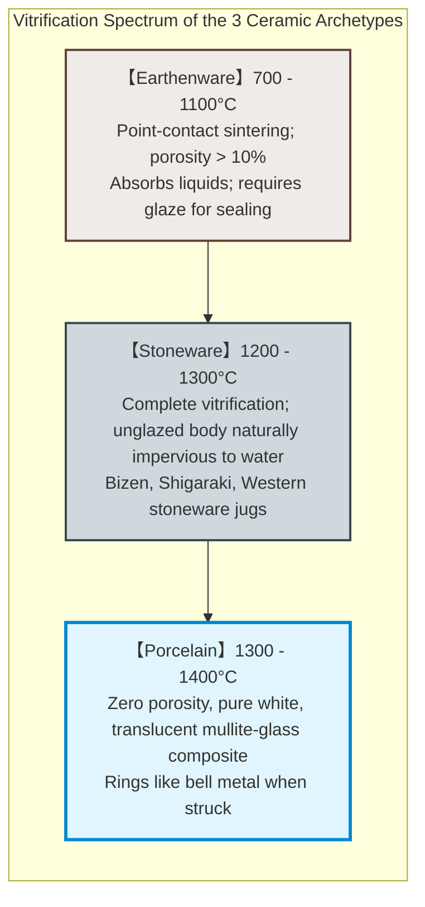
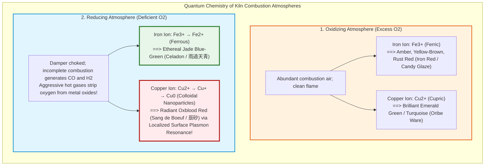
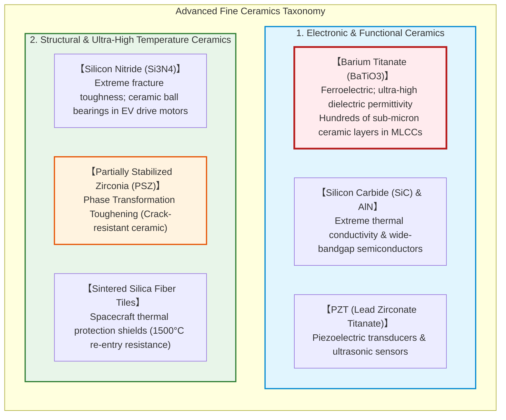

## Introduction: Why Does Soft Mud Metamorphose into Resilient Stone in the Fire?

Tens of thousands of years ago, along the fertile riverbanks of the late Paleolithic era, early humans stumbled upon one of the most astonishing transformations in the physical world. A patch of soft, plastic earth—malleable when hydrated and easily crushed between two fingers—was cast into the radiant heat of a bonfire. When the temperature crossed a critical thermodynamic threshold, the mud did not bake dry only to dissolve in the next rainfall; instead, it underwent an irreversible chemical metamorphosis. It emerged as a hard, ringing, watertight vessel: **Ceramics**.

This marked the dawn of humanity’s first synthetic material engineering.

The word "ceramics" originates from the ancient Greek **"keramos" (κέραμος)**, meaning "potter’s clay" or "burnt earth." Across millennia, this primordial craft evolved from rudimentary earthenware to Chinese high-fire celadon and white porcelain, Japanese Jomon vessels and Edo-period Arita/Imari porcelain, and the revered royal kilns of Meissen and Sèvres in Europe.

In contemporary materials science and solid-state physics, however, ceramics have shattered the decorative confines of domestic dinnerware:
- Over 1,000 microscopic **Multilayer Ceramic Capacitors (MLCCs)** stabilize voltages within a single modern smartphone (and more than 10,000 in an electric vehicle);
- Ultra-high-purity silica tiles withstand the incandescent $1500^\circ\text{C}$ atmospheric re-entry plasma on the outer skin of spacecraft;
- **Bioactive hydroxyapatite ceramics** bond directly to living bone in prosthetic implants;
- Wide-bandgap semiconductor ceramics like **Silicon Carbide ($\text{SiC}$)** and **Gallium Nitride ($\text{GaN}$)** power next-generation high-efficiency electric power inverters.



Why does heating mundane earth cause such a dramatic physical transformation?
Why do porous terra-cotta flowerpots seep water, while fine porcelain repels liquid like solid glass and rings with a clear, metallic pitch when struck?
And how does the kiln burner's manipulation of oxygen—the dance between **oxidizing** and **reducing** atmospheres—dictate the quantum electronic transitions that render iron glaze into serene celadon jade or vibrant amber?

This treatise provides an exhaustive scientific breakdown: from the crystallographic nanosheets of clay minerals and the atomic diffusion of solid- and liquid-phase sintering, to glaze glass chemistry, the geopolitical saga of European porcelain alchemy, and the nano-engineered ferroelectric ceramics powering modern computing.

---

## Chapter 1: The Nanostructure of Clay Minerals and the Physics of Plasticity

### 1.1 Layered Silicates (Phyllosilicates): The Kaolinite Nanosheet

Potter’s clay is fundamentally distinct from common sand or dirt. It is the chemical product of hundreds of millions of years of geothermal and meteoric weathering acting upon granitic rocks, particularly feldspar. This process produces **phyllosilicates (layered silicate minerals)**.

The foundational mineral of pottery and fine porcelain is **Kaolinite** ($\text{Al}_2\text{Si}_2\text{O}_5(\text{OH})_4$, or $\text{Al}_2\text{O}_3 \cdot 2\text{SiO}_2 \cdot 2\text{H}_2\text{O}$).

Kaolinite possesses an asymmetric **1:1 dioctahedral layer lattice** measuring approximately 0.72 nanometers in thickness:
1. **Tetrahedral Silica Sheet ($\text{Si-O}$)**: Silicon cations ($\text{Si}^{4+}$) coordinated to four oxygen atoms, sharing three basal corners in a continuous hexagonal mesh.
2. **Octahedral Alumina Sheet ($\text{Al-O/OH}$)**: Aluminum cations ($\text{Al}^{3+}$) coordinated to oxygen and hydroxyl ($-\text{OH}$) groups in an edge-sharing gibbsite-type sheet.



Under high-resolution transmission electron microscopy (TEM), kaolinite crystals appear as microscopic hexagonal plates—resembling microscopic playing cards—measuring 0.2 to 2 micrometers wide and a few tens of nanometers thick.

### 1.2 Electric Double Layers and the Molecular Mechanism of Plasticity

If you wet common beach sand (quartz granules, $100 \sim 500\,\mu\text{m}$), you can compress it into a temporary castle, but releasing your hand leaves a fragile mass that collapses under the slightest shear. Why does wet clay exhibit **plasticity**—the unique ability to be deformed smoothly into intricate thin-walled vessels under hand pressure on a potter’s wheel, and permanently retain that exact shape without slumping when the force is removed?

The physical answer lies in the **vast specific surface area** of clay combined with its **surface electrostatic charge and bound water films**:

1. **Immense Specific Surface Area**:
   Because clay particles are sub-micron nanosheets, their specific surface area ranges from $10 \text{ to } 30\,\text{m}^2/\text{g}$ (and up to hundreds of $\text{m}^2/\text{g}$ in smectite clays).
2. **Permanent Basal Negative Charge and Edge Positive Charge**:
   Isomorphous ionic substitution within the crystal lattice (e.g., $\text{Al}^{3+}$ replacing $\text{Si}^{4+}$ in tetrahedral sites) leaves the basal faces of kaolinite plates with a permanent **negative electrostatic charge**. Conversely, broken bonds along crystal edges expose protonated alumina groups carrying a **positive charge** at neutral-to-acidic pH.
3. **Structured Water Film Lubrication**:
   When water is kneaded into dry clay, polar water molecules coordinate intensely to the charged basal surfaces, forming a nanometer-thin envelope of structured, viscous "adsorbed water."
   - **Shear Compliance (Sliding)**: Under applied shear stress (the potter's fingers), the hexagonal plates glide smoothly past one another over these lubricating water films like a stacked deck of cards.
   - **Yield Stress (Shape Retention)**: When the external forming stress is removed, the capillary suction pressure of the liquid menisci, combined with electrostatic attraction between negative faces and positive edges ("house-of-cards" flocculation), instantly locks the particles in place.



### 1.3 Drying Shrinkage and Capillary Tension

Formed "green" clay bodies contain 20% to 30% water by weight. As the ware dries, interstitial free water evaporates, drawing clay plates closer via capillary action. This induces a **linear drying shrinkage of 5% to 10%**.

If drying proceeds non-uniformly—such as a warm draft striking one side of a vessel—the exterior shrinks faster than the moist core. Because dry clay possesses negligible tensile ductility, differential shrinkage generates high localized tensile stresses, producing rapid shrinkage cracks. Thus, ceramic ware must undergo slow, humidity-controlled curing before entering the kiln.

---

## Chapter 2: The Kiln Reactor—Thermal Transformations and Sintering

Firing clay is not mere desiccation; it is a cascade of high-temperature solid-state chemical reactions, polymorphic phase transformations, and liquid-phase sintering.



### 2.1 Dehydroxylation ($450 \sim 600^\circ\text{C}$): Crossing the Point of No Return

Between $450^\circ\text{C}$ and $600^\circ\text{C}$, thermal vibrational energy overcomes the chemical bonds holding the structural hydroxyl groups within the octahedral sheet. The $-\text{OH}$ ions combine and liberate chemically bound water vapor:

$$\text{Al}_2\text{Si}_2\text{O}_5(\text{OH})_4 \xrightarrow{450 \sim 600^\circ\text{C}} \text{Al}_2\text{Si}_2\text{O}_7 \text{ (Metakaolin)} + 2\text{H}_2\text{O} \uparrow$$

The orderly crystalline lattice of kaolinite collapses into an amorphous, metastable aluminosilicate phase known as **metakaolin**. At this moment, the material crosses the point of no return: even if immersed in boiling water for decades, metakaolin can never rehydrate into malleable mud. The clay has permanently died; the ceramic has begun to live.

### 2.2 Mullite ($3\text{Al}_2\text{O}_3 \cdot 2\text{SiO}_2$) Needle Crystallization

Above $1000^\circ\text{C}$, the amorphous metakaolin reorganizes into an intermediate spinel-type phase, and past $1100^\circ\text{C}$, nucleates into **mullite** ($3\text{Al}_2\text{O}_3 \cdot 2\text{SiO}_2$):

$$3(\text{Al}_2\text{O}_3 \cdot 2\text{SiO}_2) \xrightarrow{> 1100^\circ\text{C}} 3\text{Al}_2\text{O}_3 \cdot 2\text{SiO}_2 \text{ (Mullite)} + 4\text{SiO}_2 \text{ (Free Silica)}$$

Mullite grows as anisotropic, needle-like acicular crystals (interlocking whiskers). These crystalline needles interweave three-dimensionally throughout the body, acting as a microscopic rebar cage that imparts high mechanical fracture toughness, thermal shock resistance, and creep resistance.

### 2.3 Sintering Thermodynamics and Liquid-Phase Vitrification

The thermodynamic driving force of **sintering** is the **minimization of total interfacial free energy ($\Delta G < 0$)**:
A collection of fine powder particles possesses enormous excess surface free energy due to its vast solid-vapor surface area. By fusing together at grain boundaries and eliminating pores, the system drastically reduces its surface area, achieving thermodynamic stability.

In high-fire ceramics and porcelain, densification is vastly accelerated by **Liquid-Phase Sintering**:



Pottery bodies incorporate **feldspar** ($\text{KAlSi}_3\text{O}_8$ or $\text{NaAlSi}_3\text{O}_8$) as a **flux**. Feldspar melts at $1150 \sim 1200^\circ\text{C}$, creating a viscous silicate melt that wicks into the interparticle voids via capillary force. Under capillary suction, solid quartz and mullite particles slide together into dense hexagonal packing. Sharp silica edges dissolve into the melt, reprecipitating onto growing mullite crystals (Ostwald ripening). Upon cooling, this liquid freezes into an amorphous glass matrix.

The resulting microstructure of fired porcelain is a **micro-composite: an interwoven network of rigid needle-like mullite crystals and residual quartz grains embedded seamlessly within an impermeable silicate glass matrix**.

---

## Chapter 3: Earthenware, Stoneware, and Porcelain—Materials Science Spectrum

In ceramic engineering, wares are categorized into four distinct classes based on firing temperature, porosity, and mineral composition.

| Classification | Raw Materials | Firing Temp | Microstructure | Water Absorption | Translucency | Acoustic Pitch |
|---|---|---|---|---|---|---|
| **Earthenware (土器 / 陶器)** | Common iron-rich clay | **$700 \sim 1150^\circ\text{C}$** | Highly porous, unvitrified matrix | **$> 10\%$** (Highly absorbent) | Opaque | Dull thud (Low frequency) |
| **Stoneware (炻器 / 焼き締め)** | Refractory stone clay + natural fluxes | **$1200 \sim 1300^\circ\text{C}$** | Vitrified, dense, impervious | **$< 1\%$** (Essentially zero) | Opaque | Hard, stony ring |
| **Porcelain (磁器)** | Pure Kaolin + Quartz + Feldspar | **$1300 \sim 1400^\circ\text{C}$** | Fully vitrified, zero pores, mullite-glass composite | **$0 \sim 0.5\%$** (Complete zero) | **Translucent** (Passes light) | **Clear metallic ring (High pitch)** |



### Why Does Porcelain Transmit Light and Ring Like Metal?

1. **Optical Translucency**:
   Light scattering in solids is caused primarily by refractive index discontinuities between pores (air, $n \approx 1.0$) and mineral grains ($n \approx 1.5 - 1.6$). In earthenware, millions of air pores scatter photons in all directions, rendering the body opaque.
   In fine porcelain, high-purity kaolin and feldspar melt into a continuous, pore-free glassy phase. The refractive index of the silica-alumina glass matches the fine crystalline mullite closely. Lacking internal air bubbles to scatter light, visible photons travel through the ceramic wall, imparting a jade-like translucency.
2. **Acoustic Ring (Metallic Pitch)**:
   In porous earthenware, internal air voids act as acoustic dampers, dissipating vibrational energy as heat; tapping it yields a dull "thud."
   In contrast, fully vitrified porcelain has near-zero internal damping and a high Young’s modulus ($E \approx 70 \text{ to } 90\,\text{GPa}$). Mechanical acoustic waves propagate across the mullite-glass matrix with minimal attenuation, resonating like a bronze bell with a crisp, clear, high-frequency ring.

---

## Chapter 4: The Physics of Glazes and Kiln Atmosphere Quantum Chemistry

A ceramic **glaze** is a thin layer of specialized silicate glass (typically 100 to 500 micrometers thick) fused directly onto the clay body during firing.

### 4.1 Atmospheric Redox Chemistry: Oxidizing vs. Reducing Flames

The magic of ceramic color is dictated by the kiln atmosphere—specifically, whether combustion takes place with an excess or deficiency of oxygen.



#### The Secret of Celadon (青磁)

The iconic jade-green hue of Song Dynasty celadon is produced by a trace concentration ($1 \text{ to } 2\%$) of iron oxide ($\text{Fe}_2\text{O}_3$):
- In an **oxidizing flame**, iron remains in the trivalent state ($\text{Fe}^{3+}$), yielding a dull yellowish-brown glaze.
- In a **reducing flame**, incomplete combustion produces carbon monoxide ($\text{CO}$), which strips oxygen from the ferric oxide:
  $$\text{Fe}_2\text{O}_3 + \text{CO} \to 2\text{FeO} + \text{CO}_2 \uparrow$$
  Divalent ferrous ions ($\text{Fe}^{2+}$) incorporate into the glassy silicate matrix, where their electronic d-orbital transitions absorb red light and transmit ethereal bluish-green light—the celebrated "rain after cloudbreak" celadon hue.

#### Colloidal Copper Red (辰砂 - Sang de Boeuf)

When copper is fired in an oxidizing kiln, $\text{Cu}^{2+}$ ions impart an emerald green (Oribe ware). When subjected to heavy reduction, copper is reduced to sub-nanometer metallic copper clusters ($\text{Cu}^0$) and cuprous oxide ($\text{Cu}_2\text{O}$). These metallic nanoparticles induce **Localized Surface Plasmon Resonance (LSPR)**, absorbing green and blue wavelengths to produce the flaming ruby crimson known as *Sang de Boeuf* (oxblood).

### 4.2 Crazing (貫入): Thermal Expansion Mismatch

When a glaze cools, fine spiderweb crackles often form across its surface, known as **crazing (貫入)**. This is driven by thermal expansion mismatch:

$$\alpha_\text{glaze} > \alpha_\text{body}$$

If the glaze contracts more than the underlying ceramic body during cooling, the rigid adhesion to the body prevents it from shrinking freely. Biaxial tensile stresses build up within the glass layer until they exceed its ultimate tensile strength. The glaze fractures with audible pinging sounds, producing fine crackle patterns that potters highlight with tea stains or sumi ink.

---

## Chapter 5: Geopolitics of White Gold—Jingdezhen, Meissen, and Arita

```mermaid
flowchart LR
    subgraph PorcelainGeopolitics["The Transcontinental Diffusion & Geopolitics of Porcelain"]
        direction LR
        Jingdezhen["【China: Jingdezhen】<br/>Centuries of imperial monopoly<br/>Exported globally along maritime Silk Road"]
        Arita["【Japan: Arita / Imari Ware】<br/>Ming-Qing transition disrupts Chinese kilns;<br/>Dutch East India Co. (VOC) exports millions of Japanese porcelains to European royalty!"]
        Meissen["【Europe: Meissen (1709)】<br/>Augustus the Strong's obsession;<br/>Alchemist Böttger discovers kaolin flux secret;<br/>First European white porcelain!"]
        
        Jingdezhen -->|Fall of Ming (1644)| Arita
        Arita -->|VOC Galleons| Meissen
    end
    
    style Jingdezhen fill:#ffebee,stroke:#b71c1c,stroke-width:2px
    style Arita fill:#e1f5fe,stroke:#0288d1,stroke-width:2px
    style Meissen fill:#e8f5e9,stroke:#2e7d32,stroke-width:3px
```

Throughout the 16th to 18th centuries, Chinese white porcelain was known in Europe as **"White Gold."** Monarchs mortgaged estates and traded cavalry regiments for blue-and-white vases.

When the fall of the Ming Dynasty in 1644 disrupted production at Jingdezhen, the Dutch East India Company (VOC) turned to Japan. In Arita (Hizen province), Korean master potter **Yi Sam-pyeong (Kanagae Sanbee)** had discovered high-grade porcelain stone at Mount Izumi in 1616. Between 1659 and the mid-18th century, millions of pieces of Japanese **Imari ware** flowed into royal palaces across Europe.

In 1709, Augustus the Strong of Saxony imprisoned the young alchemist **Johann Friedrich Böttger**, demanding he produce gold or face execution. Guided by polymath Ehrenfried Walther von Tschirnhaus, Böttger unlocked the true secret: porcelain was not glass alchemy, but the high-temperature ($> 1300^\circ\text{C}$) liquid-phase sintering of **kaolin clay and feldspar flux**. In 1710, the **Meissen Porcelain Manufactory** was founded, shattering the Asian monopoly.

---

## Chapter 6: Advanced Technical Ceramics in Electronics and Aerospace



### 6.1 Barium Titanate ($\text{BaTiO}_3$) and MLCCs: The Heart of the Digital World

The unsung foundation of modern computing is the **Multilayer Ceramic Capacitor (MLCC)**.

At the core of MLCCs is **Barium Titanate ($\text{BaTiO}_3$)**, a ferroelectric ceramic possessing a perovskite crystal structure. The off-center displacement of $\text{Ti}^{4+}$ ions creates huge spontaneous electric polarization, yielding relative dielectric constants **exceeding 5,000 to 10,000**—thousands of times greater than silicon dioxide or plastic polymers.

Modern MLCC engineering stacks over **1,000 alternating layers** of $\text{BaTiO}_3$ ceramic dielectric (each thinner than **0.5 micrometers**) and nickel electrodes into a package smaller than a grain of salt ($0.25 \times 0.125\,\text{mm}$). Without this nano-sintered ceramic miracle, no smartphone, GPU, or electric car could operate without crashing from electrical noise.

### 6.2 Transformation Toughening in Zirconia ($\text{ZrO}_2$)

Historically, ceramics suffered from catastrophic brittleness. This barrier was broken by **Partially Stabilized Zirconia (PSZ)**.

By doping zirconium dioxide with yttria ($\text{Y}_2\text{O}_3$), the high-temperature **tetragonal crystal phase** is metastably preserved at room temperature. When a microcrack initiates and propagates, the localized stress concentration at the crack tip triggers a stress-induced martensitic transformation from the tetragonal phase to the larger **monoclinic phase** ($\approx 4 - 5\%$ volume expansion).

This instantaneous volume expansion acts like an internal clamp, generating compressive stresses that arrest crack propagation in its tracks. This **transformation toughening** gives zirconia fracture toughness approaching metals, enabling high-stress ceramic ball bearings, industrial pump valves, and biocompatible dental implants.

---

## Conclusion: From Primordial Fire to Nano-Crystal Engineering

Knead the wet earth, shape it with human hands, and fire it in the flame.

When Paleolithic hunter-gatherers shaped the first clay pots, they unwittingly initiated the thermodynamic reorganization of silicon and aluminum atoms, unleashing solid-state sintering and phase transformations.

From the atomic plasticity of kaolinite nanosheets to the interlocking strength of mullite whiskers, the redox chemistry of reduction glazes, and the ferroelectric domains of barium titanate in artificial intelligence processors, the fundamental principle remains unbroken: **the precise alignment of inorganic atomic bonds through the transformative power of thermal energy**.

Ceramics is not an ancient relic of the past; it is humanity’s oldest, most resilient, and most vital material engineering discipline.
