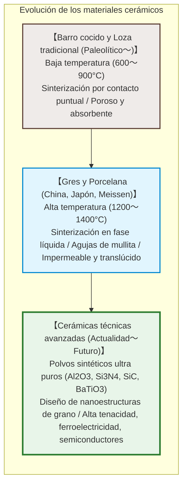
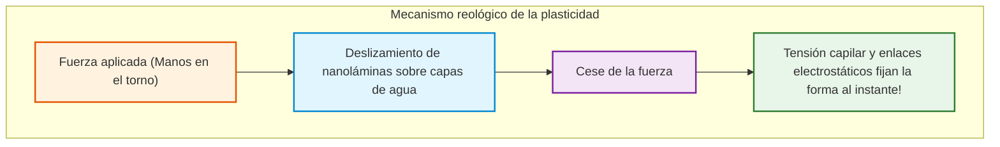
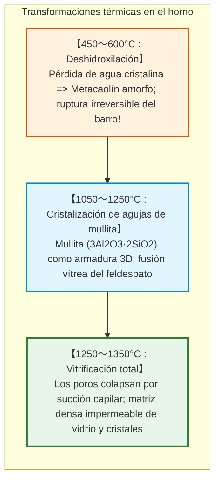
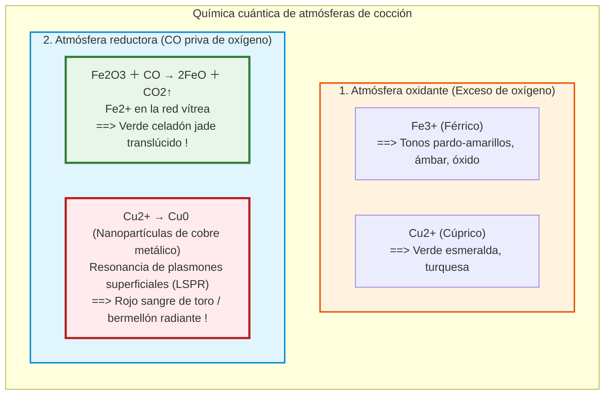

## Introducción: Por qué el barro blando se transforma en piedra eterna

Hace decenas de miles de años, la humanidad descubrió en las brasas un prodigio de la naturaleza: una arcilla blanda y plástica, modelable con los dedos, arrojada a un fuego de alta temperatura, se transformaba de forma irreversible en un objeto pétreo, impermeable y sonoro: **la cerámica**.

Del griego **«keramos» (κέραμος)**, la cerámica hoy trasciende por completo el menaje doméstico:
- Más de 1.000 **condensadores cerámicos multicapa (MLCC)** estabilizan los circuitos de cada smartphone;
- Las baldosas de sílice soportan el plasma a $1500^\circ\text{C}$ en el escudo térmico espacial;
- Las biocerámicas de hidroxiapatita se integran molecularmente en el tejido óseo humano;
- El **carburo de silicio ($\text{SiC}$)** impulsa los inversores de los vehículos eléctricos.

---

## Capítulo 1: Nanoestructura de la caolinita y física de la plasticidad

### 1.1 La red 1:1 de la caolinita

La arcilla pura está formada por **caolinita** ($\text{Al}_2\text{Si}_2\text{O}_5(\text{OH})_4$), un filosilicato en láminas de 0,72 nm de espesor:
1. Una lámina tetraédrica de sílice ($\text{Si-O}$);
2. Una lámina octaédrica de alúmina ($\text{Al-O/OH}$, tipo gibbsita).

### 1.2 Mecanismo de la plasticidad

- **Área superficial enorme**: $10 \text{ a } 30\,\text{m}^2/\text{g}$.
- **Caras negativas y bordes positivos** en disposición de «castillo de naipes».
- **Películas de agua estructurada**: Permiten el deslizamiento bajo tensión cortante (**deformación fluida**), mientras que la tensión capilar inmoviliza las partículas de inmediato al retirar la fuerza (**mantenimiento de forma**).

---

## Capítulo 2: Sinterización y metamorfosis térmica en el horno

1. **Deshidroxilación ($450 \sim 600^\circ\text{C}$)**: Los grupos $-\text{OH}$ forman vapor de agua. La caolinita pasa a ser **metacaolín** amorfo no retornable a barro.
2. **Crecimiento de mullita ($> 1100^\circ\text{C}$)**: Agujas entrelazadas de **mullita** ($3\text{Al}_2\text{O}_3 \cdot 2\text{SiO}_2$) que actúan como armaduras de hormigón.
3. **Sinterización en fase líquida**: El feldespato se funde en líquido viscoso y colapsa los poros mediante tracción capilar.

---

## Capítulo 3: Loza, Gres y Porcelana

| Categoría | Temperatura | Microestructura | Absorción | Translucidez | Sonido al golpe |
|---|---|---|---|---|---|
| **Loza / Barro cocido** | **$800 \sim 1150^\circ\text{C}$** | Sinterización por puntos, poroso | **$> 10\%$** | Opaco | Sonido sordo y mate |
| **Gres** | **$1200 \sim 1280^\circ\text{C}$** | Vitrificado, impermeable | **$< 1\%$** | Opaco | Sonido pétreo duro |
| **Porcelana** | **$1300 \sim 1400^\circ\text{C}$** | Matriz vítrea con mullita sin poros | **$0 \sim 0{,}2\%$** | **Translúcida** | **Timbre metálico cristalino** |

---

## Capítulo 4: Química de los esmaltes y atmósferas de cocción

- **El Celadón**: Un $1 \sim 2\%$ de hierro reducido a $\text{Fe}^{2+}$ absorbe la luz roja y deja pasar el azul verdoso del jade.
- **Craquelado**: Ocurre cuando el coeficiente térmico del esmalte supera al del cuerpo ($\alpha_\text{esmalte} > \alpha_\text{cuerpo}$), agrietando el vidrio decorativamente al enfriarse.

---

## Capítulo 5: El Oro Blanco – Jingdezhen, Meissen y Arita

En el siglo XVII, Europa sucumbió a la fiebre de la porcelana de Arita (Imari). Augusto el Fuerte encarceló al alquimista **Johann Friedrich Böttger**, quien descifró la fórmula en 1709: caolín y feldespato a más de $1300^\circ\text{C}$. En 1710 nació la manufactura de **Meissen**.

---

## Capítulo 6: Cerámicas técnicas avanzadas

- **Titanato de bario ($\text{BaTiO}_3$) y MLCC**: Constante dieléctrica de más de 5.000 a 10.000. Más de 1.000 microcapas apiladas en chips diminutos.
- **Circona parcialmente estabilizada (PSZ)**: Tenacidad por transformación de fase. La tensión en la punta de la grieta induce una expansión del 4 % que frena la fractura en seco.

---

## Conclusión: El pacto primordial entre la tierra y el fuego

Desde la primera vasija de barro de la prehistoria hasta los chips de carburo de silicio de la era cuántica, la cerámica representa la reordenación molecular inorgánica más exitosa y duradera de la humanidad.
