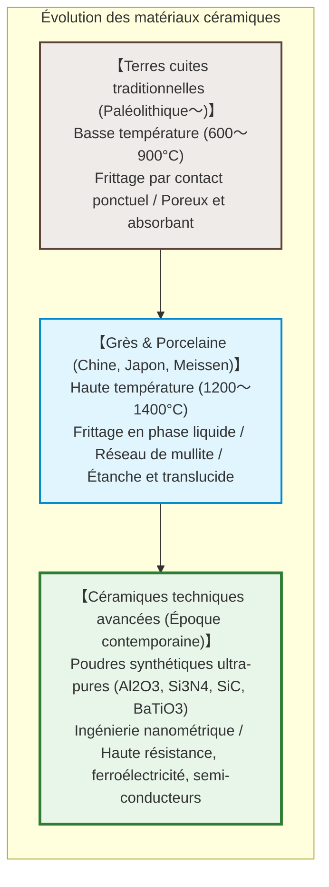
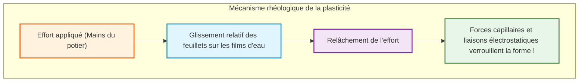
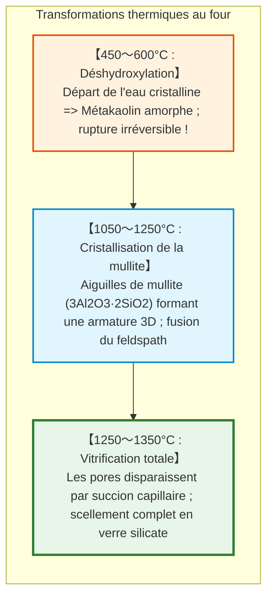
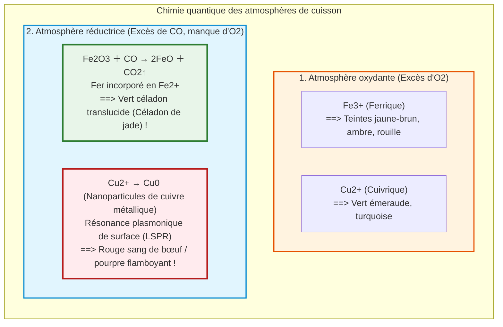

## Introduction : Pourquoi la boue devient pierre au cœur du feu

Il y a des dizaines de milliers d'années, l'humanité a découvert l'une des transformations physiques les plus remarquables : une argile malléable, façonnable sous les doigts, jetée dans un feu violent, se transforme de manière irréversible en un récipient dur, étanche et sonnant : **la céramique**.

Du grec **« keramos » (κέραμος)**, la céramique transcende aujourd'hui les arts de la table :
- Plus de 1 000 **condensateurs céramiques multicouches (MLCC)** équipent chaque smartphone moderne ;
- Les tuiles en silice résistent au plasma à $1500^\circ\text{C}$ lors du retour spatial ;
- Les biocéramiques d'hydroxyapatite s'intègrent directement aux os humains ;
- Le **carbure de silicium ($\text{SiC}$)** propulse les onduleurs des véhicules électriques.

---

## Chapitre 1 : Nanostructure de la kaolinite et physique de la plasticité

### 1.1 Le réseau 1:1 de la kaolinite

L'argile pure est composée de **kaolinite** ($\text{Al}_2\text{Si}_2\text{O}_5(\text{OH})_4$), un phyllosilicate en feuillets asymétriques de 0,72 nm d'épaisseur :
1. Une couche tétraédrique de silice ($\text{Si-O}$) ;
2. Une couche octaédrique d'alumine ($\text{Al-O/OH}$, type gibbsite).

### 1.2 Le mécanisme de la plasticité

- **Surface spécifique gigantesque** ($10 \text{ à } 30\,\text{m}^2/\text{g}$) ;
- **Surfaces négatives et bords positifs** créant une structure en « château de cartes » ;
- **Films d'eau nanométriques** permettant le glissement sous contrainte de cisaillement (**déformation**), tandis que la succion capillaire fige instantanément la forme dès que l'effort cesse (**maintien de forme**).

---

## Chapitre 2 : Frittage et métamorphose thermique dans le four

1. **Déshydroxylation ($450 \sim 600^\circ\text{C}$)** : Les ions $-\text{OH}$ forment de la vapeur d'eau. La kaolinite devient du **métakaolin** amorphe non réhydratable.
2. **Croissance de la mullite ($> 1100^\circ\text{C}$)** : Aiguilles enchevêtrées de **mullite** ($3\text{Al}_2\text{O}_3 \cdot 2\text{SiO}_2$) agissant comme une armature en béton armé.
3. **Frittage en phase liquide** : Le feldspath fond en liquide visqueux et comble tous les interstices par capillarité.

---

## Chapitre 3 : Terre cuite, Grès et Porcelaine

| Catégorie | Température | Microstructure | Absorption | Translucidité | Sonorité |
|---|---|---|---|---|---|
| **Terre cuite** | **$800 \sim 1150^\circ\text{C}$** | Frittage ponctuel poreux | **$> 10\%$** | Opaque | Son sourd et mat |
| **Grès** | **$1200 \sim 1280^\circ\text{C}$** | Densa, imperméable sans émail | **$< 1\%$** | Opaque | Son pierreux dur |
| **Porcelaine** | **$1300 \sim 1400^\circ\text{C}$** | Matrice mullite-verre sans pores | **$0 \sim 0{,}2\%$** | **Translucide** | **Son métallique cristallin** |

---

## Chapitre 4 : Chimie des émaux et atmosphère du four

- **Le Céladon** : Une infime quantité de fer ($1 \sim 2\%$) réduite en $\text{Fe}^{2+}$ absorbe le rouge et transmet le célèbre vert céladon.
- **Le Tressaillement (Craquelures)** : Dilatation thermique de l'émail supérieure à celle du tesson ($\alpha_\text{émail} > \alpha_\text{tesson}$), créant des microfissures décoratives au refroidissement.

---

## Chapitre 5 : L'Or Blanc – Jingdezhen, Meissen et Arita

Au XVIIe siècle, l'Europe s'enflamme pour la porcelaine d'Arita (Imari). Auguste le Fort fait emprisonner l'alchimiste **Johann Friedrich Böttger**, qui perce le secret en 1709 : cuire le kaolin et le feldspath à plus de $1300^\circ\text{C}$. En 1710 naît la manufacture royale de **Meissen**.

---

## Chapitre 6 : Céramiques techniques avancées

- **Titanate de baryum ($\text{BaTiO}_3$) & MLCC** : Constante diélectrique phénoménale ($\varepsilon_r > 5000$). Plus de 1 000 couches submicroniques empilées dans les puces électroniques.
- **Zircone partiellement stabilisée (PSZ)** : Renforcement par transformation de phase. La contrainte transforme la phase quadratique en phase monoclinique avec une expansion de 4 % qui bloque instantanément les fissures.

---

## Conclusion : L'alliance séculaire de la matière et du feu

De la première écuelle d'argile aux puces en carbure de silicium de l'intelligence artificielle, l'humanité a maîtrisé l'art de réorganiser les liaisons inorganiques par la chaleur. La céramique reste la colonne vertébrale matérielle de notre civilisation.
