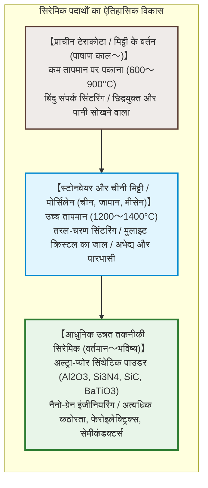
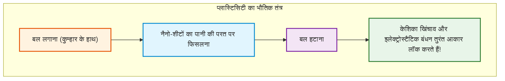
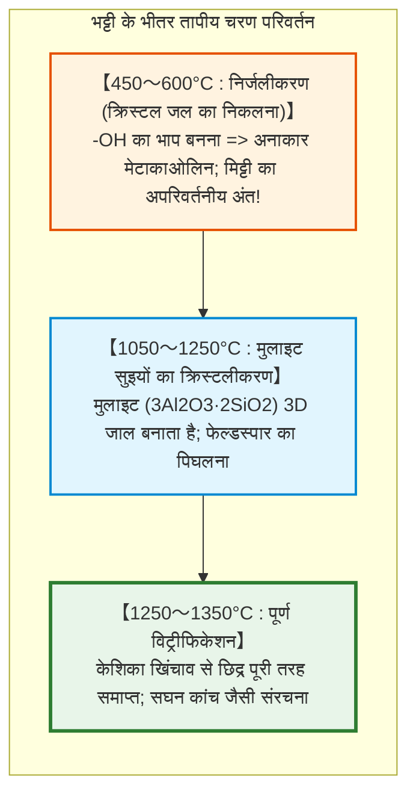
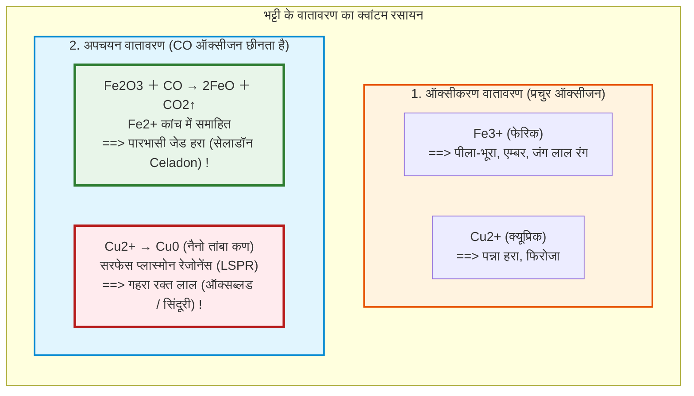

## प्रस्तावना: आग में तपकर पत्थर बनती कोमल मिट्टी

हजारों साल पहले पाषाण काल के मनुष्यों ने आग में एक अनोखा चमत्कार देखा: पानी मिलाने पर उंगलियों से आसानी से मुड़ने वाली कोमल 'मिट्टी', जब तेज आग में तपती है, तो दोबारा कभी पानी में नहीं घुलती, बल्कि एक बेहद कठोर, जलरोधी और खनकदार 'बर्तन' में बदल जाती है: **सिरेमिक (Ceramics)**।

यह शब्द प्राचीन यूनानी भाषा के **«keramos» (κέραμος)** से आया है, जिसका अर्थ है पकी हुई मिट्टी। आज सिरेमिक केवल बर्तनों तक सीमित नहीं है:
- हर स्मार्टफोन में 1,000 से अधिक **मल्टीलेयर सिरेमिक कैपेसिटर (MLCC)** लगे होते हैं;
- अंतरिक्ष यान के पुनरागमन के समय शुद्ध सिलिका टाइल्स $1500^\circ\text{C}$ के प्लाज्मा तापमान को झेलती हैं;
- हाइड्रॉक्सीपैटाइट बायोसिरेमिक सीधे मानव हड्डियों के साथ जुड़ जाता है;
- **सिलिकॉन कार्बाइड ($\text{SiC}$)** इलेक्ट्रिक वाहनों के पावर सेमीकंडक्टर को ऊर्जा देता है।

---

## अध्याय 1: काओलिनाइट की नैनोसंरचना और प्लास्टिसिटी का भौतिक विज्ञान

### 1.1 काओलिनाइट की 1:1 परतदार संरचना

पोर्सिलेन बनाने वाली मिट्टी का मुख्य खनिज **काओलिनाइट** ($\text{Al}_2\text{Si}_2\text{O}_5(\text{OH})_4$) है, जो 0.72 नैनोमीटर मोटी शीटों से बना एक फाइलोसिलिकेट खनिज है:
1. सिलिका टेट्राहेड्रल शीट ($\text{Si-O}$);
2. एल्यूमिना ऑक्टाहेड्रल शीट ($\text{Al-O/OH}$)।

### 1.2 प्लास्टिसिटी (Plasticity) का तंत्र

- **अत्यधिक विशिष्ट सतह क्षेत्र**: $10 \text{ से } 30\,\text{m}^2/\text{g}$;
- **नकारात्मक सतह और सकारात्मक किनारे**, जो 'ताश के पत्तों' जैसा ढांचा बनाते हैं;
- **नैनोमीटर जल परतें**: दबाव पड़ने पर कण पानी की झिल्ली पर आसानी से फिसलते हैं (**आकार बदलना**), और दबाव हटते ही केशिका खिंचाव उन्हें तुरंत उसी रूप में स्थिर कर देता है (**आकार बनाए रखना**)।

---

## अध्याय 2: भट्टी में चरण परिवर्तन और सिंटरिंग

1. **निर्जलीकरण ($450 \sim 600^\circ\text{C}$)**: रासायनिक रूप से बंधा पानी निकल जाता है और मिट्टी अनाकार **मेटाकाओलिन** बन जाती है।
2. **मुलाइट का विकास ($> 1100^\circ\text{C}$)**: सुई जैसी **मुलाइट** ($3\text{Al}_2\text{O}_3 \cdot 2\text{SiO}_2$) की संरचना बनती है जो कंक्रीट में लोहे के सरियों की तरह काम करती है।
3. **तरल-चरण सिंटरिंग**: फेल्डस्पार पिघलकर गाढ़ा कांच बन जाता है और सभी छिद्रों को बंद कर देता है।

---

## अध्याय 3: मिट्टी के बर्तन, स्टोनवेयर और पोर्सिलेन

| श्रेणी | पकाने का तापमान | सूक्ष्म संरचना | जल अवशोषण | पारभासकता | खनक |
|---|---|---|---|---|---|
| **टेराकोटा / मिट्टी के बर्तन** | **$800 \sim 1150^\circ\text{C}$** | छिद्रयुक्त कण सिंटरिंग | **$> 10\%$** | अपारदर्शी | मंद भारी आवाज |
| **स्टोनवेयर** | **$1200 \sim 1280^\circ\text{C}$** | विट्रीफाइड, जलरोधी | **$< 1\%$** | अपारदर्शी | पत्थर जैसी कठोर आवाज |
| **पोर्सिलेन (चीनी मिट्टी)** | **$1300 \sim 1400^\circ\text{C}$** | छिद्ररहित ग्लास-मुलाइट कंपोजिट | **$0 \sim 0{,}2\%$** | **पारभासी (रोशनी आर-पार)** | **स्पष्ट धातु जैसी खनक** |

---

## अध्याय 4: शीशे की चमक (ग्लेज़) और भट्टी का वातावरण

- **सेलाडॉन (Celadon)**: $1 \sim 2\%$ लोहा जब अपचयन में $\text{Fe}^{2+}$ में बदलता है, तो यह लाल रोशनी को सोखकर सुंदर जेड-हरा रंग देता है।
- **क्रेज़िंग (दरारें)**: जब ग्लेज़ का तापीय प्रसार मिट्टी से अधिक होता है ($\alpha_\text{ग्लेज़} > \alpha_\text{बॉडी}$), तो ठंडा होने पर बारीक दरारों का जादुई पैटर्न बनता है।

---

## अध्याय 5: सफेद सोना – मीसेन और अरिता

17वीं सदी में यूरोप अरिता (इमारी) पोर्सिलेन का दीवाना था। ऑगस्टस द स्ट्रॉन्ग ने कीमियागर **जोहान फ्रेडरिक बॉटगर** को कैद किया, जिसने 1709 में काओलिन और फेल्डस्पार को $1300^\circ\text{C}$ पर तपाकर पोर्सिलेन का रहस्य खोजा। 1710 में यूरोप की पहली पोर्सिलेन फैक्ट्री **मीसेन (Meissen)** स्थापित हुई।

---

## अध्याय 6: उन्नत तकनीकी सिरेमिक

- **बेरियम टाइटनेस ($\text{BaTiO}_3$) और MLCC**: ढांचागत विस्थापन के कारण डाइइलेक्ट्रिक स्थिरांक 5,000 से 10,000 तक पहुंच जाता है। माइक्रोचिप्स में 1,000 से अधिक नैनो-परतें जमा की जाती हैं।
- **आंशिक रूप से स्थिर ज़िरकोनिया (PSZ)**: तनाव से प्रेरित फेज़ ट्रांसफ़ॉर्मेशन के कारण 4% आयतन फैलता है, जो दरार को आगे बढ़ने से तुरंत रोक देता है।

---

## निष्कर्ष: पृथ्वी और अग्नि का अमर मिलन

प्राचीन काल के मिट्टी के पहले प्याले से लेकर आर्टिफिशियल इंटेलिजेंस के सुपरकंप्यूटिंग सेमीकंडक्टर तक: बुनियादी सिद्धांत वही है—अत्यधिक ऊष्मा द्वारा अकार्बनिक परमाणुओं का पुनर्गठन। सिरेमिक मानव सभ्यता की सबसे टिकाऊ और क्रांतिकारी तकनीक है।
