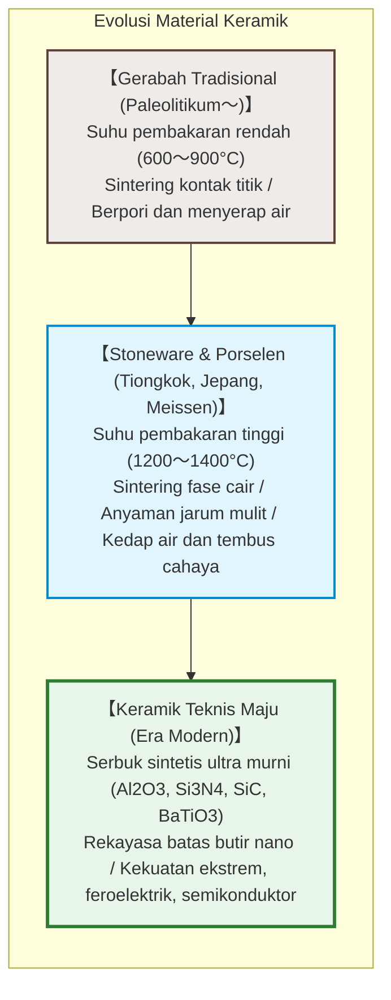
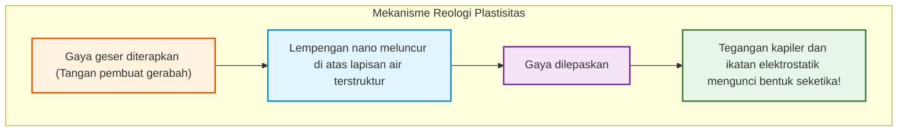
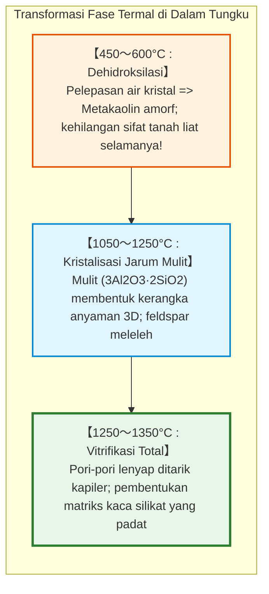
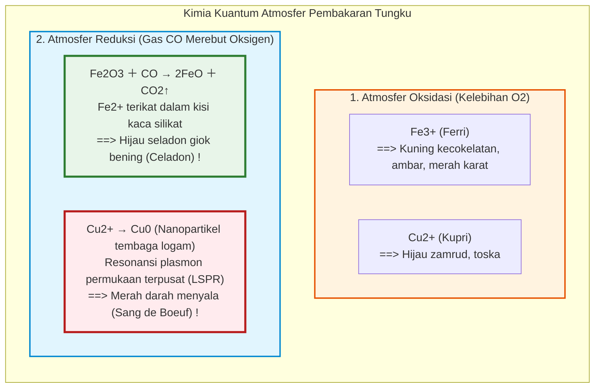

## Pendahuluan: Lumpur Lunak yang Menjadi Batu Abadi Melalui Api

Puluhan ribu tahun silam pada zaman Paleolitikum akhir, manusia menemukan keajaiban di dalam api: tanah liat lunak dan plastis yang mudah ditekan dengan jari, ketika dibakar pada suhu tinggi di dalam kobaran api, berubah secara permanen menjadi wadah yang keras, padat, dan kedap air: **keramik**.

Berasal dari bahasa Yunani kuno **«keramos» (κέραμος)** yang berarti tanah liat yang dibakar, keramik kini melompat jauh melampaui perabot rumah tangga:
- Lebih dari 1.000 **Kapasitor Keramik Multilapis (MLCC)** menstabilkan tegangan di dalam setiap ponsel pintar;
- Genteng silika murni menahan panas plasma $1500^\circ\text{C}$ saat pesawat antariksa memasuki atmosfer bumi;
- Biokeramik hidroksiapatit menyatu langsung dengan jaringan tulang manusia;
- **Silikon Karbida ($\text{SiC}$)** menjadi jantung semikonduktor daya kendaraan listrik.

---

## Bab 1: Nanostruktur Kaolinit dan Fisika Plastisitas

### 1.1 Kisi Lapisan 1:1 Kaolinit

Tanah liat pembuat porselen didominasi oleh **kaolinit** ($\text{Al}_2\text{Si}_2\text{O}_5(\text{OH})_4$), suatu mineral filosilikat dengan lapisan asimetris setebal 0,72 nm:
1. Lembaran silika tetrahedral ($\text{Si-O}$);
2. Lembaran alumina oktahedral ($\text{Al-O/OH}$).

Di bawah mikroskop elektron, partikel kaolinit tampak sebagai lempengan heksagonal tipis berukuran mikron dengan ketebalan puluhan nanometer.

### 1.2 Mekanisme Plastisitas

- **Luas permukaan spesifik luar biasa**: $10 \text{ hingga } 30\,\text{m}^2/\text{g}$;
- **Permukaan dasar bermuatan negatif dan tepi bermuatan positif**, membentuk tatanan rumah kartu (*house of cards*);
- **Lapisan air terstruktur**: Partikel meluncur mulus satu sama lain di atas lapisan air nanometer saat diberi tekanan (**kemudahan deformasi**), sementara tegangan kapiler dan tarikan muatan langsung mengunci bentuk saat tekanan dilepas (**penjagaan bentuk**).

---

## Bab 2: Sintering dan Transformasi Termal di Dalam Tungku

1. **Dehidroksilasi ($450 \sim 600^\circ\text{C}$)**: Gugus $-\text{OH}$ terlepas sebagai uap air, mengubah kaolinit menjadi **metakaolin** amorf yang tidak dapat kembali menjadi lumpur.
2. **Pertumbuhan Mulit ($> 1100^\circ\text{C}$)**: Kristal jarum **mulit** ($3\text{Al}_2\text{O}_3 \cdot 2\text{SiO}_2$) tumbuh saling mengunci seperti jaring kawat baja pada beton bertulang.
3. **Sintering Fase Cair**: Feldspar meleleh menjadi cairan silikat kental yang menyedot partikel padat dan menutup semua celah pori melalui hisapan kapiler.

---

## Bab 3: Gerabah, Stoneware, dan Porselen

| Kategori | Suhu Pembakaran | Mikrostruktur | Daya Serap Air | Translusensi | Suara Ketukan |
|---|---|---|---|---|---|
| **Gerabah (Earthenware)** | **$800 \sim 1150^\circ\text{C}$** | Sintering kontak butiran berpori | **$> 10\%$** | Buram | Bunyi redup / hampa |
| **Stoneware** | **$1200 \sim 1280^\circ\text{C}$** | Terpadatkan padat kedap air | **$< 1\%$** | Buram | Bunyi batu keras |
| **Porselen (Porcelain)** | **$1300 \sim 1400^\circ\text{C}$** | Komposit kaca-mulit tanpa pori | **$0 \sim 0{,}2\%$** | **Tembus Cahaya** | **Denting logam jernih** |

---

## Bab 4: Kimia Glasir dan Atmosfer Pembakaran

- **Seladon**: Sedikit zat besi ($1 \sim 2\%$) yang tereduksi menjadi $\text{Fe}^{2+}$ menyerap spektrum merah dan memancarkan kilau hijau giok yang memukau.
- **Retak Seribu (Craquelure)**: Terjadi jika koefisien pemuaian glasir lebih besar dari badan keramik ($\alpha_\text{glasur} > \alpha_\text{badan}$), menghasilkan retakan artistik saat mendingin.

---

## Bab 5: Emas Putih – Meissen dan Arita

Pada abad ke-17, Eropa tergila-gila pada porselen Arita (Imari). Raja Augustus mengurung alkemis **Johann Friedrich Böttger**, yang pada 1709 berhasil mengungkap rahasia percampuran kaolin dan feldspar pada suhu $> 1300^\circ\text{C}$, melahirkan pabrik porselen pertama Eropa, **Meissen** (1710).

---

## Bab 6: Keramik Teknis Maju

- **Barium Titanat ($\text{BaTiO}_3$) & MLCC**: Konstanta dielektrik melebihi 5.000-10.000, menumpuk lebih dari 1.000 lapisan keramik berukuran sub-mikron dalam chip mungil.
- **Zirkonia Sebagian Terstabilkan (PSZ)**: Ketangguhan transformasi fase. Tegangan pada ujung retakan memicu ekspansi volume 4 % yang langsung mengunci dan menghentikan perambatan retakan.

---

## Kesimpulan: Perpaduan Abadi Tanah dan Api

Dari mangkuk gerabah pertama zaman prasejarah hingga semikonduktor silikon karbida era kecerdasan buatan, prinsip dasarnya tetap sama: penataan ulang termodinamika ikatan atom anorganik melalui panas. Keramik adalah mahakarya rekayasa material tertua dan paling abadi milik umat manusia.
