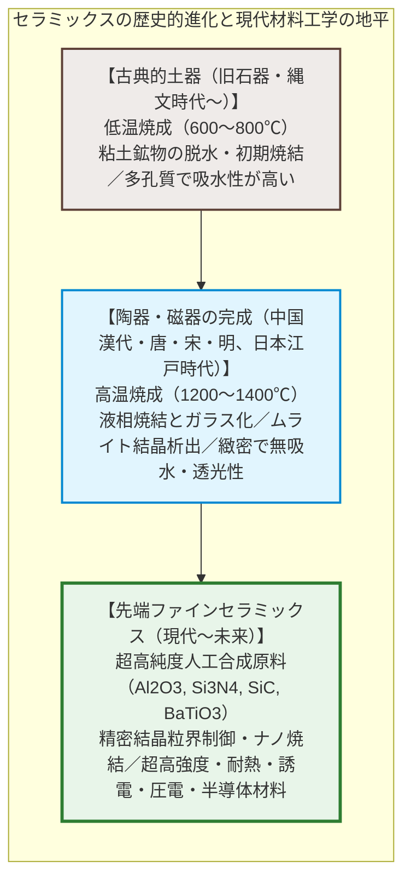
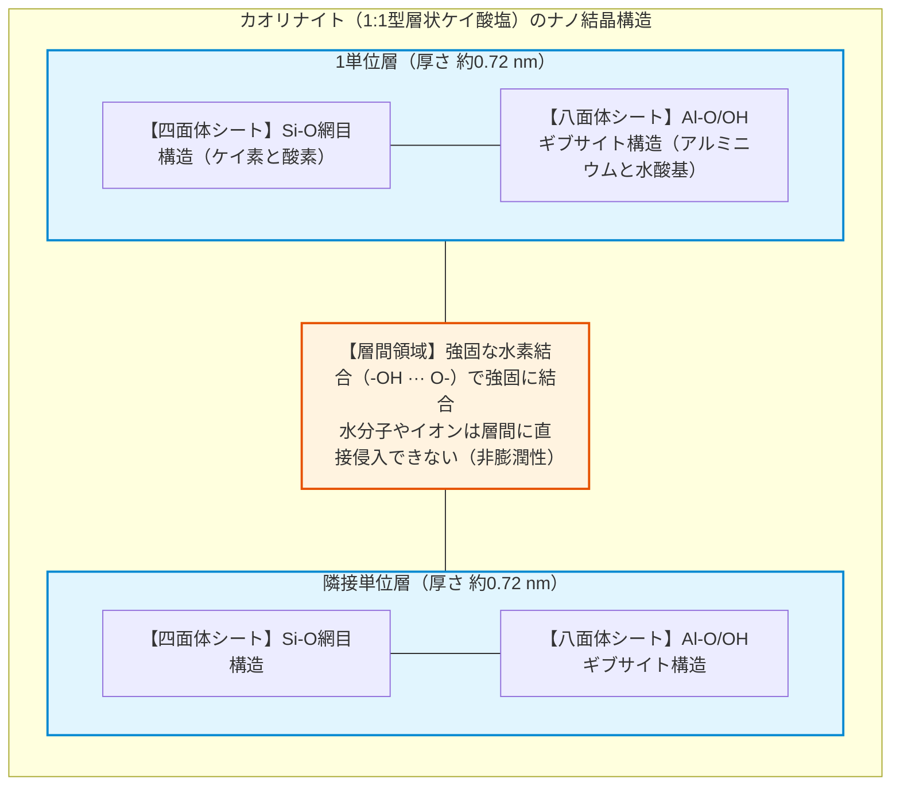
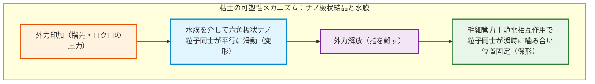
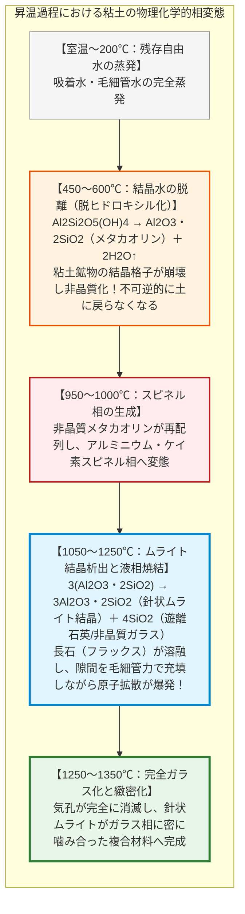
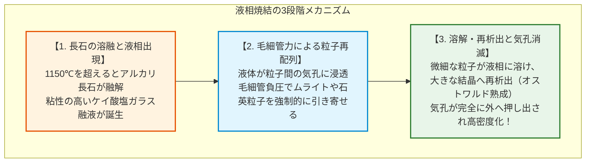
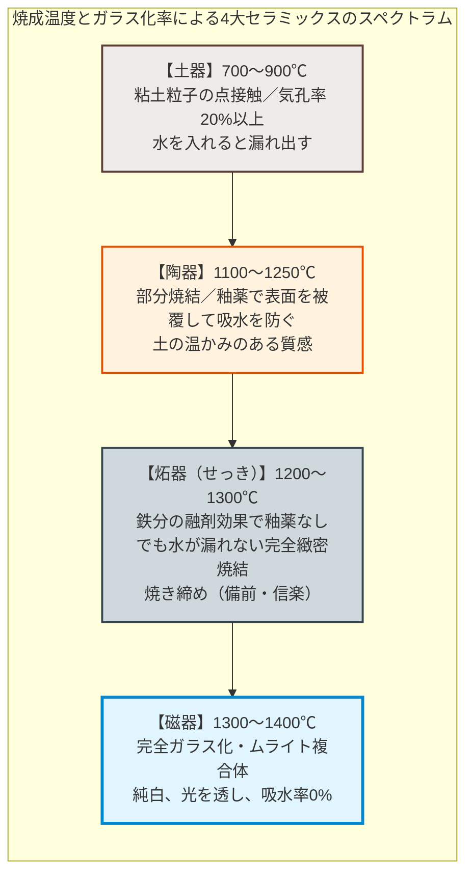
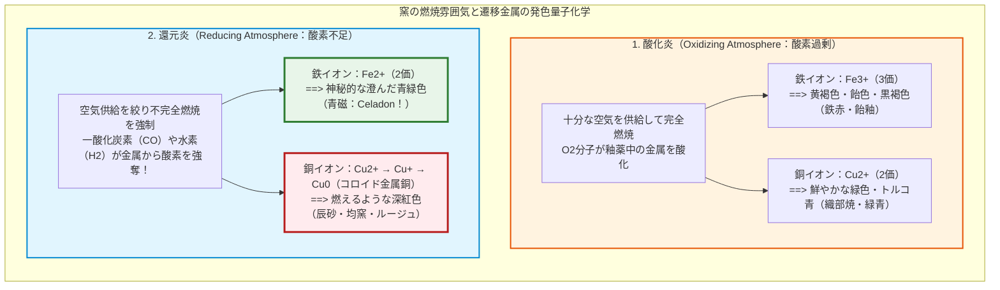
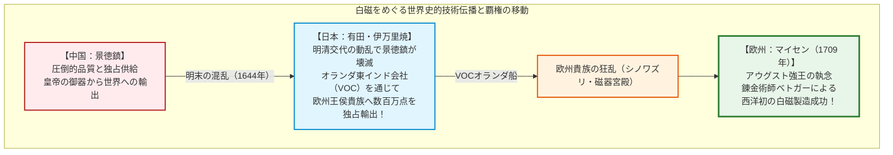
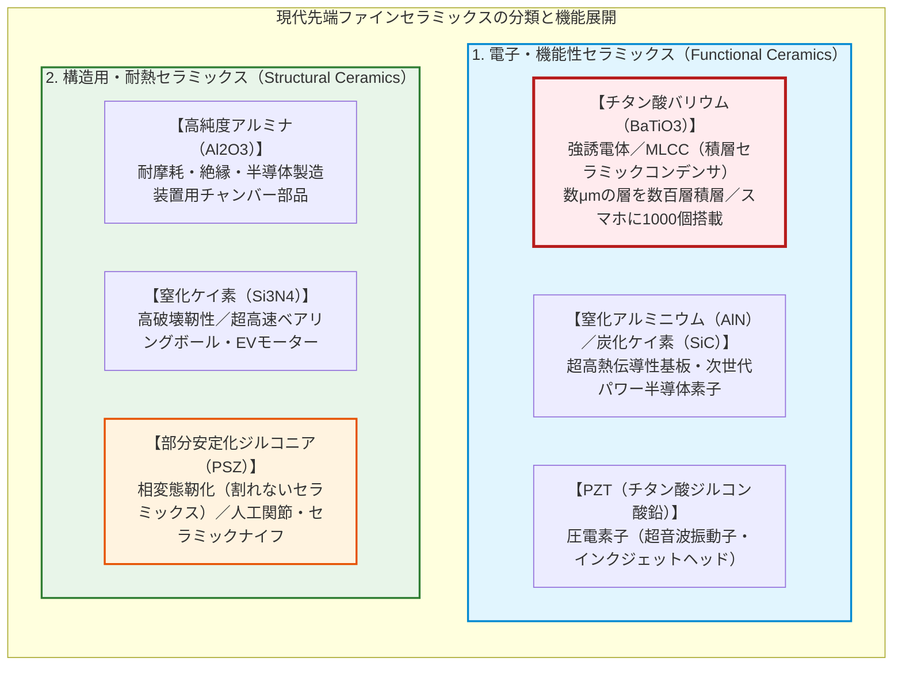

## 序論：柔らかい泥が、なぜ火をくぐると硬質な石を超えるのか？

人類が火を制御し始めた数万年前、泥遊びの延長線上にひとつの奇跡的な現象が発見された。水を含ませると自在に形を変え、指先で容易に押しつぶせる柔らかい「粘土（土）」が、赤く燃え盛る炎の中に投じられて一定の温度を超えると、二度と水に溶けることのない、硬く、緻密で、水を蓄えることのできる堅牢な「器」へと不可逆的に変貌を遂げたのである。

これが、人類最初の人工材料工学**「セラミックス（Ceramics）」**の夜明けである。

「セラミックス」の語源は、古代ギリシャ語の「粘土を焼いたもの」を意味する**「ケラモス（Keramos）」**に由来する。日本においては、縄文土器（紀元前1万数千年前）から始まり、須恵器、瀬戸・美濃・信楽・備前などの六古窯、そして江戸時代の伊万里・有田焼に代表される白磁へと昇華を遂げてきた。

しかし現代の物質科学において、セラミックスは単なる「日用品の食器や花瓶」の枠を遥かに超越している：
- スマートフォン1台の中に1000個以上、EV（電気自動車）1台に1万個以上搭載され、電子回路の電圧を安定化させる**MLCC（積層セラミックコンデンサ）**；
- 大気圏再突入時の $1500^\circ\text{C}$ を超えるプラズマ断熱を担う**スペースシャトルの耐熱タイル**；
- 人工関節や人工歯根として生体骨と直接分子結合する**生体活性バイオセラミックス（アパタイト）**；
- 次世代パワー半導体の中核を担うワイドバンドギャップ半導体**炭化ケイ素（$\text{SiC}$）や窒化ガリウム（$\text{GaN}$）**。

なぜ、ありふれた地殻の土（粘土）を加熱するだけで、このような劇的な変態が起きるのか？
なぜ土器は水を吸うのに、磁器はガラスのように水を弾き、叩くと金属のような澄んだ甲高い音を響かせるのか？
そして、陶芸家が窯の炎の酸素量を制御する「酸化炎」と「還元炎」は、いかなる量子化学的メカニズムによって青磁の神秘的な翡翠色や辰砂の鮮紅を生み出すのか？

本稿では、粘土鉱物のナノスケール結晶構造から、焼結（シンタリング）における原子拡散の物理化学、陶磁器の分類、炎の酸化還元工学、ヨーロッパを熱狂させた白磁の歴史、そして先端半導体を支える電子セラミックスの最前線までを余すところなく徹底解剖する。

---

## 第1章：粘土鉱物のナノ構造と「可塑性」の物理化学

### 1.1 層状ケイ酸塩鉱物（フィロケイ酸塩）：カオリナイトのナノシート

焼き物の主原料となる「粘土（Clay）」とは、単なる細かい砂や泥ではない。地殻の大部分を占める花崗岩などの岩石に含まれる長石が、数億年に及ぶ雨水、炭酸ガス、地熱熱水による化学的風化作用を受けて生成した**層状ケイ酸塩鉱物（Phyllosilicate minerals）**である。

その代表格であり、陶磁器の最重要鉱物であるのが**カオリナイト（カオリン、Kaolinite）**である。その化学組成は以下のように表される：

$$\text{Al}_2\text{Si}_2\text{O}_5(\text{OH})_4 \quad \text{または} \quad \text{Al}_2\text{O}_3 \cdot 2\text{SiO}_2 \cdot 2\text{H}_2\text{O}$$

カオリナイトの結晶構造は、厚さわずか約0.7ナノメートルの極薄シートが幾重にも積み重なった**1:1型層状格子**を持つ：
1. **ケイ素-酸素四面体シート（$\text{Si-O}$シート）**：ひとつのケイ素原子を取り囲む4つの酸素原子が底面を共有して六角網目状に平面的に連なる。
2. **アルミニウム-酸素/水酸基八面体シート（$\text{Al-O/OH}$シート、ギブサイト型シート）**：アルミニウム原子を取り囲む酸素および水酸基（$-\text{OH}$）が八面体を形成して連なる。

カオリナイトの結晶粒子は、顕微鏡下で観察すると幅が数百ナノメートルから数マイクロメートル、厚みが数十ナノメートルの、六角板状の微小な「トランプのカード」のような形態をしている。

### 1.2 水分子の吸着と電気二重層：なぜ土は自在に曲がり、形を保つのか？

砂（石英の粒、直径数十〜数百 $\mu\text{m}$）に水を加えても、握った瞬間は固まるが、力を抜けば崩れてしまう。なぜ粘土だけが、ロクロの上で極薄の壺へと引き伸ばされ、指を離してもその形状を保ち続ける**「可塑性（Plasticity）」**を発揮するのか？

その理由は、粘土粒子の**圧倒的な微細さ（比表面積の巨大さ）**と、**粒子表面の表面電荷・電気二重層**にある：

1. **巨大な比表面積**：
   粘土粒子のサイズは $2\,\mu\text{m}$ 以下の超微粒子であり、その比表面積は $1\,\text{g}$ あたり $10 \sim 30\,\text{m}^2$（モンモリロナイトなど膨潤性粘土では数百 $\text{m}^2/\text{g}$）にも達する。
2. **表面の負電荷と端面の正電荷**：
   ケイ素やアルミニウムの結晶格子欠陥や同形置換（例：$\text{Si}^{4+}$ が $\text{Al}^{3+}$ に置換）により、板状粒子の平坦面は恒常的に**マイナスの電荷**を帯びている。一方、結晶の破断面である端面（エッジ）では、pH環境によって**プラスの電荷**を帯びる。
3. **水膜の潤滑と毛細管結合**：
   粘土に水を練り込むと、水分子の双極子モーメント（$\text{H}^{\delta+}-\text{O}^{\delta-}$）が負に帯電した粒子表面に整然と配位し、厚さ数ナノメートルの「束縛水（配向水膜）」を形成する。
   - **滑り（潤滑性）**：外力を加えると、板状粒子同士が水膜を介して滑り台のようにスライドするため、粘土は滑らかに変形する。
   - **保形性（降伏値）**：外力を取り去ると、薄い水膜の表面張力（毛細管引力）と、平坦面（負）と端面（正）の静電引力（カードハウス構造）が働き、粒子同士が強固に位置を固定する。

### 1.3 乾燥収縮の力学：なぜ急に乾かすとヒビ割れるのか

成形された生の器（生素地）には、粒子間の間隙を満たす「自由水」が多量に含まれている（含水率 約20〜30%）。

乾燥が進むと、自由水が蒸発し、粒子同士が毛細管引力によって引き寄せられながら接近する。この過程で器の寸法は**5〜10%も収縮（乾燥収縮）**する。

もし器の表面だけが急激に乾燥すると、表面はすでに収縮しようとするのに対し、内部はまだ水分を含んで収縮しないため、表面に強大な引張応力が発生する。粘土は圧縮には強いが引張には極めて脆いため、乾燥亀裂（ヒビ）が一瞬で走る。したがって、陶芸において生素地の乾燥は、湿度を保ちながら数日から数週間かけて極めてゆっくりと均一に行われなければならない。

---

## 第2章：窯の中で何が起きているのか——熱変成と「焼結」の原子拡散

成形・乾燥された生素地を窯に入れ、室温から $1000 \sim 1300^\circ\text{C}$ を超える高温へと加熱していく過程は、**固相反応・相変態・原子拡散・液相焼結が連続的に引き起こされる極限の化学リアクター**である。

### 2.1 結晶水の脱離（$450 \sim 600^\circ\text{C}$）：土への回帰の終焉

温度が $450^\circ\text{C}$ を超えると、乾燥後も結晶構造内に固く組み込まれていた水酸基（$-\text{OH}$）が、熱運動によって互いに結合して水分子（$\text{H}_2\text{O}$）となり、水蒸気として結晶格子から脱離する（**脱ヒドロキシル化**）：

$$\text{Al}_2\text{Si}_2\text{O}_5(\text{OH})_4 \xrightarrow{450 \sim 600^\circ\text{C}} \text{Al}_2\text{Si}_2\text{O}_7 \text{（メタカオリン：非晶質無水ケイ酸アルミニウム）} + 2\text{H}_2\text{O} \uparrow$$

この反応により、カオリナイト本来の規則的な層状結晶構造は完全に崩壊し、無秩序な非晶質（アモルファス）状態である**メタカオリン（Metakaolin）**へと変化する。

この脱水反応が完了した瞬間、物質はもはや水に浸けても二度と泥に戻ることはできない。化学的・構造的に「土」から「セラミックスの前駆体」へと不可逆の境界線を越えたのである。

### 2.2 ムライト結晶（$3\text{Al}_2\text{O}_3 \cdot 2\text{SiO}_2$）の析出

温度が $1000^\circ\text{C}$ を超えると、非晶質のメタカオリン構造の中から、極めて高い融点（約 $1850^\circ\text{C}$）と驚異的な機械的強度・熱衝撃耐性を誇るケイ酸アルミニウム化合物**「ムライト（Mullite、針状結晶）」**が自発的に結晶化し始める：

$$3(\text{Al}_2\text{O}_3 \cdot 2\text{SiO}_2) \xrightarrow{> 1100^\circ\text{C}} 3\text{Al}_2\text{O}_3 \cdot 2\text{SiO}_2 \text{（ムライト）} + 4\text{SiO}_2 \text{（遊離シリカ）}$$

このムライト結晶は、無数の極細の針（ウィスカー）のような形態で成長する。この針状結晶が三次元的に絡み合い、フェルトや鉄筋のように網目を形成することが、焼き物の驚異的な曲げ強度と耐熱衝撃性の骨格を決定づける。

### 2.3 焼結（Sintering）の本質：表面エネルギーの低下と液相焼結

粉末の粒子同士が、融点以下で互いにくっつき合って緻密な塊になる現象を**「焼結（Sintering）」**と呼ぶ。

焼結の熱力学的駆動力は、**系全体の「全表面エネルギーの極小化」**である：
微細な粉末は、体積に比して莫大な表面積（表面自由エネルギー）を持っている。粒子と粒子が合体して気孔（すきま）が消滅し、結晶粒界が形成されると、表面積が激減して巨額のギブス自由エネルギーが解放される（$\Delta G < 0$）。

陶磁器の焼成において決定的な役割を果たすのが、長石（Feldspar）の存在による**「液相焼結（Liquid-Phase Sintering）」**である：

1. **長石の溶融（融剤・フラックスの役割）**：
   素地中に配合された長石（カリ長石 $\text{KAlSi}_3\text{O}_8$ やソーダ長石 $\text{NaAlSi}_3\text{O}_8$）は、石英やカオリンよりも融点が低く、約 $1150 \sim 1200^\circ\text{C}$ で溶融して粘性の高いケイ酸塩液体となる。
2. **粒子の再配列と毛細管引力**：
   生成した液体は、ムライト結晶や石英粒子の表面を濡らし、毛細管現象によって微細な隙間へと吸い込まれる。この毛細管引力によって、固相粒子同士が急速に引き寄せられ、空隙が収縮する。
3. **溶解・析出と完全ガラス化**：
   微小な尖ったシリカ粒子が液相に溶け込み、針状のムライト結晶の表面に再析出していく。冷却すると、この液相は非晶質の**「ガラス相」**として固化する。

つまり、完成した焼き物（特に磁器）の内部構造とは、**「頑丈に絡み合ったムライトの針状結晶（鉄筋）の間隙を、緻密なケイ酸塩ガラス相（コンクリート）が完全に隙間なく埋め尽くしたナノ・マイクロ複合材料」**なのである。

---

## 第3章：土器・陶器・炻器・磁器の4分類と材料科学的境界

陶芸の世界では、原料の配合、焼成温度、および素地の物理特性によって、焼き物を厳密に4つのカテゴリーに大別する。

| 分類 | 主な原料 | 焼成温度 | 素地の状態 | 吸水率 | 透光性 | 打音 | 代表例 |
|---|---|---|---|---|---|---|---|
| **土器（Earthenware）** | 普通の粘土（不純物多） | **$700 \sim 900^\circ\text{C}$** | 多孔質、赤褐色、未ガラス化 | **10% 以上**（極めて高い） | なし | 鈍い濁音（ポコポコ） | 縄文土器、弥生土器、素焼き鉢、テラコッタ |
| **陶器（Pottery）** | 陶土（カオリン＋有色粘土） | **$1100 \sim 1250^\circ\text{C}$** | 焼結、やや多孔質、不透明 | **3 〜 10%**（釉薬で止水） | なし | 鈍い低音（コツコツ） | 益子焼、萩焼、楽焼、京焼 |
| **炻器（Stoneware）** | 耐火性粘土（鉄分・長石含有） | **$1200 \sim 1300^\circ\text{C}$** | 完全焼結、極めて緻密、無釉 | **1% 以下**（ほぼ皆無） | なし | 硬い打音 | 備前焼、信楽焼、常滑焼、萬古焼 |
| **磁器（Porcelain）** | 陶石（カオリン＋石英＋長石） | **$1300 \sim 1400^\circ\text{C}$** | 完全ガラス化、純白、無孔質 | **0 〜 0.5%**（完全ゼロ） | **あり**（光を透す） | **澄んだ金属音（キーン）** | 有田・伊万里焼、九谷焼、景徳鎮、マイセン |

### なぜ磁器は光を透し、金属のような澄んだ音を鳴らすのか？

磁器の指先ではじいた時の「キーン」という澄んだ金属音と、電灯にかざした時に光が透ける現象は、材料科学的に極めて明快な理由がある：

1. **光の透過性（半透明性）**：
   光が物質を透過するのを妨げる最大の要因は、内部の「気孔（空気の泡）」と「不純物（酸化鉄など）」による光の散乱・吸収である。
   磁器は、不純物（鉄分）を極限まで排除した高純度カオリンと石英・長石を用い、長石が $1300^\circ\text{C}$ 以上で完全に溶融して内部の気孔を根こそぎ押し出し、屈折率の近いガラス相と微細結晶で満たされる。そのため、可視光線が内部で乱反射されずに直進・散乱透過し、まるで乳白色の宝石のように光を透す。
2. **音響物理と弾性率（澄んだ打音）**：
   土器や陶器の内部には無数の微細な空気の隙間（気孔）が残っている。気孔は音波（振動）に対する強力なダンパー（減衰材）として作用するため、叩いても振動が瞬時に吸収され、「ボコボコ」という鈍い濁音しか出ない。
   対照的に磁器は、気孔率がほぼゼロであり、剛直なムライト結晶と連続したガラス相が一体化した高弾性率体（ヤング率 $\approx 70 \sim 90\,\text{GPa}$）を形成している。弾性波が減衰することなく素地全体を高速で駆け巡るため、叩くと金属の鐘のように澄んだ高周波の共鳴音（金属音）を長く響かせるのである。

---

## 第4章：釉薬（うわぐすり）のガラス科学と窯の雰囲気工学

焼き物の表面を覆う美しく艶やかな被膜**「釉薬（ゆうやく、Glaze）」**は、本質的に**「素地の上で直接溶融させて焼き付けたナノ〜マイクロ厚のケイ酸塩ガラス」**である。

### 4.1 釉薬の3大構成要素

釉薬の化学組成は、ガラス工学と完全に軌を一にしており、以下の3要素の厳密な配合比によって決定される：
1. **網目形成酸化物（酸性成分）**：二酸化ケイ素（シリカ、$\text{SiO}_2$）。ガラスの骨格を作る主役。
2. **網目修飾酸化物（塩基性融剤・フラックス）**：アルカリ金属・アルカリ土類金属酸化物（$\text{K}_2\text{O}, \text{Na}_2\text{O}, \text{CaO}, \text{MgO}$）。石英の強固な結合を分断し、融点を $1700^\circ\text{C}$ から $1200^\circ\text{C}$ 付近へと劇的に引き下げる（木灰、石灰石、長石など）。
3. **中間酸化物（粘性調整剤）**：酸化アルミニウム（アルミナ、$\text{Al}_2\text{O}_3$）。高温で溶融した釉薬が粘性を保ち、器の側面をダラダラと流れ落ちるのを防ぐ。

### 4.2 酸化炎と還元炎：炎の化学が決定するイオンの原子価

窯焚きにおいて、陶芸家が最も神経を研ぎ澄ますのが**「窯の雰囲気（Atmosphere）」**の制御である。燃料（薪、ガス、灯油）を燃焼させる際、窯内に供給する空気（酸素）の量を調節することで、釉薬や素地に含まれる遷移金属イオンの酸化還元状態（原子価）が変わり、劇的な発色の変化が起きる。

#### 奇跡の「青磁（Celadon）」の化学

中国・宋代に頂点を極めた「青磁」の翡翠のような高貴な青緑色は、釉薬中にわずか **$1 \sim 2\%$ 含まれる微量の酸化鉄（$\text{Fe}$）**によって生み出される：
- **酸化炎で焼成した場合**：酸素が十分にあるため、鉄は3価のフェリイオン（$\text{Fe}^{3+}$）となる。$\text{Fe}^{3+}$ は青色の光を強く吸収するため、釉薬はくすんだ**黄褐色や茶褐色（きはだ色）**になってしまう。
- **還元炎で焼成した場合**：不完全燃焼によって発生した一酸化炭素（$\text{CO}$）が、釉薬中の酸化鉄から酸素を奪い取る：
  $$\text{Fe}_2\text{O}_3 + \text{CO} \to 2\text{FeO} + \text{CO}_2 \uparrow$$
  鉄は2価のフェロイオン（$\text{Fe}^{2+}$）へと還元され、ケイ酸塩ガラスネットワークに組み込まれる。$\text{Fe}^{2+}$ の配位構造は可視光の赤色領域を吸収し、青〜緑色の光を透過・散乱するため、あの息を呑むような澄み切った**雨過天青の青磁色**が誕生するのである。

#### 鮮紅の「辰砂（しんしゃ / Copper Red）」

釉薬に微量の銅（$\text{Cu}$）を添加した場合：
- 酸化炎では2価の銅イオン（$\text{Cu}^{2+}$）となり、美しい**緑色（織部焼の緑）**になる。
- 強力な還元炎で焼くと、銅イオンは金属銅原子（$\text{Cu}^0$）あるいは亜酸化銅（$\text{Cu}_2\text{O}$）にまで還元され、ガラス内部でナノサイズの超微粒子として析出する。このナノ粒子が引き起こす**局在表面プラズモン共鳴（LSPR）**によって特定の波長の光が吸収・散乱され、ルビーのような**深紅（辰砂・牛血紅）**が発色する。

### 4.3 貫入（かんにゅう）：熱膨張率のミスマッチが織りなす亀裂の美学

焼き上がった器が窯の中で冷えていく際、釉薬の表面に細かなヒビ割れ模様が入ることがある。これを**「貫入（かんにゅう、Crazing）」**と呼ぶ。

これは、**素地（胎土）と釉薬（ガラス）の熱膨張係数（CTE）の差**によって引き起こされる力学現象である：

$$\alpha_\text{釉薬} > \alpha_\text{素地}$$

釉薬の熱収縮率が素地の熱収縮率よりも大きい場合、冷却過程で釉薬は素地よりも大きく縮もうとする。しかし、素地に強固に焼き付けられているため縮むことができず、釉薬層には強大な**二次元引張応力**が蓄積する。ガラスの引張破壊限界を超えた瞬間、「ピン、ピン」と涼やかな音を立てて無数の微細クラック（貫入）が走る。

工学的には「釉薬の欠陥」であるが、東洋の陶芸（青磁や萩焼など）では、このクラックに茶渋や墨を染み込ませて景色として愛でる高度な美的表現へと昇華させた。

---

## 第5章：名窯の歴史と地政学——景徳鎮からマイセン、有田焼へ

陶磁器、とりわけ**「白磁（Porcelain）」**は、単なる日用品ではなく、中世から近世にかけての世界経済を動かした最高級のハイテク戦略物資であった。

### 5.1 「白い黄金」に狂乱したヨーロッパ

中世ヨーロッパにおいて、王侯貴族たちが使っていた食器は銀器、錫器、あるいは粗悪な陶器（土器）であった。そこに大航海時代を通じて中国から運ばれてきた白磁は、彼らにとって文字通りの衝撃であった。
ガラスのように薄く、雪のように白く、光を透し、硬く、金属の音がする謎の器——ヨーロッパの人々はそれを「東洋の魔術」と呼び、金と同等の価値で取引されたことから**「白い黄金（White Gold）」**と崇めた。

ザクセン選帝侯・ポーランド王のアウグスト強王（Augustus the Strong）は重度の「磁器狂（Maladie de porcelaine）」として知られ、プロイセン王に対して自軍の精鋭騎兵連隊600人と中国の青花磁器の壺151個を交換したという逸話は有名である。

### 5.2 有田焼の世界進出とオランダ東インド会社（VOC）

17世紀中頃、中国で明朝から清朝への王朝交代（1644年）に伴う大動乱が勃発し、景徳鎮の民窯・官窯が戦火によって徹底的に破壊された。中国からの磁器供給が完全に途絶したヨーロッパ市場は激しいパニックに陥った。

オランダ東インド会社（VOC）が白羽の矢を立てたのが、朝鮮出兵（文禄・慶長の役）の際に鍋島藩によって連れてこられた朝鮮人陶工・**李参平（金莚三）**らによって、1616年に泉山で陶石が発見され白磁の焼成に成功していた日本の**有田（肥前・鍋島藩）**であった。

有田で作られた磁器は、伊万里港から積み出されたため**「IMARI（伊万里焼）」**の名でヨーロッパへ輸出された。1659年からの数十年間で数百数百万点に及ぶ伊万里焼がアムステルダムへと運ばれ、ヴェルサイユ宮殿をはじめ全欧の王宮を彩り、ヨーロッパの食卓文化を不可逆的に変革した。

### 5.3 ベトガーによる錬金術的解明（1709年・マイセンの誕生）

自国での磁器製造に執念を燃やしたアウグスト強王は、錬金術師**ヨハン・フリードリヒ・ベトガー（Johann Friedrich Böttger）**を城の地下牢に幽閉し、「金を作れなければ死刑、磁器を作れば解放する」と脅迫して研究を命じた。

数学者・物理学者エーレンフリート・ヴァルター・フォン・チルンハウスの指導のもと、ベトガーは試行錯誤の末、1709年に決定的なブレイクスルーに到達した：
**磁器の正体はガラスの配合ではなく、カオリン（白い粘土）と長石（フラックス）を $1300^\circ\text{C}$ 以上の超高温で焼き固めることにある。**

翌1710年、ドレスデン近郊に**マイセン（Meissen）王立磁器製作所**が設立された。国家最高軍事機密として厳重に守られたマイセンの製法はやがて全欧へと漏洩し、ウィーン窯、フランスのセーヴル窯、英国のウェッジウッドなどが林立してヨーロッパ磁器産業の黄金時代が幕を開けた。

---

## 第6章：先端ファインセラミックス——電子・半導体・極限環境を支える無機材料

20世紀後半から現代において、セラミックスは天然の土を脱し、純度99.99%以上の人工合成無機化合物粉末から精密に焼結される**「ファインセラミックス（アドバンスト・セラミックス）」**へと劇的な進化を遂げた。

金属の持つ「高温での軟化・腐食」、プラスチックの持つ「熱への弱さ・剛性の低さ」を完全に克服する究極の材料として、現代エレクトロニクスと宇宙開発の心臓部を支えている。

### 6.1 チタン酸バリウム（$\text{BaTiO}_3$）とMLCC：情報社会を支える「電子のダム」

現代のデジタル文明において、最も大量に生産されている工業製品のひとつが**MLCC（Multilayer Ceramic Capacitor：積層セラミックコンデンサ）**である。

MLCCの中核を担うのが、ペロブスカイト型結晶構造を持つ強誘電体材料**チタン酸バリウム（$\text{BaTiO}_3$）**である。

チタン酸バリウムは、結晶格子内のチタンイオン（$\text{Ti}^{4+}$）が中心からわずかに変位することにより、外部電場がなくても巨大な自発分極を生じる。その比誘電率は**数千〜1万以上**に達し、シリコン酸化膜（$\approx 3.9$）や一般的なプラスチックフィルムとは桁違いの静電容量を誇る。

最新のMLCC工学では：
- 厚さわずか **0.5マイクロメートル（髪の毛の100分の1以下）** のチタン酸バリウムセラミック誘電体シートと、ニッケル（$\text{Ni}$）内部電極を、**1000層以上**にも及ぶ超高精度で交互に積層；
- 縦0.25mm × 横0.125mm（0201サイズ）という米粒よりも遥かに小さな極小チップの中に、巨大な電気容量を凝縮させている。

この極限のナノ粒子均一焼結技術がなければ、現代の5Gスマートフォン、自動運転車、高密度AIサーバーの高速演算プロセッサは、電源ノイズによって一瞬たりとも正常に稼働することはできない。

### 6.2 割れないセラミックス：ジルコニアの「相変態靭化（Transformation Toughening）」

セラミックスの最大の弱点は「脆さ（脆性破壊：衝撃を受けると一瞬で割れること）」であった。この常識を打ち破ったのが、**部分安定化ジルコニア（PSZ: Partially Stabilized Zirconia）**である。

二酸化ジルコニウム（$\text{ZrO}_2$）に酸化イットリウム（$\text{Y}_2\text{O}_3$）を少量固溶させると、室温で通常は不安定な**「正方晶相（Tetragonal）」**準安定状態で室温に凍結させることができる。

材料内部にクラック（亀裂）が入り、先端に応力が集中すると、その応力エネルギーをトリガーとして、クラック先端のジルコニア粒子が一瞬で体積の大きな**「単斜晶相（Monoclinic）」**へとマルテンサイト変態を起こす（体積が約4〜5%膨張する）。この体積膨張がクラック先端を強力に締め付ける圧縮応力（応力遮蔽効果）として作用し、クラックの進展を力ずくで停止させる。

この**「相変態靭化」**により、ジルコニアは金属に匹敵する驚異的な破壊靭性を獲得し、医療用の人工股関節骨頭、歯科用インプラント、工業用ポンプ部品として過酷な環境で活躍している。

---

## 結語：火と土が出会った1万年前の直感から、現代のナノ結晶制御へ

足元の土をこね、水で形作り、炎で焼き固める。

1万数千年前の古代人が川辺の粘土を手にとって土器を焼き始めたとき、彼らは無自覚のうちに、地殻を構成するケイ素とアルミニウムの原子配列を組み替え、脱水と焼結という熱力学的相変態の扉を開いていた。

カオリナイトのナノシートが織りなす可塑性、長石の液相焼結がもたらす無気孔のガラス化、ムライト結晶の三次元格子、そして不完全燃焼の還元炎が原子の電子軌道を制御して生み出す青磁の奇跡。そのすべてのプロセスは、自然界の物理化学法則が極限の炎の中で交錯する壮大なオーケストレーションであった。

土器から陶器へ、陶器から白磁へ、そして白磁から半導体や宇宙船を支えるファインセラミックスへ。材料が変わろうとも、その根底に流れる原理は常にひとつである——**「無機酸化物の原子間結合を、熱と化学の力で極限まで緻密に秩序づけること」**。

泥を宝石へと変え、文明の記憶を永久に留め、そして未来のテクノロジーを切り拓くセラミックスの科学は、人類が獲得した最も古く、そして今なお最も先鋭的なマテリアル・エンジニアリングなのである。
