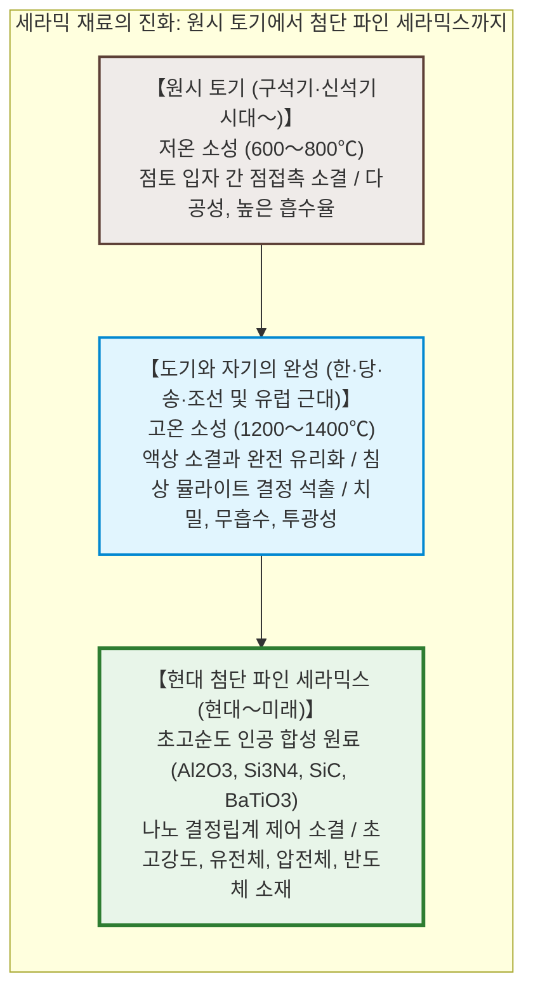
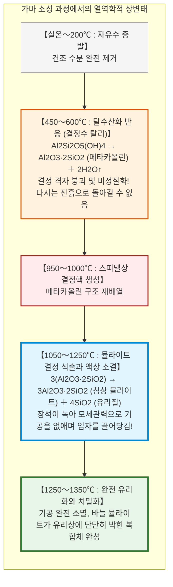
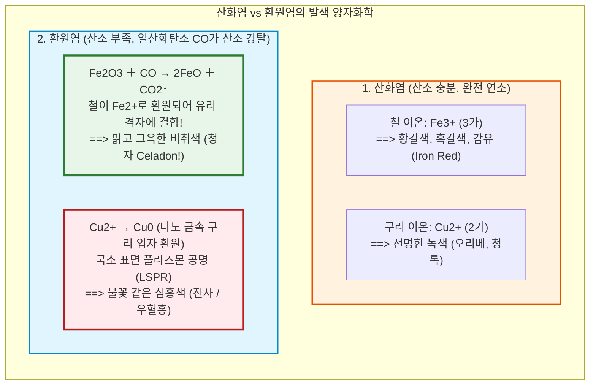

## 서론: 부드러운 흙은 왜 불을 통과하면 돌보다 단단해지는가?

수만 년 전 구석기 시대 후기, 인류는 불을 통제하는 과정에서 기적적인 자연 현상을 발견했다. 물을 섞으면 자유자재로 형태가 바뀌고 손가락으로 누르면 쉽게 으깨지는 부드러운 '점토(흙)'가, 타오르는 불길 속에서 고온으로 구워지면 다시는 물에 풀리지 않는 단단하고 치밀한 '그릇'으로 비가역적 변태를 이룬 것이다.

이것이 인류 최초의 인공 재료공학인 **'세라믹스(Ceramics)'**의 시작이다.

'세라믹스'의 어원은 고대 그리스어로 '불에 구운 흙'을 뜻하는 **'케라모스(Keramos)'**에서 유래했다. 한국의 빗살무늬토기에서 조선의 백자, 중국 징더전의 청자와 백자, 일본의 이마리·아리타 도자기에 이르기까지 도자기는 문명의 기술적 척도였다.

오늘날 현대 재료과학에서 세라믹은 식기의 영역을 아득히 초월한다:
- 스마트폰 1대에 1,000개 이상, 전기차에 10,000개 이상 탑재되는 **MLCC(적층 세라믹 커패시터)**;
- 우주왕복선이 대기권 재진입 시 $1500^\circ\text{C}$가 넘는 플라즈마 열을 차단하는 **초경량 내열 타일**;
- 인체 뼈와 직접 분자 결합하는 **생체 활성 세라믹 인공관절**;
- 차세대 전기차 전력 반도체로 각광받는 **탄화규소($\text{SiC}$)와 질화갈륨($\text{GaN}$)**.

---

## 제1장: 점토 광물의 나노 구조와 가소성의 물리화학

### 1.1 카올리나이트의 1:1 층상 결정 구조

도자기의 핵심 원료는 화강암의 장석이 수억 년간 풍화되어 형성된 **층상 규산염(Phyllosilicates)**인 **카올리나이트(Kaolinite)**이다:

$$\text{Al}_2\text{Si}_2\text{O}_5(\text{OH})_4 \quad (\text{Al}_2\text{O}_3 \cdot 2\text{SiO}_2 \cdot 2\text{H}_2\text{O})$$

두께 약 0.72nm의 얇은 층이 겹겹이 쌓인 구조로, 규소-산소 사면체층과 알루미늄-산소/수산화물 팔면체층이 단단한 수소결합으로 묶여 있다. 전자현미경으로 보면 수십 나노미터 두께의 육각 판상 나노 플레이트 형태를 띤다.

### 1.2 가소성(Plasticity): 왜 물을 섞으면 형태를 유지하는가?

모래는 물을 섞어도 힘을 빼면 무너지지만, 점토가 물레 위에서 얇은 기벽으로 성형되는 이유는 점토 나노 입자의 **거대한 비표면적(g당 10~30m2)**과 **표면 전하** 덕분이다.

입자 표면은 음(-)전하를 띠고 부서진 모서리는 양(+)전하를 띤다. 물 분자가 표면에 결합수 막을 형성하면, 외력을 가했을 때 판상 입자들이 수막을 타고 미끄러져 변형되고(유연성), 힘을 제거하면 모세관 장력과 양·음전하의 정전기적 인력('카드하우스' 구조)에 의해 입자들이 즉각 제자리에 맞물려 고정된다(보형성).

---

## 제2장: 가마 안에서의 물리화학적 상변태와 소결

건조된 기물을 $1000 \sim 1350^\circ\text{C}$로 가열하면 일련의 열역학적 상변태가 일어난다:

1. **탈수산화 반응 ($450 \sim 600^\circ\text{C}$)**: 결정 내의 $-\text{OH}$가 물 분자로 날아가며 **메타카올린(Metakaolin)**이라는 비정질 상태가 된다. 이 순간 물에 넣어도 다시 흙으로 풀리지 않는 '비가역의 강'을 건넌다.
2. **침상 뮬라이트(Mullite) 결정 형성**: $1100^\circ\text{C}$ 이상에서 바늘 모양의 **뮬라이트($3\text{Al}_2\text{O}_3 \cdot 2\text{SiO}_2$)** 결정이 석출되어 철근처럼 3차원으로 얽힌다.
3. **액상 소결(Liquid-Phase Sintering)**: 장석이 녹아 점성 높은 규산염 액체가 되고, 모세관 음압으로 기공을 메운다. 완성된 자기는 **"바늘 뮬라이트 결정(철근) + 비정질 규산염 유리상(콘크리트)"**의 복합재료가 된다.

---

## 제3장: 토기, 석기, 자기의 과학적 분류

| 구분 | 소성 온도 | 미세구조 | 흡수율 | 투광성 | 타격음 |
|---|---|---|---|---|---|
| **토기 (Earthenware)** | **$700 \sim 1000^\circ\text{C}$** | 다공성 입자 점접촉 | **$> 10\%$** | 없음 | 둔탁한 소리 (퍽퍽) |
| **석기 (Stoneware)** | **$1200 \sim 1280^\circ\text{C}$** | 치밀 소결, 무유 방수 | **$< 1\%$** | 없음 | 단단한 돌 소리 (옹기) |
| **자기 (Porcelain)** | **$1300 \sim 1400^\circ\text{C}$** | 완전 유리화, 기공 제로 | **$< 0.2\%$ (완전 방수)** | **있음 (빛 투과)** | **맑은 쇳소리 (쨍하는 공명)** |

자기가 빛을 통과시키는 이유는 기공(공기 방울)이 완전히 사라져 빛의 난반사가 없기 때문이며, 쇳소리가 나는 이유는 탄성률이 높고 진동을 흡수하는 기공 댐퍼가 없어 탄성파가 감쇠 없이 전달되기 때문이다.

---

## 제4장: 유약의 유리 화학과 가마 분위기

유약은 소지 표면에 구워낸 얇은 규산염 유리이다. 가마 안의 **산소 농도(분위기)**에 따라 전이금속의 원자가가 달라져 신비로운 색이 결정된다:

- **청자의 비취색**: 유약 속 1~2%의 철분이 환원염에서 일산화탄소에 의해 **2가 철 이온($\text{Fe}^{2+}$)**으로 환원되면서 붉은빛을 흡수하고 맑은 청록빛을 투과시킨 결과이다.
- **빙렬(빙렬문 / 크랙)**: 유약의 열팽창계수가 소지보다 클 때($\alpha_\text{유약} > \alpha_\text{소지}$) 냉각 과정에서 유약층에 발생하는 2차원 인장응력 균열이다.

---

## 제5장: 백자의 세계사—징더전, 아리타, 마이센

조선 도공 이삼평이 1616년 일본 아리타에서 도석을 발견하며 시작된 일본 백자(이마리)는 명청 교체기 혼란으로 징더전이 파괴되자 네덜란드 동인도회사(VOC)를 통해 유럽으로 수백만 점 수출되어 왕실을 뒤흔들었다.

작센의 아우구스트 강건왕은 연금술사 **뵈트거(Böttger)**를 감금하여 연구를 강제했고, 1709년 고령토와 장석을 $1300^\circ\text{C}$ 이상에서 융합하는 비밀을 밝혀내며 서양 최초의 백자 가마인 **마이센(Meissen)**이 탄생했다.

---

## 제6장: 첨단 파인 세라믹스의 비상

현대 세라믹스는 초고순도 합성 무기 화합물을 정밀 소결하는 **파인 세라믹스**로 진화했다:
- **티탄산바륨($\text{BaTiO}_3$)과 MLCC**: 페로브스카이트 결정 구조의 자발 분극으로 초고유전율($\varepsilon_r > 5000$)을 구현, 머리카락 굵기의 100분의 1인 0.5미크론 세라믹 층을 1,000층 이상 쌓아 스마트폰과 자율주행차의 심장부를 지탱한다.
- **지르코니아($\text{ZrO}_2$) 상변태 강화**: 응력이 집중될 때 준안정 정방정상에서 단사정상으로 상변태를 일으키며 4% 체적이 팽창해 균열 끝을 꽉 조여 깨지지 않는 고인성 인공관절 세라믹을 완성한다.

---

## 결론: 흙과 불의 1만 년 서사시

발밑의 흙을 반죽하고 불로 구워내는 행위. 1만 년 전 인류가 점토를 불에 던졌을 때 이미 원자 재배열과 소결이라는 열역학의 문이 열렸다.

고령토 나노시트의 가소성에서 뮬라이트의 바늘 결정, 환원염이 빚어낸 청자의 신비, 그리고 인공지능 칩을 구동하는 나노 세라믹 콘덴서에 이르기까지, **무기 산화물의 화학 결합을 열과 화학으로 극한까지 질서화하는 과학**은 인류 문명의 가장 단단하고 영원한 토대이다.
