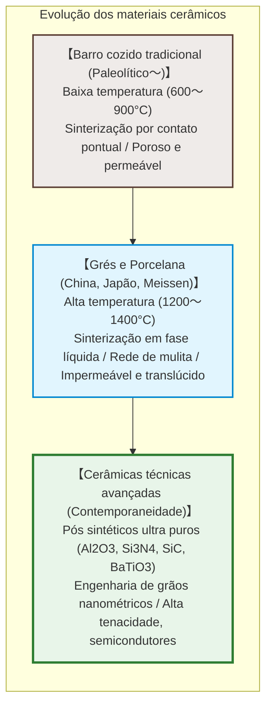
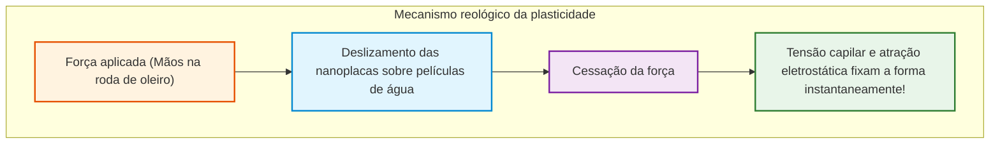
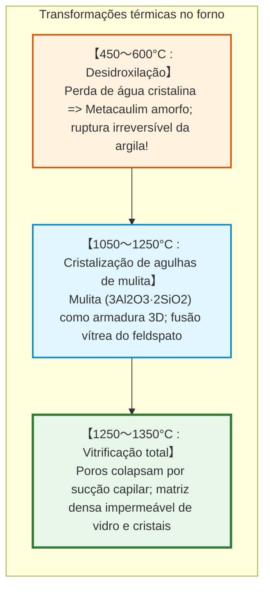
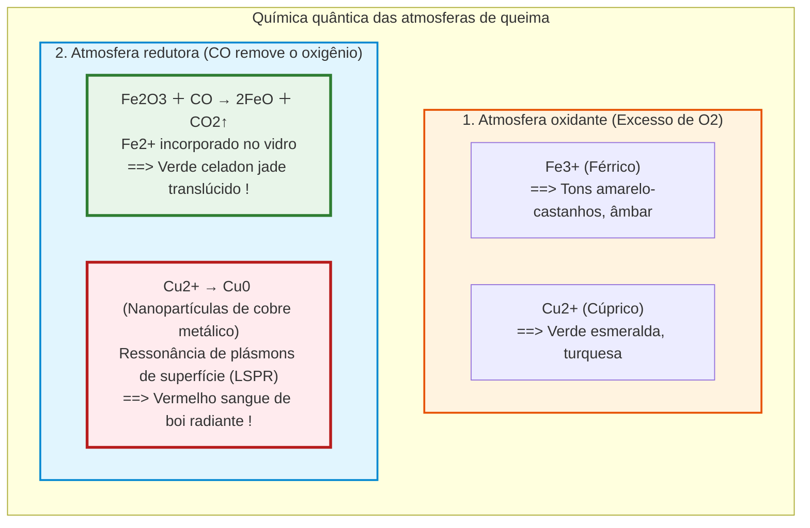

## Introdução: A lama que se torna pedra eterna pelo fogo

Milhares de anos atrás, a humanidade descobriu um prodígio nos fornos primitivos: uma argila macia e plástica, facilmente moldável com as mãos, lançada a um fogo de alta temperatura, transformava-se de modo irreversível num recipiente rochoso, impermeável e ressonante: **a cerâmica**.

Do grego **«keramos» (κέραμος)**, a cerâmica hoje extrapola em muito o artesanato doméstico:
- Mais de 1.000 **capacitores cerâmicos multicamadas (MLCC)** equipam cada smartphone moderno;
- Placas de sílica pura suportam o plasma a $1500^\circ\text{C}$ na reentrada de espaçonaves;
- Biocerâmicas de hidroxiapatita se integram diretamente ao tecido ósseo humano;
- O **carboneto de silício ($\text{SiC}$)** impulsiona inversores de veículos elétricos.

---

## Capítulo 1: Nanoestrutura da caulinita e a física da plasticidade

### 1.1 A rede 1:1 da caulinita

A argila nobre é composta de **caulinita** ($\text{Al}_2\text{Si}_2\text{O}_5(\text{OH})_4$), um filossilicato em lâminas de 0,72 nm de espessura:
1. Uma lâmina tetraédrica de sílica ($\text{Si-O}$);
2. Uma lâmina octaédrica de alumina ($\text{Al-O/OH}$).

### 1.2 Mecanismo da plasticidade

- **Área superficial enorme**: $10 \text{ a } 30\,\text{m}^2/\text{g}$;
- **Superfícies basais negativas e bordas positivas** gerando atração em «castelo de cartas»;
- **Filmes de água nanométricos**: Permitem o deslizamento suave sob tensão cortante (**deformabilidade**), enquanto a tensão capilar trava as partículas instantaneamente ao cessar a força (**manutenção da forma**).

---

## Capítulo 2: Sinterização e transformações térmicas no forno

1. **Desidroxilação ($450 \sim 600^\circ\text{C}$)**: A saída dos grupos $-\text{OH}$ em forma de vapor forma o **metacaulim** amorfo que nunca mais reidrata em lama.
2. **Cristalização da mulita ($> 1100^\circ\text{C}$)**: Agulhas de **mulita** ($3\text{Al}_2\text{O}_3 \cdot 2\text{SiO}_2$) crescem entrelaçadas como armações de concreto armado.
3. **Sinterização em fase líquida**: O feldspato funde num líquido viscoso que preenche os poros por capilaridade.

---

## Capítulo 3: Faiança, Grés e Porcelana

| Categoria | Temperatura | Microestrutura | Absorção | Translucidez | Som ao bater |
|---|---|---|---|---|---|
| **Faiança / Barro** | **$800 \sim 1150^\circ\text{C}$** | Sinterização por pontos | **$> 10\%$** | Opaco | Som surdo e oco |
| **Grés** | **$1200 \sim 1280^\circ\text{C}$** | Vitrificado, estanque | **$< 1\%$** | Opaco | Som duro de pedra |
| **Porcelana** | **$1300 \sim 1400^\circ\text{C}$** | Matriz vítrea sem poros com mulita | **$0 \sim 0{,}2\%$** | **Translúcida** | **Timbre metálico cristalino** |

---

## Capítulo 4: Química dos esmaltes e atmosfera do forno

- **O Celadon**: Pequenas quantidades de ferro ($1 \sim 2\%$) reduzidas a $\text{Fe}^{2+}$ produzem a cobiçada cor verde-azulada do jade.
- **Craquelê**: Ocorre quando o coeficiente térmico do esmalte supera o do corpo ($\alpha_\text{esmalte} > \alpha_\text{corpo}$), fendilhando o vidro de forma artística.

---

## Capítulo 5: O Ouro Branco – Meissen e Arita

No século XVII, a Europa foi tomada pela loucura das porcelanas de Arita (Imari). Augusto, o Forte, aprisionou o alquimista **Johann Friedrich Böttger**, que descobriu o segredo em 1709: cozer caulim e feldspato a mais de $1300^\circ\text{C}$. Em 1710 nascia a manufatura real de **Meissen**.

---

## Capítulo 6: Cerâmicas técnicas avançadas

- **Titanato de bário ($\text{BaTiO}_3$) e MLCC**: Constante dielétrica de até 10.000, empilhando mais de 1.000 camadas submicrométricas em microchips.
- **Zircônia parcialmente estabilizada (PSZ)**: Tenacidade por transformação de fase. A tensão induz expansão volumétrica de 4 % que esmaga e trava trincas estruturais.

---

## Conclusão: A grande aliança da terra e do fogo

Da primeira tigela de barro cozida na Idade da Pedra até os chips de alta potência da inteligência artificial, o princípio segue imutável: o reordenamento termodinâmico das ligações inorgânicas pelo calor. A cerâmica é o alicerce físico mais perene da civilização humana.
